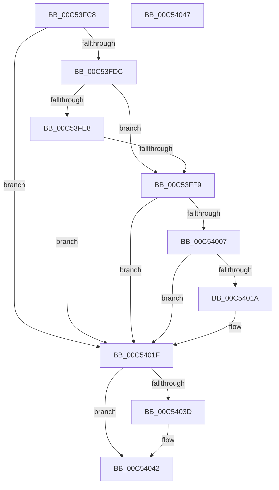

# KitpInitAitSampleRate

- RVA: `0x00C53FC8`–`0x00C54048` (길이 `128` bytes)
- VA: `0x0000000140C53FC8`
- 실행 섹션: `INIT`
- PDB 이름 있음: `예`; PDB Function 태그: `아니요`
- unwind 정보 RVA: `0x0005C788`
- 디코드: `33`개 명령, `128/128` bytes 표시
- 미해석 바이트: `0` (있으면 어셈블리에 `.byte`로 보존)

> 이 문서는 커널 이미지의 기계어와 PDB 기호를 분석해 생성했습니다. 4번과 5번은 함수 원형과 자료형을 바이너리 사용 방식에서 추정한 C 해석이며 원본 소스 복구 결과는 아닙니다.

## 1. Dependencies

- 직접 호출 지점: **5**; 고유 호출 대상: **5**
- 직접 호출자로 확인된 함수: **1**
- RIP 상대 이미지 참조: **1**

### Outgoing calls
- `0x00C53FEF` → [strstr](../../text/4F/strstr_function_004FF680.md) (function, `0x004FF680`)
- `0x00C53FFE` → [KitpOpenRegKey](../../page/7D/KitpOpenRegKey_function_007D117C.md) (function, `0x007D117C`)
- `0x00C54011` → [KitpReadUlongFromKey](../../page/7D/KitpReadUlongFromKey_function_007D11D0.md) (function, `0x007D11D0`)
- `0x00C5402E` → [ZwSetSystemInformation](../../text/6B/ZwSetSystemInformation_function_006B0870.md) (function, `0x006B0870`)
- `0x00C5403D` → [ZwClose](../../text/6A/ZwClose_function_006AD2B0.md) (function, `0x006AD2B0`)

### Direct callers
- [IoInitSystemPreDrivers](../C2/IoInitSystemPreDrivers_function_00C2AC3C.md) at `0x00C2B8CE`

### Static image references
- `0x00C53FE8` → RVA `0x00C79180` (` ?? ::PBOPGDP::`string'`; read)

## 2. Other-region calls and transfers

- 다른 실행 섹션으로 향하는 call: **5**
  - `0x00C53FEF` → [strstr](../../text/4F/strstr_function_004FF680.md) (`INIT` → `.text`)
  - `0x00C53FFE` → [KitpOpenRegKey](../../page/7D/KitpOpenRegKey_function_007D117C.md) (`INIT` → `PAGE`)
  - `0x00C54011` → [KitpReadUlongFromKey](../../page/7D/KitpReadUlongFromKey_function_007D11D0.md) (`INIT` → `PAGE`)
  - `0x00C5402E` → [ZwSetSystemInformation](../../text/6B/ZwSetSystemInformation_function_006B0870.md) (`INIT` → `.text`)
  - `0x00C5403D` → [ZwClose](../../text/6A/ZwClose_function_006AD2B0.md) (`INIT` → `.text`)
- 별도 외부 분기/꼬리 이동을 확인하지 못했습니다.

## 3. Assembly (complete function range)

```asm
00C53FC8  48 83 EC 28                     sub rsp, 0x28
00C53FCC  83 64 24 30 00                  and dword ptr [rsp + 0x30], 0
00C53FD1  48 83 64 24 38 00               and qword ptr [rsp + 0x38], 0
00C53FD7  48 85 C9                        test rcx, rcx
00C53FDA  74 43                           je 0x140c5401f
00C53FDC  48 8B 89 D8 00 00 00            mov rcx, qword ptr [rcx + 0xd8]
00C53FE3  48 85 C9                        test rcx, rcx
00C53FE6  74 11                           je 0x140c53ff9
00C53FE8  48 8D 15 91 51 02 00            lea rdx, [rip + 0x25191]
00C53FEF  E8 8C B6 8A FF                  call 0x1404ff680
00C53FF4  48 85 C0                        test rax, rax
00C53FF7  75 26                           jne 0x140c5401f
00C53FF9  4C 8D 44 24 38                  lea r8, [rsp + 0x38]
00C53FFE  E8 79 D1 B7 FF                  call 0x1407d117c
00C54003  85 C0                           test eax, eax
00C54005  78 18                           js 0x140c5401f
00C54007  48 8B 4C 24 38                  mov rcx, qword ptr [rsp + 0x38]
00C5400C  4C 8D 44 24 30                  lea r8, [rsp + 0x30]
00C54011  E8 BA D1 B7 FF                  call 0x1407d11d0
00C54016  85 C0                           test eax, eax
00C54018  79 05                           jns 0x140c5401f
00C5401A  83 64 24 30 00                  and dword ptr [rsp + 0x30], 0
00C5401F  41 B8 04 00 00 00               mov r8d, 4
00C54025  48 8D 54 24 30                  lea rdx, [rsp + 0x30]
00C5402A  41 8D 48 6B                     lea ecx, [r8 + 0x6b]
00C5402E  E8 3D C8 A5 FF                  call 0x1406b0870
00C54033  48 8B 4C 24 38                  mov rcx, qword ptr [rsp + 0x38]
00C54038  48 85 C9                        test rcx, rcx
00C5403B  74 05                           je 0x140c54042
00C5403D  E8 6E 92 A5 FF                  call 0x1406ad2b0
00C54042  48 83 C4 28                     add rsp, 0x28
00C54046  C3                              ret
00C54047  CC                              int3
```

## 4. C-style interpretation (structured pseudocode)

```c
__int64 __fastcall KitpInitAitSampleRate(__int64 a1)
{
    __int64 result;
    __int64 v_rsp;
    unsigned __int64 v_stack_p10;
    unsigned int v_stack_p8;

    v_rsp = (v_rsp) - (40);
    if (a1 == 0) goto loc_00C5401F;
    if (*(unsigned __int64 *)(a1 + 216) == 0) goto loc_00C53FF9;
    result = strstr(*(unsigned __int64 *)(a1 + 216), v_rip + 151953, a3, a4);
    if (result != 0) goto loc_00C5401F;
loc_00C53FF9:
    result = KitpOpenRegKey(*(unsigned __int64 *)(a1 + 216), v_rip + 151953, v_stack_p10, a4);
    if (sign_flag) goto loc_00C5401F;
    result = KitpReadUlongFromKey(v_stack_p10, v_rip + 151953, v_stack_p8, a4);
    if (sign_flag) {
    }
    result = ZwSetSystemInformation(4 + 107, v_stack_p8, 4, a4);
    if (v_stack_p10 != 0) {
        result = ZwClose(v_stack_p10, v_stack_p8, 4, a4);
    }
    v_rsp = (v_rsp) + (40);
    return result;
}
```

## 5. (Beta) C Style

```c
int64_t KitpInitAitSampleRate(int64_t Arg1)
{
    int64_t result;
    int64_t local_rsp;
    uint64_t v_stack_p10;
    uint32_t v_stack_p8;

    local_rsp = (local_rsp) - (40);
    if (Arg1 == 0) goto loc_00C5401F;
    if (*(uint64_t *)(Arg1 + 0xD8) == 0) goto loc_00C53FF9;
    result = strstr(*(uint64_t *)(Arg1 + 0xD8), v_rip + 151953, a3, a4);
    if (result != 0) goto loc_00C5401F;
loc_00C53FF9:
    result = KitpOpenRegKey(*(uint64_t *)(Arg1 + 0xD8), v_rip + 151953, v_stack_p10, a4);
    if (sign_flag) goto loc_00C5401F;
    result = KitpReadUlongFromKey(v_stack_p10, v_rip + 151953, v_stack_p8, a4);
    if (sign_flag) {
    }
    result = ZwSetSystemInformation(4 + 107, v_stack_p8, 4, a4);
    if (v_stack_p10 != 0) {
        result = ZwClose(v_stack_p10, v_stack_p8, 4, a4);
    }
    local_rsp = (local_rsp) + (40);
    return result;
}
```

## 6. Execution-region graph

[열기: 2D/3D 그래프와 함수 탐색 컨트롤 패널](../../../control-panel.html?section=init&rva=0x00C53FC8&view=graph)

- 2D 그래프는 위에서 아래로 흐르고, 3D 그래프는 빈 공간을 드래그해 회전합니다. Shift+드래그는 이동, 휠은 확대·축소, 함수 노드 선택은 대상 보고서 이동입니다.

### Static fallback


