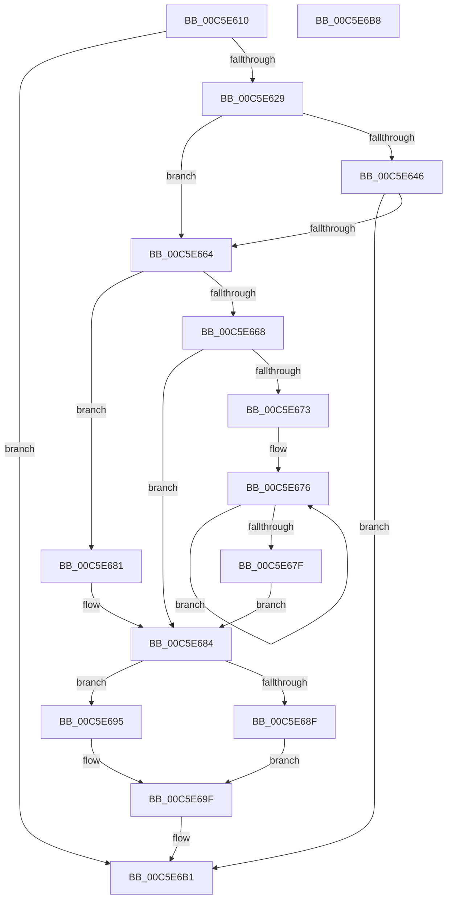

# MiAddLoaderHalIoPte

- RVA: `0x00C5E610`–`0x00C5E6B9` (길이 `169` bytes)
- VA: `0x0000000140C5E610`
- 실행 섹션: `INIT`
- PDB 이름 있음: `예`; PDB Function 태그: `아니요`
- unwind 정보 RVA: `0x0005D2F4`
- 디코드: `48`개 명령, `169/169` bytes 표시
- 미해석 바이트: `0` (있으면 어셈블리에 `.byte`로 보존)

> 이 문서는 커널 이미지의 기계어와 PDB 기호를 분석해 생성했습니다. 4번과 5번은 함수 원형과 자료형을 바이너리 사용 방식에서 추정한 C 해석이며 원본 소스 복구 결과는 아닙니다.

## 1. Dependencies

- 직접 호출 지점: **1**; 고유 호출 대상: **1**
- 직접 호출자로 확인된 함수: **0**
- RIP 상대 이미지 참조: **1**

### Outgoing calls
- `0x00C5E6AC` → [MiReferenceIoPages](../../text/23/MiReferenceIoPages_function_0023C804.md) (function, `0x0023C804`)

### Direct callers
- 이 함수 시작 RVA로 연결되는 직접 call은 확인되지 않았습니다. 간접 호출은 완전히 역산할 수 없습니다.

### Static image references
- `0x00C5E63D` → RVA `0x00E2DCE0` (`.data`; read)

## 2. Other-region calls and transfers

- 다른 실행 섹션으로 향하는 call: **1**
  - `0x00C5E6AC` → [MiReferenceIoPages](../../text/23/MiReferenceIoPages_function_0023C804.md) (`INIT` → `.text`)
- 별도 외부 분기/꼬리 이동을 확인하지 못했습니다.

## 3. Assembly (complete function range)

```asm
00C5E610  48 83 EC 38                     sub rsp, 0x38
00C5E614  48 8B 0A                        mov rcx, qword ptr [rdx]
00C5E617  41 BA 01 00 00 00               mov r10d, 1
00C5E61D  45 8B C8                        mov r9d, r8d
00C5E620  41 84 CA                        test r10b, cl
00C5E623  0F 84 88 00 00 00               je 0x140c5e6b1
00C5E629  48 8B D1                        mov rdx, rcx
00C5E62C  48 B8 FF FF FF FF FF 00 00 00   movabs rax, 0xffffffffff
00C5E636  48 C1 EA 0C                     shr rdx, 0xc
00C5E63A  48 23 D0                        and rdx, rax
00C5E63D  48 3B 15 9C F6 1C 00            cmp rdx, qword ptr [rip + 0x1cf69c]
00C5E644  77 1E                           ja 0x140c5e664
00C5E646  48 8D 04 52                     lea rax, [rdx + rdx*2]
00C5E64A  48 03 C0                        add rax, rax
00C5E64D  49 B8 28 00 00 00 00 DE FF FF   movabs r8, 0xffffde0000000028
00C5E657  49 8B 04 C0                     mov rax, qword ptr [r8 + rax*8]
00C5E65B  48 C1 E8 36                     shr rax, 0x36
00C5E65F  41 85 C2                        test r10d, eax
00C5E662  75 4D                           jne 0x140c5e6b1
00C5E664  84 C9                           test cl, cl
00C5E666  79 19                           jns 0x140c5e681
00C5E668  41 B8 00 02 00 00               mov r8d, 0x200
00C5E66E  45 3B CA                        cmp r9d, r10d
00C5E671  7E 11                           jle 0x140c5e684
00C5E673  41 FF C9                        dec r9d
00C5E676  49 C1 E0 09                     shl r8, 9
00C5E67A  4D 2B CA                        sub r9, r10
00C5E67D  75 F7                           jne 0x140c5e676
00C5E67F  EB 03                           jmp 0x140c5e684
00C5E681  4D 8B C2                        mov r8, r10
00C5E684  8A C1                           mov al, cl
00C5E686  45 33 DB                        xor r11d, r11d
00C5E689  24 18                           and al, 0x18
00C5E68B  3C 08                           cmp al, 8
00C5E68D  75 06                           jne 0x140c5e695
00C5E68F  45 8D 4B 02                     lea r9d, [r11 + 2]
00C5E693  EB 0A                           jmp 0x140c5e69f
00C5E695  F6 C1 10                        test cl, 0x10
00C5E698  45 8B CA                        mov r9d, r10d
00C5E69B  45 0F 45 CB                     cmovne r9d, r11d
00C5E69F  4C 89 5C 24 28                  mov qword ptr [rsp + 0x28], r11
00C5E6A4  41 8B CA                        mov ecx, r10d
00C5E6A7  4C 89 5C 24 20                  mov qword ptr [rsp + 0x20], r11
00C5E6AC  E8 53 E1 5D FF                  call 0x14023c804
00C5E6B1  33 C0                           xor eax, eax
00C5E6B3  48 83 C4 38                     add rsp, 0x38
00C5E6B7  C3                              ret
00C5E6B8  CC                              int3
```

## 4. C-style interpretation (structured pseudocode)

```c
__int64 __fastcall MiAddLoaderHalIoPte(__int64 a1, __int64 a2, int a3)
{
    __int64 result;
    __int64 v_r11;
    __int64 v_rsp;
    unsigned __int64 v_stack_m10;
    unsigned __int64 v_stack_m18;

    v_rsp = (v_rsp) - (56);
    if (((1) & ((unsigned __int8)(*(unsigned __int64 *)(a2)))) == 0) goto loc_00C5E6B1;
    a2 = (*(unsigned __int64 *)(a2)) >> (12);
    a2 = (a2) & (result);
    if (a2 > (*(unsigned __int64 *)(v_rip + 1898140))) goto loc_00C5E664;
    result = (a2 + a2 * 2) + (a2 + a2 * 2);
    result = (*(unsigned __int64 *)(a3 + result * 8)) >> (54);
    if (((1) & ((unsigned int)(result))) != 0) goto loc_00C5E6B1;
loc_00C5E664:
    if (!sign_flag) goto loc_00C5E681;
    if (((unsigned int)((unsigned int)(a3))) <= 1) goto loc_00C5E684;
    a4 = (unsigned int)(((unsigned int)(a3)) - 1);
loc_00C5E676:
    a3 = (512) << (9);
    a4 = (a4) - (1);
    if (condition_is_not_equal) goto loc_00C5E676;
    goto loc_00C5E684;
loc_00C5E681:
loc_00C5E684:
    v_r11 = 0;
    result = (unsigned __int8)(((unsigned __int8)(*(unsigned __int64 *)(a2))) & (24));
    if (((unsigned __int8)(result)) != 8) goto loc_00C5E695;
    goto loc_00C5E69F;
loc_00C5E695:
    a4 = 1;
    if ((((unsigned __int8)(*(unsigned __int64 *)(a2))) & (16)) != 0) { a4 = 0; }
loc_00C5E69F:
    v_stack_m10 = 0;
    v_stack_m18 = 0;
    result = MiReferenceIoPages(1, a2, 1, a4);
loc_00C5E6B1:
    result = 0;
    v_rsp = (v_rsp) + (56);
    return result;
}
```

## 5. (Beta) C Style

```c
int64_t MiAddLoaderHalIoPte(int64_t Arg1, void *Arg2, int32_t Arg3)
{
    uint8_t *arg2 = (uint8_t *)Arg2;

    int64_t result;
    int64_t local_r11;
    int64_t local_rsp;
    uint64_t v_stack_m10;
    uint64_t v_stack_m18;

    local_rsp = (local_rsp) - (56);
    if (((1) & ((uint8_t)(*(uint64_t *)(arg2)))) == 0) goto loc_00C5E6B1;
    Arg2 = (*(uint64_t *)(arg2)) >> (12);
    Arg2 = (Arg2) & (result);
    if (Arg2 > (*(uint64_t *)(v_rip + 0x1CF69C))) goto loc_00C5E664;
    result = (Arg2 + Arg2 * 2) + (Arg2 + Arg2 * 2);
    result = (*(uint64_t *)(Arg3 + result * 8)) >> (54);
    if (((1) & ((uint32_t)(result))) != 0) goto loc_00C5E6B1;
loc_00C5E664:
    if (!sign_flag) goto loc_00C5E681;
    if (((uint32_t)((uint32_t)(Arg3))) <= 1) goto loc_00C5E684;
    a4 = (uint32_t)(((uint32_t)(Arg3)) - 1);
loc_00C5E676:
    Arg3 = (512) << (9);
    a4 = (a4) - (1);
    if (condition_is_not_equal) goto loc_00C5E676;
    goto loc_00C5E684;
loc_00C5E681:
loc_00C5E684:
    local_r11 = 0;
    result = (uint8_t)(((uint8_t)(*(uint64_t *)(arg2))) & (24));
    if (((uint8_t)(result)) != 8) goto loc_00C5E695;
    goto loc_00C5E69F;
loc_00C5E695:
    a4 = 1;
    if ((((uint8_t)(*(uint64_t *)(arg2))) & (16)) != 0) { a4 = 0; }
loc_00C5E69F:
    v_stack_m10 = 0;
    v_stack_m18 = 0;
    result = MiReferenceIoPages(1, Arg2, 1, a4);
loc_00C5E6B1:
    result = 0;
    local_rsp = (local_rsp) + (56);
    return result;
}
```

### 관측된 메모리 오프셋

구조체 형식이 확인되지 않은 접근은 인자 기준의 오프셋으로만 기록했습니다.

| 기준 인자 | 오프셋 표현 | 폭 (bit) | 접근 |
|---|---:|---:|---|
| `Arg2` | `+ 0x0` | `64` | `R` |

## 6. Execution-region graph

[열기: 2D/3D 그래프와 함수 탐색 컨트롤 패널](../../../control-panel.html?section=init&rva=0x00C5E610&view=graph)

- 2D 그래프는 위에서 아래로 흐르고, 3D 그래프는 빈 공간을 드래그해 회전합니다. Shift+드래그는 이동, 휠은 확대·축소, 함수 노드 선택은 대상 보고서 이동입니다.

### Static fallback


