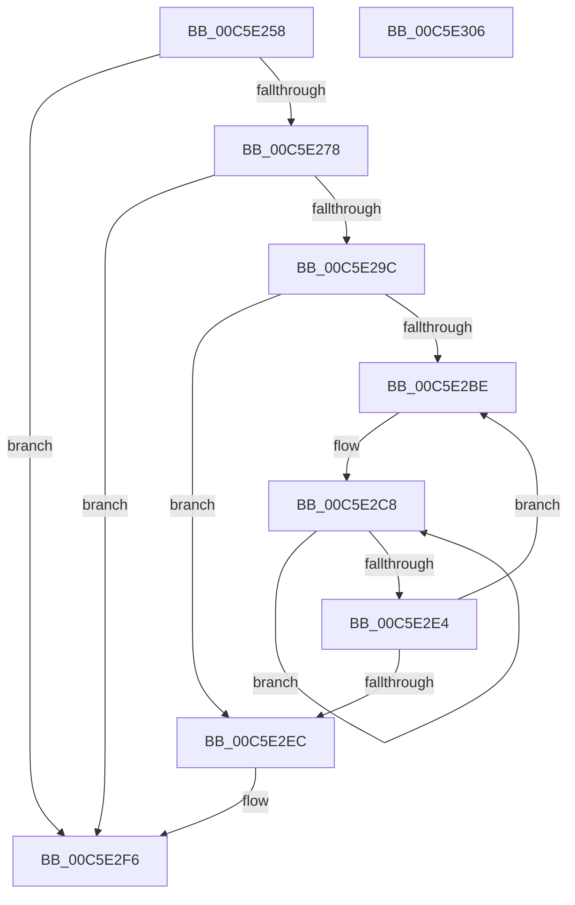

# MiComputeNumaCosts

- RVA: `0x00C5E258`–`0x00C5E307` (길이 `175` bytes)
- VA: `0x0000000140C5E258`
- 실행 섹션: `INIT`
- PDB 이름 있음: `예`; PDB Function 태그: `아니요`
- unwind 정보 RVA: `0x00060BC4`
- 디코드: `49`개 명령, `175/175` bytes 표시
- 미해석 바이트: `0` (있으면 어셈블리에 `.byte`로 보존)

> 이 문서는 커널 이미지의 기계어와 PDB 기호를 분석해 생성했습니다. 4번과 5번은 함수 원형과 자료형을 바이너리 사용 방식에서 추정한 C 해석이며 원본 소스 복구 결과는 아닙니다.

## 1. Dependencies

- 직접 호출 지점: **3**; 고유 호출 대상: **3**
- 직접 호출자로 확인된 함수: **1**
- RIP 상대 이미지 참조: **3**

### Outgoing calls
- `0x00C5E28F` → [ExAllocatePool2](../../poolcode/B8/ExAllocatePool2_function_00B820F0.md) (function, `0x00B820F0`)
- `0x00C5E2A9` → [memcpy](../../text/6C/memcpy_function_006C6840.md) (function, `0x006C6840`)
- `0x00C5E2F1` → [ExFreePoolWithTag](../../poolcode/B8/ExFreePoolWithTag_function_00B82870.md) (function, `0x00B82870`)

### Direct callers
- [MmInitSystem](../BE/MmInitSystem_function_00BEE990.md) at `0x00BEEA57`

### Static image references
- `0x00C5E267` → RVA `0x00FC5000` (`ALMOSTRO`; read)
- `0x00C5E29C` → RVA `0x00F234E0` (`.data`; read)
- `0x00C5E2D5` → RVA `0x00E2DBD0` (`.data`; read)

## 2. Other-region calls and transfers

- 다른 실행 섹션으로 향하는 call: **3**
  - `0x00C5E28F` → [ExAllocatePool2](../../poolcode/B8/ExAllocatePool2_function_00B820F0.md) (`INIT` → `POOLCODE`)
  - `0x00C5E2A9` → [memcpy](../../text/6C/memcpy_function_006C6840.md) (`INIT` → `.text`)
  - `0x00C5E2F1` → [ExFreePoolWithTag](../../poolcode/B8/ExFreePoolWithTag_function_00B82870.md) (`INIT` → `POOLCODE`)
- 별도 외부 분기/꼬리 이동을 확인하지 못했습니다.

## 3. Assembly (complete function range)

```asm
00C5E258  48 89 5C 24 08                  mov qword ptr [rsp + 8], rbx
00C5E25D  48 89 74 24 10                  mov qword ptr [rsp + 0x10], rsi
00C5E262  57                              push rdi
00C5E263  48 83 EC 20                     sub rsp, 0x20
00C5E267  0F B7 05 92 6D 36 00            movzx eax, word ptr [rip + 0x366d92]
00C5E26E  BE 01 00 00 00                  mov esi, 1
00C5E273  66 3B C6                        cmp ax, si
00C5E276  76 7E                           jbe 0x140c5e2f6
00C5E278  0F AF C0                        imul eax, eax
00C5E27B  41 B8 4E 75 6D 61               mov r8d, 0x616d754e
00C5E281  B9 00 01 00 00                  mov ecx, 0x100
00C5E286  48 63 F8                        movsxd rdi, eax
00C5E289  48 03 FF                        add rdi, rdi
00C5E28C  48 8B D7                        mov rdx, rdi
00C5E28F  E8 5C 3E F2 FF                  call 0x140b820f0
00C5E294  48 8B D8                        mov rbx, rax
00C5E297  48 85 C0                        test rax, rax
00C5E29A  74 5A                           je 0x140c5e2f6
00C5E29C  48 8B 15 3D 52 2C 00            mov rdx, qword ptr [rip + 0x2c523d]
00C5E2A3  4C 8B C7                        mov r8, rdi
00C5E2A6  48 8B C8                        mov rcx, rax
00C5E2A9  E8 92 85 A6 FF                  call 0x1406c6840
00C5E2AE  44 0F B7 0D 4A 6D 36 00         movzx r9d, word ptr [rip + 0x366d4a]
00C5E2B6  45 33 C0                        xor r8d, r8d
00C5E2B9  45 85 C9                        test r9d, r9d
00C5E2BC  74 2E                           je 0x140c5e2ec
00C5E2BE  45 33 DB                        xor r11d, r11d
00C5E2C1  45 8B D1                        mov r10d, r9d
00C5E2C4  45 0F AF D0                     imul r10d, r8d
00C5E2C8  43 8D 04 1A                     lea eax, [r10 + r11]
00C5E2CC  44 03 DE                        add r11d, esi
00C5E2CF  0F B7 0C 43                     movzx ecx, word ptr [rbx + rax*2]
00C5E2D3  8B D0                           mov edx, eax
00C5E2D5  48 8B 05 F4 F8 1C 00            mov rax, qword ptr [rip + 0x1cf8f4]
00C5E2DC  89 0C 90                        mov dword ptr [rax + rdx*4], ecx
00C5E2DF  45 3B D9                        cmp r11d, r9d
00C5E2E2  72 E4                           jb 0x140c5e2c8
00C5E2E4  44 03 C6                        add r8d, esi
00C5E2E7  45 3B C1                        cmp r8d, r9d
00C5E2EA  72 D2                           jb 0x140c5e2be
00C5E2EC  33 D2                           xor edx, edx
00C5E2EE  48 8B CB                        mov rcx, rbx
00C5E2F1  E8 7A 45 F2 FF                  call 0x140b82870
00C5E2F6  48 8B 5C 24 30                  mov rbx, qword ptr [rsp + 0x30]
00C5E2FB  48 8B 74 24 38                  mov rsi, qword ptr [rsp + 0x38]
00C5E300  48 83 C4 20                     add rsp, 0x20
00C5E304  5F                              pop rdi
00C5E305  C3                              ret
00C5E306  CC                              int3
```

## 4. C-style interpretation (structured pseudocode)

```c
__int64 __fastcall MiComputeNumaCosts(void)
{
    __int64 result;
    __int64 v_r10;
    __int64 v_r11;
    __int64 v_rdi;
    __int64 v_rsp;
    unsigned __int64 v_stack_p10;
    unsigned __int64 v_stack_p8;

    v_stack_p8 = v_rbx;
    v_stack_p10 = v_rsi;
    v_rsp = (v_rsp) - (32);
    if (((unsigned __int16)(*(unsigned __int16 *)(v_rip + 3566994))) <= 1) goto loc_00C5E2F6;
    result = (unsigned int)((*(unsigned __int16 *)(v_rip + 3566994)) * ((unsigned int)(*(unsigned __int16 *)(v_rip + 3566994))));
    v_rdi = ((int)((unsigned int)(result))) + ((int)((unsigned int)(result)));
    result = ExAllocatePool2(256, v_rdi, (unsigned int)(0x616D754EULL), a4);
    if (result == 0) goto loc_00C5E2F6;
    result = memcpy(result, *(unsigned __int64 *)(v_rip + 2904637), v_rdi, a4);
    a3 = 0;
    if ((unsigned int)(*(unsigned __int16 *)(v_rip + 3566922)) == 0) goto loc_00C5E2EC;
loc_00C5E2BE:
    v_r11 = 0;
    v_r10 = (unsigned int)(((unsigned int)((unsigned int)(*(unsigned __int16 *)(v_rip + 3566922)))) * (0));
loc_00C5E2C8:
    v_r11 = (unsigned int)((v_r11) + (1));
    *(unsigned int *)(*(unsigned __int64 *)(v_rip + 1898740) + (unsigned int)((unsigned int)(v_r10 + v_r11 * 1)) * 4) = (unsigned int)(*(unsigned __int16 *)(result + v_r10 + v_r11 * 1 * 2));
    if (((unsigned int)(v_r11)) < ((unsigned int)(*(unsigned __int16 *)(v_rip + 3566922)))) goto loc_00C5E2C8;
    a3 = (unsigned int)((a3) + (1));
    if (((unsigned int)(a3)) < ((unsigned int)(*(unsigned __int16 *)(v_rip + 3566922)))) goto loc_00C5E2BE;
loc_00C5E2EC:
    a2 = 0;
    result = ExFreePoolWithTag(result, a2, a3, *(unsigned __int16 *)(v_rip + 3566922));
loc_00C5E2F6:
    v_rsp = (v_rsp) + (32);
    return result;
}
```

## 5. (Beta) C Style

```c
void MiComputeNumaCosts(void)
{
    int64_t result;
    int64_t local_r10;
    int64_t local_r11;
    int64_t local_rdi;
    int64_t local_rsp;
    uint64_t v_stack_p10;
    uint64_t v_stack_p8;

    v_stack_p8 = local_rbx;
    v_stack_p10 = local_rsi;
    local_rsp = (local_rsp) - (32);
    if (((uint16_t)(*(uint16_t *)(v_rip + 0x366D92))) <= 1) goto loc_00C5E2F6;
    result = (uint32_t)((*(uint16_t *)(v_rip + 0x366D92)) * ((uint32_t)(*(uint16_t *)(v_rip + 0x366D92))));
    local_rdi = ((int32_t)((uint32_t)(result))) + ((int32_t)((uint32_t)(result)));
    result = ExAllocatePool2(256, local_rdi, (uint32_t)(0x616D754EULL), a4);
    if (result == 0) goto loc_00C5E2F6;
    result = memcpy(result, *(uint64_t *)(v_rip + 0x2C523D), local_rdi, a4);
    a3 = 0;
    if ((uint32_t)(*(uint16_t *)(v_rip + 0x366D4A)) == 0) goto loc_00C5E2EC;
loc_00C5E2BE:
    local_r11 = 0;
    local_r10 = (uint32_t)(((uint32_t)((uint32_t)(*(uint16_t *)(v_rip + 0x366D4A)))) * (0));
loc_00C5E2C8:
    local_r11 = (uint32_t)((local_r11) + (1));
    *(uint32_t *)(*(uint64_t *)(v_rip + 0x1CF8F4) + (uint32_t)((uint32_t)(local_r10 + local_r11 * 1)) * 4) = (uint32_t)(*(uint16_t *)(result + local_r10 + local_r11 * 1 * 2));
    if (((uint32_t)(local_r11)) < ((uint32_t)(*(uint16_t *)(v_rip + 0x366D4A)))) goto loc_00C5E2C8;
    a3 = (uint32_t)((a3) + (1));
    if (((uint32_t)(a3)) < ((uint32_t)(*(uint16_t *)(v_rip + 0x366D4A)))) goto loc_00C5E2BE;
loc_00C5E2EC:
    a2 = 0;
    result = ExFreePoolWithTag(result, a2, a3, *(uint16_t *)(v_rip + 0x366D4A));
loc_00C5E2F6:
    local_rsp = (local_rsp) + (32);
    return result;
}
```

## 6. Execution-region graph

[열기: 2D/3D 그래프와 함수 탐색 컨트롤 패널](../../../control-panel.html?section=init&rva=0x00C5E258&view=graph)

- 2D 그래프는 위에서 아래로 흐르고, 3D 그래프는 빈 공간을 드래그해 회전합니다. Shift+드래그는 이동, 휠은 확대·축소, 함수 노드 선택은 대상 보고서 이동입니다.

### Static fallback


