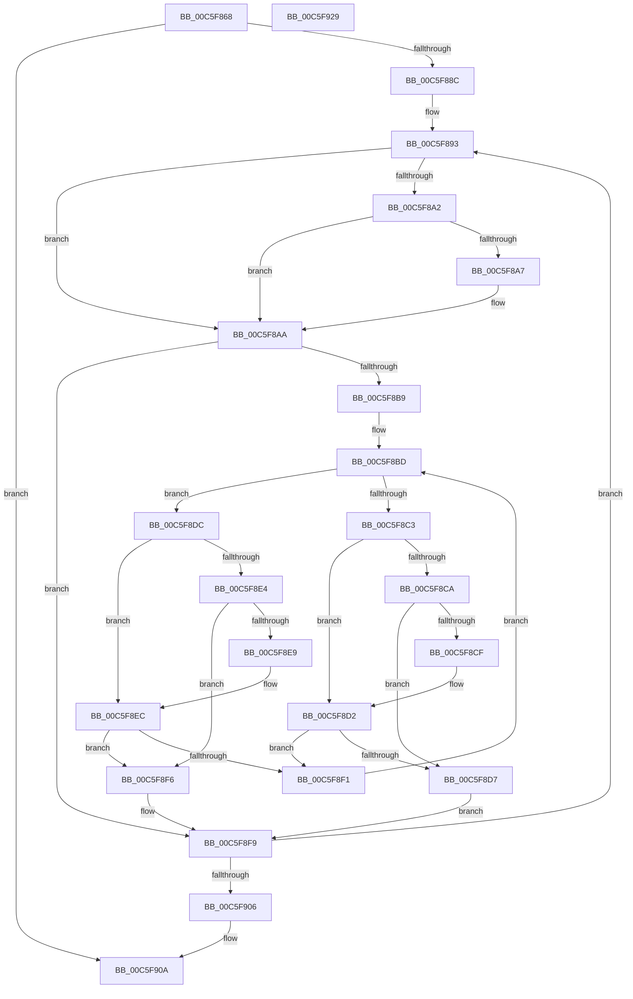

# MiConstructLoaderMemoryTree

- RVA: `0x00C5F868`–`0x00C5F92A` (길이 `194` bytes)
- VA: `0x0000000140C5F868`
- 실행 섹션: `INIT`
- PDB 이름 있음: `예`; PDB Function 태그: `아니요`
- unwind 정보 RVA: `0x0006F978`
- 디코드: `62`개 명령, `194/194` bytes 표시
- 미해석 바이트: `0` (있으면 어셈블리에 `.byte`로 보존)

> 이 문서는 커널 이미지의 기계어와 PDB 기호를 분석해 생성했습니다. 4번과 5번은 함수 원형과 자료형을 바이너리 사용 방식에서 추정한 C 해석이며 원본 소스 복구 결과는 아닙니다.

## 1. Dependencies

- 직접 호출 지점: **1**; 고유 호출 대상: **1**
- 직접 호출자로 확인된 함수: **1**
- RIP 상대 이미지 참조: **0**

### Outgoing calls
- `0x00C5F8FC` → [RtlRbInsertNodeEx](../../text/2E/RtlRbInsertNodeEx_function_002E4570.md) (function, `0x002E4570`)

### Direct callers
- [MiInitNucleus](MiInitNucleus_function_00C5FD38.md) at `0x00C5FD8F`

### Static image references
- 디코드된 RIP-relative 메모리 참조가 없습니다.

## 2. Other-region calls and transfers

- 다른 실행 섹션으로 향하는 call: **1**
  - `0x00C5F8FC` → [RtlRbInsertNodeEx](../../text/2E/RtlRbInsertNodeEx_function_002E4570.md) (`INIT` → `.text`)
- 별도 외부 분기/꼬리 이동을 확인하지 못했습니다.

## 3. Assembly (complete function range)

```asm
00C5F868  48 89 5C 24 08                  mov qword ptr [rsp + 8], rbx
00C5F86D  48 89 74 24 10                  mov qword ptr [rsp + 0x10], rsi
00C5F872  48 89 7C 24 18                  mov qword ptr [rsp + 0x18], rdi
00C5F877  41 56                           push r14
00C5F879  48 83 EC 20                     sub rsp, 0x20
00C5F87D  48 8D 59 20                     lea rbx, [rcx + 0x20]
00C5F881  48 8B F9                        mov rdi, rcx
00C5F884  4C 8B 33                        mov r14, qword ptr [rbx]
00C5F887  4C 3B F3                        cmp r14, rbx
00C5F88A  74 7E                           je 0x140c5f90a
00C5F88C  48 8D B1 60 01 00 00            lea rsi, [rcx + 0x160]
00C5F893  F6 46 08 01                     test byte ptr [rsi + 8], 1
00C5F897  4D 8B CE                        mov r9, r14
00C5F89A  4D 8B 36                        mov r14, qword ptr [r14]
00C5F89D  48 8B 16                        mov rdx, qword ptr [rsi]
00C5F8A0  74 08                           je 0x140c5f8aa
00C5F8A2  48 85 D2                        test rdx, rdx
00C5F8A5  74 03                           je 0x140c5f8aa
00C5F8A7  48 33 D6                        xor rdx, rsi
00C5F8AA  0F B6 4E 08                     movzx ecx, byte ptr [rsi + 8]
00C5F8AE  45 32 C0                        xor r8b, r8b
00C5F8B1  83 E1 01                        and ecx, 1
00C5F8B4  48 85 D2                        test rdx, rdx
00C5F8B7  74 40                           je 0x140c5f8f9
00C5F8B9  4D 8B 41 20                     mov r8, qword ptr [r9 + 0x20]
00C5F8BD  4C 3B 42 20                     cmp r8, qword ptr [rdx + 0x20]
00C5F8C1  73 19                           jae 0x140c5f8dc
00C5F8C3  48 8B 02                        mov rax, qword ptr [rdx]
00C5F8C6  85 C9                           test ecx, ecx
00C5F8C8  74 08                           je 0x140c5f8d2
00C5F8CA  48 85 C0                        test rax, rax
00C5F8CD  74 08                           je 0x140c5f8d7
00C5F8CF  48 33 C2                        xor rax, rdx
00C5F8D2  48 85 C0                        test rax, rax
00C5F8D5  75 1A                           jne 0x140c5f8f1
00C5F8D7  45 32 C0                        xor r8b, r8b
00C5F8DA  EB 1D                           jmp 0x140c5f8f9
00C5F8DC  48 8B 42 08                     mov rax, qword ptr [rdx + 8]
00C5F8E0  85 C9                           test ecx, ecx
00C5F8E2  74 08                           je 0x140c5f8ec
00C5F8E4  48 85 C0                        test rax, rax
00C5F8E7  74 0D                           je 0x140c5f8f6
00C5F8E9  48 33 C2                        xor rax, rdx
00C5F8EC  48 85 C0                        test rax, rax
00C5F8EF  74 05                           je 0x140c5f8f6
00C5F8F1  48 8B D0                        mov rdx, rax
00C5F8F4  EB C7                           jmp 0x140c5f8bd
00C5F8F6  41 B0 01                        mov r8b, 1
00C5F8F9  48 8B CE                        mov rcx, rsi
00C5F8FC  E8 6F 4C 68 FF                  call 0x1402e4570
00C5F901  4C 3B F3                        cmp r14, rbx
00C5F904  75 8D                           jne 0x140c5f893
00C5F906  48 8D 5F 20                     lea rbx, [rdi + 0x20]
00C5F90A  48 83 23 00                     and qword ptr [rbx], 0
00C5F90E  48 83 67 28 00                  and qword ptr [rdi + 0x28], 0
00C5F913  48 8B 7C 24 40                  mov rdi, qword ptr [rsp + 0x40]
00C5F918  48 8B 5C 24 30                  mov rbx, qword ptr [rsp + 0x30]
00C5F91D  48 8B 74 24 38                  mov rsi, qword ptr [rsp + 0x38]
00C5F922  48 83 C4 20                     add rsp, 0x20
00C5F926  41 5E                           pop r14
00C5F928  C3                              ret
00C5F929  CC                              int3
```

## 4. C-style interpretation (structured pseudocode)

```c
__int64 __fastcall MiConstructLoaderMemoryTree(__int64 a1, __int64 a2, unsigned __int8 a3)
{
    __int64 result;
    __int64 v_rsp;
    unsigned __int64 v_stack_p10;
    unsigned __int64 v_stack_p18;
    unsigned __int64 v_stack_p8;

    v_stack_p8 = v_rbx;
    v_stack_p10 = v_rsi;
    v_stack_p18 = v_rdi;
    v_rsp = (v_rsp) - (32);
    if ((*(unsigned __int64 *)(a1 + 32)) == (a1 + 32)) goto loc_00C5F90A;
loc_00C5F893:
    if (((*(unsigned __int8 *)(a1 + 352 + 8)) & (1)) == 0) goto loc_00C5F8AA;
    if (*(unsigned __int64 *)(a1 + 352) != 0) {
        a2 = (*(unsigned __int64 *)(a1 + 352)) ^ (a1 + 352);
    }
    a3 = 0;
    a1 = (unsigned int)((*(unsigned __int8 *)(a1 + 352 + 8)) & (1));
    if (a2 == 0) goto loc_00C5F8F9;
loc_00C5F8BD:
    if ((*(unsigned __int64 *)(*(unsigned __int64 *)(a1 + 32) + 32)) >= (*(unsigned __int64 *)(a2 + 32))) goto loc_00C5F8DC;
    if ((unsigned int)(a1) == 0) goto loc_00C5F8D2;
    if (*(unsigned __int64 *)(a2) == 0) goto loc_00C5F8D7;
    result = (*(unsigned __int64 *)(a2)) ^ (a2);
loc_00C5F8D2:
    if (result != 0) goto loc_00C5F8F1;
loc_00C5F8D7:
    a3 = 0;
    goto loc_00C5F8F9;
loc_00C5F8DC:
    if ((unsigned int)(a1) == 0) goto loc_00C5F8EC;
    if (*(unsigned __int64 *)(a2 + 8) == 0) goto loc_00C5F8F6;
    result = (*(unsigned __int64 *)(a2 + 8)) ^ (a2);
loc_00C5F8EC:
    if (result == 0) goto loc_00C5F8F6;
loc_00C5F8F1:
    goto loc_00C5F8BD;
loc_00C5F8F6:
loc_00C5F8F9:
    result = RtlRbInsertNodeEx(a1 + 352, result, 1, *(unsigned __int64 *)(a1 + 32));
    if ((*(unsigned __int64 *)(*(unsigned __int64 *)(a1 + 32))) != (a1 + 32)) goto loc_00C5F893;
loc_00C5F90A:
    v_rsp = (v_rsp) + (32);
    return result;
}
```

## 5. (Beta) C Style

```c
int64_t MiConstructLoaderMemoryTree(void *Arg1, int64_t Arg2, uint8_t Arg3)
{
    uint8_t *arg1 = (uint8_t *)Arg1;

    int64_t result;
    int64_t local_rsp;
    uint64_t v_stack_p10;
    uint64_t v_stack_p18;
    uint64_t v_stack_p8;

    v_stack_p8 = local_rbx;
    v_stack_p10 = local_rsi;
    v_stack_p18 = local_rdi;
    local_rsp = (local_rsp) - (32);
    if ((*(uint64_t *)(arg1 + 0x20)) == (Arg1 + 32)) goto loc_00C5F90A;
loc_00C5F893:
    if (((*(uint8_t *)(arg1 + 0x160 + 0x8)) & (1)) == 0) goto loc_00C5F8AA;
    if (*(uint64_t *)(arg1 + 0x160) != 0) {
        Arg2 = (*(uint64_t *)(arg1 + 0x160)) ^ (Arg1 + 352);
    }
    Arg3 = 0;
    Arg1 = (uint32_t)((*(uint8_t *)(arg1 + 0x160 + 0x8)) & (1));
    if (Arg2 == 0) goto loc_00C5F8F9;
loc_00C5F8BD:
    if ((*(uint64_t *)(*(uint64_t *)(arg1 + 0x20) + 0x20)) >= (*(uint64_t *)(Arg2 + 0x20))) goto loc_00C5F8DC;
    if ((uint32_t)(Arg1) == 0) goto loc_00C5F8D2;
    if (*(uint64_t *)(Arg2) == 0) goto loc_00C5F8D7;
    result = (*(uint64_t *)(Arg2)) ^ (Arg2);
loc_00C5F8D2:
    if (result != 0) goto loc_00C5F8F1;
loc_00C5F8D7:
    Arg3 = 0;
    goto loc_00C5F8F9;
loc_00C5F8DC:
    if ((uint32_t)(Arg1) == 0) goto loc_00C5F8EC;
    if (*(uint64_t *)(Arg2 + 0x8) == 0) goto loc_00C5F8F6;
    result = (*(uint64_t *)(Arg2 + 0x8)) ^ (Arg2);
loc_00C5F8EC:
    if (result == 0) goto loc_00C5F8F6;
loc_00C5F8F1:
    goto loc_00C5F8BD;
loc_00C5F8F6:
loc_00C5F8F9:
    result = RtlRbInsertNodeEx(Arg1 + 352, result, 1, *(uint64_t *)(arg1 + 0x20));
    if ((*(uint64_t *)(*(uint64_t *)(arg1 + 0x20))) != (Arg1 + 32)) goto loc_00C5F893;
loc_00C5F90A:
    local_rsp = (local_rsp) + (32);
    return result;
}
```

### 관측된 메모리 오프셋

구조체 형식이 확인되지 않은 접근은 인자 기준의 오프셋으로만 기록했습니다.

| 기준 인자 | 오프셋 표현 | 폭 (bit) | 접근 |
|---|---:|---:|---|
| `Arg1` | `+ 0x0` | `64` | `R` |
| `Arg1` | `+ 0x0` | `64` | `R/W` |
| `Arg1` | `+ 0x8` | `8` | `R` |
| `Arg1` | `+ 0x20` | `64` | `R` |
| `Arg1` | `+ 0x28` | `64` | `R/W` |
| `Arg1` | `+ 0x160` | `64` | `R` |

## 6. Execution-region graph

[열기: 2D/3D 그래프와 함수 탐색 컨트롤 패널](../../../control-panel.html?section=init&rva=0x00C5F868&view=graph)

- 2D 그래프는 위에서 아래로 흐르고, 3D 그래프는 빈 공간을 드래그해 회전합니다. Shift+드래그는 이동, 휠은 확대·축소, 함수 노드 선택은 대상 보고서 이동입니다.

### Static fallback


