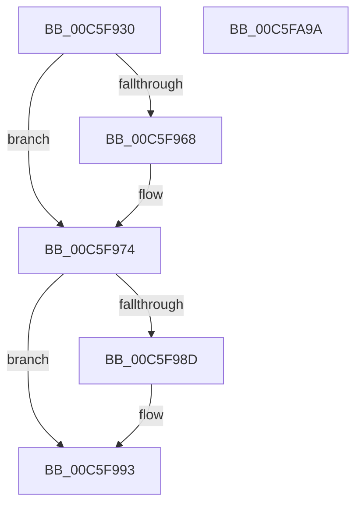

# MiCreatePfnDatabase

- RVA: `0x00C5F930`–`0x00C5FA9B` (길이 `363` bytes)
- VA: `0x0000000140C5F930`
- 실행 섹션: `INIT`
- PDB 이름 있음: `예`; PDB Function 태그: `아니요`
- unwind 정보 RVA: `0x0005CAAC`
- 디코드: `80`개 명령, `363/363` bytes 표시
- 미해석 바이트: `0` (있으면 어셈블리에 `.byte`로 보존)

> 이 문서는 커널 이미지의 기계어와 PDB 기호를 분석해 생성했습니다. 4번과 5번은 함수 원형과 자료형을 바이너리 사용 방식에서 추정한 C 해석이며 원본 소스 복구 결과는 아닙니다.

## 1. Dependencies

- 직접 호출 지점: **7**; 고유 호출 대상: **6**
- 직접 호출자로 확인된 함수: **1**
- RIP 상대 이미지 참조: **19**

### Outgoing calls
- `0x00C5F93D` → [MiQueryHardwareCacheInformation](../C6/MiQueryHardwareCacheInformation_function_00C6AB54.md) (function, `0x00C6AB54`)
- `0x00C5F9F7` → [MiCreatePartitionOffsets](../../page/7F/MiCreatePartitionOffsets_function_007FD18C.md) (function, `0x007FD18C`)
- `0x00C5FA65` → [MiCreatePartitionOffsets](../../page/7F/MiCreatePartitionOffsets_function_007FD18C.md) (function, `0x007FD18C`)
- `0x00C5FA6D` → [MiCreateSparsePfnDatabase](../C6/MiCreateSparsePfnDatabase_function_00C62088.md) (function, `0x00C62088`)
- `0x00C5FA74` → [MiInitializePartitions](../C6/MiInitializePartitions_function_00C64898.md) (function, `0x00C64898`)
- `0x00C5FA82` → [MiInitializePartition](../../page/7F/MiInitializePartition_function_007FD3E8.md) (function, `0x007FD3E8`)
- `0x00C5FA8A` → [MiInitializeNumaGraph](MiInitializeNumaGraph_function_00C5E310.md) (function, `0x00C5E310`)

### Direct callers
- [MiInitNucleus](MiInitNucleus_function_00C5FD38.md) at `0x00C6008B`

### Static image references
- `0x00C5F942` → RVA `0x00E2DCC0` (`.data`; read)
- `0x00C5F952` → RVA `0x00E2DCC4` (`.data`; write)
- `0x00C5F959` → RVA `0x00E2DCCC` (`.data`; write)
- `0x00C5F974` → RVA `0x00E2DCC0` (`.data`; write)
- `0x00C5F97A` → RVA `0x00E2DCE0` (`.data`; read)
- `0x00C5F984` → RVA `0x00E35C00` (`.data`; read)
- `0x00C5F993` → RVA `0x00FC5000` (`ALMOSTRO`; read)
- `0x00C5F9AF` → RVA `0x00E2DBF8` (`.data`; write)
- `0x00C5F9C5` → RVA `0x00E2DBD0` (`.data`; write)
- `0x00C5F9E3` → RVA `0x00E35E18` (`.data`; write)
- `0x00C5F9F0` → RVA `0x00E30098` (`.data`; write)
- `0x00C5F9FC` → RVA `0x00E300A0` (`.data`; write)
- `0x00C5FA11` → RVA `0x00FC6DE0` (`ALMOSTRO`; write)
- `0x00C5FA25` → RVA `0x00FC6C38` (`ALMOSTRO`; write)
- `0x00C5FA2F` → RVA `0x00E2DBF8` (`.data`; read/write)
- `0x00C5FA39` → RVA `0x00E2DBD0` (`.data`; read/write)
- `0x00C5FA43` → RVA `0x00E35E18` (`.data`; read/write)
- `0x00C5FA4D` → RVA `0x00E30098` (`.data`; read)
- `0x00C5FA54` → RVA `0x00E38D00` (`.data`; read)

## 2. Other-region calls and transfers

- 다른 실행 섹션으로 향하는 call: **3**
  - `0x00C5F9F7` → [MiCreatePartitionOffsets](../../page/7F/MiCreatePartitionOffsets_function_007FD18C.md) (`INIT` → `PAGE`)
  - `0x00C5FA65` → [MiCreatePartitionOffsets](../../page/7F/MiCreatePartitionOffsets_function_007FD18C.md) (`INIT` → `PAGE`)
  - `0x00C5FA82` → [MiInitializePartition](../../page/7F/MiInitializePartition_function_007FD3E8.md) (`INIT` → `PAGE`)
- 별도 외부 분기/꼬리 이동을 확인하지 못했습니다.

## 3. Assembly (complete function range)

```asm
00C5F930  48 89 5C 24 08                  mov qword ptr [rsp + 8], rbx
00C5F935  57                              push rdi
00C5F936  48 83 EC 20                     sub rsp, 0x20
00C5F93A  48 8B F9                        mov rdi, rcx
00C5F93D  E8 12 B2 00 00                  call 0x140c6ab54
00C5F942  8B 15 78 E3 1C 00               mov edx, dword ptr [rip + 0x1ce378]
00C5F948  48 B8 00 01 00 00 00 01 00 00   movabs rax, 0x10000000100
00C5F952  48 89 05 6B E3 1C 00            mov qword ptr [rip + 0x1ce36b], rax
00C5F959  89 05 6D E3 1C 00               mov dword ptr [rip + 0x1ce36d], eax
00C5F95F  B8 00 01 00 00                  mov eax, 0x100
00C5F964  3B D0                           cmp edx, eax
00C5F966  77 0C                           ja 0x140c5f974
00C5F968  B9 20 00 00 00                  mov ecx, 0x20
00C5F96D  8B C2                           mov eax, edx
00C5F96F  3B D1                           cmp edx, ecx
00C5F971  0F 42 C1                        cmovb eax, ecx
00C5F974  89 05 46 E3 1C 00               mov dword ptr [rip + 0x1ce346], eax
00C5F97A  48 8B 05 5F E3 1C 00            mov rax, qword ptr [rip + 0x1ce35f]
00C5F981  48 FF C0                        inc rax
00C5F984  48 39 05 75 62 1D 00            cmp qword ptr [rip + 0x1d6275], rax
00C5F98B  75 06                           jne 0x140c5f993
00C5F98D  48 05 00 08 00 00               add rax, 0x800
00C5F993  0F B7 0D 66 56 36 00            movzx ecx, word ptr [rip + 0x365666]
00C5F99A  4C 8D 04 40                     lea r8, [rax + rax*2]
00C5F99E  8B D1                           mov edx, ecx
00C5F9A0  49 C1 E0 04                     shl r8, 4
00C5F9A4  48 69 DA 68 01 00 00            imul rbx, rdx, 0x168
00C5F9AB  48 8D 04 49                     lea rax, [rcx + rcx*2]
00C5F9AF  4C 89 05 42 E2 1C 00            mov qword ptr [rip + 0x1ce242], r8
00C5F9B6  48 C1 E0 07                     shl rax, 7
00C5F9BA  33 D2                           xor edx, edx
00C5F9BC  4C 03 C0                        add r8, rax
00C5F9BF  48 83 C3 3F                     add rbx, 0x3f
00C5F9C3  8B C1                           mov eax, ecx
00C5F9C5  4C 89 05 04 E2 1C 00            mov qword ptr [rip + 0x1ce204], r8
00C5F9CC  0F AF C0                        imul eax, eax
00C5F9CF  48 98                           cdqe
00C5F9D1  48 8D 0C 85 07 00 00 00         lea rcx, [rax*4 + 7]
00C5F9D9  49 03 C8                        add rcx, r8
00C5F9DC  48 83 E1 F8                     and rcx, 0xfffffffffffffff8
00C5F9E0  48 03 D9                        add rbx, rcx
00C5F9E3  48 89 0D 2E 64 1D 00            mov qword ptr [rip + 0x1d642e], rcx
00C5F9EA  48 83 E3 C0                     and rbx, 0xffffffffffffffc0
00C5F9EE  33 C9                           xor ecx, ecx
00C5F9F0  48 89 1D A1 06 1D 00            mov qword ptr [rip + 0x1d06a1], rbx
00C5F9F7  E8 90 D7 B9 FF                  call 0x1407fd18c
00C5F9FC  48 89 05 9D 06 1D 00            mov qword ptr [rip + 0x1d069d], rax
00C5FA03  48 8D 88 FF 0F 00 00            lea rcx, [rax + 0xfff]
00C5FA0A  48 03 CB                        add rcx, rbx
00C5FA0D  48 C1 E9 0C                     shr rcx, 0xc
00C5FA11  48 89 0D C8 73 36 00            mov qword ptr [rip + 0x3673c8], rcx
00C5FA18  48 B9 00 00 00 00 00 DE FF FF   movabs rcx, 0xffffde0000000000
00C5FA22  48 8B C1                        mov rax, rcx
00C5FA25  48 89 05 0C 72 36 00            mov qword ptr [rip + 0x36720c], rax
00C5FA2C  48 8B C1                        mov rax, rcx
00C5FA2F  48 01 05 C2 E1 1C 00            add qword ptr [rip + 0x1ce1c2], rax
00C5FA36  48 8B C1                        mov rax, rcx
00C5FA39  48 01 05 90 E1 1C 00            add qword ptr [rip + 0x1ce190], rax
00C5FA40  48 8B C1                        mov rax, rcx
00C5FA43  48 01 05 CE 63 1D 00            add qword ptr [rip + 0x1d63ce], rax
00C5FA4A  48 8B C1                        mov rax, rcx
00C5FA4D  48 8B 15 44 06 1D 00            mov rdx, qword ptr [rip + 0x1d0644]
00C5FA54  48 8D 0D A5 92 1D 00            lea rcx, [rip + 0x1d92a5]
00C5FA5B  48 03 D0                        add rdx, rax
00C5FA5E  48 89 15 33 06 1D 00            mov qword ptr [rip + 0x1d0633], rdx
00C5FA65  E8 22 D7 B9 FF                  call 0x1407fd18c
00C5FA6A  48 8B CF                        mov rcx, rdi
00C5FA6D  E8 16 26 00 00                  call 0x140c62088
00C5FA72  33 C9                           xor ecx, ecx
00C5FA74  E8 1F 4E 00 00                  call 0x140c64898
00C5FA79  33 D2                           xor edx, edx
00C5FA7B  48 8D 0D 7E 92 1D 00            lea rcx, [rip + 0x1d927e]
00C5FA82  E8 61 D9 B9 FF                  call 0x1407fd3e8
00C5FA87  48 8B CF                        mov rcx, rdi
00C5FA8A  E8 81 E8 FF FF                  call 0x140c5e310
00C5FA8F  48 8B 5C 24 30                  mov rbx, qword ptr [rsp + 0x30]
00C5FA94  48 83 C4 20                     add rsp, 0x20
00C5FA98  5F                              pop rdi
00C5FA99  C3                              ret
00C5FA9A  CC                              int3
```

## 4. C-style interpretation (structured pseudocode)

```c
__int64 __fastcall MiCreatePfnDatabase(__int64 a1)
{
    __int64 result;
    __int64 v_rbx;
    __int64 v_rsp;
    unsigned __int64 v_stack_p8;

    v_stack_p8 = v_rbx;
    v_rsp = (v_rsp) - (32);
    result = MiQueryHardwareCacheInformation(a1, a2, a3, a4);
    *(unsigned __int64 *)(v_rip + 1893227) = result;
    *(unsigned int *)(v_rip + 1893229) = (unsigned int)(result);
    result = 256;
    if (((unsigned int)((unsigned int)(*(unsigned int *)(v_rip + 1893240)))) <= 256) {
        a1 = 32;
        result = (unsigned int)((unsigned int)(*(unsigned int *)(v_rip + 1893240)));
        if (((unsigned int)((unsigned int)(*(unsigned int *)(v_rip + 1893240)))) < ((unsigned int)(a1))) { result = (unsigned int)(a1); }
    }
    *(unsigned int *)(v_rip + 1893190) = (unsigned int)(result);
    result = (*(unsigned __int64 *)(v_rip + 1893215)) + 1;
    if ((*(unsigned __int64 *)(v_rip + 1925749)) == result) {
        result = (result) + (0x800ULL);
    }
    a3 = (result + result * 2) << (4);
    v_rbx = (v_rbx) * ((unsigned int)((unsigned int)(*(unsigned __int16 *)(v_rip + 3561062))));
    *(unsigned __int64 *)(v_rip + 1892930) = a3;
    result = (*(unsigned __int16 *)(v_rip + 3561062) + *(unsigned __int16 *)(v_rip + 3561062) * 2) << (7);
    a2 = 0;
    a3 = (a3) + (result);
    v_rbx = (v_rbx) + (63);
    *(unsigned __int64 *)(v_rip + 1892868) = a3;
    result = (unsigned int)(((unsigned int)((unsigned int)(*(unsigned __int16 *)(v_rip + 3561062)))) * ((unsigned int)((unsigned int)((unsigned int)(*(unsigned __int16 *)(v_rip + 3561062))))));
    a1 = (result * 4 + 7) + (a3);
    a1 = (a1) & (-8);
    v_rbx = (v_rbx) + (a1);
    *(unsigned __int64 *)(v_rip + 1926190) = a1;
    v_rbx = (v_rbx) & (-64);
    a1 = 0;
    *(unsigned __int64 *)(v_rip + 1902241) = v_rbx;
    result = MiCreatePartitionOffsets(a1, a2, a3, a4);
    *(unsigned __int64 *)(v_rip + 1902237) = result;
    a1 = (result + 4095) + (v_rbx);
    a1 = (a1) >> (12);
    *(unsigned __int64 *)(v_rip + 3568584) = a1;
    *(unsigned __int64 *)(v_rip + 3568140) = a1;
    a2 = (*(unsigned __int64 *)(v_rip + 1902148)) + (a1);
    *(unsigned __int64 *)(v_rip + 1902131) = a2;
    result = MiCreatePartitionOffsets(v_rip + 1938085, a2, a3, a4);
    result = MiCreateSparsePfnDatabase(a1, a2, a3, a4);
    a1 = 0;
    result = MiInitializePartitions(a1, a2, a3, a4);
    a2 = 0;
    result = MiInitializePartition(v_rip + 1938046, a2, a3, a4);
    result = MiInitializeNumaGraph(0, a2, a3, a4);
    v_rsp = (v_rsp) + (32);
    return result;
}
```

## 5. (Beta) C Style

```c
int64_t MiCreatePfnDatabase(int64_t Arg1)
{
    int64_t result;
    int64_t local_rbx;
    int64_t local_rsp;
    uint64_t v_stack_p8;

    v_stack_p8 = local_rbx;
    local_rsp = (local_rsp) - (32);
    result = MiQueryHardwareCacheInformation(Arg1, a2, a3, a4);
    *(uint64_t *)(v_rip + 0x1CE36B) = result;
    *(uint32_t *)(v_rip + 0x1CE36D) = (uint32_t)(result);
    result = 256;
    if (((uint32_t)((uint32_t)(*(uint32_t *)(v_rip + 0x1CE378)))) <= 256) {
        Arg1 = 32;
        result = (uint32_t)((uint32_t)(*(uint32_t *)(v_rip + 0x1CE378)));
        if (((uint32_t)((uint32_t)(*(uint32_t *)(v_rip + 0x1CE378)))) < ((uint32_t)(Arg1))) { result = (uint32_t)(Arg1); }
    }
    *(uint32_t *)(v_rip + 0x1CE346) = (uint32_t)(result);
    result = (*(uint64_t *)(v_rip + 0x1CE35F)) + 1;
    if ((*(uint64_t *)(v_rip + 0x1D6275)) == result) {
        result = (result) + (0x800ULL);
    }
    a3 = (result + result * 2) << (4);
    local_rbx = (local_rbx) * ((uint32_t)((uint32_t)(*(uint16_t *)(v_rip + 0x365666))));
    *(uint64_t *)(v_rip + 0x1CE242) = a3;
    result = (*(uint16_t *)(v_rip + 0x365666) + *(uint16_t *)(v_rip + 0x365666) * 2) << (7);
    a2 = 0;
    a3 = (a3) + (result);
    local_rbx = (local_rbx) + (63);
    *(uint64_t *)(v_rip + 0x1CE204) = a3;
    result = (uint32_t)(((uint32_t)((uint32_t)(*(uint16_t *)(v_rip + 0x365666)))) * ((uint32_t)((uint32_t)((uint32_t)(*(uint16_t *)(v_rip + 0x365666))))));
    Arg1 = (result * 4 + 7) + (a3);
    Arg1 = (Arg1) & (-8);
    local_rbx = (local_rbx) + (Arg1);
    *(uint64_t *)(v_rip + 0x1D642E) = Arg1;
    local_rbx = (local_rbx) & (-64);
    Arg1 = 0;
    *(uint64_t *)(v_rip + 0x1D06A1) = local_rbx;
    result = MiCreatePartitionOffsets(Arg1, a2, a3, a4);
    *(uint64_t *)(v_rip + 0x1D069D) = result;
    Arg1 = (result + 4095) + (local_rbx);
    Arg1 = (Arg1) >> (12);
    *(uint64_t *)(v_rip + 0x3673C8) = Arg1;
    *(uint64_t *)(v_rip + 0x36720C) = Arg1;
    a2 = (*(uint64_t *)(v_rip + 0x1D0644)) + (Arg1);
    *(uint64_t *)(v_rip + 0x1D0633) = a2;
    result = MiCreatePartitionOffsets(v_rip + 1938085, a2, a3, a4);
    result = MiCreateSparsePfnDatabase(Arg1, a2, a3, a4);
    Arg1 = 0;
    result = MiInitializePartitions(Arg1, a2, a3, a4);
    a2 = 0;
    result = MiInitializePartition(v_rip + 1938046, a2, a3, a4);
    result = MiInitializeNumaGraph(0, a2, a3, a4);
    local_rsp = (local_rsp) + (32);
    return result;
}
```

## 6. Execution-region graph

[열기: 2D/3D 그래프와 함수 탐색 컨트롤 패널](../../../control-panel.html?section=init&rva=0x00C5F930&view=graph)

- 2D 그래프는 위에서 아래로 흐르고, 3D 그래프는 빈 공간을 드래그해 회전합니다. Shift+드래그는 이동, 휠은 확대·축소, 함수 노드 선택은 대상 보고서 이동입니다.

### Static fallback


