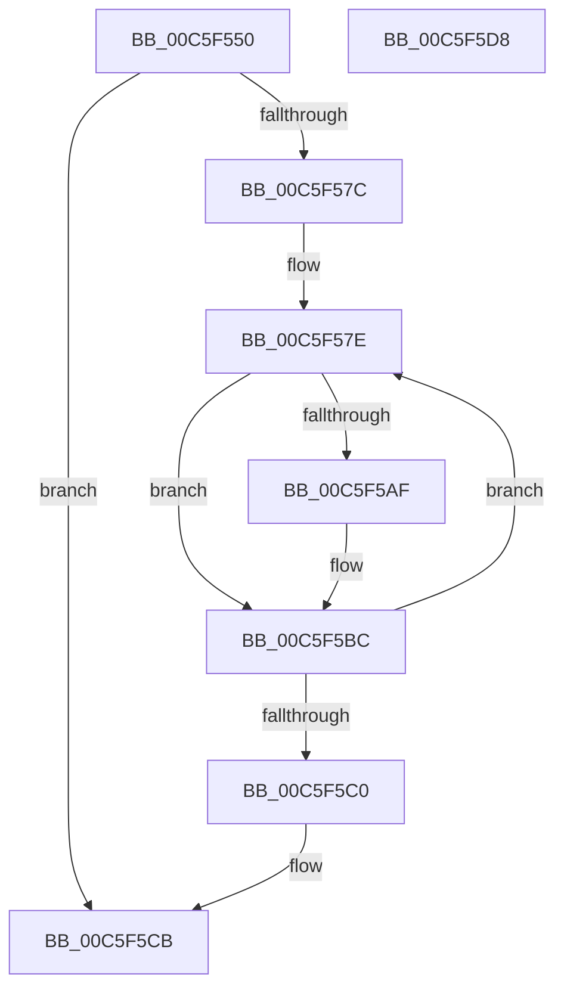

# MiEnablePagingOfDriver

- RVA: `0x00C5F550`–`0x00C5F5D9` (길이 `137` bytes)
- VA: `0x0000000140C5F550`
- 실행 섹션: `INIT`
- PDB 이름 있음: `예`; PDB Function 태그: `아니요`
- unwind 정보 RVA: `0x0008A658`
- 디코드: `39`개 명령, `137/137` bytes 표시
- 미해석 바이트: `0` (있으면 어셈블리에 `.byte`로 보존)

> 이 문서는 커널 이미지의 기계어와 PDB 기호를 분석해 생성했습니다. 4번과 5번은 함수 원형과 자료형을 바이너리 사용 방식에서 추정한 C 해석이며 원본 소스 복구 결과는 아닙니다.

## 1. Dependencies

- 직접 호출 지점: **4**; 고유 호출 대상: **4**
- 직접 호출자로 확인된 함수: **0**
- RIP 상대 이미지 참조: **0**

### Outgoing calls
- `0x00C5F572` → [MiImagePagable](../../page/7F/MiImagePagable_function_007F8BD0.md) (function, `0x007F8BD0`)
- `0x00C5F59E` → [MiSnapDriverRange](../../page/A4/MiSnapDriverRange_function_00A4B328.md) (function, `0x00A4B328`)
- `0x00C5F5B7` → [MiSetPagingOfDriver](../../text/4A/MiSetPagingOfDriver_function_004A76C4.md) (function, `0x004A76C4`)
- `0x00C5F5C6` → [MiLockPagableSections](../C6/MiLockPagableSections_function_00C6C35C.md) (function, `0x00C6C35C`)

### Direct callers
- 이 함수 시작 RVA로 연결되는 직접 call은 확인되지 않았습니다. 간접 호출은 완전히 역산할 수 없습니다.

### Static image references
- 디코드된 RIP-relative 메모리 참조가 없습니다.

## 2. Other-region calls and transfers

- 다른 실행 섹션으로 향하는 call: **3**
  - `0x00C5F572` → [MiImagePagable](../../page/7F/MiImagePagable_function_007F8BD0.md) (`INIT` → `PAGE`)
  - `0x00C5F59E` → [MiSnapDriverRange](../../page/A4/MiSnapDriverRange_function_00A4B328.md) (`INIT` → `PAGE`)
  - `0x00C5F5B7` → [MiSetPagingOfDriver](../../text/4A/MiSetPagingOfDriver_function_004A76C4.md) (`INIT` → `.text`)
- 별도 외부 분기/꼬리 이동을 확인하지 못했습니다.

## 3. Assembly (complete function range)

```asm
00C5F550  48 89 5C 24 10                  mov qword ptr [rsp + 0x10], rbx
00C5F555  57                              push rdi
00C5F556  48 83 EC 30                     sub rsp, 0x30
00C5F55A  48 8B 51 30                     mov rdx, qword ptr [rcx + 0x30]
00C5F55E  48 8B D9                        mov rbx, rcx
00C5F561  48 83 64 24 50 00               and qword ptr [rsp + 0x50], 0
00C5F567  48 83 64 24 40 00               and qword ptr [rsp + 0x40], 0
00C5F56D  0F BA 69 68 16                  bts dword ptr [rcx + 0x68], 0x16
00C5F572  E8 59 96 B9 FF                  call 0x1407f8bd0
00C5F577  48 85 C0                        test rax, rax
00C5F57A  74 4F                           je 0x140c5f5cb
00C5F57C  33 FF                           xor edi, edi
00C5F57E  45 33 C9                        xor r9d, r9d
00C5F581  48 8D 44 24 50                  lea rax, [rsp + 0x50]
00C5F586  48 89 44 24 28                  mov qword ptr [rsp + 0x28], rax
00C5F58B  8B D7                           mov edx, edi
00C5F58D  48 8D 44 24 40                  lea rax, [rsp + 0x40]
00C5F592  48 8B CB                        mov rcx, rbx
00C5F595  48 89 44 24 20                  mov qword ptr [rsp + 0x20], rax
00C5F59A  45 8D 41 01                     lea r8d, [r9 + 1]
00C5F59E  E8 85 BD DE FF                  call 0x140a4b328
00C5F5A3  48 8B 54 24 40                  mov rdx, qword ptr [rsp + 0x40]
00C5F5A8  8B F8                           mov edi, eax
00C5F5AA  48 85 D2                        test rdx, rdx
00C5F5AD  74 0D                           je 0x140c5f5bc
00C5F5AF  4C 8B 44 24 50                  mov r8, qword ptr [rsp + 0x50]
00C5F5B4  48 8B CB                        mov rcx, rbx
00C5F5B7  E8 08 81 84 FF                  call 0x1404a76c4
00C5F5BC  85 FF                           test edi, edi
00C5F5BE  75 BE                           jne 0x140c5f57e
00C5F5C0  8D 57 01                        lea edx, [rdi + 1]
00C5F5C3  48 8B CB                        mov rcx, rbx
00C5F5C6  E8 91 CD 00 00                  call 0x140c6c35c
00C5F5CB  48 8B 5C 24 48                  mov rbx, qword ptr [rsp + 0x48]
00C5F5D0  33 C0                           xor eax, eax
00C5F5D2  48 83 C4 30                     add rsp, 0x30
00C5F5D6  5F                              pop rdi
00C5F5D7  C3                              ret
00C5F5D8  CC                              int3
```

## 4. C-style interpretation (structured pseudocode)

```c
__int64 __fastcall MiEnablePagingOfDriver(__int64 a1, __int64 a2, __int64 a3, int a4)
{
    __int64 result;
    __int64 v_rdi;
    __int64 v_rsp;
    unsigned __int64 v_stack_m10;
    unsigned __int64 v_stack_m18;
    unsigned __int64 v_stack_p10;
    unsigned __int64 v_stack_p18;
    unsigned __int64 v_stack_p8;

    v_stack_p10 = v_rbx;
    v_rsp = (v_rsp) - (48);
    result = MiImagePagable(a1, *(unsigned __int64 *)(a1 + 48), a3, a4);
    if (result == 0) goto loc_00C5F5CB;
    v_rdi = 0;
loc_00C5F57E:
    a4 = 0;
    v_stack_m10 = v_stack_p18;
    v_stack_m18 = v_stack_p8;
    result = MiSnapDriverRange(a1, 0, a4 + 1, a4);
    if (v_stack_p8 != 0) {
        a3 = v_stack_p18;
        a1 = a1;
        result = MiSetPagingOfDriver(a1, v_stack_p8, a3, a4);
    }
    if ((unsigned int)((unsigned int)((unsigned int)(result))) != 0) goto loc_00C5F57E;
    result = MiLockPagableSections(a1, (unsigned int)((unsigned int)(result)) + 1, a3, a4);
loc_00C5F5CB:
    result = 0;
    v_rsp = (v_rsp) + (48);
    return result;
}
```

## 5. (Beta) C Style

```c
int64_t MiEnablePagingOfDriver(void *Arg1, int64_t Arg2, int64_t Arg3, int32_t Arg4)
{
    uint8_t *arg1 = (uint8_t *)Arg1;

    int64_t result;
    int64_t local_rdi;
    int64_t local_rsp;
    uint64_t v_stack_m10;
    uint64_t v_stack_m18;
    uint64_t v_stack_p10;
    uint64_t v_stack_p18;
    uint64_t v_stack_p8;

    v_stack_p10 = local_rbx;
    local_rsp = (local_rsp) - (48);
    result = MiImagePagable(Arg1, *(uint64_t *)(arg1 + 0x30), Arg3, Arg4);
    if (result == 0) goto loc_00C5F5CB;
    local_rdi = 0;
loc_00C5F57E:
    Arg4 = 0;
    v_stack_m10 = v_stack_p18;
    v_stack_m18 = v_stack_p8;
    result = MiSnapDriverRange(Arg1, 0, Arg4 + 1, Arg4);
    if (v_stack_p8 != 0) {
        Arg3 = v_stack_p18;
        Arg1 = Arg1;
        result = MiSetPagingOfDriver(Arg1, v_stack_p8, Arg3, Arg4);
    }
    if ((uint32_t)((uint32_t)((uint32_t)(result))) != 0) goto loc_00C5F57E;
    result = MiLockPagableSections(Arg1, (uint32_t)((uint32_t)(result)) + 1, Arg3, Arg4);
loc_00C5F5CB:
    result = 0;
    local_rsp = (local_rsp) + (48);
    return result;
}
```

### 관측된 메모리 오프셋

구조체 형식이 확인되지 않은 접근은 인자 기준의 오프셋으로만 기록했습니다.

| 기준 인자 | 오프셋 표현 | 폭 (bit) | 접근 |
|---|---:|---:|---|
| `Arg1` | `+ 0x30` | `64` | `R` |
| `Arg1` | `+ 0x68` | `32` | `R/W` |

## 6. Execution-region graph

[열기: 2D/3D 그래프와 함수 탐색 컨트롤 패널](../../../control-panel.html?section=init&rva=0x00C5F550&view=graph)

- 2D 그래프는 위에서 아래로 흐르고, 3D 그래프는 빈 공간을 드래그해 회전합니다. Shift+드래그는 이동, 휠은 확대·축소, 함수 노드 선택은 대상 보고서 이동입니다.

### Static fallback


