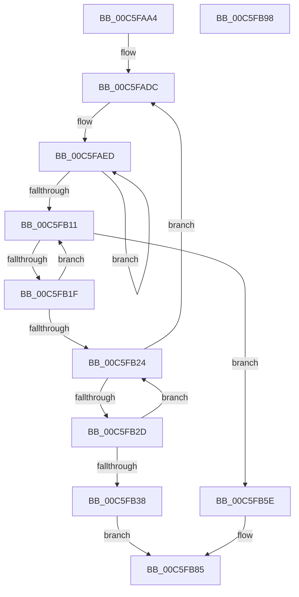

# MiExamineHalVa

- RVA: `0x00C5FAA4`–`0x00C5FB99` (길이 `245` bytes)
- VA: `0x0000000140C5FAA4`
- 실행 섹션: `INIT`
- PDB 이름 있음: `예`; PDB Function 태그: `아니요`
- unwind 정보 RVA: `0x000D7808`
- 디코드: `64`개 명령, `245/245` bytes 표시
- 미해석 바이트: `0` (있으면 어셈블리에 `.byte`로 보존)

> 이 문서는 커널 이미지의 기계어와 PDB 기호를 분석해 생성했습니다. 4번과 5번은 함수 원형과 자료형을 바이너리 사용 방식에서 추정한 C 해석이며 원본 소스 복구 결과는 아닙니다.

## 1. Dependencies

- 직접 호출 지점: **1**; 고유 호출 대상: **1**
- 직접 호출자로 확인된 함수: **1**
- RIP 상대 이미지 참조: **1**

### Outgoing calls
- `0x00C5FB8D` → [_security_check_cookie](../../text/6A/_security_check_cookie_function_006AC640.md) (function, `0x006AC640`)

### Direct callers
- [MiInitNucleus](MiInitNucleus_function_00C5FD38.md) at `0x00C5FE11`

### Static image references
- `0x00C5FAAA` → RVA `0x00E0A740` (`.data`; read)

## 2. Other-region calls and transfers

- 다른 실행 섹션으로 향하는 call: **1**
  - `0x00C5FB8D` → [_security_check_cookie](../../text/6A/_security_check_cookie_function_006AC640.md) (`INIT` → `.text`)
- 별도 외부 분기/꼬리 이동을 확인하지 못했습니다.

## 3. Assembly (complete function range)

```asm
00C5FAA4  40 53                           push rbx
00C5FAA6  48 83 EC 20                     sub rsp, 0x20
00C5FAAA  48 8B 05 8F AC 1A 00            mov rax, qword ptr [rip + 0x1aac8f]
00C5FAB1  48 33 C4                        xor rax, rsp
00C5FAB4  48 89 44 24 18                  mov qword ptr [rsp + 0x18], rax
00C5FAB9  0F 57 C0                        xorps xmm0, xmm0
00C5FABC  F3 0F 7F 44 24 08               movdqu xmmword ptr [rsp + 8], xmm0
00C5FAC2  48 BA F0 FF FF 7F FB F6 FF FF   movabs rdx, 0xfffff6fb7ffffff0
00C5FACC  41 BB 03 00 00 00               mov r11d, 3
00C5FAD2  48 BB 00 00 00 00 80 F6 FF FF   movabs rbx, 0xfffff68000000000
00C5FADC  48 83 EA 08                     sub rdx, 8
00C5FAE0  4C 8D 0C 24                     lea r9, [rsp]
00C5FAE4  48 8B CA                        mov rcx, rdx
00C5FAE7  4D 8B D3                        mov r10, r11
00C5FAEA  45 8B C3                        mov r8d, r11d
00C5FAED  49 89 09                        mov qword ptr [r9], rcx
00C5FAF0  48 B8 F8 FF FF FF 7F 00 00 00   movabs rax, 0x7ffffffff8
00C5FAFA  48 C1 E9 09                     shr rcx, 9
00C5FAFE  48 23 C8                        and rcx, rax
00C5FB01  48 8B C3                        mov rax, rbx
00C5FB04  48 03 C8                        add rcx, rax
00C5FB07  4D 8D 49 08                     lea r9, [r9 + 8]
00C5FB0B  49 83 EA 01                     sub r10, 1
00C5FB0F  75 DC                           jne 0x140c5faed
00C5FB11  41 FF C8                        dec r8d
00C5FB14  4A 8B 04 C4                     mov rax, qword ptr [rsp + r8*8]
00C5FB18  48 8B 00                        mov rax, qword ptr [rax]
00C5FB1B  A8 01                           test al, 1
00C5FB1D  74 3F                           je 0x140c5fb5e
00C5FB1F  45 85 C0                        test r8d, r8d
00C5FB22  75 ED                           jne 0x140c5fb11
00C5FB24  48 F7 C2 FF 0F 00 00            test rdx, 0xfff
00C5FB2B  74 AF                           je 0x140c5fadc
00C5FB2D  48 83 EA 08                     sub rdx, 8
00C5FB31  48 8B 02                        mov rax, qword ptr [rdx]
00C5FB34  A8 01                           test al, 1
00C5FB36  75 EC                           jne 0x140c5fb24
00C5FB38  48 8B CB                        mov rcx, rbx
00C5FB3B  48 C1 E1 19                     shl rcx, 0x19
00C5FB3F  48 C1 E2 19                     shl rdx, 0x19
00C5FB43  48 2B D1                        sub rdx, rcx
00C5FB46  48 8D 82 00 00 00 10            lea rax, [rdx + 0x10000000]
00C5FB4D  48 C1 F8 10                     sar rax, 0x10
00C5FB51  48 C1 E0 19                     shl rax, 0x19
00C5FB55  48 2B C1                        sub rax, rcx
00C5FB58  48 C1 F8 10                     sar rax, 0x10
00C5FB5C  EB 27                           jmp 0x140c5fb85
00C5FB5E  48 8B C3                        mov rax, rbx
00C5FB61  48 C1 E2 19                     shl rdx, 0x19
00C5FB65  48 C1 E0 19                     shl rax, 0x19
00C5FB69  48 2B D0                        sub rdx, rax
00C5FB6C  48 81 C2 00 00 00 10            add rdx, 0x10000000
00C5FB73  48 C1 FA 10                     sar rdx, 0x10
00C5FB77  48 C1 E2 19                     shl rdx, 0x19
00C5FB7B  48 2B D0                        sub rdx, rax
00C5FB7E  48 C1 FA 10                     sar rdx, 0x10
00C5FB82  48 8B C2                        mov rax, rdx
00C5FB85  48 8B 4C 24 18                  mov rcx, qword ptr [rsp + 0x18]
00C5FB8A  48 33 CC                        xor rcx, rsp
00C5FB8D  E8 AE CA A4 FF                  call 0x1406ac640
00C5FB92  48 83 C4 20                     add rsp, 0x20
00C5FB96  5B                              pop rbx
00C5FB97  C3                              ret
00C5FB98  CC                              int3
```

## 4. C-style interpretation (structured pseudocode)

```c
__int64 __fastcall MiExamineHalVa(void)
{
    __int64 result;
    __int64 v_r10;
    __int64 v_rsp;
    unsigned __int64 v_stack_m10;
    unsigned __int64 v_stack_m20;
    unsigned __int64 v_stack_m28;

    v_rsp = (v_rsp) - (32);
    result = (*(unsigned __int64 *)(v_rip + 1748111)) ^ (v_rsp);
    v_stack_m10 = result;
    v_stack_m20 = v_xmm0;
loc_00C5FADC:
    a2 = (a2) - (8);
loc_00C5FAED:
    *(unsigned __int64 *)(v_stack_m28) = a2;
    a1 = (a2) >> (9);
    a1 = (a1) & (result);
    a1 = (a1) + (v_rbx);
    v_r10 = (3) - (1);
    if (condition_is_not_equal) goto loc_00C5FAED;
loc_00C5FB11:
    a3 = (unsigned int)((3) - 1);
    if ((((unsigned __int8)(*(unsigned __int64 *)(*(unsigned __int64 *)(v_rsp + a3 * 8)))) & (1)) == 0) goto loc_00C5FB5E;
    if ((unsigned int)(a3) != 0) goto loc_00C5FB11;
loc_00C5FB24:
    if (((a2) & (0xFFFULL)) == 0) goto loc_00C5FADC;
    a2 = (a2) - (8);
    if ((((unsigned __int8)(*(unsigned __int64 *)(a2))) & (1)) != 0) goto loc_00C5FB24;
    a1 = (v_rbx) << (25);
    a2 = (a2) << (25);
    a2 = (a2) - (a1);
    result = (a2 + 268435456) >> (16);
    result = (result) << (25);
    result = (result) - (a1);
    result = (result) >> (16);
    goto loc_00C5FB85;
loc_00C5FB5E:
    a2 = (a2) << (25);
    result = (v_rbx) << (25);
    a2 = (a2) - (result);
    a2 = (a2) + (0x10000000ULL);
    a2 = (a2) >> (16);
    a2 = (a2) << (25);
    a2 = (a2) - (result);
    a2 = (a2) >> (16);
loc_00C5FB85:
    a1 = (v_stack_m10) ^ (v_rsp);
    result = _security_check_cookie(a1, a2, a3, v_stack_m28 + 8);
    v_rsp = (v_rsp) + (32);
    return result;
}
```

## 5. (Beta) C Style

```c
void MiExamineHalVa(void)
{
    int64_t result;
    int64_t local_r10;
    int64_t local_rsp;
    uint64_t v_stack_m10;
    uint64_t v_stack_m20;
    uint64_t v_stack_m28;

    local_rsp = (local_rsp) - (32);
    result = (*(uint64_t *)(v_rip + 0x1AAC8F)) ^ (local_rsp);
    v_stack_m10 = result;
    v_stack_m20 = v_xmm0;
loc_00C5FADC:
    a2 = (a2) - (8);
loc_00C5FAED:
    *(uint64_t *)(v_stack_m28) = a2;
    a1 = (a2) >> (9);
    a1 = (a1) & (result);
    a1 = (a1) + (local_rbx);
    local_r10 = (3) - (1);
    if (condition_is_not_equal) goto loc_00C5FAED;
loc_00C5FB11:
    a3 = (uint32_t)((3) - 1);
    if ((((uint8_t)(*(uint64_t *)(*(uint64_t *)(local_rsp + a3 * 8)))) & (1)) == 0) goto loc_00C5FB5E;
    if ((uint32_t)(a3) != 0) goto loc_00C5FB11;
loc_00C5FB24:
    if (((a2) & (0xFFFULL)) == 0) goto loc_00C5FADC;
    a2 = (a2) - (8);
    if ((((uint8_t)(*(uint64_t *)(a2))) & (1)) != 0) goto loc_00C5FB24;
    a1 = (local_rbx) << (25);
    a2 = (a2) << (25);
    a2 = (a2) - (a1);
    result = (a2 + 268435456) >> (16);
    result = (result) << (25);
    result = (result) - (a1);
    result = (result) >> (16);
    goto loc_00C5FB85;
loc_00C5FB5E:
    a2 = (a2) << (25);
    result = (local_rbx) << (25);
    a2 = (a2) - (result);
    a2 = (a2) + (0x10000000ULL);
    a2 = (a2) >> (16);
    a2 = (a2) << (25);
    a2 = (a2) - (result);
    a2 = (a2) >> (16);
loc_00C5FB85:
    a1 = (v_stack_m10) ^ (local_rsp);
    result = _security_check_cookie(a1, a2, a3, v_stack_m28 + 8);
    local_rsp = (local_rsp) + (32);
    return result;
}
```

## 6. Execution-region graph

[열기: 2D/3D 그래프와 함수 탐색 컨트롤 패널](../../../control-panel.html?section=init&rva=0x00C5FAA4&view=graph)

- 2D 그래프는 위에서 아래로 흐르고, 3D 그래프는 빈 공간을 드래그해 회전합니다. Shift+드래그는 이동, 휠은 확대·축소, 함수 노드 선택은 대상 보고서 이동입니다.

### Static fallback


