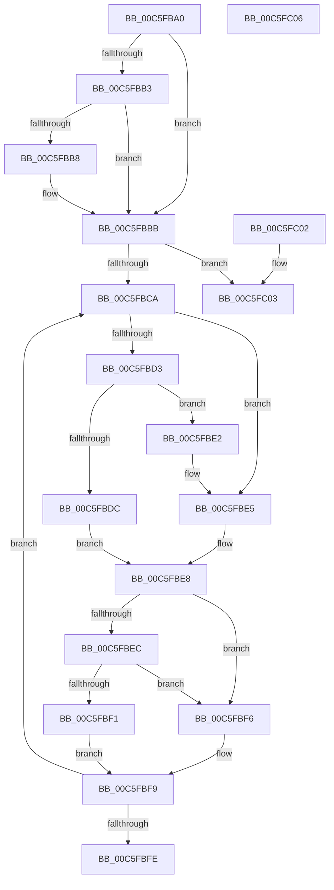

# MiFindDescriptorByPfn

- RVA: `0x00C5FBA0`–`0x00C5FC07` (길이 `103` bytes)
- VA: `0x0000000140C5FBA0`
- 실행 섹션: `INIT`
- PDB 이름 있음: `예`; PDB Function 태그: `아니요`
- unwind 정보 RVA: `0x000DB714`
- 디코드: `38`개 명령, `103/103` bytes 표시
- 미해석 바이트: `0` (있으면 어셈블리에 `.byte`로 보존)

> 이 문서는 커널 이미지의 기계어와 PDB 기호를 분석해 생성했습니다. 4번과 5번은 함수 원형과 자료형을 바이너리 사용 방식에서 추정한 C 해석이며 원본 소스 복구 결과는 아닙니다.

## 1. Dependencies

- 직접 호출 지점: **0**; 고유 호출 대상: **0**
- 직접 호출자로 확인된 함수: **4**
- RIP 상대 이미지 참조: **0**

### Outgoing calls
- 직접 디코드된 call 명령이 없습니다.

### Direct callers
- [MiMarkLargePageRanges](../C6/MiMarkLargePageRanges_function_00C60CFC.md) at `0x00C60E1C`
- [MiIsRegularMemory](../C6/MiIsRegularMemory_function_00C627A8.md) at `0x00C627EE`
- [MiRemoveLargeFreeLoaderDescriptors](../C6/MiRemoveLargeFreeLoaderDescriptors_function_00C6283C.md) at `0x00C62949`
- [MiRemoveLargeFreeLoaderDescriptors](../C6/MiRemoveLargeFreeLoaderDescriptors_function_00C6283C.md) at `0x00C62B07`
- [MiCheckLargePageSystemImage](../C6/MiCheckLargePageSystemImage_function_00C669A4.md) at `0x00C66A17`

### Static image references
- 디코드된 RIP-relative 메모리 참조가 없습니다.

## 2. Other-region calls and transfers

- 다른 실행 섹션으로 향하는 call: **0**
- 별도 외부 분기/꼬리 이동을 확인하지 못했습니다.

## 3. Assembly (complete function range)

```asm
00C5FBA0  48 81 C1 60 01 00 00            add rcx, 0x160
00C5FBA7  4C 8B D2                        mov r10, rdx
00C5FBAA  F6 41 08 01                     test byte ptr [rcx + 8], 1
00C5FBAE  4C 8B 01                        mov r8, qword ptr [rcx]
00C5FBB1  74 08                           je 0x140c5fbbb
00C5FBB3  4D 85 C0                        test r8, r8
00C5FBB6  74 03                           je 0x140c5fbbb
00C5FBB8  4C 33 C1                        xor r8, rcx
00C5FBBB  0F B6 51 08                     movzx edx, byte ptr [rcx + 8]
00C5FBBF  45 33 C9                        xor r9d, r9d
00C5FBC2  83 E2 01                        and edx, 1
00C5FBC5  4D 85 C0                        test r8, r8
00C5FBC8  74 39                           je 0x140c5fc03
00C5FBCA  49 8B 48 20                     mov rcx, qword ptr [r8 + 0x20]
00C5FBCE  4C 3B D1                        cmp r10, rcx
00C5FBD1  72 12                           jb 0x140c5fbe5
00C5FBD3  49 03 48 28                     add rcx, qword ptr [r8 + 0x28]
00C5FBD7  4C 3B D1                        cmp r10, rcx
00C5FBDA  72 06                           jb 0x140c5fbe2
00C5FBDC  49 8B 40 08                     mov rax, qword ptr [r8 + 8]
00C5FBE0  EB 06                           jmp 0x140c5fbe8
00C5FBE2  4D 8B C8                        mov r9, r8
00C5FBE5  49 8B 00                        mov rax, qword ptr [r8]
00C5FBE8  85 D2                           test edx, edx
00C5FBEA  74 0A                           je 0x140c5fbf6
00C5FBEC  48 85 C0                        test rax, rax
00C5FBEF  74 05                           je 0x140c5fbf6
00C5FBF1  4C 33 C0                        xor r8, rax
00C5FBF4  EB 03                           jmp 0x140c5fbf9
00C5FBF6  4C 8B C0                        mov r8, rax
00C5FBF9  4D 85 C0                        test r8, r8
00C5FBFC  75 CC                           jne 0x140c5fbca
00C5FBFE  49 8B C1                        mov rax, r9
00C5FC01  C3                              ret
00C5FC02  CC                              int3
00C5FC03  33 C0                           xor eax, eax
00C5FC05  C3                              ret
00C5FC06  CC                              int3
```

## 4. C-style interpretation (structured pseudocode)

```c
__int64 __fastcall MiFindDescriptorByPfn(__int64 a1, __int64 a2, __int64 a3, int a4)
{
    __int64 result;

    a1 = (a1) + (352);
    if (((*(unsigned __int8 *)(a1 + 8)) & (1)) == 0) goto loc_00C5FBBB;
    if (*(unsigned __int64 *)(a1) != 0) {
        a3 = (*(unsigned __int64 *)(a1)) ^ (a1);
    }
    a4 = 0;
    a2 = (unsigned int)((*(unsigned __int8 *)(a1 + 8)) & (1));
    if (a3 == 0) goto loc_00C5FC03;
loc_00C5FBCA:
    if (a2 < (*(unsigned __int64 *)(a3 + 32))) goto loc_00C5FBE5;
    a1 = (*(unsigned __int64 *)(a3 + 32)) + (*(unsigned __int64 *)(a3 + 40));
    if (a2 < a1) goto loc_00C5FBE2;
    goto loc_00C5FBE8;
loc_00C5FBE2:
loc_00C5FBE5:
loc_00C5FBE8:
    if ((unsigned int)(a2) == 0) goto loc_00C5FBF6;
    if (*(unsigned __int64 *)(a3) == 0) goto loc_00C5FBF6;
    a3 = (a3) ^ (*(unsigned __int64 *)(a3));
    goto loc_00C5FBF9;
loc_00C5FBF6:
loc_00C5FBF9:
    if (*(unsigned __int64 *)(a3) != 0) goto loc_00C5FBCA;
    return a3;
loc_00C5FC03:
    result = 0;
    return result;
}
```

## 5. (Beta) C Style

```c
int64_t MiFindDescriptorByPfn(void *Arg1, int64_t Arg2, int64_t Arg3, int32_t Arg4)
{
    uint8_t *arg1 = (uint8_t *)Arg1;

    int64_t result;

    Arg1 = (Arg1) + (352);
    if (((*(uint8_t *)(arg1 + 0x8)) & (1)) == 0) goto loc_00C5FBBB;
    if (*(uint64_t *)(arg1) != 0) {
        Arg3 = (*(uint64_t *)(arg1)) ^ (Arg1);
    }
    Arg4 = 0;
    Arg2 = (uint32_t)((*(uint8_t *)(arg1 + 0x8)) & (1));
    if (Arg3 == 0) goto loc_00C5FC03;
loc_00C5FBCA:
    if (Arg2 < (*(uint64_t *)(Arg3 + 0x20))) goto loc_00C5FBE5;
    Arg1 = (*(uint64_t *)(Arg3 + 0x20)) + (*(uint64_t *)(Arg3 + 0x28));
    if (Arg2 < Arg1) goto loc_00C5FBE2;
    goto loc_00C5FBE8;
loc_00C5FBE2:
loc_00C5FBE5:
loc_00C5FBE8:
    if ((uint32_t)(Arg2) == 0) goto loc_00C5FBF6;
    if (*(uint64_t *)(Arg3) == 0) goto loc_00C5FBF6;
    Arg3 = (Arg3) ^ (*(uint64_t *)(Arg3));
    goto loc_00C5FBF9;
loc_00C5FBF6:
loc_00C5FBF9:
    if (*(uint64_t *)(Arg3) != 0) goto loc_00C5FBCA;
    return Arg3;
loc_00C5FC03:
    result = 0;
    return result;
}
```

### 관측된 메모리 오프셋

구조체 형식이 확인되지 않은 접근은 인자 기준의 오프셋으로만 기록했습니다.

| 기준 인자 | 오프셋 표현 | 폭 (bit) | 접근 |
|---|---:|---:|---|
| `Arg1` | `+ 0x0` | `64` | `R` |
| `Arg1` | `+ 0x8` | `8` | `R` |

## 6. Execution-region graph

[열기: 2D/3D 그래프와 함수 탐색 컨트롤 패널](../../../control-panel.html?section=init&rva=0x00C5FBA0&view=graph)

- 2D 그래프는 위에서 아래로 흐르고, 3D 그래프는 빈 공간을 드래그해 회전합니다. Shift+드래그는 이동, 휠은 확대·축소, 함수 노드 선택은 대상 보고서 이동입니다.

### Static fallback


