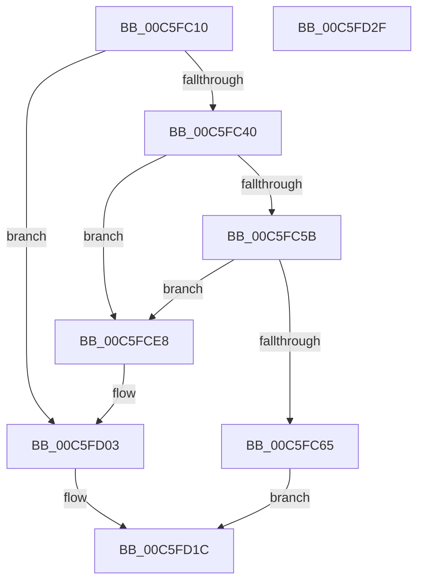

# MiFreeBootPageTable

- RVA: `0x00C5FC10`–`0x00C5FD30` (길이 `288` bytes)
- VA: `0x0000000140C5FC10`
- 실행 섹션: `INIT`
- PDB 이름 있음: `예`; PDB Function 태그: `아니요`
- unwind 정보 RVA: `0x0008A658`
- 디코드: `70`개 명령, `288/288` bytes 표시
- 미해석 바이트: `0` (있으면 어셈블리에 `.byte`로 보존)

> 이 문서는 커널 이미지의 기계어와 PDB 기호를 분석해 생성했습니다. 4번과 5번은 함수 원형과 자료형을 바이너리 사용 방식에서 추정한 C 해석이며 원본 소스 복구 결과는 아닙니다.

## 1. Dependencies

- 직접 호출 지점: **6**; 고유 호출 대상: **6**
- 직접 호출자로 확인된 함수: **1**
- RIP 상대 이미지 참조: **1**

### Outgoing calls
- `0x00C5FC7C` → [MiUpdateLargePageBitMap](../../text/37/MiUpdateLargePageBitMap_function_0037619C.md) (function, `0x0037619C`)
- `0x00C5FC84` → [MiLockPageInline](../../text/31/MiLockPageInline_function_0031A340.md) (function, `0x0031A340`)
- `0x00C5FCCF` → [MiUnlockPage](../../text/31/MiUnlockPage_function_0031A3E0.md) (function, `0x0031A3E0`)
- `0x00C5FCE1` → [MiReturnMdlCharges](../../text/3F/MiReturnMdlCharges_function_003F6238.md) (function, `0x003F6238`)
- `0x00C5FCFD` → [KeBugCheckEx](../../text/4F/KeBugCheckEx_function_004FD660.md) (function, `0x004FD660`)
- `0x00C5FD1F` → [MiLockAndInsertPageInFreeList](../../text/47/MiLockAndInsertPageInFreeList_function_00470FA8.md) (function, `0x00470FA8`)

### Direct callers
- [MxZeroBootMappings](../C6/MxZeroBootMappings_function_00C61344.md) at `0x00C613D7`

### Static image references
- `0x00C5FC6C` → RVA `0x00E38D00` (`.data`; read)

## 2. Other-region calls and transfers

- 다른 실행 섹션으로 향하는 call: **6**
  - `0x00C5FC7C` → [MiUpdateLargePageBitMap](../../text/37/MiUpdateLargePageBitMap_function_0037619C.md) (`INIT` → `.text`)
  - `0x00C5FC84` → [MiLockPageInline](../../text/31/MiLockPageInline_function_0031A340.md) (`INIT` → `.text`)
  - `0x00C5FCCF` → [MiUnlockPage](../../text/31/MiUnlockPage_function_0031A3E0.md) (`INIT` → `.text`)
  - `0x00C5FCE1` → [MiReturnMdlCharges](../../text/3F/MiReturnMdlCharges_function_003F6238.md) (`INIT` → `.text`)
  - `0x00C5FCFD` → [KeBugCheckEx](../../text/4F/KeBugCheckEx_function_004FD660.md) (`INIT` → `.text`)
  - `0x00C5FD1F` → [MiLockAndInsertPageInFreeList](../../text/47/MiLockAndInsertPageInFreeList_function_00470FA8.md) (`INIT` → `.text`)
- 별도 외부 분기/꼬리 이동을 확인하지 못했습니다.

## 3. Assembly (complete function range)

```asm
00C5FC10  48 89 5C 24 10                  mov qword ptr [rsp + 0x10], rbx
00C5FC15  57                              push rdi
00C5FC16  48 83 EC 30                     sub rsp, 0x30
00C5FC1A  48 8D 1C 49                     lea rbx, [rcx + rcx*2]
00C5FC1E  48 8B D1                        mov rdx, rcx
00C5FC21  48 C1 E3 04                     shl rbx, 4
00C5FC25  48 B8 00 00 00 00 00 DE FF FF   movabs rax, 0xffffde0000000000
00C5FC2F  48 03 D8                        add rbx, rax
00C5FC32  33 FF                           xor edi, edi
00C5FC34  8B 43 20                        mov eax, dword ptr [rbx + 0x20]
00C5FC37  66 85 C0                        test ax, ax
00C5FC3A  0F 84 C3 00 00 00               je 0x140c5fd03
00C5FC40  4C 8B 4B 18                     mov r9, qword ptr [rbx + 0x18]
00C5FC44  48 B9 FF FF FF FF FF FF FF 3F   movabs rcx, 0x3fffffffffffffff
00C5FC4E  4C 23 C9                        and r9, rcx
00C5FC51  66 83 F8 02                     cmp ax, 2
00C5FC55  0F 85 8D 00 00 00               jne 0x140c5fce8
00C5FC5B  49 83 F9 01                     cmp r9, 1
00C5FC5F  0F 85 83 00 00 00               jne 0x140c5fce8
00C5FC65  48 81 E2 00 FE FF FF            and rdx, 0xfffffffffffffe00
00C5FC6C  48 8D 0D 8D 90 1D 00            lea rcx, [rip + 0x1d908d]
00C5FC73  45 33 C9                        xor r9d, r9d
00C5FC76  41 B8 00 02 00 00               mov r8d, 0x200
00C5FC7C  E8 1B 65 71 FF                  call 0x14037619c
00C5FC81  48 8B CB                        mov rcx, rbx
00C5FC84  E8 B7 A6 6B FF                  call 0x14031a340
00C5FC89  8B 4B 20                        mov ecx, dword ptr [rbx + 0x20]
00C5FC8C  8A D0                           mov dl, al
00C5FC8E  89 4C 24 40                     mov dword ptr [rsp + 0x40], ecx
00C5FC92  48 B8 00 00 00 00 00 00 00 C0   movabs rax, 0xc000000000000000
00C5FC9C  66 89 7C 24 40                  mov word ptr [rsp + 0x40], di
00C5FCA1  8B 4C 24 40                     mov ecx, dword ptr [rsp + 0x40]
00C5FCA5  89 4B 20                        mov dword ptr [rbx + 0x20], ecx
00C5FCA8  48 8B 4B 18                     mov rcx, qword ptr [rbx + 0x18]
00C5FCAC  48 23 C8                        and rcx, rax
00C5FCAF  48 89 4B 18                     mov qword ptr [rbx + 0x18], rcx
00C5FCB3  48 8B CB                        mov rcx, rbx
00C5FCB6  8B 43 20                        mov eax, dword ptr [rbx + 0x20]
00C5FCB9  89 44 24 40                     mov dword ptr [rsp + 0x40], eax
00C5FCBD  C1 E8 10                        shr eax, 0x10
00C5FCC0  24 FD                           and al, 0xfd
00C5FCC2  0C 05                           or al, 5
00C5FCC4  88 44 24 42                     mov byte ptr [rsp + 0x42], al
00C5FCC8  8B 44 24 40                     mov eax, dword ptr [rsp + 0x40]
00C5FCCC  89 43 20                        mov dword ptr [rbx + 0x20], eax
00C5FCCF  E8 0C A7 6B FF                  call 0x14031a3e0
00C5FCD4  45 33 C0                        xor r8d, r8d
00C5FCD7  8D 57 01                        lea edx, [rdi + 1]
00C5FCDA  48 8D 0D 1F 90 1D 00            lea rcx, [rip + 0x1d901f]
00C5FCE1  E8 52 65 79 FF                  call 0x1403f6238
00C5FCE6  EB 34                           jmp 0x140c5fd1c
00C5FCE8  0F B7 C8                        movzx ecx, ax
00C5FCEB  4C 8B C2                        mov r8, rdx
00C5FCEE  48 89 4C 24 20                  mov qword ptr [rsp + 0x20], rcx
00C5FCF3  BA 0F 03 03 03                  mov edx, 0x303030f
00C5FCF8  B9 1A 00 00 00                  mov ecx, 0x1a
00C5FCFD  E8 5E D9 89 FF                  call 0x1404fd660
00C5FD02  CC                              int3
00C5FD03  48 8B 43 28                     mov rax, qword ptr [rbx + 0x28]
00C5FD07  48 B9 00 00 00 00 00 00 40 00   movabs rcx, 0x40000000000000
00C5FD11  48 0B C1                        or rax, rcx
00C5FD14  48 89 43 28                     mov qword ptr [rbx + 0x28], rax
00C5FD18  48 89 7B 08                     mov qword ptr [rbx + 8], rdi
00C5FD1C  48 8B CB                        mov rcx, rbx
00C5FD1F  E8 84 12 81 FF                  call 0x140470fa8
00C5FD24  48 8B 5C 24 48                  mov rbx, qword ptr [rsp + 0x48]
00C5FD29  48 83 C4 30                     add rsp, 0x30
00C5FD2D  5F                              pop rdi
00C5FD2E  C3                              ret
00C5FD2F  CC                              int3
```

## 4. C-style interpretation (structured pseudocode)

```c
__int64 __fastcall MiFreeBootPageTable(__int64 a1)
{
    __int64 result;
    __int64 v_rbx;
    __int64 v_rdi;
    __int64 v_rsp;
    unsigned __int64 v_stack_m18;
    unsigned __int64 v_stack_p10;
    unsigned int v_stack_p8;
    unsigned __int8 v_stack_pA;

    v_stack_p10 = v_rbx;
    v_rsp = (v_rsp) - (48);
    v_rbx = (a1 + a1 * 2) << (4);
    v_rbx = (v_rbx) + (result);
    v_rdi = 0;
    if ((unsigned __int16)((unsigned int)(*(unsigned int *)(v_rbx + 32))) == 0) goto loc_00C5FD03;
    a4 = (*(unsigned __int64 *)(v_rbx + 24)) & (a1);
    if (((unsigned __int16)((unsigned int)(*(unsigned int *)(v_rbx + 32)))) != 2) goto loc_00C5FCE8;
    if (a4 != 1) goto loc_00C5FCE8;
    a2 = (a1) & (-512);
    a4 = 0;
    result = MiUpdateLargePageBitMap(v_rip + 1937549, a2, 512, a4);
    result = MiLockPageInline(v_rbx, a2, 512, a4);
    v_stack_p8 = (unsigned int)((unsigned int)(*(unsigned int *)(v_rbx + 32)));
    v_stack_p8 = 0;
    *(unsigned int *)(v_rbx + 32) = (unsigned int)((unsigned int)(v_stack_p8));
    a1 = (*(unsigned __int64 *)(v_rbx + 24)) & (result);
    *(unsigned __int64 *)(v_rbx + 24) = a1;
    v_stack_p8 = (unsigned int)((unsigned int)(*(unsigned int *)(v_rbx + 32)));
    result = (unsigned int)(((unsigned int)(*(unsigned int *)(v_rbx + 32))) >> (16));
    result = (unsigned __int8)((result) & (253));
    result = (unsigned __int8)((result) | (5));
    v_stack_pA = (unsigned __int8)(result);
    *(unsigned int *)(v_rbx + 32) = (unsigned int)((unsigned int)(v_stack_p8));
    result = MiUnlockPage(v_rbx, (unsigned __int8)(result), 512, a4);
    a3 = 0;
    result = MiReturnMdlCharges(v_rip + 1937439, v_rdi + 1, a3, a4);
    goto loc_00C5FD1C;
loc_00C5FCE8:
    v_stack_m18 = (unsigned __int16)(result);
    result = KeBugCheckEx(26, (unsigned int)(0x303030FULL), v_rdi + 1, a4);
loc_00C5FD03:
    result = (*(unsigned __int64 *)(v_rbx + 40)) | (26);
    *(unsigned __int64 *)(v_rbx + 40) = result;
    *(unsigned __int64 *)(v_rbx + 8) = 0;
loc_00C5FD1C:
    result = MiLockAndInsertPageInFreeList(v_rbx, (unsigned int)(0x303030FULL), v_rdi + 1, a4);
    v_rsp = (v_rsp) + (48);
    return result;
}
```

## 5. (Beta) C Style

```c
int64_t MiFreeBootPageTable(void *Arg1)
{
    uint8_t *arg1 = (uint8_t *)Arg1;

    int64_t result;
    int64_t local_rbx;
    int64_t local_rdi;
    int64_t local_rsp;
    uint64_t v_stack_m18;
    uint64_t v_stack_p10;
    uint32_t v_stack_p8;
    uint8_t v_stack_pA;

    v_stack_p10 = local_rbx;
    local_rsp = (local_rsp) - (48);
    local_rbx = (Arg1 + Arg1 * 2) << (4);
    local_rbx = (local_rbx) + (result);
    local_rdi = 0;
    if ((uint16_t)((uint32_t)(*(uint32_t *)(local_rbx + 0x20))) == 0) goto loc_00C5FD03;
    a4 = (*(uint64_t *)(local_rbx + 0x18)) & (Arg1);
    if (((uint16_t)((uint32_t)(*(uint32_t *)(local_rbx + 0x20)))) != 2) goto loc_00C5FCE8;
    if (a4 != 1) goto loc_00C5FCE8;
    a2 = (Arg1) & (-512);
    a4 = 0;
    result = MiUpdateLargePageBitMap(v_rip + 1937549, a2, 512, a4);
    result = MiLockPageInline(local_rbx, a2, 512, a4);
    v_stack_p8 = (uint32_t)((uint32_t)(*(uint32_t *)(local_rbx + 0x20)));
    v_stack_p8 = 0;
    *(uint32_t *)(local_rbx + 0x20) = (uint32_t)((uint32_t)(v_stack_p8));
    Arg1 = (*(uint64_t *)(local_rbx + 0x18)) & (result);
    *(void **)(local_rbx + 0x18) = Arg1;
    v_stack_p8 = (uint32_t)((uint32_t)(*(uint32_t *)(local_rbx + 0x20)));
    result = (uint32_t)(((uint32_t)(*(uint32_t *)(local_rbx + 0x20))) >> (16));
    result = (uint8_t)((result) & (253));
    result = (uint8_t)((result) | (5));
    v_stack_pA = (uint8_t)(result);
    *(uint32_t *)(local_rbx + 0x20) = (uint32_t)((uint32_t)(v_stack_p8));
    result = MiUnlockPage(local_rbx, (uint8_t)(result), 512, a4);
    a3 = 0;
    result = MiReturnMdlCharges(v_rip + 1937439, local_rdi + 1, a3, a4);
    goto loc_00C5FD1C;
loc_00C5FCE8:
    v_stack_m18 = (uint16_t)(result);
    result = KeBugCheckEx(26, (uint32_t)(0x303030FULL), local_rdi + 1, a4);
loc_00C5FD03:
    result = (*(uint64_t *)(local_rbx + 0x28)) | (26);
    *(uint64_t *)(local_rbx + 0x28) = result;
    *(uint64_t *)(local_rbx + 0x8) = 0;
loc_00C5FD1C:
    result = MiLockAndInsertPageInFreeList(local_rbx, (uint32_t)(0x303030FULL), local_rdi + 1, a4);
    local_rsp = (local_rsp) + (48);
    return result;
}
```

### 관측된 메모리 오프셋

구조체 형식이 확인되지 않은 접근은 인자 기준의 오프셋으로만 기록했습니다.

| 기준 인자 | 오프셋 표현 | 폭 (bit) | 접근 |
|---|---:|---:|---|
| `Arg1` | `+ 0x0 + rcx*2` | `64` | `R` |

## 6. Execution-region graph

[열기: 2D/3D 그래프와 함수 탐색 컨트롤 패널](../../../control-panel.html?section=init&rva=0x00C5FC10&view=graph)

- 2D 그래프는 위에서 아래로 흐르고, 3D 그래프는 빈 공간을 드래그해 회전합니다. Shift+드래그는 이동, 휠은 확대·축소, 함수 노드 선택은 대상 보고서 이동입니다.

### Static fallback


