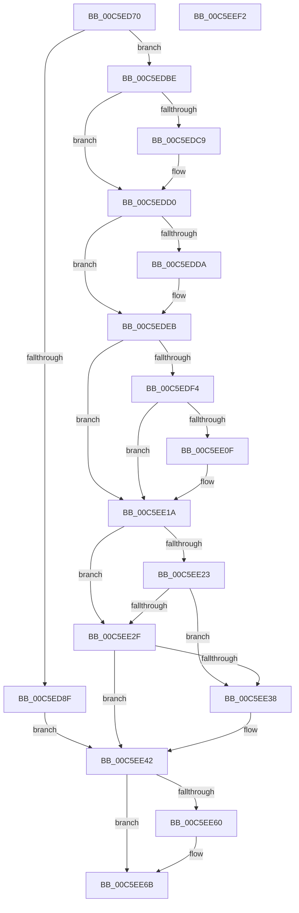

# MiInitializeBootDefaults

- RVA: `0x00C5ED70`–`0x00C5EEF3` (길이 `387` bytes)
- VA: `0x0000000140C5ED70`
- 실행 섹션: `INIT`
- PDB 이름 있음: `예`; PDB Function 태그: `아니요`
- unwind 정보 RVA: `0x0005C788`
- 디코드: `71`개 명령, `387/387` bytes 표시
- 미해석 바이트: `0` (있으면 어셈블리에 `.byte`로 보존)

> 이 문서는 커널 이미지의 기계어와 PDB 기호를 분석해 생성했습니다. 4번과 5번은 함수 원형과 자료형을 바이너리 사용 방식에서 추정한 C 해석이며 원본 소스 복구 결과는 아닙니다.

## 1. Dependencies

- 직접 호출 지점: **2**; 고유 호출 대상: **2**
- 직접 호출자로 확인된 함수: **1**
- RIP 상대 이미지 참조: **28**

### Outgoing calls
- `0x00C5ED82` → [strstr](../../text/4F/strstr_function_004FF680.md) (function, `0x004FF680`)
- `0x00C5EECE` → [ExGenRandom](../../text/41/ExGenRandom_function_0041B010.md) (function, `0x0041B010`)

### Direct callers
- [MiInitNucleus](MiInitNucleus_function_00C5FD38.md) at `0x00C5FE20`

### Static image references
- `0x00C5ED7B` → RVA `0x00C79180` (` ?? ::PBOPGDP::`string'`; read)
- `0x00C5ED8F` → RVA `0x00FC5008` (`ALMOSTRO`; read)
- `0x00C5ED96` → RVA `0x00FC6C28` (`ALMOSTRO`; write)
- `0x00C5ED9D` → RVA `0x00FC6C14` (`ALMOSTRO`; write)
- `0x00C5EDA4` → RVA `0x00E37615` (`.data`; write)
- `0x00C5EDAB` → RVA `0x00FC51FC` (`ALMOSTRO`; write)
- `0x00C5EDBE` → RVA `0x00FC5054` (`ALMOSTRO`; read)
- `0x00C5EDD0` → RVA `0x00FC5054` (`ALMOSTRO`; write)
- `0x00C5EDDC` → RVA `0x00FC6A88` (`ALMOSTRO`; read/write)
- `0x00C5EDEB` → RVA `0x00F04A20` (`.data`; read)
- `0x00C5EDF4` → RVA `0x00FC6A88` (`ALMOSTRO`; read)
- `0x00C5EDFF` → RVA `0x00F04ABC` (`.data`; read)
- `0x00C5EE06` → RVA `0x00FC6A88` (`ALMOSTRO`; write)
- `0x00C5EE23` → RVA `0x00E681A0` (`.data`; read)
- `0x00C5EE2F` → RVA `0x00FC6C28` (`ALMOSTRO`; read)
- `0x00C5EE4D` → RVA `0x00FC42C0` (`.data`; read)
- `0x00C5EE6B` → RVA `0x00E2D988` (`.data`; read)
- `0x00C5EE72` → RVA `0x00E2D978` (`.data`; write)
- `0x00C5EE79` → RVA `0x00E2D990` (`.data`; write)
- `0x00C5EE85` → RVA `0x00E2D988` (`.data`; write)
- `0x00C5EE8C` → RVA `0x00FC5214` (`ALMOSTRO`; read)
- `0x00C5EE9A` → RVA `0x00E2DB58` (`.data`; read)
- `0x00C5EEA1` → RVA `0x00E2CD10` (`.data`; write)
- `0x00C5EEA8` → RVA `0x00E2DB60` (`.data`; write)
- `0x00C5EEAF` → RVA `0x00E2DB58` (`.data`; write)
- `0x00C5EEC0` → RVA `0x00E2DB50` (`.data`; write)
- `0x00C5EEC7` → RVA `0x00E2D530` (`.data`; write)
- `0x00C5EEE6` → RVA `0x00E2D530` (`.data`; read/write)

## 2. Other-region calls and transfers

- 다른 실행 섹션으로 향하는 call: **2**
  - `0x00C5ED82` → [strstr](../../text/4F/strstr_function_004FF680.md) (`INIT` → `.text`)
  - `0x00C5EECE` → [ExGenRandom](../../text/41/ExGenRandom_function_0041B010.md) (`INIT` → `.text`)
- 별도 외부 분기/꼬리 이동을 확인하지 못했습니다.

## 3. Assembly (complete function range)

```asm
00C5ED70  48 83 EC 28                     sub rsp, 0x28
00C5ED74  48 8B 89 D8 00 00 00            mov rcx, qword ptr [rcx + 0xd8]
00C5ED7B  48 8D 15 FE A3 01 00            lea rdx, [rip + 0x1a3fe]
00C5ED82  E8 F9 08 8A FF                  call 0x1404ff680
00C5ED87  45 33 C0                        xor r8d, r8d
00C5ED8A  48 85 C0                        test rax, rax
00C5ED8D  74 2F                           je 0x140c5edbe
00C5ED8F  48 8B 05 72 62 36 00            mov rax, qword ptr [rip + 0x366272]
00C5ED96  44 89 05 8B 7E 36 00            mov dword ptr [rip + 0x367e8b], r8d
00C5ED9D  44 89 05 70 7E 36 00            mov dword ptr [rip + 0x367e70], r8d
00C5EDA4  C6 05 6A 88 1D 00 01            mov byte ptr [rip + 0x1d886a], 1
00C5EDAB  44 89 05 4A 64 36 00            mov dword ptr [rip + 0x36644a], r8d
00C5EDB2  C6 80 EC 02 00 00 01            mov byte ptr [rax + 0x2ec], 1
00C5EDB9  E9 84 00 00 00                  jmp 0x140c5ee42
00C5EDBE  8B 05 90 62 36 00               mov eax, dword ptr [rip + 0x366290]
00C5EDC4  0F BD C8                        bsr ecx, eax
00C5EDC7  74 07                           je 0x140c5edd0
00C5EDC9  B8 01 00 00 00                  mov eax, 1
00C5EDCE  D3 E0                           shl eax, cl
00C5EDD0  89 05 7E 62 36 00               mov dword ptr [rip + 0x36627e], eax
00C5EDD6  85 C0                           test eax, eax
00C5EDD8  74 11                           je 0x140c5edeb
00C5EDDA  FF C8                           dec eax
00C5EDDC  48 0F BA 2D A3 7C 36 00 07      bts qword ptr [rip + 0x367ca3], 7
00C5EDE5  89 05 69 62 36 00               mov dword ptr [rip + 0x366269], eax
00C5EDEB  44 39 05 2E 5C 2A 00            cmp dword ptr [rip + 0x2a5c2e], r8d
00C5EDF2  74 26                           je 0x140c5ee1a
00C5EDF4  48 8B 05 8D 7C 36 00            mov rax, qword ptr [rip + 0x367c8d]
00C5EDFB  48 83 C8 01                     or rax, 1
00C5EDFF  44 39 05 B6 5C 2A 00            cmp dword ptr [rip + 0x2a5cb6], r8d
00C5EE06  48 89 05 7B 7C 36 00            mov qword ptr [rip + 0x367c7b], rax
00C5EE0D  74 0B                           je 0x140c5ee1a
00C5EE0F  48 83 C8 02                     or rax, 2
00C5EE13  48 89 05 6E 7C 36 00            mov qword ptr [rip + 0x367c6e], rax
00C5EE1A  F6 05 67 7C 36 00 01            test byte ptr [rip + 0x367c67], 1
00C5EE21  74 0C                           je 0x140c5ee2f
00C5EE23  F7 05 73 93 20 00 00 00 40 00   test dword ptr [rip + 0x209373], 0x400000
00C5EE2D  74 09                           je 0x140c5ee38
00C5EE2F  44 39 05 F2 7D 36 00            cmp dword ptr [rip + 0x367df2], r8d
00C5EE36  74 0A                           je 0x140c5ee42
00C5EE38  C7 05 D2 7D 36 00 01 00 00 00   mov dword ptr [rip + 0x367dd2], 1
00C5EE42  48 8B 0D 3F 7C 36 00            mov rcx, qword ptr [rip + 0x367c3f]
00C5EE49  48 83 C9 08                     or rcx, 8
00C5EE4D  F7 05 69 54 36 00 00 00 08 00   test dword ptr [rip + 0x365469], 0x80000
00C5EE57  48 89 0D 2A 7C 36 00            mov qword ptr [rip + 0x367c2a], rcx
00C5EE5E  75 0B                           jne 0x140c5ee6b
00C5EE60  48 83 C9 40                     or rcx, 0x40
00C5EE64  48 89 0D 1D 7C 36 00            mov qword ptr [rip + 0x367c1d], rcx
00C5EE6B  48 8D 05 16 EB 1C 00            lea rax, [rip + 0x1ceb16]
00C5EE72  4C 89 05 FF EA 1C 00            mov qword ptr [rip + 0x1ceaff], r8
00C5EE79  48 89 05 10 EB 1C 00            mov qword ptr [rip + 0x1ceb10], rax
00C5EE80  B9 01 00 00 00                  mov ecx, 1
00C5EE85  48 89 05 FC EA 1C 00            mov qword ptr [rip + 0x1ceafc], rax
00C5EE8C  48 63 05 81 63 36 00            movsxd rax, dword ptr [rip + 0x366381]
00C5EE93  48 69 D0 80 69 67 FF            imul rdx, rax, -0x989680
00C5EE9A  48 8D 05 B7 EC 1C 00            lea rax, [rip + 0x1cecb7]
00C5EEA1  4C 89 05 68 DE 1C 00            mov qword ptr [rip + 0x1cde68], r8
00C5EEA8  48 89 05 B1 EC 1C 00            mov qword ptr [rip + 0x1cecb1], rax
00C5EEAF  48 89 05 A2 EC 1C 00            mov qword ptr [rip + 0x1ceca2], rax
00C5EEB6  48 B8 FF FF FF FF F5 7F 00 00   movabs rax, 0x7ff5ffffffff
00C5EEC0  48 89 15 89 EC 1C 00            mov qword ptr [rip + 0x1cec89], rdx
00C5EEC7  48 89 05 62 E6 1C 00            mov qword ptr [rip + 0x1ce662], rax
00C5EECE  E8 3D C1 7B FF                  call 0x14041b010
00C5EED3  0F B6 C0                        movzx eax, al
00C5EED6  48 B9 00 00 80 FF FD FF FF FF   movabs rcx, 0xfffffffdff800000
00C5EEE0  C1 E0 10                        shl eax, 0x10
00C5EEE3  48 2B C8                        sub rcx, rax
00C5EEE6  48 01 0D 43 E6 1C 00            add qword ptr [rip + 0x1ce643], rcx
00C5EEED  48 83 C4 28                     add rsp, 0x28
00C5EEF1  C3                              ret
00C5EEF2  CC                              int3
```

## 4. C-style interpretation (structured pseudocode)

```c
__int64 __fastcall MiInitializeBootDefaults(__int64 a1, __int64 a2, int a3)
{
    __int64 result;
    __int64 v_rsp;

    v_rsp = (v_rsp) - (40);
    result = strstr(*(unsigned __int64 *)(a1 + 216), v_rip + 107518, a3, a4);
    a3 = 0;
    if (result == 0) goto loc_00C5EDBE;
    *(unsigned int *)(v_rip + 3571339) = 0;
    *(unsigned int *)(v_rip + 3571312) = 0;
    *(unsigned __int8 *)(v_rip + 1935466) = 1;
    *(unsigned int *)(v_rip + 3564618) = 0;
    *(unsigned __int8 *)(*(unsigned __int64 *)(v_rip + 3564146) + 748) = 1;
    goto loc_00C5EE42;
loc_00C5EDBE:
    result = (unsigned int)(*(unsigned int *)(v_rip + 3564176));
    if (result != 0) {
        result = 1;
        result = (unsigned int)((result) << ((unsigned __int8)(*(unsigned __int64 *)(a1 + 216))));
    }
    *(unsigned int *)(v_rip + 3564158) = (unsigned int)(result);
    if ((unsigned int)(result) != 0) {
        result = (unsigned int)((result) - 1);
        *(unsigned int *)(v_rip + 3564137) = (unsigned int)(result);
    }
    if ((*(unsigned int *)(v_rip + 2776110)) == 0) goto loc_00C5EE1A;
    result = (*(unsigned __int64 *)(v_rip + 3570829)) | (1);
    *(unsigned __int64 *)(v_rip + 3570811) = result;
    if ((*(unsigned int *)(v_rip + 2776246)) != 0) {
        result = (result) | (2);
        *(unsigned __int64 *)(v_rip + 3570798) = result;
    }
    if (((*(unsigned __int8 *)(v_rip + 3570791)) & (1)) == 0) goto loc_00C5EE2F;
    if (((*(unsigned int *)(v_rip + 2134899)) & (0x400000ULL)) == 0) goto loc_00C5EE38;
loc_00C5EE2F:
    if ((*(unsigned int *)(v_rip + 3571186)) != 0) {
        *(unsigned int *)(v_rip + 3571154) = 1;
    }
    a1 = (*(unsigned __int64 *)(v_rip + 3570751)) | (8);
    *(unsigned __int64 *)(v_rip + 3570730) = a1;
    if (((*(unsigned int *)(v_rip + 3560553)) & (0x80000ULL)) == 0) {
        a1 = (a1) | (64);
        *(unsigned __int64 *)(v_rip + 3570717) = a1;
    }
    *(unsigned __int64 *)(v_rip + 1895167) = 0;
    *(unsigned __int64 *)(v_rip + 1895184) = v_rip + 1895190;
    *(unsigned __int64 *)(v_rip + 1895164) = v_rip + 1895190;
    a2 = (v_rip + 107518) * ((int)(*(unsigned int *)(v_rip + 3564417)));
    *(unsigned __int64 *)(v_rip + 1891944) = 0;
    *(unsigned __int64 *)(v_rip + 1895601) = v_rip + 1895607;
    *(unsigned __int64 *)(v_rip + 1895586) = v_rip + 1895607;
    *(unsigned __int64 *)(v_rip + 1895561) = a2;
    *(unsigned __int64 *)(v_rip + 1893986) = v_rip + 1895607;
    result = ExGenRandom(1, a2, a3, a4);
    result = (unsigned int)(((unsigned __int8)(result)) << (16));
    a1 = (1) - (result);
    v_rsp = (v_rsp) + (40);
    return result;
}
```

## 5. (Beta) C Style

```c
int64_t MiInitializeBootDefaults(void *Arg1, int64_t Arg2, int32_t Arg3)
{
    uint8_t *arg1 = (uint8_t *)Arg1;

    int64_t result;
    int64_t local_rsp;

    local_rsp = (local_rsp) - (40);
    result = strstr(*(uint64_t *)(arg1 + 0xD8), v_rip + 107518, Arg3, a4);
    Arg3 = 0;
    if (result == 0) goto loc_00C5EDBE;
    *(uint32_t *)(v_rip + 0x367E8B) = 0;
    *(uint32_t *)(v_rip + 0x367E70) = 0;
    *(uint8_t *)(v_rip + 0x1D886A) = 1;
    *(uint32_t *)(v_rip + 0x36644A) = 0;
    *(uint8_t *)(*(uint64_t *)(v_rip + 0x366272) + 0x2EC) = 1;
    goto loc_00C5EE42;
loc_00C5EDBE:
    result = (uint32_t)(*(uint32_t *)(v_rip + 0x366290));
    if (result != 0) {
        result = 1;
        result = (uint32_t)((result) << ((uint8_t)(*(uint64_t *)(arg1 + 0xD8))));
    }
    *(uint32_t *)(v_rip + 0x36627E) = (uint32_t)(result);
    if ((uint32_t)(result) != 0) {
        result = (uint32_t)((result) - 1);
        *(uint32_t *)(v_rip + 0x366269) = (uint32_t)(result);
    }
    if ((*(uint32_t *)(v_rip + 0x2A5C2E)) == 0) goto loc_00C5EE1A;
    result = (*(uint64_t *)(v_rip + 0x367C8D)) | (1);
    *(uint64_t *)(v_rip + 0x367C7B) = result;
    if ((*(uint32_t *)(v_rip + 0x2A5CB6)) != 0) {
        result = (result) | (2);
        *(uint64_t *)(v_rip + 0x367C6E) = result;
    }
    if (((*(uint8_t *)(v_rip + 0x367C67)) & (1)) == 0) goto loc_00C5EE2F;
    if (((*(uint32_t *)(v_rip + 0x209373)) & (0x400000ULL)) == 0) goto loc_00C5EE38;
loc_00C5EE2F:
    if ((*(uint32_t *)(v_rip + 0x367DF2)) != 0) {
        *(uint32_t *)(v_rip + 0x367DD2) = 1;
    }
    Arg1 = (*(uint64_t *)(v_rip + 0x367C3F)) | (8);
    *(void **)(v_rip + 0x367C2A) = Arg1;
    if (((*(uint32_t *)(v_rip + 0x365469)) & (0x80000ULL)) == 0) {
        Arg1 = (Arg1) | (64);
        *(void **)(v_rip + 0x367C1D) = Arg1;
    }
    *(uint64_t *)(v_rip + 0x1CEAFF) = 0;
    *(uint64_t *)(v_rip + 0x1CEB10) = v_rip + 1895190;
    *(uint64_t *)(v_rip + 0x1CEAFC) = v_rip + 1895190;
    Arg2 = (v_rip + 107518) * ((int32_t)(*(uint32_t *)(v_rip + 0x366381)));
    *(uint64_t *)(v_rip + 0x1CDE68) = 0;
    *(uint64_t *)(v_rip + 0x1CECB1) = v_rip + 1895607;
    *(uint64_t *)(v_rip + 0x1CECA2) = v_rip + 1895607;
    *(uint64_t *)(v_rip + 0x1CEC89) = Arg2;
    *(uint64_t *)(v_rip + 0x1CE662) = v_rip + 1895607;
    result = ExGenRandom(1, Arg2, Arg3, a4);
    result = (uint32_t)(((uint8_t)(result)) << (16));
    Arg1 = (1) - (result);
    local_rsp = (local_rsp) + (40);
    return result;
}
```

### 관측된 메모리 오프셋

구조체 형식이 확인되지 않은 접근은 인자 기준의 오프셋으로만 기록했습니다.

| 기준 인자 | 오프셋 표현 | 폭 (bit) | 접근 |
|---|---:|---:|---|
| `Arg1` | `+ 0xD8` | `64` | `R` |

## 6. Execution-region graph

[열기: 2D/3D 그래프와 함수 탐색 컨트롤 패널](../../../control-panel.html?section=init&rva=0x00C5ED70&view=graph)

- 2D 그래프는 위에서 아래로 흐르고, 3D 그래프는 빈 공간을 드래그해 회전합니다. Shift+드래그는 이동, 휠은 확대·축소, 함수 노드 선택은 대상 보고서 이동입니다.

### Static fallback


