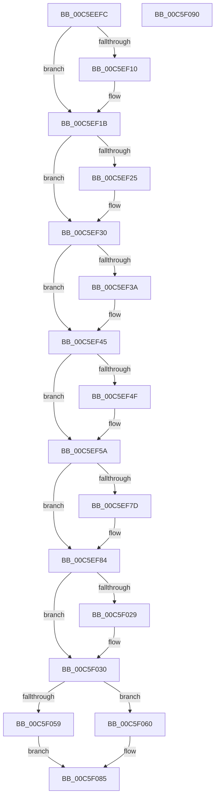

# MiInitializeBootProcess

- RVA: `0x00C5EEFC`–`0x00C5F091` (길이 `405` bytes)
- VA: `0x0000000140C5EEFC`
- 실행 섹션: `INIT`
- PDB 이름 있음: `예`; PDB Function 태그: `아니요`
- unwind 정보 RVA: `0x0008A658`
- 디코드: `76`개 명령, `405/405` bytes 표시
- 미해석 바이트: `0` (있으면 어셈블리에 `.byte`로 보존)

> 이 문서는 커널 이미지의 기계어와 PDB 기호를 분석해 생성했습니다. 4번과 5번은 함수 원형과 자료형을 바이너리 사용 방식에서 추정한 C 해석이며 원본 소스 복구 결과는 아닙니다.

## 1. Dependencies

- 직접 호출 지점: **5**; 고유 호출 대상: **5**
- 직접 호출자로 확인된 함수: **1**
- RIP 상대 이미지 참조: **13**

### Outgoing calls
- `0x00C5EFE1` → [MiSetPageTablePfnBuddy](../../text/4A/MiSetPageTablePfnBuddy_function_004A3394.md) (function, `0x004A3394`)
- `0x00C5F00A` → [ExAcquireSpinLockExclusive](../../text/24/ExAcquireSpinLockExclusive_function_00248690.md) (function, `0x00248690`)
- `0x00C5F04A` → [MiReleaseSpinLockExclusive](../../text/24/MiReleaseSpinLockExclusive_function_002482C0.md) (function, `0x002482C0`)
- `0x00C5F04F` → [MiAllocateProcessExtension](../../page/70/MiAllocateProcessExtension_function_007059A8.md) (function, `0x007059A8`)
- `0x00C5F080` → [MmInitializeProcessAddressSpace](../../page/8C/MmInitializeProcessAddressSpace_function_008CF6B0.md) (function, `0x008CF6B0`)

### Direct callers
- [MiInitSystem](MiInitSystem_function_00C5E6C0.md) at `0x00C5E7F0`

### Static image references
- `0x00C5EF06` → RVA `0x00FC5238` (`ALMOSTRO`; read)
- `0x00C5EF10` → RVA `0x00FC5238` (`ALMOSTRO`; write)
- `0x00C5EF1B` → RVA `0x00FC5230` (`ALMOSTRO`; read)
- `0x00C5EF25` → RVA `0x00FC5230` (`ALMOSTRO`; write)
- `0x00C5EF30` → RVA `0x00FC5228` (`ALMOSTRO`; read)
- `0x00C5EF3A` → RVA `0x00FC5228` (`ALMOSTRO`; write)
- `0x00C5EF45` → RVA `0x00FC5220` (`ALMOSTRO`; read)
- `0x00C5EF4F` → RVA `0x00FC5220` (`ALMOSTRO`; write)
- `0x00C5EF63` → RVA `0x00E38840` (`.data`; read)
- `0x00C5F003` → RVA `0x00E374C0` (`.data`; read)
- `0x00C5F00F` → RVA `0x00E2DB60` (`.data`; read)
- `0x00C5F016` → RVA `0x00E2DB58` (`.data`; read)
- `0x00C5F03C` → RVA `0x00E2DB60` (`.data`; write)

## 2. Other-region calls and transfers

- 다른 실행 섹션으로 향하는 call: **5**
  - `0x00C5EFE1` → [MiSetPageTablePfnBuddy](../../text/4A/MiSetPageTablePfnBuddy_function_004A3394.md) (`INIT` → `.text`)
  - `0x00C5F00A` → [ExAcquireSpinLockExclusive](../../text/24/ExAcquireSpinLockExclusive_function_00248690.md) (`INIT` → `.text`)
  - `0x00C5F04A` → [MiReleaseSpinLockExclusive](../../text/24/MiReleaseSpinLockExclusive_function_002482C0.md) (`INIT` → `.text`)
  - `0x00C5F04F` → [MiAllocateProcessExtension](../../page/70/MiAllocateProcessExtension_function_007059A8.md) (`INIT` → `PAGE`)
  - `0x00C5F080` → [MmInitializeProcessAddressSpace](../../page/8C/MmInitializeProcessAddressSpace_function_008CF6B0.md) (`INIT` → `PAGE`)
- 별도 외부 분기/꼬리 이동을 확인하지 못했습니다.

## 3. Assembly (complete function range)

```asm
00C5EEFC  48 89 5C 24 10                  mov qword ptr [rsp + 0x10], rbx
00C5EF01  57                              push rdi
00C5EF02  48 83 EC 30                     sub rsp, 0x30
00C5EF06  48 83 3D 2A 63 36 00 00         cmp qword ptr [rip + 0x36632a], 0
00C5EF0E  75 0B                           jne 0x140c5ef1b
00C5EF10  48 C7 05 1D 63 36 00 00 00 10 00  mov qword ptr [rip + 0x36631d], 0x100000
00C5EF1B  48 83 3D 0D 63 36 00 00         cmp qword ptr [rip + 0x36630d], 0
00C5EF23  75 0B                           jne 0x140c5ef30
00C5EF25  48 C7 05 00 63 36 00 00 20 00 00  mov qword ptr [rip + 0x366300], 0x2000
00C5EF30  48 83 3D F0 62 36 00 00         cmp qword ptr [rip + 0x3662f0], 0
00C5EF38  75 0B                           jne 0x140c5ef45
00C5EF3A  48 C7 05 E3 62 36 00 00 00 01 00  mov qword ptr [rip + 0x3662e3], 0x10000
00C5EF45  48 83 3D D3 62 36 00 00         cmp qword ptr [rip + 0x3662d3], 0
00C5EF4D  75 0B                           jne 0x140c5ef5a
00C5EF4F  48 C7 05 C6 62 36 00 00 10 00 00  mov qword ptr [rip + 0x3662c6], 0x1000
00C5EF5A  65 48 8B 04 25 88 01 00 00      mov rax, qword ptr gs:[0x188]
00C5EF63  48 8D 3D D6 98 1D 00            lea rdi, [rip + 0x1d98d6]
00C5EF6A  48 8B 98 B8 00 00 00            mov rbx, qword ptr [rax + 0xb8]
00C5EF71  8B 83 B8 04 00 00               mov eax, dword ptr [rbx + 0x4b8]
00C5EF77  24 0F                           and al, 0xf
00C5EF79  3C 01                           cmp al, 1
00C5EF7B  74 07                           je 0x140c5ef84
00C5EF7D  48 8D BB C0 04 00 00            lea rdi, [rbx + 0x4c0]
00C5EF84  48 C7 83 70 04 00 00 32 00 00 00  mov qword ptr [rbx + 0x470], 0x32
00C5EF8F  48 C7 83 78 04 00 00 C2 01 00 00  mov qword ptr [rbx + 0x478], 0x1c2
00C5EF9A  48 B8 68 DF BE 7D FB F6 FF FF   movabs rax, 0xfffff6fb7dbedf68
00C5EFA4  48 8B 00                        mov rax, qword ptr [rax]
00C5EFA7  48 B9 FF FF FF FF FF 00 00 00   movabs rcx, 0xffffffffff
00C5EFB1  48 C1 E8 0C                     shr rax, 0xc
00C5EFB5  48 23 C1                        and rax, rcx
00C5EFB8  48 8D 0C 40                     lea rcx, [rax + rax*2]
00C5EFBC  48 C1 E1 04                     shl rcx, 4
00C5EFC0  48 B8 00 00 00 00 00 DE FF FF   movabs rax, 0xffffde0000000000
00C5EFCA  48 03 C8                        add rcx, rax
00C5EFCD  45 33 C0                        xor r8d, r8d
00C5EFD0  48 BA 01 00 00 00 00 01 00 00   movabs rdx, 0x10000000001
00C5EFDA  48 C7 01 00 00 00 00            mov qword ptr [rcx], 0
00C5EFE1  E8 AE 43 84 FF                  call 0x1404a3394
00C5EFE6  C6 83 EE 06 00 00 FF            mov byte ptr [rbx + 0x6ee], 0xff
00C5EFED  F0 81 8B F4 01 00 00 00 00 04 00  lock or dword ptr [rbx + 0x1f4], 0x40000
00C5EFF8  F0 81 8B F4 01 00 00 00 08 00 00  lock or dword ptr [rbx + 0x1f4], 0x800
00C5F003  48 8D 0D B6 84 1D 00            lea rcx, [rip + 0x1d84b6]
00C5F00A  E8 81 96 5E FF                  call 0x140248690
00C5F00F  48 8B 15 4A EB 1C 00            mov rdx, qword ptr [rip + 0x1ceb4a]
00C5F016  4C 8D 05 3B EB 1C 00            lea r8, [rip + 0x1ceb3b]
00C5F01D  48 8D 8B 40 05 00 00            lea rcx, [rbx + 0x540]
00C5F024  4C 39 02                        cmp qword ptr [rdx], r8
00C5F027  74 07                           je 0x140c5f030
00C5F029  B9 03 00 00 00                  mov ecx, 3
00C5F02E  CD 29                           int 0x29
00C5F030  48 89 51 08                     mov qword ptr [rcx + 8], rdx
00C5F034  4C 89 01                        mov qword ptr [rcx], r8
00C5F037  48 89 0A                        mov qword ptr [rdx], rcx
00C5F03A  8A D0                           mov dl, al
00C5F03C  48 89 0D 1D EB 1C 00            mov qword ptr [rip + 0x1ceb1d], rcx
00C5F043  48 8D 0D 76 84 1D 00            lea rcx, [rip + 0x1d8476]
00C5F04A  E8 71 92 5E FF                  call 0x1402482c0
00C5F04F  E8 54 69 AA FF                  call 0x1407059a8
00C5F054  48 85 C0                        test rax, rax
00C5F057  75 07                           jne 0x140c5f060
00C5F059  B8 9A 00 00 C0                  mov eax, 0xc000009a
00C5F05E  EB 25                           jmp 0x140c5f085
00C5F060  83 64 24 40 00                  and dword ptr [rsp + 0x40], 0
00C5F065  4C 8D 4C 24 40                  lea r9, [rsp + 0x40]
00C5F06A  83 64 24 20 00                  and dword ptr [rsp + 0x20], 0
00C5F06F  48 05 00 01 00 00               add rax, 0x100
00C5F075  45 33 C0                        xor r8d, r8d
00C5F078  48 89 07                        mov qword ptr [rdi], rax
00C5F07B  33 D2                           xor edx, edx
00C5F07D  48 8B CB                        mov rcx, rbx
00C5F080  E8 2B 06 C7 FF                  call 0x1408cf6b0
00C5F085  48 8B 5C 24 48                  mov rbx, qword ptr [rsp + 0x48]
00C5F08A  48 83 C4 30                     add rsp, 0x30
00C5F08E  5F                              pop rdi
00C5F08F  C3                              ret
00C5F090  CC                              int3
```

## 4. C-style interpretation (structured pseudocode)

```c
__int64 __fastcall MiInitializeBootProcess(__int64 a1, __int64 a2, int a3)
{
    __int64 result;
    __int64 v_rdi;
    __int64 v_rsp;
    unsigned int v_stack_m18;
    unsigned __int64 v_stack_p10;
    unsigned int v_stack_p8;

    v_stack_p10 = v_rbx;
    v_rsp = (v_rsp) - (48);
    if ((*(unsigned __int64 *)(v_rip + 3564330)) == 0) {
        *(unsigned __int64 *)(v_rip + 3564317) = 0x100000ULL;
    }
    if ((*(unsigned __int64 *)(v_rip + 3564301)) == 0) {
        *(unsigned __int64 *)(v_rip + 3564288) = 0x2000ULL;
    }
    if ((*(unsigned __int64 *)(v_rip + 3564272)) == 0) {
        *(unsigned __int64 *)(v_rip + 3564259) = 0x10000ULL;
    }
    if ((*(unsigned __int64 *)(v_rip + 3564243)) == 0) {
        *(unsigned __int64 *)(v_rip + 3564230) = 0x1000ULL;
    }
    result = (unsigned __int8)(((unsigned int)(*(unsigned int *)(*(unsigned __int64 *)(*(unsigned __int64 *)(gs_base + (0 + 392)) + 184) + 1208))) & (15));
    v_rdi = v_rip + 1939670;
    if (((unsigned __int8)(result)) != 1) {
        v_rdi = *(unsigned __int64 *)(*(unsigned __int64 *)(gs_base + (0 + 392)) + 184) + 1216;
    }
    *(unsigned __int64 *)(*(unsigned __int64 *)(*(unsigned __int64 *)(gs_base + (0 + 392)) + 184) + 1136) = 50;
    *(unsigned __int64 *)(*(unsigned __int64 *)(*(unsigned __int64 *)(gs_base + (0 + 392)) + 184) + 1144) = 450;
    result = (*(unsigned __int64 *)(result)) >> (12);
    result = (result) & (a1);
    a1 = (result + result * 2) << (4);
    a1 = (a1) + (result);
    a3 = 0;
    *(unsigned __int64 *)(a1) = 0;
    result = MiSetPageTablePfnBuddy(a1, a2, a3, a4);
    *(unsigned __int8 *)(*(unsigned __int64 *)(*(unsigned __int64 *)(gs_base + (0 + 392)) + 184) + 1774) = 255;
    result = ExAcquireSpinLockExclusive(v_rip + 1934518, a2, a3, a4);
    if ((*(unsigned __int64 *)(*(unsigned __int64 *)(v_rip + 1895242))) != (v_rip + 1895227)) {
        a1 = 3;
    }
    *(unsigned __int64 *)(a1 + 8) = *(unsigned __int64 *)(v_rip + 1895242);
    *(unsigned __int64 *)(a1) = v_rip + 1895227;
    *(unsigned __int64 *)(*(unsigned __int64 *)(v_rip + 1895242)) = a1;
    *(unsigned __int64 *)(v_rip + 1895197) = a1;
    result = MiReleaseSpinLockExclusive(v_rip + 1934454, (unsigned __int8)(result), v_rip + 1895227, a4);
    result = MiAllocateProcessExtension(v_rip + 1934454, (unsigned __int8)(result), v_rip + 1895227, a4);
    if (result != 0) goto loc_00C5F060;
    goto loc_00C5F085;
loc_00C5F060:
    result = ((unsigned int)(0xC000009AULL)) + (256);
    a3 = 0;
    *(unsigned __int64 *)(v_rdi) = result;
    a2 = 0;
    result = MmInitializeProcessAddressSpace(*(unsigned __int64 *)(*(unsigned __int64 *)(gs_base + (0 + 392)) + 184), a2, a3, v_stack_p8);
loc_00C5F085:
    v_rsp = (v_rsp) + (48);
    return result;
}
```

## 5. (Beta) C Style

```c
int64_t MiInitializeBootProcess(int64_t Arg1, int64_t Arg2, int32_t Arg3)
{
    int64_t result;
    int64_t local_rdi;
    int64_t local_rsp;
    uint32_t v_stack_m18;
    uint64_t v_stack_p10;
    uint32_t v_stack_p8;

    v_stack_p10 = local_rbx;
    local_rsp = (local_rsp) - (48);
    if ((*(uint64_t *)(v_rip + 0x36632A)) == 0) {
        *(uint64_t *)(v_rip + 0x36631D) = 0x100000ULL;
    }
    if ((*(uint64_t *)(v_rip + 0x36630D)) == 0) {
        *(uint64_t *)(v_rip + 0x366300) = 0x2000ULL;
    }
    if ((*(uint64_t *)(v_rip + 0x3662F0)) == 0) {
        *(uint64_t *)(v_rip + 0x3662E3) = 0x10000ULL;
    }
    if ((*(uint64_t *)(v_rip + 0x3662D3)) == 0) {
        *(uint64_t *)(v_rip + 0x3662C6) = 0x1000ULL;
    }
    result = (uint8_t)(((uint32_t)(*(uint32_t *)(*(uint64_t *)(*(uint64_t *)(gs_base + (0 + 0x188)) + 0xB8) + 0x4B8))) & (15));
    local_rdi = v_rip + 1939670;
    if (((uint8_t)(result)) != 1) {
        local_rdi = *(uint64_t *)(*(uint64_t *)(gs_base + (0 + 0x188)) + 0xB8) + 1216;
    }
    *(uint64_t *)(*(uint64_t *)(*(uint64_t *)(gs_base + (0 + 0x188)) + 0xB8) + 0x470) = 50;
    *(uint64_t *)(*(uint64_t *)(*(uint64_t *)(gs_base + (0 + 0x188)) + 0xB8) + 0x478) = 450;
    result = (*(uint64_t *)(result)) >> (12);
    result = (result) & (Arg1);
    Arg1 = (result + result * 2) << (4);
    Arg1 = (Arg1) + (result);
    Arg3 = 0;
    *(uint64_t *)(Arg1) = 0;
    result = MiSetPageTablePfnBuddy(Arg1, Arg2, Arg3, a4);
    *(uint8_t *)(*(uint64_t *)(*(uint64_t *)(gs_base + (0 + 0x188)) + 0xB8) + 0x6EE) = 255;
    result = ExAcquireSpinLockExclusive(v_rip + 1934518, Arg2, Arg3, a4);
    if ((*(uint64_t *)(*(uint64_t *)(v_rip + 0x1CEB4A))) != (v_rip + 1895227)) {
        Arg1 = 3;
    }
    *(uint64_t *)(Arg1 + 0x8) = *(uint64_t *)(v_rip + 0x1CEB4A);
    *(uint64_t *)(Arg1) = v_rip + 1895227;
    *(uint64_t *)(*(uint64_t *)(v_rip + 0x1CEB4A)) = Arg1;
    *(uint64_t *)(v_rip + 0x1CEB1D) = Arg1;
    result = MiReleaseSpinLockExclusive(v_rip + 1934454, (uint8_t)(result), v_rip + 1895227, a4);
    result = MiAllocateProcessExtension(v_rip + 1934454, (uint8_t)(result), v_rip + 1895227, a4);
    if (result != 0) goto loc_00C5F060;
    goto loc_00C5F085;
loc_00C5F060:
    result = ((uint32_t)(0xC000009AULL)) + (256);
    Arg3 = 0;
    *(uint64_t *)(local_rdi) = result;
    Arg2 = 0;
    result = MmInitializeProcessAddressSpace(*(uint64_t *)(*(uint64_t *)(gs_base + (0 + 0x188)) + 0xB8), Arg2, Arg3, v_stack_p8);
loc_00C5F085:
    local_rsp = (local_rsp) + (48);
    return result;
}
```

## 6. Execution-region graph

[열기: 2D/3D 그래프와 함수 탐색 컨트롤 패널](../../../control-panel.html?section=init&rva=0x00C5EEFC&view=graph)

- 2D 그래프는 위에서 아래로 흐르고, 3D 그래프는 빈 공간을 드래그해 회전합니다. Shift+드래그는 이동, 휠은 확대·축소, 함수 노드 선택은 대상 보고서 이동입니다.

### Static fallback


