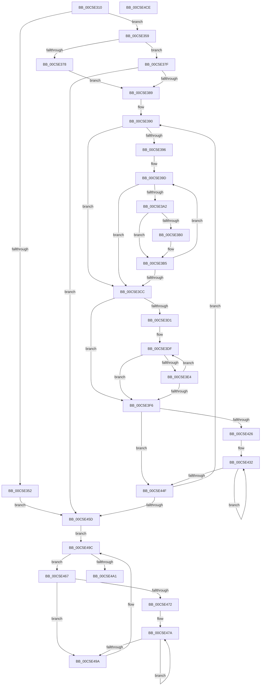

# MiInitializeNumaGraph

- RVA: `0x00C5E310`–`0x00C5E4CF` (길이 `447` bytes)
- VA: `0x0000000140C5E310`
- 실행 섹션: `INIT`
- PDB 이름 있음: `예`; PDB Function 태그: `아니요`
- unwind 정보 RVA: `0x000D7618`
- 디코드: `126`개 명령, `447/447` bytes 표시
- 미해석 바이트: `0` (있으면 어셈블리에 `.byte`로 보존)

> 이 문서는 커널 이미지의 기계어와 PDB 기호를 분석해 생성했습니다. 4번과 5번은 함수 원형과 자료형을 바이너리 사용 방식에서 추정한 C 해석이며 원본 소스 복구 결과는 아닙니다.

## 1. Dependencies

- 직접 호출 지점: **2**; 고유 호출 대상: **2**
- 직접 호출자로 확인된 함수: **1**
- RIP 상대 이미지 참조: **4**

### Outgoing calls
- `0x00C5E412` → [qsort](../../text/50/qsort_function_005009F0.md) (function, `0x005009F0`)
- `0x00C5E4AC` → [_security_check_cookie](../../text/6A/_security_check_cookie_function_006AC640.md) (function, `0x006AC640`)

### Direct callers
- [MiCreatePfnDatabase](MiCreatePfnDatabase_function_00C5F930.md) at `0x00C5FA8A`

### Static image references
- `0x00C5E32B` → RVA `0x00E0A740` (`.data`; read)
- `0x00C5E35B` → RVA `0x00FC5000` (`ALMOSTRO`; read)
- `0x00C5E3FD` → RVA `0x00C388C0` (`KiNodeCostSort`; read)
- `0x00C5E439` → RVA `0x00E2DBD0` (`.data`; read)

## 2. Other-region calls and transfers

- 다른 실행 섹션으로 향하는 call: **2**
  - `0x00C5E412` → [qsort](../../text/50/qsort_function_005009F0.md) (`INIT` → `.text`)
  - `0x00C5E4AC` → [_security_check_cookie](../../text/6A/_security_check_cookie_function_006AC640.md) (`INIT` → `.text`)
- 별도 외부 분기/꼬리 이동을 확인하지 못했습니다.

## 3. Assembly (complete function range)

```asm
00C5E310  48 89 5C 24 08                  mov qword ptr [rsp + 8], rbx
00C5E315  48 89 6C 24 10                  mov qword ptr [rsp + 0x10], rbp
00C5E31A  48 89 74 24 18                  mov qword ptr [rsp + 0x18], rsi
00C5E31F  57                              push rdi
00C5E320  41 56                           push r14
00C5E322  41 57                           push r15
00C5E324  48 81 EC 30 04 00 00            sub rsp, 0x430
00C5E32B  48 8B 05 0E C4 1A 00            mov rax, qword ptr [rip + 0x1ac40e]
00C5E332  48 33 C4                        xor rax, rsp
00C5E335  48 89 84 24 20 04 00 00         mov qword ptr [rsp + 0x420], rax
00C5E33D  48 8B 81 F0 00 00 00            mov rax, qword ptr [rcx + 0xf0]
00C5E344  33 ED                           xor ebp, ebp
00C5E346  48 8B 90 28 01 00 00            mov rdx, qword ptr [rax + 0x128]
00C5E34D  48 85 D2                        test rdx, rdx
00C5E350  75 07                           jne 0x140c5e359
00C5E352  8B DD                           mov ebx, ebp
00C5E354  E9 04 01 00 00                  jmp 0x140c5e45d
00C5E359  8B 32                           mov esi, dword ptr [rdx]
00C5E35B  44 0F B7 0D 9D 6C 36 00         movzx r9d, word ptr [rip + 0x366c9d]
00C5E363  41 3B F1                        cmp esi, r9d
00C5E366  41 8B F9                        mov edi, r9d
00C5E369  0F 46 FE                        cmovbe edi, esi
00C5E36C  8D 46 01                        lea eax, [rsi + 1]
00C5E36F  4C 8D 3C 82                     lea r15, [rdx + rax*4]
00C5E373  83 FF 40                        cmp edi, 0x40
00C5E376  76 07                           jbe 0x140c5e37f
00C5E378  BF 40 00 00 00                  mov edi, 0x40
00C5E37D  EB 0A                           jmp 0x140c5e389
00C5E37F  8B DD                           mov ebx, ebp
00C5E381  85 FF                           test edi, edi
00C5E383  0F 84 D4 00 00 00               je 0x140c5e45d
00C5E389  4C 8D 74 24 28                  lea r14, [rsp + 0x28]
00C5E38E  8B DD                           mov ebx, ebp
00C5E390  8B C5                           mov eax, ebp
00C5E392  85 F6                           test esi, esi
00C5E394  74 36                           je 0x140c5e3cc
00C5E396  44 8B C6                        mov r8d, esi
00C5E399  44 0F AF C3                     imul r8d, ebx
00C5E39D  83 F8 40                        cmp eax, 0x40
00C5E3A0  73 2A                           jae 0x140c5e3cc
00C5E3A2  41 8D 0C 00                     lea ecx, [r8 + rax]
00C5E3A6  41 0F B7 0C 4F                  movzx ecx, word ptr [r15 + rcx*2]
00C5E3AB  66 85 C9                        test cx, cx
00C5E3AE  75 05                           jne 0x140c5e3b5
00C5E3B0  B9 01 00 00 00                  mov ecx, 1
00C5E3B5  8B D0                           mov edx, eax
00C5E3B7  48 03 D2                        add rdx, rdx
00C5E3BA  0F B7 C9                        movzx ecx, cx
00C5E3BD  89 44 D4 20                     mov dword ptr [rsp + rdx*8 + 0x20], eax
00C5E3C1  FF C0                           inc eax
00C5E3C3  48 89 4C D4 28                  mov qword ptr [rsp + rdx*8 + 0x28], rcx
00C5E3C8  3B C6                           cmp eax, esi
00C5E3CA  72 D1                           jb 0x140c5e39d
00C5E3CC  41 3B C1                        cmp eax, r9d
00C5E3CF  73 25                           jae 0x140c5e3f6
00C5E3D1  8B C8                           mov ecx, eax
00C5E3D3  48 8D 54 24 28                  lea rdx, [rsp + 0x28]
00C5E3D8  48 C1 E1 04                     shl rcx, 4
00C5E3DC  48 03 D1                        add rdx, rcx
00C5E3DF  83 F8 40                        cmp eax, 0x40
00C5E3E2  73 12                           jae 0x140c5e3f6
00C5E3E4  48 83 0A FF                     or qword ptr [rdx], 0xffffffffffffffff
00C5E3E8  89 42 F8                        mov dword ptr [rdx - 8], eax
00C5E3EB  FF C0                           inc eax
00C5E3ED  48 83 C2 10                     add rdx, 0x10
00C5E3F1  41 3B C1                        cmp eax, r9d
00C5E3F4  72 E9                           jb 0x140c5e3df
00C5E3F6  0F B7 15 03 6C 36 00            movzx edx, word ptr [rip + 0x366c03]
00C5E3FD  4C 8D 0D BC A4 FD FF            lea r9, [rip - 0x25b44]
00C5E404  41 B8 10 00 00 00               mov r8d, 0x10
00C5E40A  49 89 2E                        mov qword ptr [r14], rbp
00C5E40D  48 8D 4C 24 20                  lea rcx, [rsp + 0x20]
00C5E412  E8 D9 25 8A FF                  call 0x1405009f0
00C5E417  44 0F B7 0D E1 6B 36 00         movzx r9d, word ptr [rip + 0x366be1]
00C5E41F  8B C5                           mov eax, ebp
00C5E421  45 85 C9                        test r9d, r9d
00C5E424  74 29                           je 0x140c5e44f
00C5E426  45 8B D1                        mov r10d, r9d
00C5E429  4C 8D 5C 24 20                  lea r11, [rsp + 0x20]
00C5E42E  44 0F AF D3                     imul r10d, ebx
00C5E432  41 8B 13                        mov edx, dword ptr [r11]
00C5E435  45 8D 04 02                     lea r8d, [r10 + rax]
00C5E439  48 8B 0D 90 F7 1C 00            mov rcx, qword ptr [rip + 0x1cf790]
00C5E440  4D 8D 5B 10                     lea r11, [r11 + 0x10]
00C5E444  FF C0                           inc eax
00C5E446  42 89 14 81                     mov dword ptr [rcx + r8*4], edx
00C5E44A  41 3B C1                        cmp eax, r9d
00C5E44D  72 E3                           jb 0x140c5e432
00C5E44F  FF C3                           inc ebx
00C5E451  49 83 C6 10                     add r14, 0x10
00C5E455  3B DF                           cmp ebx, edi
00C5E457  0F 82 33 FF FF FF               jb 0x140c5e390
00C5E45D  44 0F B7 0D 9B 6B 36 00         movzx r9d, word ptr [rip + 0x366b9b]
00C5E465  EB 35                           jmp 0x140c5e49c
00C5E467  45 8D 1C 19                     lea r11d, [r9 + rbx]
00C5E46B  8B CB                           mov ecx, ebx
00C5E46D  41 3B DB                        cmp ebx, r11d
00C5E470  73 28                           jae 0x140c5e49a
00C5E472  45 8D 51 FF                     lea r10d, [r9 - 1]
00C5E476  44 0F AF D3                     imul r10d, ebx
00C5E47A  33 D2                           xor edx, edx
00C5E47C  45 8D 04 0A                     lea r8d, [r10 + rcx]
00C5E480  8B C1                           mov eax, ecx
00C5E482  FF C1                           inc ecx
00C5E484  41 F7 F1                        div r9d
00C5E487  48 8B 05 42 F7 1C 00            mov rax, qword ptr [rip + 0x1cf742]
00C5E48E  83 E2 3F                        and edx, 0x3f
00C5E491  42 89 14 80                     mov dword ptr [rax + r8*4], edx
00C5E495  41 3B CB                        cmp ecx, r11d
00C5E498  72 E0                           jb 0x140c5e47a
00C5E49A  FF C3                           inc ebx
00C5E49C  41 3B D9                        cmp ebx, r9d
00C5E49F  72 C6                           jb 0x140c5e467
00C5E4A1  48 8B 8C 24 20 04 00 00         mov rcx, qword ptr [rsp + 0x420]
00C5E4A9  48 33 CC                        xor rcx, rsp
00C5E4AC  E8 8F E1 A4 FF                  call 0x1406ac640
00C5E4B1  4C 8D 9C 24 30 04 00 00         lea r11, [rsp + 0x430]
00C5E4B9  49 8B 5B 20                     mov rbx, qword ptr [r11 + 0x20]
00C5E4BD  49 8B 6B 28                     mov rbp, qword ptr [r11 + 0x28]
00C5E4C1  49 8B 73 30                     mov rsi, qword ptr [r11 + 0x30]
00C5E4C5  49 8B E3                        mov rsp, r11
00C5E4C8  41 5F                           pop r15
00C5E4CA  41 5E                           pop r14
00C5E4CC  5F                              pop rdi
00C5E4CD  C3                              ret
00C5E4CE  CC                              int3
```

## 4. C-style interpretation (structured pseudocode)

```c
__int64 __fastcall MiInitializeNumaGraph(__int64 a1)
{
    __int64 result;
    __int64 v_r10;
    __int64 v_r14;
    __int64 v_rbp;
    __int64 v_rbx;
    __int64 v_rdi;
    __int64 v_rsp;
    unsigned __int64 v_stack_m18;
    unsigned __int64 v_stack_m28;
    unsigned __int64 v_stack_m420;
    unsigned __int64 v_stack_m428;
    unsigned __int64 v_stack_p10;
    unsigned __int64 v_stack_p18;
    unsigned __int64 v_stack_p8;

    v_stack_p8 = v_rbx;
    v_stack_p10 = v_rbp;
    v_stack_p18 = v_rsi;
    v_rsp = (v_rsp) - (0x430ULL);
    result = (*(unsigned __int64 *)(v_rip + 1754126)) ^ (v_rsp);
    v_stack_m28 = result;
    v_rbp = 0;
    if (*(unsigned __int64 *)(*(unsigned __int64 *)(a1 + 240) + 296) != 0) goto loc_00C5E359;
    goto loc_00C5E45D;
loc_00C5E359:
    v_rdi = (unsigned int)((unsigned int)(*(unsigned __int16 *)(v_rip + 3566749)));
    if (((unsigned int)((unsigned int)(*(unsigned int *)(*(unsigned __int64 *)(*(unsigned __int64 *)(a1 + 240) + 296))))) <= ((unsigned int)(*(unsigned __int16 *)(v_rip + 3566749)))) { v_rdi = (unsigned int)((unsigned int)(*(unsigned int *)(*(unsigned __int64 *)(*(unsigned __int64 *)(a1 + 240) + 296)))); }
    if (((unsigned int)(v_rdi)) <= 64) goto loc_00C5E37F;
    goto loc_00C5E389;
loc_00C5E37F:
    if (64 == 0) goto loc_00C5E45D;
loc_00C5E389:
loc_00C5E390:
    if ((unsigned int)((unsigned int)(*(unsigned int *)(*(unsigned __int64 *)(*(unsigned __int64 *)(a1 + 240) + 296)))) == 0) goto loc_00C5E3CC;
    a3 = (unsigned int)(((unsigned int)((unsigned int)((unsigned int)(*(unsigned int *)(*(unsigned __int64 *)(*(unsigned __int64 *)(a1 + 240) + 296)))))) * (0));
loc_00C5E39D:
    if (0 >= 64) goto loc_00C5E3CC;
    if ((unsigned __int16)(*(unsigned __int16 *)(*(unsigned __int64 *)(*(unsigned __int64 *)(a1 + 240) + 296) + (unsigned int)(*(unsigned int *)(*(unsigned __int64 *)(*(unsigned __int64 *)(a1 + 240) + 296))) + 1 * 4 + a3 + 0 * 1 * 2)) == 0) {
        a1 = 1;
    }
    a2 = (0) + (0);
    *(unsigned int *)(v_rsp + a2 * 8 + 32) = 0;
    result = (unsigned int)((0) + 1);
    *(unsigned __int64 *)(v_rsp + a2 * 8 + 40) = (unsigned __int16)(a1);
    if (((unsigned int)(result)) < ((unsigned int)((unsigned int)(*(unsigned int *)(*(unsigned __int64 *)(*(unsigned __int64 *)(a1 + 240) + 296)))))) goto loc_00C5E39D;
loc_00C5E3CC:
    if (((unsigned int)(result)) >= ((unsigned int)(*(unsigned __int16 *)(v_rip + 3566749)))) goto loc_00C5E3F6;
    a1 = ((unsigned int)((unsigned int)(result))) << (4);
    a2 = (v_stack_m420) + (a1);
loc_00C5E3DF:
    if (((unsigned int)(result)) >= 64) goto loc_00C5E3F6;
    *(unsigned int *)(a2 - 8) = (unsigned int)(result);
    result = (unsigned int)((result) + 1);
    a2 = (a2) + (16);
    if (((unsigned int)(result)) < ((unsigned int)(*(unsigned __int16 *)(v_rip + 3566749)))) goto loc_00C5E3DF;
loc_00C5E3F6:
    *(unsigned __int64 *)(v_stack_m420) = 0;
    result = qsort(v_stack_m428, *(unsigned __int16 *)(v_rip + 3566595), 16, v_rip - 154436);
    if ((unsigned int)(*(unsigned __int16 *)(v_rip + 3566561)) == 0) goto loc_00C5E44F;
    v_r10 = (unsigned int)(((unsigned int)((unsigned int)(*(unsigned __int16 *)(v_rip + 3566561)))) * (0));
loc_00C5E432:
    result = (unsigned int)((0) + 1);
    *(unsigned int *)(*(unsigned __int64 *)(v_rip + 1898384) + v_r10 + 0 * 1 * 4) = (unsigned int)((unsigned int)(*(unsigned int *)(v_stack_m428)));
    if (((unsigned int)(result)) < ((unsigned int)(*(unsigned __int16 *)(v_rip + 3566561)))) goto loc_00C5E432;
loc_00C5E44F:
    v_rbx = (unsigned int)((0) + 1);
    v_r14 = (v_stack_m420) + (16);
    if (((unsigned int)(v_rbx)) < 64) goto loc_00C5E390;
loc_00C5E45D:
    goto loc_00C5E49C;
loc_00C5E467:
    if (((unsigned int)(v_rbx)) >= ((unsigned int)(*(unsigned __int16 *)(v_rip + 3566491) + v_rbx * 1))) goto loc_00C5E49A;
    v_r10 = (unsigned int)((*(unsigned __int16 *)(v_rip + 3566491) - 1) * ((unsigned int)(v_rbx)));
loc_00C5E47A:
    a2 = 0;
    a1 = (unsigned int)(((unsigned int)((unsigned int)(v_rbx))) + 1);
    a2 = (unsigned int)((a2) & (63));
    *(unsigned int *)(*(unsigned __int64 *)(v_rip + 1898306) + v_r10 + (unsigned int)((unsigned int)(v_rbx)) * 1 * 4) = (unsigned int)(a2);
    if (((unsigned int)(a1)) < ((unsigned int)(*(unsigned __int16 *)(v_rip + 3566491) + v_rbx * 1))) goto loc_00C5E47A;
loc_00C5E49A:
    v_rbx = (unsigned int)((v_rbx) + 1);
loc_00C5E49C:
    if (((unsigned int)(v_rbx)) < ((unsigned int)(*(unsigned __int16 *)(v_rip + 3566491)))) goto loc_00C5E467;
    a1 = (v_stack_m28) ^ (v_rsp);
    result = _security_check_cookie(a1, a2, v_r10 + (unsigned int)((unsigned int)(v_rbx)) * 1, *(unsigned __int16 *)(v_rip + 3566491));
    return result;
}
```

## 5. (Beta) C Style

```c
int64_t MiInitializeNumaGraph(void *Arg1)
{
    uint8_t *arg1 = (uint8_t *)Arg1;

    int64_t result;
    int64_t local_r10;
    int64_t local_r14;
    int64_t local_rbp;
    int64_t local_rbx;
    int64_t local_rdi;
    int64_t local_rsp;
    uint64_t v_stack_m18;
    uint64_t v_stack_m28;
    uint64_t v_stack_m420;
    uint64_t v_stack_m428;
    uint64_t v_stack_p10;
    uint64_t v_stack_p18;
    uint64_t v_stack_p8;

    v_stack_p8 = local_rbx;
    v_stack_p10 = local_rbp;
    v_stack_p18 = local_rsi;
    local_rsp = (local_rsp) - (0x430ULL);
    result = (*(uint64_t *)(v_rip + 0x1AC40E)) ^ (local_rsp);
    v_stack_m28 = result;
    local_rbp = 0;
    if (*(uint64_t *)(*(uint64_t *)(arg1 + 0xF0) + 0x128) != 0) goto loc_00C5E359;
    goto loc_00C5E45D;
loc_00C5E359:
    local_rdi = (uint32_t)((uint32_t)(*(uint16_t *)(v_rip + 0x366C9D)));
    if (((uint32_t)((uint32_t)(*(uint32_t *)(*(uint64_t *)(*(uint64_t *)(arg1 + 0xF0) + 0x128))))) <= ((uint32_t)(*(uint16_t *)(v_rip + 0x366C9D)))) { local_rdi = (uint32_t)((uint32_t)(*(uint32_t *)(*(uint64_t *)(*(uint64_t *)(arg1 + 0xF0) + 0x128)))); }
    if (((uint32_t)(local_rdi)) <= 64) goto loc_00C5E37F;
    goto loc_00C5E389;
loc_00C5E37F:
    if (64 == 0) goto loc_00C5E45D;
loc_00C5E389:
loc_00C5E390:
    if ((uint32_t)((uint32_t)(*(uint32_t *)(*(uint64_t *)(*(uint64_t *)(arg1 + 0xF0) + 0x128)))) == 0) goto loc_00C5E3CC;
    a3 = (uint32_t)(((uint32_t)((uint32_t)((uint32_t)(*(uint32_t *)(*(uint64_t *)(*(uint64_t *)(arg1 + 0xF0) + 0x128)))))) * (0));
loc_00C5E39D:
    if (0 >= 64) goto loc_00C5E3CC;
    if ((uint16_t)(*(uint16_t *)(*(uint64_t *)(*(uint64_t *)(arg1 + 0xF0) + 0x128) + (uint32_t)(*(uint32_t *)(*(uint64_t *)(*(uint64_t *)(arg1 + 0xF0) + 0x128))) + 0x1 * 4 + a3 + 0x0 * 1 * 2)) == 0) {
        Arg1 = 1;
    }
    a2 = (0) + (0);
    *(uint32_t *)(local_rsp + a2 * 8 + 0x20) = 0;
    result = (uint32_t)((0) + 1);
    *(uint64_t *)(local_rsp + a2 * 8 + 0x28) = (uint16_t)(Arg1);
    if (((uint32_t)(result)) < ((uint32_t)((uint32_t)(*(uint32_t *)(*(uint64_t *)(*(uint64_t *)(arg1 + 0xF0) + 0x128)))))) goto loc_00C5E39D;
loc_00C5E3CC:
    if (((uint32_t)(result)) >= ((uint32_t)(*(uint16_t *)(v_rip + 0x366C9D)))) goto loc_00C5E3F6;
    Arg1 = ((uint32_t)((uint32_t)(result))) << (4);
    a2 = (v_stack_m420) + (Arg1);
loc_00C5E3DF:
    if (((uint32_t)(result)) >= 64) goto loc_00C5E3F6;
    *(uint32_t *)(a2 - 0x8) = (uint32_t)(result);
    result = (uint32_t)((result) + 1);
    a2 = (a2) + (16);
    if (((uint32_t)(result)) < ((uint32_t)(*(uint16_t *)(v_rip + 0x366C9D)))) goto loc_00C5E3DF;
loc_00C5E3F6:
    *(uint64_t *)(v_stack_m420) = 0;
    result = qsort(v_stack_m428, *(uint16_t *)(v_rip + 0x366C03), 16, v_rip - 154436);
    if ((uint32_t)(*(uint16_t *)(v_rip + 0x366BE1)) == 0) goto loc_00C5E44F;
    local_r10 = (uint32_t)(((uint32_t)((uint32_t)(*(uint16_t *)(v_rip + 0x366BE1)))) * (0));
loc_00C5E432:
    result = (uint32_t)((0) + 1);
    *(uint32_t *)(*(uint64_t *)(v_rip + 0x1CF790) + local_r10 + 0x0 * 1 * 4) = (uint32_t)((uint32_t)(*(uint32_t *)(v_stack_m428)));
    if (((uint32_t)(result)) < ((uint32_t)(*(uint16_t *)(v_rip + 0x366BE1)))) goto loc_00C5E432;
loc_00C5E44F:
    local_rbx = (uint32_t)((0) + 1);
    local_r14 = (v_stack_m420) + (16);
    if (((uint32_t)(local_rbx)) < 64) goto loc_00C5E390;
loc_00C5E45D:
    goto loc_00C5E49C;
loc_00C5E467:
    if (((uint32_t)(local_rbx)) >= ((uint32_t)(*(uint16_t *)(v_rip + 0x366B9B) + local_rbx * 1))) goto loc_00C5E49A;
    local_r10 = (uint32_t)((*(uint16_t *)(v_rip + 0x366B9B) - 1) * ((uint32_t)(local_rbx)));
loc_00C5E47A:
    a2 = 0;
    Arg1 = (uint32_t)(((uint32_t)((uint32_t)(local_rbx))) + 1);
    a2 = (uint32_t)((a2) & (63));
    *(uint32_t *)(*(uint64_t *)(v_rip + 0x1CF742) + local_r10 + (uint32_t)((uint32_t)(local_rbx)) * 1 * 4) = (uint32_t)(a2);
    if (((uint32_t)(Arg1)) < ((uint32_t)(*(uint16_t *)(v_rip + 0x366B9B) + local_rbx * 1))) goto loc_00C5E47A;
loc_00C5E49A:
    local_rbx = (uint32_t)((local_rbx) + 1);
loc_00C5E49C:
    if (((uint32_t)(local_rbx)) < ((uint32_t)(*(uint16_t *)(v_rip + 0x366B9B)))) goto loc_00C5E467;
    Arg1 = (v_stack_m28) ^ (local_rsp);
    result = _security_check_cookie(Arg1, a2, local_r10 + (uint32_t)((uint32_t)(local_rbx)) * 1, *(uint16_t *)(v_rip + 0x366B9B));
    return result;
}
```

### 관측된 메모리 오프셋

구조체 형식이 확인되지 않은 접근은 인자 기준의 오프셋으로만 기록했습니다.

| 기준 인자 | 오프셋 표현 | 폭 (bit) | 접근 |
|---|---:|---:|---|
| `Arg1` | `+ 0xF0` | `64` | `R` |

## 6. Execution-region graph

[열기: 2D/3D 그래프와 함수 탐색 컨트롤 패널](../../../control-panel.html?section=init&rva=0x00C5E310&view=graph)

- 2D 그래프는 위에서 아래로 흐르고, 3D 그래프는 빈 공간을 드래그해 회전합니다. Shift+드래그는 이동, 휠은 확대·축소, 함수 노드 선택은 대상 보고서 이동입니다.

### Static fallback


