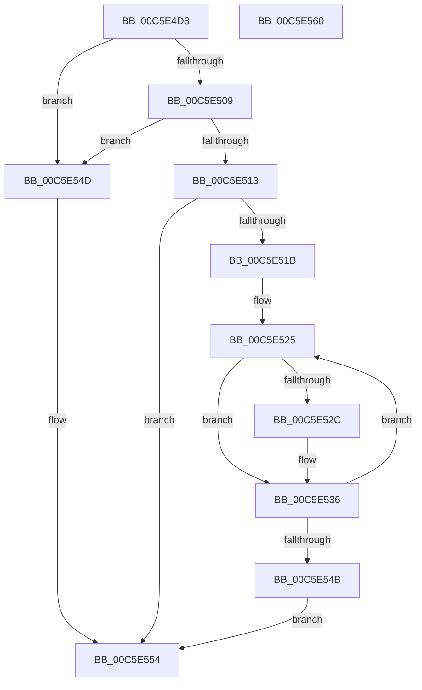

# MiInitializeNumaRangesTemporary

- RVA: `0x00C5E4D8`–`0x00C5E561` (길이 `137` bytes)
- VA: `0x0000000140C5E4D8`
- 실행 섹션: `INIT`
- PDB 이름 있음: `예`; PDB Function 태그: `아니요`
- unwind 정보 RVA: `0x0005D2F4`
- 디코드: `35`개 명령, `137/137` bytes 표시
- 미해석 바이트: `0` (있으면 어셈블리에 `.byte`로 보존)

> 이 문서는 커널 이미지의 기계어와 PDB 기호를 분석해 생성했습니다. 4번과 5번은 함수 원형과 자료형을 바이너리 사용 방식에서 추정한 C 해석이며 원본 소스 복구 결과는 아닙니다.

## 1. Dependencies

- 직접 호출 지점: **1**; 고유 호출 대상: **1**
- 직접 호출자로 확인된 함수: **1**
- RIP 상대 이미지 참조: **6**

### Outgoing calls
- `0x00C5E500` → [guard_dispatch_icall](../../text/6B/guard_dispatch_icall_function_006BAAD0.md) (function, `0x006BAAD0`)

### Direct callers
- [MiInitNucleus](MiInitNucleus_function_00C5FD38.md) at `0x00C5FEE3`

### Static image references
- `0x00C5E4DC` → RVA `0x00E00638` (`.data`; read)
- `0x00C5E4F1` → RVA `0x00E2DC10` (`.data`; read/write)
- `0x00C5E51B` → RVA `0x00FC5000` (`ALMOSTRO`; read)
- `0x00C5E536` → RVA `0x00E2DBC4` (`.data`; write)
- `0x00C5E54D` → RVA `0x00E2DC00` (`.data`; read)
- `0x00C5E554` → RVA `0x00E2DC20` (`.data`; write)

## 2. Other-region calls and transfers

- 다른 실행 섹션으로 향하는 call: **1**
  - `0x00C5E500` → [guard_dispatch_icall](../../text/6B/guard_dispatch_icall_function_006BAAD0.md) (`INIT` → `.text`)
- 별도 외부 분기/꼬리 이동을 확인하지 못했습니다.

## 3. Assembly (complete function range)

```asm
00C5E4D8  48 83 EC 38                     sub rsp, 0x38
00C5E4DC  48 8B 05 55 21 1A 00            mov rax, qword ptr [rip + 0x1a2155]
00C5E4E3  4C 8D 44 24 40                  lea r8, [rsp + 0x40]
00C5E4E8  48 83 64 24 40 00               and qword ptr [rsp + 0x40], 0
00C5E4EE  45 33 C9                        xor r9d, r9d
00C5E4F1  48 83 0D 17 F7 1C 00 FF         or qword ptr [rip + 0x1cf717], 0xffffffffffffffff
00C5E4F9  41 8D 51 10                     lea edx, [r9 + 0x10]
00C5E4FD  8D 4A 0E                        lea ecx, [rdx + 0xe]
00C5E500  E8 CB C5 A5 FF                  call 0x1406baad0
00C5E505  85 C0                           test eax, eax
00C5E507  78 44                           js 0x140c5e54d
00C5E509  48 8B 44 24 40                  mov rax, qword ptr [rsp + 0x40]
00C5E50E  48 85 C0                        test rax, rax
00C5E511  74 3A                           je 0x140c5e54d
00C5E513  33 D2                           xor edx, edx
00C5E515  48 83 38 FF                     cmp qword ptr [rax], -1
00C5E519  74 39                           je 0x140c5e554
00C5E51B  44 0F B7 05 DD 6A 36 00         movzx r8d, word ptr [rip + 0x366add]
00C5E523  33 C9                           xor ecx, ecx
00C5E525  44 39 44 01 08                  cmp dword ptr [rcx + rax + 8], r8d
00C5E52A  72 0A                           jb 0x140c5e536
00C5E52C  83 64 01 08 00                  and dword ptr [rcx + rax + 8], 0
00C5E531  48 8B 44 24 40                  mov rax, qword ptr [rsp + 0x40]
00C5E536  89 15 88 F6 1C 00               mov dword ptr [rip + 0x1cf688], edx
00C5E53C  FF C2                           inc edx
00C5E53E  8B CA                           mov ecx, edx
00C5E540  48 C1 E1 04                     shl rcx, 4
00C5E544  48 83 3C 01 FF                  cmp qword ptr [rcx + rax], -1
00C5E549  75 DA                           jne 0x140c5e525
00C5E54B  EB 07                           jmp 0x140c5e554
00C5E54D  48 8D 05 AC F6 1C 00            lea rax, [rip + 0x1cf6ac]
00C5E554  48 89 05 C5 F6 1C 00            mov qword ptr [rip + 0x1cf6c5], rax
00C5E55B  48 83 C4 38                     add rsp, 0x38
00C5E55F  C3                              ret
00C5E560  CC                              int3
```

## 4. C-style interpretation (structured pseudocode)

```c
__int64 __fastcall MiInitializeNumaRangesTemporary(__int64 a1, __int64 a2, __int64 a3, int a4)
{
    __int64 result;
    __int64 v_rsp;
    unsigned __int64 v_stack_p8;

    v_rsp = (v_rsp) - (56);
    a4 = 0;
    result = guard_dispatch_icall(a4 + 16 + 14, a4 + 16, v_stack_p8, a4);
    if (sign_flag) goto loc_00C5E54D;
    if (v_stack_p8 == 0) goto loc_00C5E54D;
    a2 = 0;
    if ((*(unsigned __int64 *)(v_stack_p8)) == -1) goto loc_00C5E554;
    a1 = 0;
loc_00C5E525:
    result = v_stack_p8;
    if ((*(unsigned int *)(a1 + v_stack_p8 * 1 + 8)) >= ((unsigned int)(*(unsigned __int16 *)(v_rip + 3566301)))) {
        result = v_stack_p8;
    }
    *(unsigned int *)(v_rip + 1898120) = 0;
    a2 = (unsigned int)((a2) + 1);
    a1 = ((unsigned int)((unsigned int)(a2))) << (4);
    if ((*(unsigned __int64 *)(a1 + result * 1)) != -1) goto loc_00C5E525;
    goto loc_00C5E554;
loc_00C5E54D:
loc_00C5E554:
    *(unsigned __int64 *)(v_rip + 1898181) = v_rip + 1898156;
    v_rsp = (v_rsp) + (56);
    return v_rip + 1898156;
}
```

## 5. (Beta) C Style

```c
int64_t MiInitializeNumaRangesTemporary(int64_t Arg1, int64_t Arg2, int64_t Arg3, int32_t Arg4)
{
    int64_t result;
    int64_t local_rsp;
    uint64_t v_stack_p8;

    local_rsp = (local_rsp) - (56);
    Arg4 = 0;
    result = guard_dispatch_icall(Arg4 + 16 + 14, Arg4 + 16, v_stack_p8, Arg4);
    if (sign_flag) goto loc_00C5E54D;
    if (v_stack_p8 == 0) goto loc_00C5E54D;
    Arg2 = 0;
    if ((*(uint64_t *)(v_stack_p8)) == -1) goto loc_00C5E554;
    Arg1 = 0;
loc_00C5E525:
    result = v_stack_p8;
    if ((*(uint32_t *)(Arg1 + v_stack_p8 * 1 + 0x8)) >= ((uint32_t)(*(uint16_t *)(v_rip + 0x366ADD)))) {
        result = v_stack_p8;
    }
    *(uint32_t *)(v_rip + 0x1CF688) = 0;
    Arg2 = (uint32_t)((Arg2) + 1);
    Arg1 = ((uint32_t)((uint32_t)(Arg2))) << (4);
    if ((*(uint64_t *)(Arg1 + result * 1)) != -1) goto loc_00C5E525;
    goto loc_00C5E554;
loc_00C5E54D:
loc_00C5E554:
    *(uint64_t *)(v_rip + 0x1CF6C5) = v_rip + 1898156;
    local_rsp = (local_rsp) + (56);
    return v_rip + 1898156;
}
```

## 6. Execution-region graph

[열기: 2D/3D 그래프와 함수 탐색 컨트롤 패널](../../../control-panel.html?section=init&rva=0x00C5E4D8&view=graph)

- 2D 그래프는 위에서 아래로 흐르고, 3D 그래프는 빈 공간을 드래그해 회전합니다. Shift+드래그는 이동, 휠은 확대·축소, 함수 노드 선택은 대상 보고서 이동입니다.

### Static fallback


