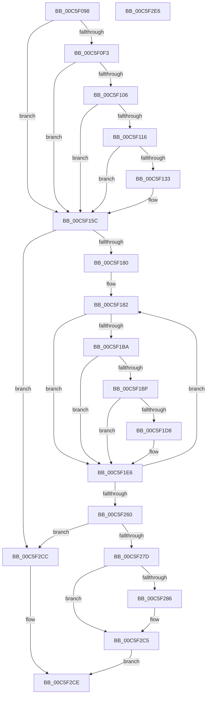

# MiInitializeSharedUserData

- RVA: `0x00C5F098`–`0x00C5F2E7` (길이 `591` bytes)
- VA: `0x0000000140C5F098`
- 실행 섹션: `INIT`
- PDB 이름 있음: `예`; PDB Function 태그: `아니요`
- unwind 정보 RVA: `0x000D7678`
- 디코드: `140`개 명령, `591/591` bytes 표시
- 미해석 바이트: `0` (있으면 어셈블리에 `.byte`로 보존)

> 이 문서는 커널 이미지의 기계어와 PDB 기호를 분석해 생성했습니다. 4번과 5번은 함수 원형과 자료형을 바이너리 사용 방식에서 추정한 C 해석이며 원본 소스 복구 결과는 아닙니다.

## 1. Dependencies

- 직접 호출 지점: **11**; 고유 호출 대상: **10**
- 직접 호출자로 확인된 함수: **1**
- RIP 상대 이미지 참조: **6**

### Outgoing calls
- `0x00C5F0C3` → [HvlGetSharedPageVa](../../text/4A/HvlGetSharedPageVa_function_004A1C00.md) (function, `0x004A1C00`)
- `0x00C5F13B` → [ExGenRandom](../../text/41/ExGenRandom_function_0041B010.md) (function, `0x0041B010`)
- `0x00C5F16F` → [MiAllocatePool](../../text/35/MiAllocatePool_function_0035B540.md) (function, `0x0035B540`)
- `0x00C5F1A7` → [MiMakeValidPte](../../text/2C/MiMakeValidPte_function_002C5590.md) (function, `0x002C5590`)
- `0x00C5F1E1` → [MiCheckLinearProtectedPteAccessedBit](../../text/29/MiCheckLinearProtectedPteAccessedBit_function_00292D80.md) (function, `0x00292D80`)
- `0x00C5F210` → [MiLockPageInline](../../text/31/MiLockPageInline_function_0031A340.md) (function, `0x0031A340`)
- `0x00C5F21C` → [MiMakeDemandZeroPte](../../text/33/MiMakeDemandZeroPte_function_00337A00.md) (function, `0x00337A00`)
- `0x00C5F245` → [MiUnlockPage](../../text/31/MiUnlockPage_function_0031A3E0.md) (function, `0x0031A3E0`)
- `0x00C5F274` → [KasanTrackAddress](../../text/46/KasanTrackAddress_function_00462520.md) (function, `0x00462520`)
- `0x00C5F2AE` → [memset](../../text/6C/memset_function_006C6C40.md) (function, `0x006C6C40`)
- `0x00C5F2C0` → [memset](../../text/6C/memset_function_006C6C40.md) (function, `0x006C6C40`)

### Direct callers
- [MiInitSystem](MiInitSystem_function_00C5E6C0.md) at `0x00C5E7DE`

### Static image references
- `0x00C5F10D` → RVA `0x00E2DCE0` (`.data`; read)
- `0x00C5F155` → RVA `0x00E2DB78` (`.data`; write)
- `0x00C5F1AC` → RVA `0x00FC6A88` (`ALMOSTRO`; read)
- `0x00C5F1ED` → RVA `0x00E2DB68` (`.data`; read)
- `0x00C5F27D` → RVA `0x00FCEC68` (`ALMOSTRO`; read)
- `0x00C5F286` → RVA `0x00FC6ED8` (`ALMOSTRO`; read)

## 2. Other-region calls and transfers

- 다른 실행 섹션으로 향하는 call: **11**
  - `0x00C5F0C3` → [HvlGetSharedPageVa](../../text/4A/HvlGetSharedPageVa_function_004A1C00.md) (`INIT` → `.text`)
  - `0x00C5F13B` → [ExGenRandom](../../text/41/ExGenRandom_function_0041B010.md) (`INIT` → `.text`)
  - `0x00C5F16F` → [MiAllocatePool](../../text/35/MiAllocatePool_function_0035B540.md) (`INIT` → `.text`)
  - `0x00C5F1A7` → [MiMakeValidPte](../../text/2C/MiMakeValidPte_function_002C5590.md) (`INIT` → `.text`)
  - `0x00C5F1E1` → [MiCheckLinearProtectedPteAccessedBit](../../text/29/MiCheckLinearProtectedPteAccessedBit_function_00292D80.md) (`INIT` → `.text`)
  - `0x00C5F210` → [MiLockPageInline](../../text/31/MiLockPageInline_function_0031A340.md) (`INIT` → `.text`)
  - `0x00C5F21C` → [MiMakeDemandZeroPte](../../text/33/MiMakeDemandZeroPte_function_00337A00.md) (`INIT` → `.text`)
  - `0x00C5F245` → [MiUnlockPage](../../text/31/MiUnlockPage_function_0031A3E0.md) (`INIT` → `.text`)
  - `0x00C5F274` → [KasanTrackAddress](../../text/46/KasanTrackAddress_function_00462520.md) (`INIT` → `.text`)
  - `0x00C5F2AE` → [memset](../../text/6C/memset_function_006C6C40.md) (`INIT` → `.text`)
  - `0x00C5F2C0` → [memset](../../text/6C/memset_function_006C6C40.md) (`INIT` → `.text`)
- 별도 외부 분기/꼬리 이동을 확인하지 못했습니다.

## 3. Assembly (complete function range)

```asm
00C5F098  48 89 5C 24 10                  mov qword ptr [rsp + 0x10], rbx
00C5F09D  48 89 74 24 18                  mov qword ptr [rsp + 0x18], rsi
00C5F0A2  57                              push rdi
00C5F0A3  41 54                           push r12
00C5F0A5  41 55                           push r13
00C5F0A7  41 56                           push r14
00C5F0A9  41 57                           push r15
00C5F0AB  48 83 EC 30                     sub rsp, 0x30
00C5F0AF  48 B8 00 00 00 00 80 F7 FF FF   movabs rax, 0xfffff78000000000
00C5F0B9  BF 01 00 00 00                  mov edi, 1
00C5F0BE  48 89 44 24 20                  mov qword ptr [rsp + 0x20], rax
00C5F0C3  E8 38 2B 84 FF                  call 0x1404a1c00
00C5F0C8  48 89 44 24 28                  mov qword ptr [rsp + 0x28], rax
00C5F0CD  48 8B C8                        mov rcx, rax
00C5F0D0  49 BC 00 00 00 00 80 F6 FF FF   movabs r12, 0xfffff68000000000
00C5F0DA  48 BB F8 FF FF FF 7F 00 00 00   movabs rbx, 0x7ffffffff8
00C5F0E4  49 BD FF FF FF FF FF 00 00 00   movabs r13, 0xffffffffff
00C5F0EE  48 85 C0                        test rax, rax
00C5F0F1  74 69                           je 0x140c5f15c
00C5F0F3  48 C1 E9 09                     shr rcx, 9
00C5F0F7  48 23 CB                        and rcx, rbx
00C5F0FA  49 8B C4                        mov rax, r12
00C5F0FD  48 8B 04 01                     mov rax, qword ptr [rcx + rax]
00C5F101  40 84 C7                        test dil, al
00C5F104  74 56                           je 0x140c5f15c
00C5F106  48 C1 E8 0C                     shr rax, 0xc
00C5F10A  49 23 C5                        and rax, r13
00C5F10D  48 3B 05 CC EB 1C 00            cmp rax, qword ptr [rip + 0x1cebcc]
00C5F114  77 46                           ja 0x140c5f15c
00C5F116  48 8D 04 40                     lea rax, [rax + rax*2]
00C5F11A  48 03 C0                        add rax, rax
00C5F11D  48 B9 28 00 00 00 00 DE FF FF   movabs rcx, 0xffffde0000000028
00C5F127  48 8B 04 C1                     mov rax, qword ptr [rcx + rax*8]
00C5F12B  48 C1 E8 36                     shr rax, 0x36
00C5F12F  85 C7                           test edi, eax
00C5F131  74 29                           je 0x140c5f15c
00C5F133  BF 02 00 00 00                  mov edi, 2
00C5F138  8D 4F FF                        lea ecx, [rdi - 1]
00C5F13B  E8 D0 BE 7B FF                  call 0x14041b010
00C5F140  8D 4F 0D                        lea ecx, [rdi + 0xd]
00C5F143  48 23 C1                        and rax, rcx
00C5F146  48 0F 45 C8                     cmovne rcx, rax
00C5F14A  48 81 C1 E0 FF 07 00            add rcx, 0x7ffe0
00C5F151  48 C1 E1 0C                     shl rcx, 0xc
00C5F155  48 89 0D 1C EA 1C 00            mov qword ptr [rip + 0x1cea1c], rcx
00C5F15C  48 8D 14 FD 00 00 00 00         lea rdx, [rdi*8]
00C5F164  B9 12 01 00 00                  mov ecx, 0x112
00C5F169  41 B8 4D 6D 53 74               mov r8d, 0x74536d4d
00C5F16F  E8 CC C3 6F FF                  call 0x14035b540
00C5F174  4C 8B F0                        mov r14, rax
00C5F177  48 85 C0                        test rax, rax
00C5F17A  0F 84 4C 01 00 00               je 0x140c5f2cc
00C5F180  33 F6                           xor esi, esi
00C5F182  48 8B 4C F4 20                  mov rcx, qword ptr [rsp + rsi*8 + 0x20]
00C5F187  48 C1 E9 09                     shr rcx, 9
00C5F18B  48 23 CB                        and rcx, rbx
00C5F18E  49 8B C4                        mov rax, r12
00C5F191  48 03 C8                        add rcx, rax
00C5F194  41 B8 01 00 00 20               mov r8d, 0x20000001
00C5F19A  4C 8B 39                        mov r15, qword ptr [rcx]
00C5F19D  49 C1 EF 0C                     shr r15, 0xc
00C5F1A1  4D 23 FD                        and r15, r13
00C5F1A4  49 8B D7                        mov rdx, r15
00C5F1A7  E8 E4 63 66 FF                  call 0x1402c5590
00C5F1AC  48 0F BA 25 D3 78 36 00 24      bt qword ptr [rip + 0x3678d3], 0x24
00C5F1B5  48 8B D8                        mov rbx, rax
00C5F1B8  73 2C                           jae 0x140c5f1e6
00C5F1BA  F6 C3 20                        test bl, 0x20
00C5F1BD  75 27                           jne 0x140c5f1e6
00C5F1BF  49 8D 0C F6                     lea rcx, [r14 + rsi*8]
00C5F1C3  49 8B C4                        mov rax, r12
00C5F1C6  48 BA 00 00 00 00 40 00 00 00   movabs rdx, 0x4000000000
00C5F1D0  48 03 C2                        add rax, rdx
00C5F1D3  48 3B C8                        cmp rcx, rax
00C5F1D6  72 0E                           jb 0x140c5f1e6
00C5F1D8  41 B8 80 00 00 00               mov r8d, 0x80
00C5F1DE  48 8B D3                        mov rdx, rbx
00C5F1E1  E8 9A 3B 63 FF                  call 0x140292d80
00C5F1E6  49 8D 04 F6                     lea rax, [r14 + rsi*8]
00C5F1EA  48 89 18                        mov qword ptr [rax], rbx
00C5F1ED  48 8D 0D 74 E9 1C 00            lea rcx, [rip + 0x1ce974]
00C5F1F4  4B 8D 1C 7F                     lea rbx, [r15 + r15*2]
00C5F1F8  48 89 04 F1                     mov qword ptr [rcx + rsi*8], rax
00C5F1FC  48 C1 E3 04                     shl rbx, 4
00C5F200  48 B8 00 00 00 00 00 DE FF FF   movabs rax, 0xffffde0000000000
00C5F20A  48 03 D8                        add rbx, rax
00C5F20D  48 8B CB                        mov rcx, rbx
00C5F210  E8 2B B1 6B FF                  call 0x14031a340
00C5F215  B9 04 00 00 00                  mov ecx, 4
00C5F21A  8A D0                           mov dl, al
00C5F21C  E8 DF 87 6D FF                  call 0x140337a00
00C5F221  48 89 43 10                     mov qword ptr [rbx + 0x10], rax
00C5F225  48 B9 00 00 00 00 00 00 00 80   movabs rcx, 0x8000000000000000
00C5F22F  48 8B 43 28                     mov rax, qword ptr [rbx + 0x28]
00C5F233  48 0B C1                        or rax, rcx
00C5F236  48 8B CB                        mov rcx, rbx
00C5F239  48 89 43 28                     mov qword ptr [rbx + 0x28], rax
00C5F23D  49 8D 04 F6                     lea rax, [r14 + rsi*8]
00C5F241  48 89 43 08                     mov qword ptr [rbx + 8], rax
00C5F245  E8 96 B1 6B FF                  call 0x14031a3e0
00C5F24A  48 FF C6                        inc rsi
00C5F24D  48 BB F8 FF FF FF 7F 00 00 00   movabs rbx, 0x7ffffffff8
00C5F257  48 3B F7                        cmp rsi, rdi
00C5F25A  0F 82 22 FF FF FF               jb 0x140c5f182
00C5F260  48 C1 E7 0C                     shl rdi, 0xc
00C5F264  45 33 C0                        xor r8d, r8d
00C5F267  48 8B D7                        mov rdx, rdi
00C5F26A  48 B9 00 00 00 00 80 F7 FF FF   movabs rcx, 0xfffff78000000000
00C5F274  E8 A7 32 80 FF                  call 0x140462520
00C5F279  85 C0                           test eax, eax
00C5F27B  78 4F                           js 0x140c5f2cc
00C5F27D  80 3D E4 F9 36 00 00            cmp byte ptr [rip + 0x36f9e4], 0
00C5F284  74 3F                           je 0x140c5f2c5
00C5F286  48 8B 1D 4B 7C 36 00            mov rbx, qword ptr [rip + 0x367c4b]
00C5F28D  48 B9 00 00 00 00 F0 0E 00 00   movabs rcx, 0xef000000000
00C5F297  48 03 D9                        add rbx, rcx
00C5F29A  BE 50 01 00 00                  mov esi, 0x150
00C5F29F  48 8B CB                        mov rcx, rbx
00C5F2A2  44 8B C6                        mov r8d, esi
00C5F2A5  33 D2                           xor edx, edx
00C5F2A7  48 81 C7 80 F5 FF FF            add rdi, -0xa80
00C5F2AE  E8 8D 79 A6 FF                  call 0x1406c6c40
00C5F2B3  48 C1 EF 03                     shr rdi, 3
00C5F2B7  48 8D 0C 1E                     lea rcx, [rsi + rbx]
00C5F2BB  4C 8B C7                        mov r8, rdi
00C5F2BE  B2 85                           mov dl, 0x85
00C5F2C0  E8 7B 79 A6 FF                  call 0x1406c6c40
00C5F2C5  B8 01 00 00 00                  mov eax, 1
00C5F2CA  EB 02                           jmp 0x140c5f2ce
00C5F2CC  33 C0                           xor eax, eax
00C5F2CE  48 8B 5C 24 68                  mov rbx, qword ptr [rsp + 0x68]
00C5F2D3  48 8B 74 24 70                  mov rsi, qword ptr [rsp + 0x70]
00C5F2D8  48 83 C4 30                     add rsp, 0x30
00C5F2DC  41 5F                           pop r15
00C5F2DE  41 5E                           pop r14
00C5F2E0  41 5D                           pop r13
00C5F2E2  41 5C                           pop r12
00C5F2E4  5F                              pop rdi
00C5F2E5  C3                              ret
00C5F2E6  CC                              int3
```

## 4. C-style interpretation (structured pseudocode)

```c
__int64 __fastcall MiInitializeSharedUserData(void)
{
    __int64 result;
    __int64 v_r15;
    __int64 v_rbx;
    __int64 v_rdi;
    __int64 v_rsi;
    __int64 v_rsp;
    unsigned __int64 v_stack_m30;
    unsigned __int64 v_stack_m38;
    unsigned __int64 v_stack_p10;
    unsigned __int64 v_stack_p18;

    v_stack_p10 = v_rbx;
    v_stack_p18 = v_rsi;
    v_rsp = (v_rsp) - (48);
    v_stack_m38 = result;
    result = HvlGetSharedPageVa(a1, a2, a3, a4);
    v_stack_m30 = result;
    if (result == 0) goto loc_00C5F15C;
    a1 = (result) >> (9);
    a1 = (a1) & (v_rbx);
    if (((1) & ((unsigned __int8)(*(unsigned __int64 *)(a1 + v_r12 * 1)))) == 0) goto loc_00C5F15C;
    result = (*(unsigned __int64 *)(a1 + v_r12 * 1)) >> (12);
    result = (result) & (v_r13);
    if (result > (*(unsigned __int64 *)(v_rip + 1895372))) goto loc_00C5F15C;
    result = (result + result * 2) + (result + result * 2);
    result = (*(unsigned __int64 *)(a1 + result * 8)) >> (54);
    v_rdi = 1;
    if (((1) & ((unsigned int)(result))) != 0) {
        v_rdi = 2;
        a1 = v_rdi - 1;
        result = ExGenRandom(a1, a2, a3, a4);
        a1 = v_rdi + 13;
        result = (result) & (a1);
        if (condition_is_not_equal) { a1 = result; }
        a1 = (a1) + (0x7FFE0ULL);
        a1 = (a1) << (12);
        *(unsigned __int64 *)(v_rip + 1894940) = a1;
    }
    result = MiAllocatePool(274, v_rdi * 8, (unsigned int)(0x74536D4DULL), a4);
    if (result == 0) goto loc_00C5F2CC;
    v_rsi = 0;
loc_00C5F182:
    a1 = (*(unsigned __int64 *)(v_rsp + v_rsi * 8 + 32)) >> (9);
    a1 = (a1) & (v_rbx);
    a1 = (a1) + (v_r12);
    v_r15 = (*(unsigned __int64 *)(a1)) >> (12);
    v_r15 = (v_r15) & (v_r13);
    result = MiMakeValidPte(a1, v_r15, (unsigned int)(0x20000001ULL), a4);
    if (condition_is_above_or_equal) goto loc_00C5F1E6;
    if ((((unsigned __int8)(result)) & (32)) != 0) goto loc_00C5F1E6;
    result = (v_r12) + (v_r15);
    if ((result + v_rsi * 8) >= result) {
        a3 = 128;
        a2 = result;
        result = MiCheckLinearProtectedPteAccessedBit(result + v_rsi * 8, a2, a3, a4);
    }
    *(unsigned __int64 *)(result + v_rsi * 8) = result;
    *(unsigned __int64 *)(v_rip + 1894772 + v_rsi * 8) = result + v_rsi * 8;
    v_rbx = (v_r15 + v_r15 * 2) << (4);
    v_rbx = (v_rbx) + (result + v_rsi * 8);
    result = MiLockPageInline(v_rbx, a2, a3, a4);
    result = MiMakeDemandZeroPte(4, (unsigned __int8)(result), a3, a4);
    *(unsigned __int64 *)(v_rbx + 16) = result;
    result = (*(unsigned __int64 *)(v_rbx + 40)) | (4);
    *(unsigned __int64 *)(v_rbx + 40) = result;
    *(unsigned __int64 *)(v_rbx + 8) = result + v_rsi * 8;
    result = MiUnlockPage(v_rbx, (unsigned __int8)(result), a3, a4);
    v_rsi = (v_rsi) + 1;
    if (v_rsi < v_rdi) goto loc_00C5F182;
    v_rdi = (v_rdi) << (12);
    a3 = 0;
    result = KasanTrackAddress(v_rbx, v_rdi, a3, a4);
    if (sign_flag) goto loc_00C5F2CC;
    if ((*(unsigned __int8 *)(v_rip + 3602916)) != 0) {
        v_rbx = *(unsigned __int64 *)(v_rip + 3570763);
        v_rbx = (v_rbx) + (v_rbx);
        v_rsi = 336;
        a1 = v_rbx;
        a3 = (unsigned int)(v_rsi);
        a2 = 0;
        v_rdi = (v_rdi) + (0xFFFFFFFFFFFFF580ULL);
        result = memset(a1, a2, a3, a4);
        v_rdi = (v_rdi) >> (3);
        a1 = v_rsi + v_rbx * 1;
        a3 = v_rdi;
        a2 = 133;
        result = memset(a1, a2, a3, a4);
    }
    goto loc_00C5F2CE;
loc_00C5F2CC:
    result = 0;
loc_00C5F2CE:
    v_rsp = (v_rsp) + (48);
    return result;
}
```

## 5. (Beta) C Style

```c
void MiInitializeSharedUserData(void)
{
    int64_t result;
    int64_t local_r15;
    int64_t local_rbx;
    int64_t local_rdi;
    int64_t local_rsi;
    int64_t local_rsp;
    uint64_t v_stack_m30;
    uint64_t v_stack_m38;
    uint64_t v_stack_p10;
    uint64_t v_stack_p18;

    v_stack_p10 = local_rbx;
    v_stack_p18 = local_rsi;
    local_rsp = (local_rsp) - (48);
    v_stack_m38 = result;
    result = HvlGetSharedPageVa(a1, a2, a3, a4);
    v_stack_m30 = result;
    if (result == 0) goto loc_00C5F15C;
    a1 = (result) >> (9);
    a1 = (a1) & (local_rbx);
    if (((1) & ((uint8_t)(*(uint64_t *)(a1 + local_r12 * 1)))) == 0) goto loc_00C5F15C;
    result = (*(uint64_t *)(a1 + local_r12 * 1)) >> (12);
    result = (result) & (local_r13);
    if (result > (*(uint64_t *)(v_rip + 0x1CEBCC))) goto loc_00C5F15C;
    result = (result + result * 2) + (result + result * 2);
    result = (*(uint64_t *)(a1 + result * 8)) >> (54);
    local_rdi = 1;
    if (((1) & ((uint32_t)(result))) != 0) {
        local_rdi = 2;
        a1 = local_rdi - 1;
        result = ExGenRandom(a1, a2, a3, a4);
        a1 = local_rdi + 13;
        result = (result) & (a1);
        if (condition_is_not_equal) { a1 = result; }
        a1 = (a1) + (0x7FFE0ULL);
        a1 = (a1) << (12);
        *(uint64_t *)(v_rip + 0x1CEA1C) = a1;
    }
    result = MiAllocatePool(274, local_rdi * 8, (uint32_t)(0x74536D4DULL), a4);
    if (result == 0) goto loc_00C5F2CC;
    local_rsi = 0;
loc_00C5F182:
    a1 = (*(uint64_t *)(local_rsp + local_rsi * 8 + 0x20)) >> (9);
    a1 = (a1) & (local_rbx);
    a1 = (a1) + (local_r12);
    local_r15 = (*(uint64_t *)(a1)) >> (12);
    local_r15 = (local_r15) & (local_r13);
    result = MiMakeValidPte(a1, local_r15, (uint32_t)(0x20000001ULL), a4);
    if (condition_is_above_or_equal) goto loc_00C5F1E6;
    if ((((uint8_t)(result)) & (32)) != 0) goto loc_00C5F1E6;
    result = (local_r12) + (local_r15);
    if ((result + local_rsi * 8) >= result) {
        a3 = 128;
        a2 = result;
        result = MiCheckLinearProtectedPteAccessedBit(result + local_rsi * 8, a2, a3, a4);
    }
    *(uint64_t *)(result + local_rsi * 8) = result;
    *(uint64_t *)(v_rip + 0x1CE974 + local_rsi * 8) = result + local_rsi * 8;
    local_rbx = (local_r15 + local_r15 * 2) << (4);
    local_rbx = (local_rbx) + (result + local_rsi * 8);
    result = MiLockPageInline(local_rbx, a2, a3, a4);
    result = MiMakeDemandZeroPte(4, (uint8_t)(result), a3, a4);
    *(uint64_t *)(local_rbx + 0x10) = result;
    result = (*(uint64_t *)(local_rbx + 0x28)) | (4);
    *(uint64_t *)(local_rbx + 0x28) = result;
    *(uint64_t *)(local_rbx + 0x8) = result + local_rsi * 8;
    result = MiUnlockPage(local_rbx, (uint8_t)(result), a3, a4);
    local_rsi = (local_rsi) + 1;
    if (local_rsi < local_rdi) goto loc_00C5F182;
    local_rdi = (local_rdi) << (12);
    a3 = 0;
    result = KasanTrackAddress(local_rbx, local_rdi, a3, a4);
    if (sign_flag) goto loc_00C5F2CC;
    if ((*(uint8_t *)(v_rip + 0x36F9E4)) != 0) {
        local_rbx = *(uint64_t *)(v_rip + 0x367C4B);
        local_rbx = (local_rbx) + (local_rbx);
        local_rsi = 336;
        a1 = local_rbx;
        a3 = (uint32_t)(local_rsi);
        a2 = 0;
        local_rdi = (local_rdi) + (0xFFFFFFFFFFFFF580ULL);
        result = memset(a1, a2, a3, a4);
        local_rdi = (local_rdi) >> (3);
        a1 = local_rsi + local_rbx * 1;
        a3 = local_rdi;
        a2 = 133;
        result = memset(a1, a2, a3, a4);
    }
    goto loc_00C5F2CE;
loc_00C5F2CC:
    result = 0;
loc_00C5F2CE:
    local_rsp = (local_rsp) + (48);
    return result;
}
```

## 6. Execution-region graph

[열기: 2D/3D 그래프와 함수 탐색 컨트롤 패널](../../../control-panel.html?section=init&rva=0x00C5F098&view=graph)

- 2D 그래프는 위에서 아래로 흐르고, 3D 그래프는 빈 공간을 드래그해 회전합니다. Shift+드래그는 이동, 휠은 확대·축소, 함수 노드 선택은 대상 보고서 이동입니다.

### Static fallback


