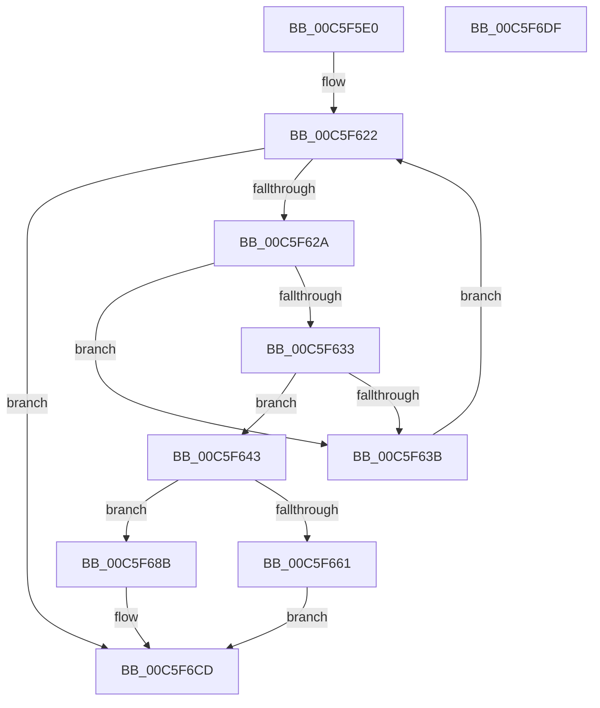

# MiProtectKernelCfgData

- RVA: `0x00C5F5E0`–`0x00C5F6E0` (길이 `256` bytes)
- VA: `0x0000000140C5F5E0`
- 실행 섹션: `INIT`
- PDB 이름 있음: `예`; PDB Function 태그: `아니요`
- unwind 정보 RVA: `0x0009E61C`
- 디코드: `66`개 명령, `256/256` bytes 표시
- 미해석 바이트: `0` (있으면 어셈블리에 `.byte`로 보존)

> 이 문서는 커널 이미지의 기계어와 PDB 기호를 분석해 생성했습니다. 4번과 5번은 함수 원형과 자료형을 바이너리 사용 방식에서 추정한 C 해석이며 원본 소스 복구 결과는 아닙니다.

## 1. Dependencies

- 직접 호출 지점: **4**; 고유 호출 대상: **4**
- 직접 호출자로 확인된 함수: **0**
- RIP 상대 이미지 참조: **0**

### Outgoing calls
- `0x00C5F607` → [RtlImageNtHeaderEx](../../text/41/RtlImageNtHeaderEx_function_0041EAA0.md) (function, `0x0041EAA0`)
- `0x00C5F658` → [MI_IS_PHYSICAL_ADDRESS](../../text/23/MI_IS_PHYSICAL_ADDRESS_function_0023B3A0.md) (function, `0x0023B3A0`)
- `0x00C5F684` → [MiProtectLargeKernelHalRange](../../page/7F/MiProtectLargeKernelHalRange_function_007F8D20.md) (function, `0x007F8D20`)
- `0x00C5F6C8` → [MiSetSystemCodeProtection](../../text/38/MiSetSystemCodeProtection_function_00384420.md) (function, `0x00384420`)

### Direct callers
- 이 함수 시작 RVA로 연결되는 직접 call은 확인되지 않았습니다. 간접 호출은 완전히 역산할 수 없습니다.

### Static image references
- 디코드된 RIP-relative 메모리 참조가 없습니다.

## 2. Other-region calls and transfers

- 다른 실행 섹션으로 향하는 call: **4**
  - `0x00C5F607` → [RtlImageNtHeaderEx](../../text/41/RtlImageNtHeaderEx_function_0041EAA0.md) (`INIT` → `.text`)
  - `0x00C5F658` → [MI_IS_PHYSICAL_ADDRESS](../../text/23/MI_IS_PHYSICAL_ADDRESS_function_0023B3A0.md) (`INIT` → `.text`)
  - `0x00C5F684` → [MiProtectLargeKernelHalRange](../../page/7F/MiProtectLargeKernelHalRange_function_007F8D20.md) (`INIT` → `PAGE`)
  - `0x00C5F6C8` → [MiSetSystemCodeProtection](../../text/38/MiSetSystemCodeProtection_function_00384420.md) (`INIT` → `.text`)
- 별도 외부 분기/꼬리 이동을 확인하지 못했습니다.

## 3. Assembly (complete function range)

```asm
00C5F5E0  48 8B C4                        mov rax, rsp
00C5F5E3  48 89 58 10                     mov qword ptr [rax + 0x10], rbx
00C5F5E7  48 89 70 18                     mov qword ptr [rax + 0x18], rsi
00C5F5EB  57                              push rdi
00C5F5EC  48 83 EC 30                     sub rsp, 0x30
00C5F5F0  48 8B 51 30                     mov rdx, qword ptr [rcx + 0x30]
00C5F5F4  4C 8D 48 08                     lea r9, [rax + 8]
00C5F5F8  48 83 60 08 00                  and qword ptr [rax + 8], 0
00C5F5FD  45 33 C0                        xor r8d, r8d
00C5F600  48 8B F1                        mov rsi, rcx
00C5F603  41 8D 48 01                     lea ecx, [r8 + 1]
00C5F607  E8 94 F4 7B FF                  call 0x14041eaa0
00C5F60C  48 8B 54 24 40                  mov rdx, qword ptr [rsp + 0x40]
00C5F611  0F B7 42 14                     movzx eax, word ptr [rdx + 0x14]
00C5F615  4C 8D 42 18                     lea r8, [rdx + 0x18]
00C5F619  0F B7 4A 06                     movzx ecx, word ptr [rdx + 6]
00C5F61D  4C 03 C0                        add r8, rax
00C5F620  33 C0                           xor eax, eax
00C5F622  3B C1                           cmp eax, ecx
00C5F624  0F 83 A3 00 00 00               jae 0x140c5f6cd
00C5F62A  41 81 38 43 46 47 52            cmp dword ptr [r8], 0x52474643
00C5F631  75 08                           jne 0x140c5f63b
00C5F633  66 41 83 78 04 4F               cmp word ptr [r8 + 4], 0x4f
00C5F639  74 08                           je 0x140c5f643
00C5F63B  49 83 C0 28                     add r8, 0x28
00C5F63F  FF C0                           inc eax
00C5F641  EB DF                           jmp 0x140c5f622
00C5F643  41 8B 58 0C                     mov ebx, dword ptr [r8 + 0xc]
00C5F647  48 03 5E 30                     add rbx, qword ptr [rsi + 0x30]
00C5F64B  41 8B 78 08                     mov edi, dword ptr [r8 + 8]
00C5F64F  48 8B CB                        mov rcx, rbx
00C5F652  48 FF CF                        dec rdi
00C5F655  48 03 FB                        add rdi, rbx
00C5F658  E8 43 BD 5D FF                  call 0x14023b3a0
00C5F65D  85 C0                           test eax, eax
00C5F65F  74 2A                           je 0x140c5f68b
00C5F661  48 C7 C0 00 00 E0 FF            mov rax, 0xffffffffffe00000
00C5F668  48 8D 97 00 00 20 00            lea rdx, [rdi + 0x200000]
00C5F66F  48 23 D8                        and rbx, rax
00C5F672  48 23 D0                        and rdx, rax
00C5F675  48 8B CB                        mov rcx, rbx
00C5F678  41 B9 01 00 00 00               mov r9d, 1
00C5F67E  41 B8 00 00 00 40               mov r8d, 0x40000000
00C5F684  E8 97 96 B9 FF                  call 0x1407f8d20
00C5F689  EB 42                           jmp 0x140c5f6cd
00C5F68B  48 C1 EF 09                     shr rdi, 9
00C5F68F  48 BA F8 FF FF FF 7F 00 00 00   movabs rdx, 0x7ffffffff8
00C5F699  48 23 FA                        and rdi, rdx
00C5F69C  48 B9 00 00 00 00 80 F6 FF FF   movabs rcx, 0xfffff68000000000
00C5F6A6  48 8B C1                        mov rax, rcx
00C5F6A9  48 C1 EB 09                     shr rbx, 9
00C5F6AD  4C 8D 04 38                     lea r8, [rax + rdi]
00C5F6B1  48 23 D3                        and rdx, rbx
00C5F6B4  48 8B C1                        mov rax, rcx
00C5F6B7  83 64 24 20 00                  and dword ptr [rsp + 0x20], 0
00C5F6BC  48 03 D0                        add rdx, rax
00C5F6BF  41 B9 01 00 00 00               mov r9d, 1
00C5F6C5  48 8B CE                        mov rcx, rsi
00C5F6C8  E8 53 4D 72 FF                  call 0x140384420
00C5F6CD  48 8B 5C 24 48                  mov rbx, qword ptr [rsp + 0x48]
00C5F6D2  33 C0                           xor eax, eax
00C5F6D4  48 8B 74 24 50                  mov rsi, qword ptr [rsp + 0x50]
00C5F6D9  48 83 C4 30                     add rsp, 0x30
00C5F6DD  5F                              pop rdi
00C5F6DE  C3                              ret
00C5F6DF  CC                              int3
```

## 4. C-style interpretation (structured pseudocode)

```c
__int64 __fastcall MiProtectKernelCfgData(__int64 a1, __int64 a2, int a3)
{
    __int64 result;
    __int64 v_rbx;
    __int64 v_rdi;
    __int64 v_rsp;
    unsigned int v_stack_m18;
    unsigned __int64 v_stack_p10;
    unsigned __int64 v_stack_p18;
    unsigned __int64 v_stack_p8;

    *(unsigned __int64 *)(v_rsp + 16) = v_rbx;
    *(unsigned __int64 *)(v_rsp + 24) = v_rsi;
    v_rsp = (v_rsp) - (48);
    a3 = 0;
    result = RtlImageNtHeaderEx(a3 + 1, *(unsigned __int64 *)(a1 + 48), a3, v_rsp + 8);
    a3 = (v_stack_p8 + 24) + (*(unsigned __int16 *)(v_stack_p8 + 20));
    result = 0;
loc_00C5F622:
    if (0 >= ((unsigned int)(*(unsigned __int16 *)(v_stack_p8 + 6)))) goto loc_00C5F6CD;
    if ((*(unsigned int *)(a3)) != 0x52474643ULL) goto loc_00C5F63B;
    if ((*(unsigned __int16 *)(a3 + 4)) == 79) goto loc_00C5F643;
loc_00C5F63B:
    a3 = (a3) + (40);
    result = (unsigned int)((result) + 1);
    goto loc_00C5F622;
loc_00C5F643:
    v_rbx = ((unsigned int)(*(unsigned int *)(a3 + 12))) + (*(unsigned __int64 *)(a1 + 48));
    v_rdi = ((unsigned int)(*(unsigned int *)(a3 + 8))) - 1;
    v_rdi = (v_rdi) + (v_rbx);
    result = MI_IS_PHYSICAL_ADDRESS(v_rbx, v_stack_p8, a3, v_rsp + 8);
    if ((unsigned int)(result) == 0) goto loc_00C5F68B;
    v_rbx = (v_rbx) & (0xFFFFFFFFFFE00000ULL);
    a2 = (v_rdi + 2097152) & (0xFFFFFFFFFFE00000ULL);
    result = MiProtectLargeKernelHalRange(v_rbx, a2, (unsigned int)(0x40000000ULL), 1);
    goto loc_00C5F6CD;
loc_00C5F68B:
    v_rdi = (v_rdi) >> (9);
    v_rdi = (v_rdi) & (a2);
    v_rbx = (v_rbx) >> (9);
    a2 = (a2) & (v_rbx);
    a2 = (a2) + (v_rbx);
    result = MiSetSystemCodeProtection(a1, a2, v_rbx + v_rdi * 1, 1);
loc_00C5F6CD:
    result = 0;
    v_rsp = (v_rsp) + (48);
    return result;
}
```

## 5. (Beta) C Style

```c
int64_t MiProtectKernelCfgData(void *Arg1, int64_t Arg2, int32_t Arg3)
{
    uint8_t *arg1 = (uint8_t *)Arg1;

    int64_t result;
    int64_t local_rbx;
    int64_t local_rdi;
    int64_t local_rsp;
    uint32_t v_stack_m18;
    uint64_t v_stack_p10;
    uint64_t v_stack_p18;
    uint64_t v_stack_p8;

    *(uint64_t *)(local_rsp + 0x10) = local_rbx;
    *(uint64_t *)(local_rsp + 0x18) = local_rsi;
    local_rsp = (local_rsp) - (48);
    Arg3 = 0;
    result = RtlImageNtHeaderEx(Arg3 + 1, *(uint64_t *)(arg1 + 0x30), Arg3, local_rsp + 8);
    Arg3 = (v_stack_p8 + 24) + (*(uint16_t *)(v_stack_p8 + 0x14));
    result = 0;
loc_00C5F622:
    if (0 >= ((uint32_t)(*(uint16_t *)(v_stack_p8 + 0x6)))) goto loc_00C5F6CD;
    if ((*(uint32_t *)(Arg3)) != 0x52474643ULL) goto loc_00C5F63B;
    if ((*(uint16_t *)(Arg3 + 0x4)) == 79) goto loc_00C5F643;
loc_00C5F63B:
    Arg3 = (Arg3) + (40);
    result = (uint32_t)((result) + 1);
    goto loc_00C5F622;
loc_00C5F643:
    local_rbx = ((uint32_t)(*(uint32_t *)(Arg3 + 0xC))) + (*(uint64_t *)(arg1 + 0x30));
    local_rdi = ((uint32_t)(*(uint32_t *)(Arg3 + 0x8))) - 1;
    local_rdi = (local_rdi) + (local_rbx);
    result = MI_IS_PHYSICAL_ADDRESS(local_rbx, v_stack_p8, Arg3, local_rsp + 8);
    if ((uint32_t)(result) == 0) goto loc_00C5F68B;
    local_rbx = (local_rbx) & (0xFFFFFFFFFFE00000ULL);
    Arg2 = (local_rdi + 2097152) & (0xFFFFFFFFFFE00000ULL);
    result = MiProtectLargeKernelHalRange(local_rbx, Arg2, (uint32_t)(0x40000000ULL), 1);
    goto loc_00C5F6CD;
loc_00C5F68B:
    local_rdi = (local_rdi) >> (9);
    local_rdi = (local_rdi) & (Arg2);
    local_rbx = (local_rbx) >> (9);
    Arg2 = (Arg2) & (local_rbx);
    Arg2 = (Arg2) + (local_rbx);
    result = MiSetSystemCodeProtection(Arg1, Arg2, local_rbx + local_rdi * 1, 1);
loc_00C5F6CD:
    result = 0;
    local_rsp = (local_rsp) + (48);
    return result;
}
```

### 관측된 메모리 오프셋

구조체 형식이 확인되지 않은 접근은 인자 기준의 오프셋으로만 기록했습니다.

| 기준 인자 | 오프셋 표현 | 폭 (bit) | 접근 |
|---|---:|---:|---|
| `Arg1` | `+ 0x30` | `64` | `R` |

## 6. Execution-region graph

[열기: 2D/3D 그래프와 함수 탐색 컨트롤 패널](../../../control-panel.html?section=init&rva=0x00C5F5E0&view=graph)

- 2D 그래프는 위에서 아래로 흐르고, 3D 그래프는 빈 공간을 드래그해 회전합니다. Shift+드래그는 이동, 휠은 확대·축소, 함수 노드 선택은 대상 보고서 이동입니다.

### Static fallback


