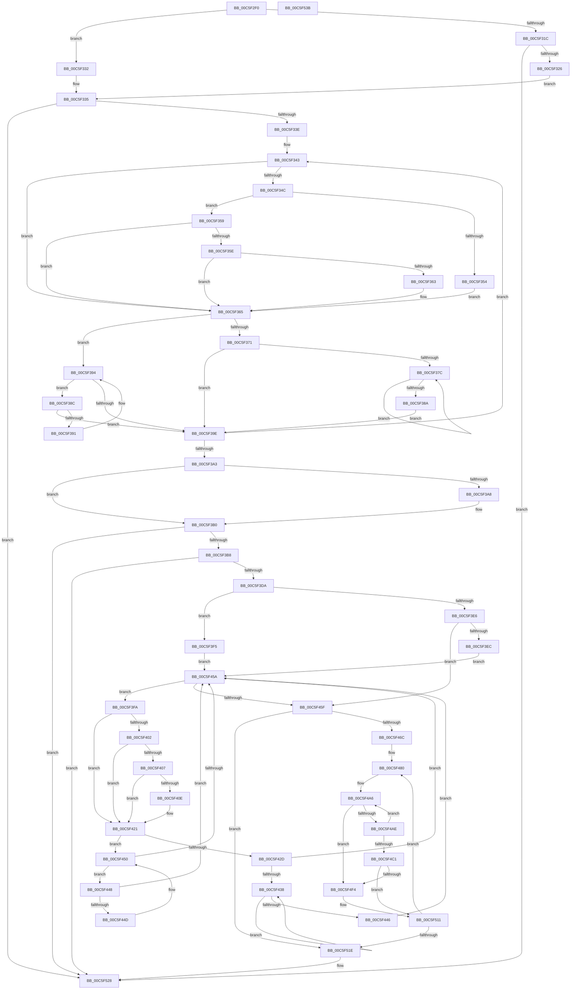

# MmFreeLoaderBlock

- RVA: `0x00C5F2F0`–`0x00C5F53C` (길이 `588` bytes)
- VA: `0x0000000140C5F2F0`
- 실행 섹션: `INIT`
- PDB 이름 있음: `예`; PDB Function 태그: `아니요`
- unwind 정보 RVA: `0x000701D4`
- 디코드: `177`개 명령, `588/588` bytes 표시
- 미해석 바이트: `0` (있으면 어셈블리에 `.byte`로 보존)

> 이 문서는 커널 이미지의 기계어와 PDB 기호를 분석해 생성했습니다. 4번과 5번은 함수 원형과 자료형을 바이너리 사용 방식에서 추정한 C 해석이며 원본 소스 복구 결과는 아닙니다.

## 1. Dependencies

- 직접 호출 지점: **5**; 고유 호출 대상: **4**
- 직접 호출자로 확인된 함수: **1**
- RIP 상대 이미지 참조: **1**

### Outgoing calls
- `0x00C5F3AB` → [MiPageBootRegistry](../../text/66/MiPageBootRegistry_function_0066E82C.md) (function, `0x0066E82C`)
- `0x00C5F3C9` → [MiAllocatePool](../../text/35/MiAllocatePool_function_0035B540.md) (function, `0x0035B540`)
- `0x00C5F4DF` → [MiDeleteBootRange](../../text/66/MiDeleteBootRange_function_0066E450.md) (function, `0x0066E450`)
- `0x00C5F50C` → [MiDeleteBootRange](../../text/66/MiDeleteBootRange_function_0066E450.md) (function, `0x0066E450`)
- `0x00C5F523` → [ExFreePoolWithTag](../../poolcode/B8/ExFreePoolWithTag_function_00B82870.md) (function, `0x00B82870`)

### Direct callers
- [KeInitSystem](../C7/KeInitSystem_function_00C71660.md) at `0x00C71BF4`

### Static image references
- `0x00C5F302` → RVA `0x00FC6B20` (`ALMOSTRO`; read)

## 2. Other-region calls and transfers

- 다른 실행 섹션으로 향하는 call: **5**
  - `0x00C5F3AB` → [MiPageBootRegistry](../../text/66/MiPageBootRegistry_function_0066E82C.md) (`INIT` → `.text`)
  - `0x00C5F3C9` → [MiAllocatePool](../../text/35/MiAllocatePool_function_0035B540.md) (`INIT` → `.text`)
  - `0x00C5F4DF` → [MiDeleteBootRange](../../text/66/MiDeleteBootRange_function_0066E450.md) (`INIT` → `.text`)
  - `0x00C5F50C` → [MiDeleteBootRange](../../text/66/MiDeleteBootRange_function_0066E450.md) (`INIT` → `.text`)
  - `0x00C5F523` → [ExFreePoolWithTag](../../poolcode/B8/ExFreePoolWithTag_function_00B82870.md) (`INIT` → `POOLCODE`)
- 별도 외부 분기/꼬리 이동을 확인하지 못했습니다.

## 3. Assembly (complete function range)

```asm
00C5F2F0  48 89 5C 24 10                  mov qword ptr [rsp + 0x10], rbx
00C5F2F5  48 89 6C 24 18                  mov qword ptr [rsp + 0x18], rbp
00C5F2FA  56                              push rsi
00C5F2FB  57                              push rdi
00C5F2FC  41 56                           push r14
00C5F2FE  48 83 EC 20                     sub rsp, 0x20
00C5F302  4C 8B 0D 17 78 36 00            mov r9, qword ptr [rip + 0x367817]
00C5F309  33 FF                           xor edi, edi
00C5F30B  33 D2                           xor edx, edx
00C5F30D  49 8D 99 60 01 00 00            lea rbx, [r9 + 0x160]
00C5F314  48 8B 43 08                     mov rax, qword ptr [rbx + 8]
00C5F318  A8 01                           test al, 1
00C5F31A  74 16                           je 0x140c5f332
00C5F31C  48 83 F8 01                     cmp rax, 1
00C5F320  0F 84 02 02 00 00               je 0x140c5f528
00C5F326  48 8B CB                        mov rcx, rbx
00C5F329  48 83 C9 01                     or rcx, 1
00C5F32D  48 33 C8                        xor rcx, rax
00C5F330  EB 03                           jmp 0x140c5f335
00C5F332  48 8B C8                        mov rcx, rax
00C5F335  48 85 C9                        test rcx, rcx
00C5F338  0F 84 EA 01 00 00               je 0x140c5f528
00C5F33E  BD 80 40 20 00                  mov ebp, 0x204080
00C5F343  4C 8B 41 28                     mov r8, qword ptr [rcx + 0x28]
00C5F347  4D 85 C0                        test r8, r8
00C5F34A  74 19                           je 0x140c5f365
00C5F34C  8B 41 18                        mov eax, dword ptr [rcx + 0x18]
00C5F34F  83 F8 13                        cmp eax, 0x13
00C5F352  75 05                           jne 0x140c5f359
00C5F354  49 03 D0                        add rdx, r8
00C5F357  EB 0C                           jmp 0x140c5f365
00C5F359  83 F8 15                        cmp eax, 0x15
00C5F35C  77 07                           ja 0x140c5f365
00C5F35E  0F A3 C5                        bt ebp, eax
00C5F361  73 02                           jae 0x140c5f365
00C5F363  FF C7                           inc edi
00C5F365  48 8B 41 08                     mov rax, qword ptr [rcx + 8]
00C5F369  4C 8B C1                        mov r8, rcx
00C5F36C  48 85 C0                        test rax, rax
00C5F36F  74 23                           je 0x140c5f394
00C5F371  4C 8B 00                        mov r8, qword ptr [rax]
00C5F374  48 8B C8                        mov rcx, rax
00C5F377  4D 85 C0                        test r8, r8
00C5F37A  74 22                           je 0x140c5f39e
00C5F37C  49 8B 00                        mov rax, qword ptr [r8]
00C5F37F  49 8B C8                        mov rcx, r8
00C5F382  4C 8B C0                        mov r8, rax
00C5F385  48 85 C0                        test rax, rax
00C5F388  75 F2                           jne 0x140c5f37c
00C5F38A  EB 12                           jmp 0x140c5f39e
00C5F38C  4C 39 01                        cmp qword ptr [rcx], r8
00C5F38F  74 0D                           je 0x140c5f39e
00C5F391  4C 8B C1                        mov r8, rcx
00C5F394  48 8B 49 10                     mov rcx, qword ptr [rcx + 0x10]
00C5F398  48 83 E1 FC                     and rcx, 0xfffffffffffffffc
00C5F39C  75 EE                           jne 0x140c5f38c
00C5F39E  48 85 C9                        test rcx, rcx
00C5F3A1  75 A0                           jne 0x140c5f343
00C5F3A3  48 85 D2                        test rdx, rdx
00C5F3A6  74 08                           je 0x140c5f3b0
00C5F3A8  49 8B C9                        mov rcx, r9
00C5F3AB  E8 7C F4 A0 FF                  call 0x14066e82c
00C5F3B0  85 FF                           test edi, edi
00C5F3B2  0F 84 70 01 00 00               je 0x140c5f528
00C5F3B8  8B D7                           mov edx, edi
00C5F3BA  B9 40 00 00 00                  mov ecx, 0x40
00C5F3BF  48 C1 E2 04                     shl rdx, 4
00C5F3C3  41 B8 4D 6D 4D 62               mov r8d, 0x624d6d4d
00C5F3C9  E8 72 C1 6F FF                  call 0x14035b540
00C5F3CE  48 8B F0                        mov rsi, rax
00C5F3D1  48 85 C0                        test rax, rax
00C5F3D4  0F 84 4E 01 00 00               je 0x140c5f528
00C5F3DA  48 8B 4B 08                     mov rcx, qword ptr [rbx + 8]
00C5F3DE  48 8B F8                        mov rdi, rax
00C5F3E1  F6 C1 01                        test cl, 1
00C5F3E4  74 0F                           je 0x140c5f3f5
00C5F3E6  48 83 F9 01                     cmp rcx, 1
00C5F3EA  74 73                           je 0x140c5f45f
00C5F3EC  48 83 CB 01                     or rbx, 1
00C5F3F0  48 33 D9                        xor rbx, rcx
00C5F3F3  EB 65                           jmp 0x140c5f45a
00C5F3F5  48 8B D9                        mov rbx, rcx
00C5F3F8  EB 60                           jmp 0x140c5f45a
00C5F3FA  8B 43 18                        mov eax, dword ptr [rbx + 0x18]
00C5F3FD  83 F8 15                        cmp eax, 0x15
00C5F400  77 1F                           ja 0x140c5f421
00C5F402  0F A3 C5                        bt ebp, eax
00C5F405  73 1A                           jae 0x140c5f421
00C5F407  48 83 7B 28 00                  cmp qword ptr [rbx + 0x28], 0
00C5F40C  74 13                           je 0x140c5f421
00C5F40E  48 8B 43 20                     mov rax, qword ptr [rbx + 0x20]
00C5F412  48 89 07                        mov qword ptr [rdi], rax
00C5F415  48 8B 43 28                     mov rax, qword ptr [rbx + 0x28]
00C5F419  48 89 47 08                     mov qword ptr [rdi + 8], rax
00C5F41D  48 83 C7 10                     add rdi, 0x10
00C5F421  48 8B 43 08                     mov rax, qword ptr [rbx + 8]
00C5F425  48 8B CB                        mov rcx, rbx
00C5F428  48 85 C0                        test rax, rax
00C5F42B  74 23                           je 0x140c5f450
00C5F42D  48 8B 08                        mov rcx, qword ptr [rax]
00C5F430  48 8B D8                        mov rbx, rax
00C5F433  48 85 C9                        test rcx, rcx
00C5F436  74 22                           je 0x140c5f45a
00C5F438  48 8B 01                        mov rax, qword ptr [rcx]
00C5F43B  48 8B D9                        mov rbx, rcx
00C5F43E  48 8B C8                        mov rcx, rax
00C5F441  48 85 C0                        test rax, rax
00C5F444  75 F2                           jne 0x140c5f438
00C5F446  EB 12                           jmp 0x140c5f45a
00C5F448  48 39 0B                        cmp qword ptr [rbx], rcx
00C5F44B  74 0D                           je 0x140c5f45a
00C5F44D  48 8B CB                        mov rcx, rbx
00C5F450  48 8B 5B 10                     mov rbx, qword ptr [rbx + 0x10]
00C5F454  48 83 E3 FC                     and rbx, 0xfffffffffffffffc
00C5F458  75 EE                           jne 0x140c5f448
00C5F45A  48 85 DB                        test rbx, rbx
00C5F45D  75 9B                           jne 0x140c5f3fa
00C5F45F  48 83 EF 10                     sub rdi, 0x10
00C5F463  48 3B FE                        cmp rdi, rsi
00C5F466  0F 82 B2 00 00 00               jb 0x140c5f51e
00C5F46C  48 BD 00 00 00 00 00 00 00 80   movabs rbp, 0x8000000000000000
00C5F476  49 BE 08 00 00 00 00 DE FF FF   movabs r14, 0xffffde0000000008
00C5F480  48 8B 07                        mov rax, qword ptr [rdi]
00C5F483  48 8D 14 40                     lea rdx, [rax + rax*2]
00C5F487  48 C1 E2 04                     shl rdx, 4
00C5F48B  48 B8 00 00 00 00 00 DE FF FF   movabs rax, 0xffffde0000000000
00C5F495  48 83 C0 08                     add rax, 8
00C5F499  48 03 D0                        add rdx, rax
00C5F49C  48 8B 1A                        mov rbx, qword ptr [rdx]
00C5F49F  48 8B 4F 08                     mov rcx, qword ptr [rdi + 8]
00C5F4A3  48 0B DD                        or rbx, rbp
00C5F4A6  48 FF C9                        dec rcx
00C5F4A9  48 85 C9                        test rcx, rcx
00C5F4AC  74 46                           je 0x140c5f4f4
00C5F4AE  48 83 C2 30                     add rdx, 0x30
00C5F4B2  48 83 C3 08                     add rbx, 8
00C5F4B6  48 8B 02                        mov rax, qword ptr [rdx]
00C5F4B9  48 0B C5                        or rax, rbp
00C5F4BC  48 3B C3                        cmp rax, rbx
00C5F4BF  74 E5                           je 0x140c5f4a6
00C5F4C1  48 8B 07                        mov rax, qword ptr [rdi]
00C5F4C4  48 8D 0C 40                     lea rcx, [rax + rax*2]
00C5F4C8  48 03 C9                        add rcx, rcx
00C5F4CB  49 8B C6                        mov rax, r14
00C5F4CE  48 8B 0C C8                     mov rcx, qword ptr [rax + rcx*8]
00C5F4D2  48 0B CD                        or rcx, rbp
00C5F4D5  48 2B D9                        sub rbx, rcx
00C5F4D8  48 C1 FB 03                     sar rbx, 3
00C5F4DC  48 8B D3                        mov rdx, rbx
00C5F4DF  E8 6C EF A0 FF                  call 0x14066e450
00C5F4E4  48 29 5F 08                     sub qword ptr [rdi + 8], rbx
00C5F4E8  48 01 1F                        add qword ptr [rdi], rbx
00C5F4EB  48 83 C7 10                     add rdi, 0x10
00C5F4EF  48 85 DB                        test rbx, rbx
00C5F4F2  75 1D                           jne 0x140c5f511
00C5F4F4  48 8B 07                        mov rax, qword ptr [rdi]
00C5F4F7  48 8D 0C 40                     lea rcx, [rax + rax*2]
00C5F4FB  48 03 C9                        add rcx, rcx
00C5F4FE  49 8B C6                        mov rax, r14
00C5F501  48 8B 0C C8                     mov rcx, qword ptr [rax + rcx*8]
00C5F505  48 8B 57 08                     mov rdx, qword ptr [rdi + 8]
00C5F509  48 0B CD                        or rcx, rbp
00C5F50C  E8 3F EF A0 FF                  call 0x14066e450
00C5F511  48 83 EF 10                     sub rdi, 0x10
00C5F515  48 3B FE                        cmp rdi, rsi
00C5F518  0F 83 62 FF FF FF               jae 0x140c5f480
00C5F51E  33 D2                           xor edx, edx
00C5F520  48 8B CE                        mov rcx, rsi
00C5F523  E8 48 33 F2 FF                  call 0x140b82870
00C5F528  48 8B 5C 24 48                  mov rbx, qword ptr [rsp + 0x48]
00C5F52D  48 8B 6C 24 50                  mov rbp, qword ptr [rsp + 0x50]
00C5F532  48 83 C4 20                     add rsp, 0x20
00C5F536  41 5E                           pop r14
00C5F538  5F                              pop rdi
00C5F539  5E                              pop rsi
00C5F53A  C3                              ret
00C5F53B  CC                              int3
```

## 4. C-style interpretation (structured pseudocode)

```c
__int64 __fastcall MmFreeLoaderBlock(__int64 a1, int a2)
{
    __int64 result;
    __int64 v_rbx;
    __int64 v_rdi;
    __int64 v_rsp;
    unsigned __int64 v_stack_p10;
    unsigned __int64 v_stack_p18;

    v_stack_p10 = v_rbx;
    v_stack_p18 = v_rbp;
    v_rsp = (v_rsp) - (32);
    v_rdi = 0;
    a2 = 0;
    if ((((unsigned __int8)(*(unsigned __int64 *)(*(unsigned __int64 *)(v_rip + 3569687) + 352 + 8))) & (1)) == 0) goto loc_00C5F332;
    if ((*(unsigned __int64 *)(*(unsigned __int64 *)(v_rip + 3569687) + 352 + 8)) == 1) goto loc_00C5F528;
    a1 = (*(unsigned __int64 *)(v_rip + 3569687) + 352) | (1);
    a1 = (a1) ^ (*(unsigned __int64 *)(*(unsigned __int64 *)(v_rip + 3569687) + 352 + 8));
    goto loc_00C5F335;
loc_00C5F332:
loc_00C5F335:
    if (*(unsigned __int64 *)(*(unsigned __int64 *)(v_rip + 3569687) + 352 + 8) == 0) goto loc_00C5F528;
loc_00C5F343:
    if (*(unsigned __int64 *)(*(unsigned __int64 *)(*(unsigned __int64 *)(v_rip + 3569687) + 352 + 8) + 40) == 0) goto loc_00C5F365;
    if (((unsigned int)((unsigned int)(*(unsigned int *)(*(unsigned __int64 *)(*(unsigned __int64 *)(v_rip + 3569687) + 352 + 8) + 24)))) != 19) goto loc_00C5F359;
    a2 = (a2) + (*(unsigned __int64 *)(*(unsigned __int64 *)(*(unsigned __int64 *)(v_rip + 3569687) + 352 + 8) + 40));
    goto loc_00C5F365;
loc_00C5F359:
    if (((unsigned int)((unsigned int)(*(unsigned int *)(*(unsigned __int64 *)(*(unsigned __int64 *)(v_rip + 3569687) + 352 + 8) + 24)))) > 21) goto loc_00C5F365;
    if (((unsigned int)((unsigned int)(*(unsigned int *)(*(unsigned __int64 *)(*(unsigned __int64 *)(v_rip + 3569687) + 352 + 8) + 24)))) < 21) {
        v_rdi = (unsigned int)((v_rdi) + 1);
    }
    if (*(unsigned __int64 *)(*(unsigned __int64 *)(*(unsigned __int64 *)(v_rip + 3569687) + 352 + 8) + 8) == 0) goto loc_00C5F394;
    if (*(unsigned __int64 *)(*(unsigned __int64 *)(*(unsigned __int64 *)(*(unsigned __int64 *)(v_rip + 3569687) + 352 + 8) + 8)) == 0) goto loc_00C5F39E;
loc_00C5F37C:
    if (*(unsigned __int64 *)(*(unsigned __int64 *)(*(unsigned __int64 *)(*(unsigned __int64 *)(*(unsigned __int64 *)(v_rip + 3569687) + 352 + 8) + 8))) != 0) goto loc_00C5F37C;
    goto loc_00C5F39E;
loc_00C5F38C:
    if ((*(unsigned __int64 *)(*(unsigned __int64 *)(*(unsigned __int64 *)(*(unsigned __int64 *)(*(unsigned __int64 *)(v_rip + 3569687) + 352 + 8) + 8)))) == (*(unsigned __int64 *)(*(unsigned __int64 *)(*(unsigned __int64 *)(*(unsigned __int64 *)(*(unsigned __int64 *)(v_rip + 3569687) + 352 + 8) + 8))))) goto loc_00C5F39E;
loc_00C5F394:
    a1 = (*(unsigned __int64 *)(*(unsigned __int64 *)(*(unsigned __int64 *)(*(unsigned __int64 *)(*(unsigned __int64 *)(v_rip + 3569687) + 352 + 8) + 8)) + 16)) & (-4);
    if (condition_is_not_equal) goto loc_00C5F38C;
loc_00C5F39E:
    if (a1 != 0) goto loc_00C5F343;
    result = *(unsigned __int64 *)(*(unsigned __int64 *)(*(unsigned __int64 *)(*(unsigned __int64 *)(*(unsigned __int64 *)(v_rip + 3569687) + 352 + 8) + 8)));
    if (a2 != 0) {
        a1 = *(unsigned __int64 *)(v_rip + 3569687);
        result = MiPageBootRegistry(a1, a2, *(unsigned __int64 *)(*(unsigned __int64 *)(*(unsigned __int64 *)(*(unsigned __int64 *)(v_rip + 3569687) + 352 + 8) + 8)), *(unsigned __int64 *)(v_rip + 3569687));
    }
    if ((unsigned int)(v_rdi) == 0) goto loc_00C5F528;
    a2 = ((unsigned int)((unsigned int)(v_rdi))) << (4);
    result = MiAllocatePool(64, a2, (unsigned int)(0x624D6D4DULL), *(unsigned __int64 *)(v_rip + 3569687));
    if (result == 0) goto loc_00C5F528;
    if ((((unsigned __int8)(*(unsigned __int64 *)(*(unsigned __int64 *)(v_rip + 3569687) + 352 + 8))) & (1)) == 0) goto loc_00C5F3F5;
    if ((*(unsigned __int64 *)(*(unsigned __int64 *)(v_rip + 3569687) + 352 + 8)) == 1) goto loc_00C5F45F;
    v_rbx = (*(unsigned __int64 *)(v_rip + 3569687) + 352) | (1);
    v_rbx = (v_rbx) ^ (*(unsigned __int64 *)(*(unsigned __int64 *)(v_rip + 3569687) + 352 + 8));
    goto loc_00C5F45A;
loc_00C5F3F5:
    goto loc_00C5F45A;
loc_00C5F3FA:
    if (((unsigned int)((unsigned int)(*(unsigned int *)(*(unsigned __int64 *)(*(unsigned __int64 *)(v_rip + 3569687) + 352 + 8) + 24)))) > 21) goto loc_00C5F421;
    if (((unsigned int)((unsigned int)(*(unsigned int *)(*(unsigned __int64 *)(*(unsigned __int64 *)(v_rip + 3569687) + 352 + 8) + 24)))) >= 21) goto loc_00C5F421;
    result = (unsigned int)(*(unsigned int *)(*(unsigned __int64 *)(*(unsigned __int64 *)(v_rip + 3569687) + 352 + 8) + 24));
    v_rdi = result;
    if ((*(unsigned __int64 *)(*(unsigned __int64 *)(*(unsigned __int64 *)(v_rip + 3569687) + 352 + 8) + 40)) != 0) {
        result = *(unsigned __int64 *)(*(unsigned __int64 *)(*(unsigned __int64 *)(v_rip + 3569687) + 352 + 8) + 32);
        *(unsigned __int64 *)(result) = result;
        result = *(unsigned __int64 *)(*(unsigned __int64 *)(*(unsigned __int64 *)(v_rip + 3569687) + 352 + 8) + 40);
        *(unsigned __int64 *)(result + 8) = result;
        v_rdi = (result) + (16);
    }
    if (*(unsigned __int64 *)(*(unsigned __int64 *)(*(unsigned __int64 *)(v_rip + 3569687) + 352 + 8) + 8) == 0) goto loc_00C5F450;
    if (*(unsigned __int64 *)(*(unsigned __int64 *)(*(unsigned __int64 *)(*(unsigned __int64 *)(v_rip + 3569687) + 352 + 8) + 8)) == 0) goto loc_00C5F45A;
loc_00C5F438:
    if (*(unsigned __int64 *)(*(unsigned __int64 *)(*(unsigned __int64 *)(*(unsigned __int64 *)(*(unsigned __int64 *)(v_rip + 3569687) + 352 + 8) + 8))) != 0) goto loc_00C5F438;
    goto loc_00C5F45A;
loc_00C5F448:
    if ((*(unsigned __int64 *)(*(unsigned __int64 *)(*(unsigned __int64 *)(*(unsigned __int64 *)(*(unsigned __int64 *)(v_rip + 3569687) + 352 + 8) + 8)))) == (*(unsigned __int64 *)(*(unsigned __int64 *)(*(unsigned __int64 *)(*(unsigned __int64 *)(*(unsigned __int64 *)(v_rip + 3569687) + 352 + 8) + 8))))) goto loc_00C5F45A;
loc_00C5F450:
    v_rbx = (*(unsigned __int64 *)(*(unsigned __int64 *)(*(unsigned __int64 *)(*(unsigned __int64 *)(*(unsigned __int64 *)(v_rip + 3569687) + 352 + 8) + 8)) + 16)) & (-4);
    if (condition_is_not_equal) goto loc_00C5F448;
loc_00C5F45A:
    if (v_rbx != 0) goto loc_00C5F3FA;
loc_00C5F45F:
    v_rdi = (v_rdi) - (16);
    if (v_rdi < result) goto loc_00C5F51E;
loc_00C5F480:
    a2 = (*(unsigned __int64 *)(v_rdi) + *(unsigned __int64 *)(v_rdi) * 2) << (4);
    result = (*(unsigned __int64 *)(v_rdi)) + (8);
    a2 = (a2) + (result);
    v_rbx = (*(unsigned __int64 *)(a2)) | ((unsigned int)(0x204080ULL));
loc_00C5F4A6:
    a1 = (*(unsigned __int64 *)(v_rdi + 8)) - 1;
    if (a1 == 0) goto loc_00C5F4F4;
    a2 = (a2) + (48);
    v_rbx = (v_rbx) + (8);
    result = (*(unsigned __int64 *)(a2)) | ((unsigned int)(0x204080ULL));
    if (result == v_rbx) goto loc_00C5F4A6;
    a1 = (*(unsigned __int64 *)(v_rdi) + *(unsigned __int64 *)(v_rdi) * 2) + (*(unsigned __int64 *)(v_rdi) + *(unsigned __int64 *)(v_rdi) * 2);
    a1 = (*(unsigned __int64 *)(v_r14 + a1 * 8)) | ((unsigned int)(0x204080ULL));
    v_rbx = (v_rbx) - (a1);
    v_rbx = (v_rbx) >> (3);
    result = MiDeleteBootRange(a1, v_rbx, (unsigned int)(0x624D6D4DULL), *(unsigned __int64 *)(v_rip + 3569687));
    v_rdi = (v_rdi) + (16);
    if (v_rbx == 0) {
        result = *(unsigned __int64 *)(v_rdi);
        a1 = result + result * 2;
        a1 = (a1) + (a1);
        result = v_r14;
        a1 = *(unsigned __int64 *)(result + a1 * 8);
        a2 = *(unsigned __int64 *)(v_rdi + 8);
        a1 = (a1) | ((unsigned int)(0x204080ULL));
        result = MiDeleteBootRange(a1, a2, (unsigned int)(0x624D6D4DULL), *(unsigned __int64 *)(v_rip + 3569687));
    }
    v_rdi = (v_rdi) - (16);
    if (v_rdi >= result) goto loc_00C5F480;
loc_00C5F51E:
    a2 = 0;
    result = ExFreePoolWithTag(result, a2, (unsigned int)(0x624D6D4DULL), *(unsigned __int64 *)(v_rip + 3569687));
loc_00C5F528:
    v_rsp = (v_rsp) + (32);
    return result;
}
```

## 5. (Beta) C Style

```c
int64_t MmFreeLoaderBlock(int64_t Arg1, int32_t Arg2)
{
    int64_t result;
    int64_t local_rbx;
    int64_t local_rdi;
    int64_t local_rsp;
    uint64_t v_stack_p10;
    uint64_t v_stack_p18;

    v_stack_p10 = local_rbx;
    v_stack_p18 = local_rbp;
    local_rsp = (local_rsp) - (32);
    local_rdi = 0;
    Arg2 = 0;
    if ((((uint8_t)(*(uint64_t *)(*(uint64_t *)(v_rip + 0x367817) + 0x160 + 0x8))) & (1)) == 0) goto loc_00C5F332;
    if ((*(uint64_t *)(*(uint64_t *)(v_rip + 0x367817) + 0x160 + 0x8)) == 1) goto loc_00C5F528;
    Arg1 = (*(uint64_t *)(v_rip + 0x367817) + 352) | (1);
    Arg1 = (Arg1) ^ (*(uint64_t *)(*(uint64_t *)(v_rip + 0x367817) + 0x160 + 0x8));
    goto loc_00C5F335;
loc_00C5F332:
loc_00C5F335:
    if (*(uint64_t *)(*(uint64_t *)(v_rip + 0x367817) + 0x160 + 0x8) == 0) goto loc_00C5F528;
loc_00C5F343:
    if (*(uint64_t *)(*(uint64_t *)(*(uint64_t *)(v_rip + 0x367817) + 0x160 + 0x8) + 0x28) == 0) goto loc_00C5F365;
    if (((uint32_t)((uint32_t)(*(uint32_t *)(*(uint64_t *)(*(uint64_t *)(v_rip + 0x367817) + 0x160 + 0x8) + 0x18)))) != 19) goto loc_00C5F359;
    Arg2 = (Arg2) + (*(uint64_t *)(*(uint64_t *)(*(uint64_t *)(v_rip + 0x367817) + 0x160 + 0x8) + 0x28));
    goto loc_00C5F365;
loc_00C5F359:
    if (((uint32_t)((uint32_t)(*(uint32_t *)(*(uint64_t *)(*(uint64_t *)(v_rip + 0x367817) + 0x160 + 0x8) + 0x18)))) > 21) goto loc_00C5F365;
    if (((uint32_t)((uint32_t)(*(uint32_t *)(*(uint64_t *)(*(uint64_t *)(v_rip + 0x367817) + 0x160 + 0x8) + 0x18)))) < 21) {
        local_rdi = (uint32_t)((local_rdi) + 1);
    }
    if (*(uint64_t *)(*(uint64_t *)(*(uint64_t *)(v_rip + 0x367817) + 0x160 + 0x8) + 0x8) == 0) goto loc_00C5F394;
    if (*(uint64_t *)(*(uint64_t *)(*(uint64_t *)(*(uint64_t *)(v_rip + 0x367817) + 0x160 + 0x8) + 0x8)) == 0) goto loc_00C5F39E;
loc_00C5F37C:
    if (*(uint64_t *)(*(uint64_t *)(*(uint64_t *)(*(uint64_t *)(*(uint64_t *)(v_rip + 0x367817) + 0x160 + 0x8) + 0x8))) != 0) goto loc_00C5F37C;
    goto loc_00C5F39E;
loc_00C5F38C:
    if ((*(uint64_t *)(*(uint64_t *)(*(uint64_t *)(*(uint64_t *)(*(uint64_t *)(v_rip + 0x367817) + 0x160 + 0x8) + 0x8)))) == (*(uint64_t *)(*(uint64_t *)(*(uint64_t *)(*(uint64_t *)(*(uint64_t *)(v_rip + 0x367817) + 0x160 + 0x8) + 0x8))))) goto loc_00C5F39E;
loc_00C5F394:
    Arg1 = (*(uint64_t *)(*(uint64_t *)(*(uint64_t *)(*(uint64_t *)(*(uint64_t *)(v_rip + 0x367817) + 0x160 + 0x8) + 0x8)) + 0x10)) & (-4);
    if (condition_is_not_equal) goto loc_00C5F38C;
loc_00C5F39E:
    if (Arg1 != 0) goto loc_00C5F343;
    result = *(uint64_t *)(*(uint64_t *)(*(uint64_t *)(*(uint64_t *)(*(uint64_t *)(v_rip + 0x367817) + 0x160 + 0x8) + 0x8)));
    if (Arg2 != 0) {
        Arg1 = *(uint64_t *)(v_rip + 0x367817);
        result = MiPageBootRegistry(Arg1, Arg2, *(uint64_t *)(*(uint64_t *)(*(uint64_t *)(*(uint64_t *)(v_rip + 0x367817) + 0x160 + 0x8) + 0x8)), *(uint64_t *)(v_rip + 0x367817));
    }
    if ((uint32_t)(local_rdi) == 0) goto loc_00C5F528;
    Arg2 = ((uint32_t)((uint32_t)(local_rdi))) << (4);
    result = MiAllocatePool(64, Arg2, (uint32_t)(0x624D6D4DULL), *(uint64_t *)(v_rip + 0x367817));
    if (result == 0) goto loc_00C5F528;
    if ((((uint8_t)(*(uint64_t *)(*(uint64_t *)(v_rip + 0x367817) + 0x160 + 0x8))) & (1)) == 0) goto loc_00C5F3F5;
    if ((*(uint64_t *)(*(uint64_t *)(v_rip + 0x367817) + 0x160 + 0x8)) == 1) goto loc_00C5F45F;
    local_rbx = (*(uint64_t *)(v_rip + 0x367817) + 352) | (1);
    local_rbx = (local_rbx) ^ (*(uint64_t *)(*(uint64_t *)(v_rip + 0x367817) + 0x160 + 0x8));
    goto loc_00C5F45A;
loc_00C5F3F5:
    goto loc_00C5F45A;
loc_00C5F3FA:
    if (((uint32_t)((uint32_t)(*(uint32_t *)(*(uint64_t *)(*(uint64_t *)(v_rip + 0x367817) + 0x160 + 0x8) + 0x18)))) > 21) goto loc_00C5F421;
    if (((uint32_t)((uint32_t)(*(uint32_t *)(*(uint64_t *)(*(uint64_t *)(v_rip + 0x367817) + 0x160 + 0x8) + 0x18)))) >= 21) goto loc_00C5F421;
    result = (uint32_t)(*(uint32_t *)(*(uint64_t *)(*(uint64_t *)(v_rip + 0x367817) + 0x160 + 0x8) + 0x18));
    local_rdi = result;
    if ((*(uint64_t *)(*(uint64_t *)(*(uint64_t *)(v_rip + 0x367817) + 0x160 + 0x8) + 0x28)) != 0) {
        result = *(uint64_t *)(*(uint64_t *)(*(uint64_t *)(v_rip + 0x367817) + 0x160 + 0x8) + 0x20);
        *(uint64_t *)(result) = result;
        result = *(uint64_t *)(*(uint64_t *)(*(uint64_t *)(v_rip + 0x367817) + 0x160 + 0x8) + 0x28);
        *(uint64_t *)(result + 0x8) = result;
        local_rdi = (result) + (16);
    }
    if (*(uint64_t *)(*(uint64_t *)(*(uint64_t *)(v_rip + 0x367817) + 0x160 + 0x8) + 0x8) == 0) goto loc_00C5F450;
    if (*(uint64_t *)(*(uint64_t *)(*(uint64_t *)(*(uint64_t *)(v_rip + 0x367817) + 0x160 + 0x8) + 0x8)) == 0) goto loc_00C5F45A;
loc_00C5F438:
    if (*(uint64_t *)(*(uint64_t *)(*(uint64_t *)(*(uint64_t *)(*(uint64_t *)(v_rip + 0x367817) + 0x160 + 0x8) + 0x8))) != 0) goto loc_00C5F438;
    goto loc_00C5F45A;
loc_00C5F448:
    if ((*(uint64_t *)(*(uint64_t *)(*(uint64_t *)(*(uint64_t *)(*(uint64_t *)(v_rip + 0x367817) + 0x160 + 0x8) + 0x8)))) == (*(uint64_t *)(*(uint64_t *)(*(uint64_t *)(*(uint64_t *)(*(uint64_t *)(v_rip + 0x367817) + 0x160 + 0x8) + 0x8))))) goto loc_00C5F45A;
loc_00C5F450:
    local_rbx = (*(uint64_t *)(*(uint64_t *)(*(uint64_t *)(*(uint64_t *)(*(uint64_t *)(v_rip + 0x367817) + 0x160 + 0x8) + 0x8)) + 0x10)) & (-4);
    if (condition_is_not_equal) goto loc_00C5F448;
loc_00C5F45A:
    if (local_rbx != 0) goto loc_00C5F3FA;
loc_00C5F45F:
    local_rdi = (local_rdi) - (16);
    if (local_rdi < result) goto loc_00C5F51E;
loc_00C5F480:
    Arg2 = (*(uint64_t *)(local_rdi) + *(uint64_t *)(local_rdi) * 2) << (4);
    result = (*(uint64_t *)(local_rdi)) + (8);
    Arg2 = (Arg2) + (result);
    local_rbx = (*(uint64_t *)(Arg2)) | ((uint32_t)(0x204080ULL));
loc_00C5F4A6:
    Arg1 = (*(uint64_t *)(local_rdi + 0x8)) - 1;
    if (Arg1 == 0) goto loc_00C5F4F4;
    Arg2 = (Arg2) + (48);
    local_rbx = (local_rbx) + (8);
    result = (*(uint64_t *)(Arg2)) | ((uint32_t)(0x204080ULL));
    if (result == local_rbx) goto loc_00C5F4A6;
    Arg1 = (*(uint64_t *)(local_rdi) + *(uint64_t *)(local_rdi) * 2) + (*(uint64_t *)(local_rdi) + *(uint64_t *)(local_rdi) * 2);
    Arg1 = (*(uint64_t *)(local_r14 + Arg1 * 8)) | ((uint32_t)(0x204080ULL));
    local_rbx = (local_rbx) - (Arg1);
    local_rbx = (local_rbx) >> (3);
    result = MiDeleteBootRange(Arg1, local_rbx, (uint32_t)(0x624D6D4DULL), *(uint64_t *)(v_rip + 0x367817));
    local_rdi = (local_rdi) + (16);
    if (local_rbx == 0) {
        result = *(uint64_t *)(local_rdi);
        Arg1 = result + result * 2;
        Arg1 = (Arg1) + (Arg1);
        result = local_r14;
        Arg1 = *(uint64_t *)(result + Arg1 * 8);
        Arg2 = *(uint64_t *)(local_rdi + 0x8);
        Arg1 = (Arg1) | ((uint32_t)(0x204080ULL));
        result = MiDeleteBootRange(Arg1, Arg2, (uint32_t)(0x624D6D4DULL), *(uint64_t *)(v_rip + 0x367817));
    }
    local_rdi = (local_rdi) - (16);
    if (local_rdi >= result) goto loc_00C5F480;
loc_00C5F51E:
    Arg2 = 0;
    result = ExFreePoolWithTag(result, Arg2, (uint32_t)(0x624D6D4DULL), *(uint64_t *)(v_rip + 0x367817));
loc_00C5F528:
    local_rsp = (local_rsp) + (32);
    return result;
}
```

## 6. Execution-region graph

[열기: 2D/3D 그래프와 함수 탐색 컨트롤 패널](../../../control-panel.html?section=init&rva=0x00C5F2F0&view=graph)

- 2D 그래프는 위에서 아래로 흐르고, 3D 그래프는 빈 공간을 드래그해 회전합니다. Shift+드래그는 이동, 휠은 확대·축소, 함수 노드 선택은 대상 보고서 이동입니다.

### Static fallback


