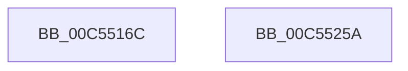

# WheaInitializeServices

- RVA: `0x00C5516C`–`0x00C5525B` (길이 `239` bytes)
- VA: `0x0000000140C5516C`
- 실행 섹션: `INIT`
- PDB 이름 있음: `예`; PDB Function 태그: `아니요`
- unwind 정보 RVA: `0x0005C788`
- 디코드: `38`개 명령, `239/239` bytes 표시
- 미해석 바이트: `0` (있으면 어셈블리에 `.byte`로 보존)

> 이 문서는 커널 이미지의 기계어와 PDB 기호를 분석해 생성했습니다. 4번과 5번은 함수 원형과 자료형을 바이너리 사용 방식에서 추정한 C 해석이며 원본 소스 복구 결과는 아닙니다.

## 1. Dependencies

- 직접 호출 지점: **2**; 고유 호출 대상: **2**
- 직접 호출자로 확인된 함수: **1**
- RIP 상대 이미지 참조: **29**

### Outgoing calls
- `0x00C55170` → [WheapSetDefaultErrorSourceConfiguration](WheapSetDefaultErrorSourceConfiguration_function_00C55540.md) (function, `0x00C55540`)
- `0x00C55250` → [WheapInitializeInUsePageOfflineNotifications](../../page/7D/WheapInitializeInUsePageOfflineNotifications_function_007D7F54.md) (function, `0x007D7F54`)

### Direct callers
- [InitBootProcessor](../C1/InitBootProcessor_function_00C1B1C8.md) at `0x00C1B41A`

### Static image references
- `0x00C55175` → RVA `0x00EEFB28` (`.data`; read)
- `0x00C5517E` → RVA `0x00EEFB18` (`.data`; write)
- `0x00C55185` → RVA `0x00EEFB30` (`.data`; write)
- `0x00C5518C` → RVA `0x00EEFB28` (`.data`; write)
- `0x00C55197` → RVA `0x00EF7DC0` (`.data`; read)
- `0x00C5519E` → RVA `0x00EEFB20` (`.data`; write)
- `0x00C551A5` → RVA `0x00EF7DC8` (`.data`; write)
- `0x00C551AC` → RVA `0x00EF7DC0` (`.data`; write)
- `0x00C551B3` → RVA `0x00EF7DE0` (`.data`; read)
- `0x00C551BA` → RVA `0x00EF7DE8` (`.data`; write)
- `0x00C551C1` → RVA `0x00EF7DE0` (`.data`; write)
- `0x00C551C8` → RVA `0x006601C0` (`WheapDeferredRecoveryServiceDpcRoutine`; read)
- `0x00C551CF` → RVA `0x00EF9F78` (`.data`; write)
- `0x00C551D6` → RVA `0x006602B0` (`WheapDeferredRecoveryServiceWorker`; read)
- `0x00C551DD` → RVA `0x00EF9FB0` (`.data`; write)
- `0x00C551E4` → RVA `0x00EF7DA0` (`.data`; write)
- `0x00C551EE` → RVA `0x00EF7DA8` (`.data`; write)
- `0x00C551F5` → RVA `0x00EF7DB0` (`.data`; write)
- `0x00C551FB` → RVA `0x00EF7DB8` (`.data`; write)
- `0x00C55204` → RVA `0x00EF7DBA` (`.data`; write)
- `0x00C5520B` → RVA `0x00EF7DBC` (`.data`; write)
- `0x00C55211` → RVA `0x00EF9FC0` (`.data`; write)
- `0x00C55218` → RVA `0x00EF9F60` (`.data`; write)
- `0x00C55222` → RVA `0x00EF9F80` (`.data`; write)
- `0x00C55229` → RVA `0x00EF9F98` (`.data`; write)
- `0x00C55230` → RVA `0x00EF9F70` (`.data`; write)
- `0x00C55237` → RVA `0x00EF9FB8` (`.data`; write)
- `0x00C5523E` → RVA `0x00EF9FA0` (`.data`; write)
- `0x00C55249` → RVA `0x00EEF570` (`.data`; write)

## 2. Other-region calls and transfers

- 다른 실행 섹션으로 향하는 call: **1**
  - `0x00C55250` → [WheapInitializeInUsePageOfflineNotifications](../../page/7D/WheapInitializeInUsePageOfflineNotifications_function_007D7F54.md) (`INIT` → `PAGE`)
- 별도 외부 분기/꼬리 이동을 확인하지 못했습니다.

## 3. Assembly (complete function range)

```asm
00C5516C  48 83 EC 28                     sub rsp, 0x28
00C55170  E8 CB 03 00 00                  call 0x140c55540
00C55175  48 8D 05 AC A9 29 00            lea rax, [rip + 0x29a9ac]
00C5517C  33 C9                           xor ecx, ecx
00C5517E  48 89 0D 93 A9 29 00            mov qword ptr [rip + 0x29a993], rcx
00C55185  48 89 05 A4 A9 29 00            mov qword ptr [rip + 0x29a9a4], rax
00C5518C  48 89 05 95 A9 29 00            mov qword ptr [rip + 0x29a995], rax
00C55193  F0 09 0C 24                     lock or dword ptr [rsp], ecx
00C55197  48 8D 05 22 2C 2A 00            lea rax, [rip + 0x2a2c22]
00C5519E  C6 05 7B A9 29 00 01            mov byte ptr [rip + 0x29a97b], 1
00C551A5  48 89 05 1C 2C 2A 00            mov qword ptr [rip + 0x2a2c1c], rax
00C551AC  48 89 05 0D 2C 2A 00            mov qword ptr [rip + 0x2a2c0d], rax
00C551B3  48 8D 05 26 2C 2A 00            lea rax, [rip + 0x2a2c26]
00C551BA  48 89 05 27 2C 2A 00            mov qword ptr [rip + 0x2a2c27], rax
00C551C1  48 89 05 18 2C 2A 00            mov qword ptr [rip + 0x2a2c18], rax
00C551C8  48 8D 05 F1 AF A0 FF            lea rax, [rip - 0x5f500f]
00C551CF  48 89 05 A2 4D 2A 00            mov qword ptr [rip + 0x2a4da2], rax
00C551D6  48 8D 05 D3 B0 A0 FF            lea rax, [rip - 0x5f4f2d]
00C551DD  48 89 05 CC 4D 2A 00            mov qword ptr [rip + 0x2a4dcc], rax
00C551E4  C7 05 B2 2B 2A 00 01 00 00 00   mov dword ptr [rip + 0x2a2bb2], 1
00C551EE  48 89 0D B3 2B 2A 00            mov qword ptr [rip + 0x2a2bb3], rcx
00C551F5  89 0D B5 2B 2A 00               mov dword ptr [rip + 0x2a2bb5], ecx
00C551FB  66 C7 05 B4 2B 2A 00 01 00      mov word ptr [rip + 0x2a2bb4], 1
00C55204  C6 05 AF 2B 2A 00 06            mov byte ptr [rip + 0x2a2baf], 6
00C5520B  89 0D AB 2B 2A 00               mov dword ptr [rip + 0x2a2bab], ecx
00C55211  48 89 0D A8 4D 2A 00            mov qword ptr [rip + 0x2a4da8], rcx
00C55218  C7 05 3E 4D 2A 00 13 01 00 00   mov dword ptr [rip + 0x2a4d3e], 0x113
00C55222  48 89 0D 57 4D 2A 00            mov qword ptr [rip + 0x2a4d57], rcx
00C55229  48 89 0D 68 4D 2A 00            mov qword ptr [rip + 0x2a4d68], rcx
00C55230  48 89 0D 39 4D 2A 00            mov qword ptr [rip + 0x2a4d39], rcx
00C55237  48 89 0D 7A 4D 2A 00            mov qword ptr [rip + 0x2a4d7a], rcx
00C5523E  48 89 0D 5B 4D 2A 00            mov qword ptr [rip + 0x2a4d5b], rcx
00C55245  F0 09 0C 24                     lock or dword ptr [rsp], ecx
00C55249  C6 05 20 A3 29 00 01            mov byte ptr [rip + 0x29a320], 1
00C55250  E8 FF 2C B8 FF                  call 0x1407d7f54
00C55255  48 83 C4 28                     add rsp, 0x28
00C55259  C3                              ret
00C5525A  CC                              int3
```

## 4. C-style interpretation (structured pseudocode)

```c
__int64 __fastcall WheaInitializeServices(int a1)
{
    __int64 result;
    __int64 v_rsp;
    unsigned int v_stack_m28;

    v_rsp = (v_rsp) - (40);
    result = WheapSetDefaultErrorSourceConfiguration(a1, a2, a3, a4);
    a1 = 0;
    *(unsigned __int64 *)(v_rip + 2730387) = 0;
    *(unsigned __int64 *)(v_rip + 2730404) = v_rip + 2730412;
    *(unsigned __int64 *)(v_rip + 2730389) = v_rip + 2730412;
    *(unsigned __int8 *)(v_rip + 2730363) = 1;
    *(unsigned __int64 *)(v_rip + 2763804) = v_rip + 2763810;
    *(unsigned __int64 *)(v_rip + 2763789) = v_rip + 2763810;
    *(unsigned __int64 *)(v_rip + 2763815) = v_rip + 2763814;
    *(unsigned __int64 *)(v_rip + 2763800) = v_rip + 2763814;
    *(unsigned __int64 *)(v_rip + 2772386) = v_rip - 6246415;
    *(unsigned __int64 *)(v_rip + 2772428) = v_rip - 6246189;
    *(unsigned int *)(v_rip + 2763698) = 1;
    *(unsigned __int64 *)(v_rip + 2763699) = 0;
    *(unsigned int *)(v_rip + 2763701) = 0;
    *(unsigned __int16 *)(v_rip + 2763700) = 1;
    *(unsigned __int8 *)(v_rip + 2763695) = 6;
    *(unsigned int *)(v_rip + 2763691) = 0;
    *(unsigned __int64 *)(v_rip + 2772392) = 0;
    *(unsigned int *)(v_rip + 2772286) = 275;
    *(unsigned __int64 *)(v_rip + 2772311) = 0;
    *(unsigned __int64 *)(v_rip + 2772328) = 0;
    *(unsigned __int64 *)(v_rip + 2772281) = 0;
    *(unsigned __int64 *)(v_rip + 2772346) = 0;
    *(unsigned __int64 *)(v_rip + 2772315) = 0;
    *(unsigned __int8 *)(v_rip + 2728736) = 1;
    result = WheapInitializeInUsePageOfflineNotifications(a1, a2, a3, a4);
    v_rsp = (v_rsp) + (40);
    return result;
}
```

## 5. (Beta) C Style

```c
int64_t WheaInitializeServices(int32_t Arg1)
{
    int64_t result;
    int64_t local_rsp;
    uint32_t v_stack_m28;

    local_rsp = (local_rsp) - (40);
    result = WheapSetDefaultErrorSourceConfiguration(Arg1, a2, a3, a4);
    Arg1 = 0;
    *(uint64_t *)(v_rip + 0x29A993) = 0;
    *(uint64_t *)(v_rip + 0x29A9A4) = v_rip + 2730412;
    *(uint64_t *)(v_rip + 0x29A995) = v_rip + 2730412;
    *(uint8_t *)(v_rip + 0x29A97B) = 1;
    *(uint64_t *)(v_rip + 0x2A2C1C) = v_rip + 2763810;
    *(uint64_t *)(v_rip + 0x2A2C0D) = v_rip + 2763810;
    *(uint64_t *)(v_rip + 0x2A2C27) = v_rip + 2763814;
    *(uint64_t *)(v_rip + 0x2A2C18) = v_rip + 2763814;
    *(uint64_t *)(v_rip + 0x2A4DA2) = v_rip - 6246415;
    *(uint64_t *)(v_rip + 0x2A4DCC) = v_rip - 6246189;
    *(uint32_t *)(v_rip + 0x2A2BB2) = 1;
    *(uint64_t *)(v_rip + 0x2A2BB3) = 0;
    *(uint32_t *)(v_rip + 0x2A2BB5) = 0;
    *(uint16_t *)(v_rip + 0x2A2BB4) = 1;
    *(uint8_t *)(v_rip + 0x2A2BAF) = 6;
    *(uint32_t *)(v_rip + 0x2A2BAB) = 0;
    *(uint64_t *)(v_rip + 0x2A4DA8) = 0;
    *(uint32_t *)(v_rip + 0x2A4D3E) = 275;
    *(uint64_t *)(v_rip + 0x2A4D57) = 0;
    *(uint64_t *)(v_rip + 0x2A4D68) = 0;
    *(uint64_t *)(v_rip + 0x2A4D39) = 0;
    *(uint64_t *)(v_rip + 0x2A4D7A) = 0;
    *(uint64_t *)(v_rip + 0x2A4D5B) = 0;
    *(uint8_t *)(v_rip + 0x29A320) = 1;
    result = WheapInitializeInUsePageOfflineNotifications(Arg1, a2, a3, a4);
    local_rsp = (local_rsp) + (40);
    return result;
}
```

## 6. Execution-region graph

[열기: 2D/3D 그래프와 함수 탐색 컨트롤 패널](../../../control-panel.html?section=init&rva=0x00C5516C&view=graph)

- 2D 그래프는 위에서 아래로 흐르고, 3D 그래프는 빈 공간을 드래그해 회전합니다. Shift+드래그는 이동, 휠은 확대·축소, 함수 노드 선택은 대상 보고서 이동입니다.

### Static fallback


