# WheaInitialize

- RVA: `0x00C54C08`–`0x00C55166` (길이 `1,374` bytes)
- VA: `0x0000000140C54C08`
- 실행 섹션: `INIT`
- PDB 이름 있음: `예`; PDB Function 태그: `아니요`
- unwind 정보 RVA: `0x000D5DE4`
- 디코드: `331`개 명령, `1,374/1,374` bytes 표시
- 미해석 바이트: `0` (있으면 어셈블리에 `.byte`로 보존)

> 이 문서는 커널 이미지의 기계어와 PDB 기호를 분석해 생성했습니다. 4번과 5번은 함수 원형과 자료형을 바이너리 사용 방식에서 추정한 C 해석이며 원본 소스 복구 결과는 아닙니다.

## 1. Dependencies

- 직접 호출 지점: **36**; 고유 호출 대상: **24**
- 직접 호출자로 확인된 함수: **1**
- RIP 상대 이미지 참조: **49**

### Outgoing calls
- `0x00C54C5A` → [WheapLoadPolicy](WheapLoadPolicy_function_00C5574C.md) (function, `0x00C5574C`)
- `0x00C54C83` → `PSHED.dll!PshedInitialize` (import, 간접 대상; import `PSHED.dll!PshedInitialize`)
- `0x00C54CA7` → [KeBugCheckEx](../../text/4F/KeBugCheckEx_function_004FD660.md) (function, `0x004FD660`)
- `0x00C54CAD` → [WheapCreatePerProcessorInfo](WheapCreatePerProcessorInfo_function_00C55264.md) (function, `0x00C55264`)
- `0x00C54CCA` → [KeBugCheckEx](../../text/4F/KeBugCheckEx_function_004FD660.md) (function, `0x004FD660`)
- `0x00C54CD8` → [WheapQueryPshedForErrorSources](WheapQueryPshedForErrorSources_function_00C55464.md) (function, `0x00C55464`)
- `0x00C54CF5` → [KeBugCheckEx](../../text/4F/KeBugCheckEx_function_004FD660.md) (function, `0x004FD660`)
- `0x00C54D4D` → [WheapInitializeEventing](WheapInitializeEventing_function_00C55610.md) (function, `0x00C55610`)
- `0x00C54D79` → [guard_dispatch_icall](../../text/6B/guard_dispatch_icall_function_006BAAD0.md) (function, `0x006BAAD0`)
- `0x00C54DAD` → [KeBugCheckEx](../../text/4F/KeBugCheckEx_function_004FD660.md) (function, `0x004FD660`)
- `0x00C54DB7` → `PSHED.dll!PshedFreeMemory` (import, 간접 대상; import `PSHED.dll!PshedFreeMemory`)
- `0x00C54DE1` → `PSHED.dll!PshedInitialize` (import, 간접 대상; import `PSHED.dll!PshedInitialize`)
- `0x00C54E05` → [KeBugCheckEx](../../text/4F/KeBugCheckEx_function_004FD660.md) (function, `0x004FD660`)
- `0x00C54E1D` → [memset](../../text/6C/memset_function_006C6C40.md) (function, `0x006C6C40`)
- `0x00C54E93` → [WheapInitWnfCallbacks](../../page/7D/WheapInitWnfCallbacks_function_007D9594.md) (function, `0x007D9594`)
- `0x00C54EA0` → [WheapQueryPshedForErrorSources](WheapQueryPshedForErrorSources_function_00C55464.md) (function, `0x00C55464`)
- `0x00C54EBC` → [KeBugCheckEx](../../text/4F/KeBugCheckEx_function_004FD660.md) (function, `0x004FD660`)
- `0x00C54EE3` → [KeAbPreAcquire](../../text/21/KeAbPreAcquire_function_00210230.md) (function, `0x00210230`)
- `0x00C54F08` → [ExfAcquirePushLockExclusiveEx](../../text/20/ExfAcquirePushLockExclusiveEx_function_0020FC90.md) (function, `0x0020FC90`)
- `0x00C54F1D` → [WheapInitializeErrorSourceTable](WheapInitializeErrorSourceTable_function_00C55304.md) (function, `0x00C55304`)
- `0x00C54F3A` → [KeBugCheckEx](../../text/4F/KeBugCheckEx_function_004FD660.md) (function, `0x004FD660`)
- `0x00C54F44` → `PSHED.dll!PshedFreeMemory` (import, 간접 대상; import `PSHED.dll!PshedFreeMemory`)
- `0x00C54F66` → [KeGetPrcb](../../text/2D/KeGetPrcb_function_002D85D0.md) (function, `0x002D85D0`)
- `0x00C54FC6` → [WheapCallErrorSourceInitialize](../../text/65/WheapCallErrorSourceInitialize_function_0065FC14.md) (function, `0x0065FC14`)
- `0x00C54FF3` → [KeBugCheckEx](../../text/4F/KeBugCheckEx_function_004FD660.md) (function, `0x004FD660`)
- `0x00C5505F` → `PSHED.dll!PshedIsSystemWheaEnabled` (import, 간접 대상; import `PSHED.dll!PshedIsSystemWheaEnabled`)
- `0x00C5506F` → [WheapCheckForAndReportErrorsFromPreviousSession](../../text/65/WheapCheckForAndReportErrorsFromPreviousSession_function_0065DC98.md) (function, `0x0065DC98`)
- `0x00C550A5` → [WheapCallErrorSourceInitialize](../../text/65/WheapCallErrorSourceInitialize_function_0065FC14.md) (function, `0x0065FC14`)
- `0x00C550D5` → [KeBugCheckEx](../../text/4F/KeBugCheckEx_function_004FD660.md) (function, `0x004FD660`)
- `0x00C550E4` → [ExGetPrmInterface](../../page/7C/ExGetPrmInterface_function_007CEC30.md) (function, `0x007CEC30`)
- `0x00C550F4` → [WheapLogInitEvent](../../page/7D/WheapLogInitEvent_function_007D83F8.md) (function, `0x007D83F8`)
- `0x00C55113` → [IoWMIRegistrationControl](../../page/9E/IoWMIRegistrationControl_function_009E2D60.md) (function, `0x009E2D60`)
- `0x00C55118` → [WheaInitializeRegChangeNotify](../../page/7D/WheaInitializeRegChangeNotify_function_007D89BC.md) (function, `0x007D89BC`)
- `0x00C5513E` → [ExfTryToWakePushLock](../../text/26/ExfTryToWakePushLock_function_00265DD0.md) (function, `0x00265DD0`)
- `0x00C5514A` → [KeAbPostRelease](../../text/2E/KeAbPostRelease_function_002E1600.md) (function, `0x002E1600`)
- `0x00C5514F` → [KeLeaveCriticalRegion](../../text/25/KeLeaveCriticalRegion_function_0025D8B0.md) (function, `0x0025D8B0`)

### Direct callers
- [IoInitSystemPreDrivers](../C2/IoInitSystemPreDrivers_function_00C2AC3C.md) at `0x00C2B7C2`
- [IoInitSystemPreDrivers](../C2/IoInitSystemPreDrivers_function_00C2AC3C.md) at `0x00C2BEB0`

### Static image references
- `0x00C54C39` → RVA `0x00EFA070` (`.data`; write)
- `0x00C54C40` → RVA `0x00EFA078` (`.data`; write)
- `0x00C54C53` → RVA `0x00EEF010` (`.data`; write)
- `0x00C54C75` → RVA `0x00EEEFF0` (`.data`; write)
- `0x00C54C83` → RVA `0x00151080` (`PSHED.dll!PshedInitialize (IAT)`; read)
- `0x00C54CFB` → RVA `0x00EEF028` (`.data`; read)
- `0x00C54D02` → RVA `0x00EEF018` (`.data`; write)
- `0x00C54D0D` → RVA `0x00EEF040` (`.data`; read)
- `0x00C54D14` → RVA `0x00EEF030` (`.data`; write)
- `0x00C54D1B` → RVA `0x00EEF028` (`.data`; write)
- `0x00C54D25` → RVA `0x00EEF020` (`.data`; write)
- `0x00C54D2B` → RVA `0x00EEF038` (`.data`; write)
- `0x00C54D32` → RVA `0x00EEF03A` (`.data`; write)
- `0x00C54D39` → RVA `0x00EEF03C` (`.data`; write)
- `0x00C54D3F` → RVA `0x00EEF048` (`.data`; write)
- `0x00C54D46` → RVA `0x00EEF040` (`.data`; write)
- `0x00C54D62` → RVA `0x00EEF0A8` (`.data`; read)
- `0x00C54DB7` → RVA `0x00151120` (`PSHED.dll!PshedFreeMemory (IAT)`; read)
- `0x00C54DC8` → RVA `0x00EF9FD0` (`.data`; read)
- `0x00C54DD3` → RVA `0x00EF9FD8` (`.data`; write)
- `0x00C54DDA` → RVA `0x00EF9FD0` (`.data`; write)
- `0x00C54E0B` → RVA `0x00EF9FE0` (`.data`; read)
- `0x00C54E22` → RVA `0x004A6BB0` (`WheapWorkQueueDpcRoutine`; read)
- `0x00C54E29` → RVA `0x00EF9FE8` (`.data`; write)
- `0x00C54E30` → RVA `0x00EFA018` (`.data`; write)
- `0x00C54E3C` → RVA `0x003865E0` (`WheapWorkQueueWorkerRoutine`; read)
- `0x00C54E43` → RVA `0x00EF9FE0` (`.data`; write)
- `0x00C54E4A` → RVA `0x00EFA050` (`.data`; write)
- `0x00C54E51` → RVA `0x00484820` (`WheapProcessWorkQueueItem`; read)
- `0x00C54E58` → RVA `0x00EFA060` (`.data`; write)
- `0x00C54E5F` → RVA `0x00EF9FF0` (`.data`; write)
- `0x00C54E66` → RVA `0x00EFA000` (`.data`; write)
- `0x00C54E70` → RVA `0x00EFA020` (`.data`; write)
- `0x00C54E77` → RVA `0x00EFA038` (`.data`; write)
- `0x00C54E7E` → RVA `0x00EFA010` (`.data`; write)
- `0x00C54E85` → RVA `0x00EFA058` (`.data`; write)
- `0x00C54E8C` → RVA `0x00EFA040` (`.data`; write)
- `0x00C54ECB` → RVA `0x00EF9FC8` (`.data`; read)
- `0x00C54EE8` → RVA `0x00EF9FC8` (`.data`; read/write)
- `0x00C54F50` → RVA `0x00FC6A80` (`ALMOSTRO`; read)
- `0x00C54F84` → RVA `0x00EEF018` (`.data`; read)
- `0x00C55048` → RVA `0x00EEEFF1` (`.data`; write)
- `0x00C5505F` → RVA `0x00151130` (`PSHED.dll!PshedIsSystemWheaEnabled (IAT)`; read)
- `0x00C550DB` → RVA `0x00EF7E00` (`.data`; read)
- `0x00C550ED` → RVA `0x00EEF580` (`.data`; write)
- `0x00C550F9` → RVA `0x00661260` (`WheaWmiDispatch`; read)
- `0x00C55105` → RVA `0x00EF7D28` (`.data`; read)
- `0x00C5510C` → RVA `0x00EF7D28` (`.data`; write)
- `0x00C5511D` → RVA `0x00EEF000` (`.data`; write)

## 2. Other-region calls and transfers

- 다른 실행 섹션으로 향하는 call: **25**
  - `0x00C54CA7` → [KeBugCheckEx](../../text/4F/KeBugCheckEx_function_004FD660.md) (`INIT` → `.text`)
  - `0x00C54CCA` → [KeBugCheckEx](../../text/4F/KeBugCheckEx_function_004FD660.md) (`INIT` → `.text`)
  - `0x00C54CF5` → [KeBugCheckEx](../../text/4F/KeBugCheckEx_function_004FD660.md) (`INIT` → `.text`)
  - `0x00C54D79` → [guard_dispatch_icall](../../text/6B/guard_dispatch_icall_function_006BAAD0.md) (`INIT` → `.text`)
  - `0x00C54DAD` → [KeBugCheckEx](../../text/4F/KeBugCheckEx_function_004FD660.md) (`INIT` → `.text`)
  - `0x00C54E05` → [KeBugCheckEx](../../text/4F/KeBugCheckEx_function_004FD660.md) (`INIT` → `.text`)
  - `0x00C54E1D` → [memset](../../text/6C/memset_function_006C6C40.md) (`INIT` → `.text`)
  - `0x00C54E93` → [WheapInitWnfCallbacks](../../page/7D/WheapInitWnfCallbacks_function_007D9594.md) (`INIT` → `PAGE`)
  - `0x00C54EBC` → [KeBugCheckEx](../../text/4F/KeBugCheckEx_function_004FD660.md) (`INIT` → `.text`)
  - `0x00C54EE3` → [KeAbPreAcquire](../../text/21/KeAbPreAcquire_function_00210230.md) (`INIT` → `.text`)
  - `0x00C54F08` → [ExfAcquirePushLockExclusiveEx](../../text/20/ExfAcquirePushLockExclusiveEx_function_0020FC90.md) (`INIT` → `.text`)
  - `0x00C54F3A` → [KeBugCheckEx](../../text/4F/KeBugCheckEx_function_004FD660.md) (`INIT` → `.text`)
  - `0x00C54F66` → [KeGetPrcb](../../text/2D/KeGetPrcb_function_002D85D0.md) (`INIT` → `.text`)
  - `0x00C54FC6` → [WheapCallErrorSourceInitialize](../../text/65/WheapCallErrorSourceInitialize_function_0065FC14.md) (`INIT` → `.text`)
  - `0x00C54FF3` → [KeBugCheckEx](../../text/4F/KeBugCheckEx_function_004FD660.md) (`INIT` → `.text`)
  - `0x00C5506F` → [WheapCheckForAndReportErrorsFromPreviousSession](../../text/65/WheapCheckForAndReportErrorsFromPreviousSession_function_0065DC98.md) (`INIT` → `.text`)
  - `0x00C550A5` → [WheapCallErrorSourceInitialize](../../text/65/WheapCallErrorSourceInitialize_function_0065FC14.md) (`INIT` → `.text`)
  - `0x00C550D5` → [KeBugCheckEx](../../text/4F/KeBugCheckEx_function_004FD660.md) (`INIT` → `.text`)
  - `0x00C550E4` → [ExGetPrmInterface](../../page/7C/ExGetPrmInterface_function_007CEC30.md) (`INIT` → `PAGE`)
  - `0x00C550F4` → [WheapLogInitEvent](../../page/7D/WheapLogInitEvent_function_007D83F8.md) (`INIT` → `PAGE`)
  - `0x00C55113` → [IoWMIRegistrationControl](../../page/9E/IoWMIRegistrationControl_function_009E2D60.md) (`INIT` → `PAGE`)
  - `0x00C55118` → [WheaInitializeRegChangeNotify](../../page/7D/WheaInitializeRegChangeNotify_function_007D89BC.md) (`INIT` → `PAGE`)
  - `0x00C5513E` → [ExfTryToWakePushLock](../../text/26/ExfTryToWakePushLock_function_00265DD0.md) (`INIT` → `.text`)
  - `0x00C5514A` → [KeAbPostRelease](../../text/2E/KeAbPostRelease_function_002E1600.md) (`INIT` → `.text`)
  - `0x00C5514F` → [KeLeaveCriticalRegion](../../text/25/KeLeaveCriticalRegion_function_0025D8B0.md) (`INIT` → `.text`)
- 별도 외부 분기/꼬리 이동을 확인하지 못했습니다.

## 3. Assembly (complete function range)

```asm
00C54C08  40 55                           push rbp
00C54C0A  53                              push rbx
00C54C0B  56                              push rsi
00C54C0C  57                              push rdi
00C54C0D  41 54                           push r12
00C54C0F  41 55                           push r13
00C54C11  41 56                           push r14
00C54C13  48 8B EC                        mov rbp, rsp
00C54C16  48 83 EC 40                     sub rsp, 0x40
00C54C1A  45 33 F6                        xor r14d, r14d
00C54C1D  44 8B E2                        mov r12d, edx
00C54C20  4C 89 75 50                     mov qword ptr [rbp + 0x50], r14
00C54C24  4C 8B E9                        mov r13, rcx
00C54C27  4C 89 75 58                     mov qword ptr [rbp + 0x58], r14
00C54C2B  44 89 75 48                     mov dword ptr [rbp + 0x48], r14d
00C54C2F  85 D2                           test edx, edx
00C54C31  0F 85 91 01 00 00               jne 0x140c54dc8
00C54C37  33 C0                           xor eax, eax
00C54C39  48 89 05 30 54 2A 00            mov qword ptr [rip + 0x2a5430], rax
00C54C40  89 05 32 54 2A 00               mov dword ptr [rip + 0x2a5432], eax
00C54C46  48 B8 14 00 00 00 80 F7 FF FF   movabs rax, 0xfffff78000000014
00C54C50  48 8B 00                        mov rax, qword ptr [rax]
00C54C53  48 89 05 B6 A3 29 00            mov qword ptr [rip + 0x29a3b6], rax
00C54C5A  E8 ED 0A 00 00                  call 0x140c5574c
00C54C5F  49 8B 85 F0 00 00 00            mov rax, qword ptr [r13 + 0xf0]
00C54C66  41 8D 76 01                     lea esi, [r14 + 1]
00C54C6A  8B 88 84 00 00 00               mov ecx, dword ptr [rax + 0x84]
00C54C70  F6 C1 02                        test cl, 2
00C54C73  75 07                           jne 0x140c54c7c
00C54C75  40 88 35 74 A3 29 00            mov byte ptr [rip + 0x29a374], sil
00C54C7C  48 8D 55 58                     lea rdx, [rbp + 0x58]
00C54C80  49 8B CD                        mov rcx, r13
00C54C83  48 FF 15 F6 C3 4F FF            call qword ptr [rip - 0xb03c0a]
00C54C8A  0F 1F 44 00 00                  nop dword ptr [rax + rax]
00C54C8F  85 C0                           test eax, eax
00C54C91  79 1A                           jns 0x140c54cad
00C54C93  45 33 C9                        xor r9d, r9d
00C54C96  4C 63 C0                        movsxd r8, eax
00C54C99  B9 22 01 00 00                  mov ecx, 0x122
00C54C9E  4C 89 74 24 20                  mov qword ptr [rsp + 0x20], r14
00C54CA3  41 8D 51 03                     lea edx, [r9 + 3]
00C54CA7  E8 B4 89 8A FF                  call 0x1404fd660
00C54CAC  CC                              int3
00C54CAD  E8 B2 05 00 00                  call 0x140c55264
00C54CB2  85 C0                           test eax, eax
00C54CB4  79 1A                           jns 0x140c54cd0
00C54CB6  45 33 C9                        xor r9d, r9d
00C54CB9  4C 63 C0                        movsxd r8, eax
00C54CBC  B9 22 01 00 00                  mov ecx, 0x122
00C54CC1  4C 89 74 24 20                  mov qword ptr [rsp + 0x20], r14
00C54CC6  41 8D 51 04                     lea edx, [r9 + 4]
00C54CCA  E8 91 89 8A FF                  call 0x1404fd660
00C54CCF  CC                              int3
00C54CD0  48 8D 55 50                     lea rdx, [rbp + 0x50]
00C54CD4  48 8D 4D 48                     lea rcx, [rbp + 0x48]
00C54CD8  E8 87 07 00 00                  call 0x140c55464
00C54CDD  85 C0                           test eax, eax
00C54CDF  79 1A                           jns 0x140c54cfb
00C54CE1  45 33 C9                        xor r9d, r9d
00C54CE4  4C 63 C0                        movsxd r8, eax
00C54CE7  B9 22 01 00 00                  mov ecx, 0x122
00C54CEC  4C 89 74 24 20                  mov qword ptr [rsp + 0x20], r14
00C54CF1  41 8D 51 05                     lea edx, [r9 + 5]
00C54CF5  E8 66 89 8A FF                  call 0x1404fd660
00C54CFA  CC                              int3
00C54CFB  4C 8D 35 26 A3 29 00            lea r14, [rip + 0x29a326]
00C54D02  48 C7 05 0B A3 29 00 54 41 42 4C  mov qword ptr [rip + 0x29a30b], 0x4c424154
00C54D0D  48 8D 05 2C A3 29 00            lea rax, [rip + 0x29a32c]
00C54D14  4C 89 35 15 A3 29 00            mov qword ptr [rip + 0x29a315], r14
00C54D1B  4C 89 35 06 A3 29 00            mov qword ptr [rip + 0x29a306], r14
00C54D22  45 33 F6                        xor r14d, r14d
00C54D25  89 35 F5 A2 29 00               mov dword ptr [rip + 0x29a2f5], esi
00C54D2B  66 89 35 06 A3 29 00            mov word ptr [rip + 0x29a306], si
00C54D32  C6 05 01 A3 29 00 06            mov byte ptr [rip + 0x29a301], 6
00C54D39  89 35 FD A2 29 00               mov dword ptr [rip + 0x29a2fd], esi
00C54D3F  48 89 05 02 A3 29 00            mov qword ptr [rip + 0x29a302], rax
00C54D46  48 89 05 F3 A2 29 00            mov qword ptr [rip + 0x29a2f3], rax
00C54D4D  E8 BE 08 00 00                  call 0x140c55610
00C54D52  48 8B 5D 50                     mov rbx, qword ptr [rbp + 0x50]
00C54D56  41 8B FE                        mov edi, r14d
00C54D59  3B 7D 48                        cmp edi, dword ptr [rbp + 0x48]
00C54D5C  73 55                           jae 0x140c54db3
00C54D5E  48 63 43 08                     movsxd rax, dword ptr [rbx + 8]
00C54D62  48 8D 0D 3F A3 29 00            lea rcx, [rip + 0x29a33f]
00C54D69  48 C1 E0 06                     shl rax, 6
00C54D6D  45 33 C0                        xor r8d, r8d
00C54D70  48 8B D3                        mov rdx, rbx
00C54D73  48 8B 04 08                     mov rax, qword ptr [rax + rcx]
00C54D77  33 C9                           xor ecx, ecx
00C54D79  E8 52 5D A6 FF                  call 0x1406baad0
00C54D7E  48 63 C8                        movsxd rcx, eax
00C54D81  85 C0                           test eax, eax
00C54D83  78 10                           js 0x140c54d95
00C54D85  8B 03                           mov eax, dword ptr [rbx]
00C54D87  C7 43 0C 02 00 00 00            mov dword ptr [rbx + 0xc], 2
00C54D8E  48 03 D8                        add rbx, rax
00C54D91  03 FE                           add edi, esi
00C54D93  EB C4                           jmp 0x140c54d59
00C54D95  48 63 43 08                     movsxd rax, dword ptr [rbx + 8]
00C54D99  45 33 C9                        xor r9d, r9d
00C54D9C  4C 8B C1                        mov r8, rcx
00C54D9F  48 89 44 24 20                  mov qword ptr [rsp + 0x20], rax
00C54DA4  B9 22 01 00 00                  mov ecx, 0x122
00C54DA9  41 8D 51 06                     lea edx, [r9 + 6]
00C54DAD  E8 AE 88 8A FF                  call 0x1404fd660
00C54DB2  CC                              int3
00C54DB3  48 8B 4D 50                     mov rcx, qword ptr [rbp + 0x50]
00C54DB7  48 FF 15 62 C3 4F FF            call qword ptr [rip - 0xb03c9e]
00C54DBE  0F 1F 44 00 00                  nop dword ptr [rax + rax]
00C54DC3  E9 8C 03 00 00                  jmp 0x140c55154
00C54DC8  48 8D 05 01 52 2A 00            lea rax, [rip + 0x2a5201]
00C54DCF  48 8D 55 58                     lea rdx, [rbp + 0x58]
00C54DD3  48 89 05 FE 51 2A 00            mov qword ptr [rip + 0x2a51fe], rax
00C54DDA  48 89 05 EF 51 2A 00            mov qword ptr [rip + 0x2a51ef], rax
00C54DE1  48 FF 15 98 C2 4F FF            call qword ptr [rip - 0xb03d68]
00C54DE8  0F 1F 44 00 00                  nop dword ptr [rax + rax]
00C54DED  85 C0                           test eax, eax
00C54DEF  79 1A                           jns 0x140c54e0b
00C54DF1  45 33 C9                        xor r9d, r9d
00C54DF4  4C 63 C0                        movsxd r8, eax
00C54DF7  B9 22 01 00 00                  mov ecx, 0x122
00C54DFC  4C 89 74 24 20                  mov qword ptr [rsp + 0x20], r14
00C54E01  41 8D 51 03                     lea edx, [r9 + 3]
00C54E05  E8 56 88 8A FF                  call 0x1404fd660
00C54E0A  CC                              int3
00C54E0B  48 8D 1D CE 51 2A 00            lea rbx, [rip + 0x2a51ce]
00C54E12  33 D2                           xor edx, edx
00C54E14  48 8B CB                        mov rcx, rbx
00C54E17  41 B8 88 00 00 00               mov r8d, 0x88
00C54E1D  E8 1E 1E A7 FF                  call 0x1406c6c40
00C54E22  48 8D 05 87 1D 85 FF            lea rax, [rip - 0x7ae279]
00C54E29  48 89 1D B8 51 2A 00            mov qword ptr [rip + 0x2a51b8], rbx
00C54E30  48 89 05 E1 51 2A 00            mov qword ptr [rip + 0x2a51e1], rax
00C54E37  BE 01 00 00 00                  mov esi, 1
00C54E3C  48 8D 05 9D 17 73 FF            lea rax, [rip - 0x8ce863]
00C54E43  48 89 1D 96 51 2A 00            mov qword ptr [rip + 0x2a5196], rbx
00C54E4A  48 89 05 FF 51 2A 00            mov qword ptr [rip + 0x2a51ff], rax
00C54E51  48 8D 05 C8 F9 82 FF            lea rax, [rip - 0x7d0638]
00C54E58  48 89 05 01 52 2A 00            mov qword ptr [rip + 0x2a5201], rax
00C54E5F  4C 89 35 8A 51 2A 00            mov qword ptr [rip + 0x2a518a], r14
00C54E66  C7 05 90 51 2A 00 13 01 00 00   mov dword ptr [rip + 0x2a5190], 0x113
00C54E70  48 89 1D A9 51 2A 00            mov qword ptr [rip + 0x2a51a9], rbx
00C54E77  4C 89 35 BA 51 2A 00            mov qword ptr [rip + 0x2a51ba], r14
00C54E7E  4C 89 35 8B 51 2A 00            mov qword ptr [rip + 0x2a518b], r14
00C54E85  48 89 1D CC 51 2A 00            mov qword ptr [rip + 0x2a51cc], rbx
00C54E8C  4C 89 35 AD 51 2A 00            mov qword ptr [rip + 0x2a51ad], r14
00C54E93  E8 FC 46 B8 FF                  call 0x1407d9594
00C54E98  48 8D 55 50                     lea rdx, [rbp + 0x50]
00C54E9C  48 8D 4D 48                     lea rcx, [rbp + 0x48]
00C54EA0  E8 BF 05 00 00                  call 0x140c55464
00C54EA5  85 C0                           test eax, eax
00C54EA7  79 19                           jns 0x140c54ec2
00C54EA9  4D 8B CC                        mov r9, r12
00C54EAC  4C 63 C0                        movsxd r8, eax
00C54EAF  8D 56 04                        lea edx, [rsi + 4]
00C54EB2  4C 89 74 24 20                  mov qword ptr [rsp + 0x20], r14
00C54EB7  B9 22 01 00 00                  mov ecx, 0x122
00C54EBC  E8 9F 87 8A FF                  call 0x1404fd660
00C54EC1  CC                              int3
00C54EC2  65 48 8B 04 25 88 01 00 00      mov rax, qword ptr gs:[0x188]
00C54ECB  48 8D 0D F6 50 2A 00            lea rcx, [rip + 0x2a50f6]
00C54ED2  48 83 CF FF                     or rdi, 0xffffffffffffffff
00C54ED6  45 33 C0                        xor r8d, r8d
00C54ED9  33 D2                           xor edx, edx
00C54EDB  66 01 B8 E4 01 00 00            add word ptr [rax + 0x1e4], di
00C54EE2  90                              nop
00C54EE3  E8 48 B3 5B FF                  call 0x140210230
00C54EE8  F0 48 0F BA 2D D6 50 2A 00 00   lock bts qword ptr [rip + 0x2a50d6], 0
00C54EF2  48 8B D8                        mov rbx, rax
00C54EF5  73 16                           jae 0x140c54f0d
00C54EF7  4C 8D 05 CA 50 2A 00            lea r8, [rip + 0x2a50ca]
00C54EFE  48 8B D0                        mov rdx, rax
00C54F01  48 8D 0D C0 50 2A 00            lea rcx, [rip + 0x2a50c0]
00C54F08  E8 83 AD 5B FF                  call 0x14020fc90
00C54F0D  48 85 DB                        test rbx, rbx
00C54F10  74 04                           je 0x140c54f16
00C54F12  40 88 73 0A                     mov byte ptr [rbx + 0xa], sil
00C54F16  48 8B 55 50                     mov rdx, qword ptr [rbp + 0x50]
00C54F1A  8B 4D 48                        mov ecx, dword ptr [rbp + 0x48]
00C54F1D  E8 E2 03 00 00                  call 0x140c55304
00C54F22  85 C0                           test eax, eax
00C54F24  79 1A                           jns 0x140c54f40
00C54F26  45 33 C9                        xor r9d, r9d
00C54F29  4C 63 C0                        movsxd r8, eax
00C54F2C  B9 22 01 00 00                  mov ecx, 0x122
00C54F31  4C 89 74 24 20                  mov qword ptr [rsp + 0x20], r14
00C54F36  41 8D 51 07                     lea edx, [r9 + 7]
00C54F3A  E8 21 87 8A FF                  call 0x1404fd660
00C54F3F  CC                              int3
00C54F40  48 8B 4D 50                     mov rcx, qword ptr [rbp + 0x50]
00C54F44  48 FF 15 D5 C1 4F FF            call qword ptr [rip - 0xb03e2b]
00C54F4B  0F 1F 44 00 00                  nop dword ptr [rax + rax]
00C54F50  8B 05 2A 1B 37 00               mov eax, dword ptr [rip + 0x371b2a]
00C54F56  41 8B DE                        mov ebx, r14d
00C54F59  85 C0                           test eax, eax
00C54F5B  74 43                           je 0x140c54fa0
00C54F5D  4C 8D 35 7C 50 2A 00            lea r14, [rip + 0x2a507c]
00C54F64  8B CB                           mov ecx, ebx
00C54F66  E8 65 36 68 FF                  call 0x1402d85d0
00C54F6B  8B 4D 48                        mov ecx, dword ptr [rbp + 0x48]
00C54F6E  03 DE                           add ebx, esi
00C54F70  48 8B 90 A0 8B 00 00            mov rdx, qword ptr [rax + 0x8ba0]
00C54F77  89 0A                           mov dword ptr [rdx], ecx
00C54F79  48 8B 88 A0 8B 00 00            mov rcx, qword ptr [rax + 0x8ba0]
00C54F80  4C 89 71 10                     mov qword ptr [rcx + 0x10], r14
00C54F84  48 8D 0D 8D A0 29 00            lea rcx, [rip + 0x29a08d]
00C54F8B  48 8B 80 A0 8B 00 00            mov rax, qword ptr [rax + 0x8ba0]
00C54F92  48 89 48 08                     mov qword ptr [rax + 8], rcx
00C54F96  8B 05 E4 1A 37 00               mov eax, dword ptr [rip + 0x371ae4]
00C54F9C  3B D8                           cmp ebx, eax
00C54F9E  72 C4                           jb 0x140c54f64
00C54FA0  48 8B 1D 81 A0 29 00            mov rbx, qword ptr [rip + 0x29a081]
00C54FA7  4C 8D 35 7A A0 29 00            lea r14, [rip + 0x29a07a]
00C54FAE  49 3B DE                        cmp rbx, r14
00C54FB1  74 46                           je 0x140c54ff9
00C54FB3  83 7B 68 07                     cmp dword ptr [rbx + 0x68], 7
00C54FB7  75 19                           jne 0x140c54fd2
00C54FB9  41 8B D4                        mov edx, r12d
00C54FBC  C7 43 6C 02 00 00 00            mov dword ptr [rbx + 0x6c], 2
00C54FC3  48 8B CB                        mov rcx, rbx
00C54FC6  E8 49 AC A0 FF                  call 0x14065fc14
00C54FCB  48 63 C8                        movsxd rcx, eax
00C54FCE  85 C0                           test eax, eax
00C54FD0  78 05                           js 0x140c54fd7
00C54FD2  48 8B 1B                        mov rbx, qword ptr [rbx]
00C54FD5  EB D7                           jmp 0x140c54fae
00C54FD7  48 63 43 68                     movsxd rax, dword ptr [rbx + 0x68]
00C54FDB  4C 8B C1                        mov r8, rcx
00C54FDE  B9 22 01 00 00                  mov ecx, 0x122
00C54FE3  48 89 44 24 20                  mov qword ptr [rsp + 0x20], rax
00C54FE8  4D 8B CC                        mov r9, r12
00C54FEB  89 73 6C                        mov dword ptr [rbx + 0x6c], esi
00C54FEE  BA 06 00 00 00                  mov edx, 6
00C54FF3  E8 68 86 8A FF                  call 0x1404fd660
00C54FF8  CC                              int3
00C54FF9  65 48 8B 04 25 20 00 00 00      mov rax, qword ptr gs:[0x20]
00C55002  0F 57 C0                        xorps xmm0, xmm0
00C55005  0F 11 45 F0                     movups xmmword ptr [rbp - 0x10], xmm0
00C55009  40 38 B0 8D 00 00 00            cmp byte ptr [rax + 0x8d], sil
00C55010  75 3D                           jne 0x140c5504f
00C55012  33 C9                           xor ecx, ecx
00C55014  B8 00 00 00 80                  mov eax, 0x80000000
00C55019  0F A2                           cpuid
00C5501B  89 45 F0                        mov dword ptr [rbp - 0x10], eax
00C5501E  89 5D F4                        mov dword ptr [rbp - 0xc], ebx
00C55021  89 4D F8                        mov dword ptr [rbp - 8], ecx
00C55024  89 55 FC                        mov dword ptr [rbp - 4], edx
00C55027  3D 08 00 00 80                  cmp eax, 0x80000008
00C5502C  72 21                           jb 0x140c5504f
00C5502E  33 C9                           xor ecx, ecx
00C55030  B8 08 00 00 80                  mov eax, 0x80000008
00C55035  0F A2                           cpuid
00C55037  89 45 F0                        mov dword ptr [rbp - 0x10], eax
00C5503A  89 5D F4                        mov dword ptr [rbp - 0xc], ebx
00C5503D  89 4D F8                        mov dword ptr [rbp - 8], ecx
00C55040  89 55 FC                        mov dword ptr [rbp - 4], edx
00C55043  40 84 DE                        test sil, bl
00C55046  74 07                           je 0x140c5504f
00C55048  40 88 35 A2 9F 29 00            mov byte ptr [rip + 0x299fa2], sil
00C5504F  49 8B 85 F0 00 00 00            mov rax, qword ptr [r13 + 0xf0]
00C55056  F6 80 58 0A 00 00 04            test byte ptr [rax + 0xa58], 4
00C5505D  75 15                           jne 0x140c55074
00C5505F  48 FF 15 CA C0 4F FF            call qword ptr [rip - 0xb03f36]
00C55066  0F 1F 44 00 00                  nop dword ptr [rax + rax]
00C5506B  84 C0                           test al, al
00C5506D  74 05                           je 0x140c55074
00C5506F  E8 24 8C A0 FF                  call 0x14065dc98
00C55074  48 8B 1D AD 9F 29 00            mov rbx, qword ptr [rip + 0x299fad]
00C5507B  44 8B EE                        mov r13d, esi
00C5507E  49 3B DE                        cmp rbx, r14
00C55081  74 58                           je 0x140c550db
00C55083  83 7B 68 07                     cmp dword ptr [rbx + 0x68], 7
00C55087  44 89 6B 7C                     mov dword ptr [rbx + 0x7c], r13d
00C5508B  74 24                           je 0x140c550b1
00C5508D  80 7B 58 00                     cmp byte ptr [rbx + 0x58], 0
00C55091  75 1E                           jne 0x140c550b1
00C55093  39 73 6C                        cmp dword ptr [rbx + 0x6c], esi
00C55096  75 19                           jne 0x140c550b1
00C55098  41 8B D4                        mov edx, r12d
00C5509B  C7 43 6C 02 00 00 00            mov dword ptr [rbx + 0x6c], 2
00C550A2  48 8B CB                        mov rcx, rbx
00C550A5  E8 6A AB A0 FF                  call 0x14065fc14
00C550AA  48 63 C8                        movsxd rcx, eax
00C550AD  85 C0                           test eax, eax
00C550AF  78 08                           js 0x140c550b9
00C550B1  48 8B 1B                        mov rbx, qword ptr [rbx]
00C550B4  44 03 EE                        add r13d, esi
00C550B7  EB C5                           jmp 0x140c5507e
00C550B9  48 63 43 68                     movsxd rax, dword ptr [rbx + 0x68]
00C550BD  4C 8B C1                        mov r8, rcx
00C550C0  B9 22 01 00 00                  mov ecx, 0x122
00C550C5  48 89 44 24 20                  mov qword ptr [rsp + 0x20], rax
00C550CA  4D 8B CC                        mov r9, r12
00C550CD  89 73 6C                        mov dword ptr [rbx + 0x6c], esi
00C550D0  BA 06 00 00 00                  mov edx, 6
00C550D5  E8 86 85 8A FF                  call 0x1404fd660
00C550DA  CC                              int3
00C550DB  48 8D 15 1E 2D 2A 00            lea rdx, [rip + 0x2a2d1e]
00C550E2  8B CE                           mov ecx, esi
00C550E4  E8 47 9B B7 FF                  call 0x1407cec30
00C550E9  85 C0                           test eax, eax
00C550EB  78 07                           js 0x140c550f4
00C550ED  40 88 35 8C A4 29 00            mov byte ptr [rip + 0x29a48c], sil
00C550F4  E8 FF 32 B8 FF                  call 0x1407d83f8
00C550F9  48 8D 05 60 C1 A0 FF            lea rax, [rip - 0x5f3ea0]
00C55100  BA 01 00 00 80                  mov edx, 0x80000001
00C55105  48 8D 0D 1C 2C 2A 00            lea rcx, [rip + 0x2a2c1c]
00C5510C  48 89 05 15 2C 2A 00            mov qword ptr [rip + 0x2a2c15], rax
00C55113  E8 48 DC D8 FF                  call 0x1409e2d60
00C55118  E8 9F 38 B8 FF                  call 0x1407d89bc
00C5511D  40 88 35 DC 9E 29 00            mov byte ptr [rip + 0x299edc], sil
00C55124  F0 48 0F C1 3D 9B 4E 2A 00      lock xadd qword ptr [rip + 0x2a4e9b], rdi
00C5512D  40 80 E7 06                     and dil, 6
00C55131  40 80 FF 02                     cmp dil, 2
00C55135  75 0C                           jne 0x140c55143
00C55137  48 8D 0D 8A 4E 2A 00            lea rcx, [rip + 0x2a4e8a]
00C5513E  E8 8D 0C 61 FF                  call 0x140265dd0
00C55143  48 8D 0D 7E 4E 2A 00            lea rcx, [rip + 0x2a4e7e]
00C5514A  E8 B1 C4 68 FF                  call 0x1402e1600
00C5514F  E8 5C 87 60 FF                  call 0x14025d8b0
00C55154  33 C0                           xor eax, eax
00C55156  48 83 C4 40                     add rsp, 0x40
00C5515A  41 5E                           pop r14
00C5515C  41 5D                           pop r13
00C5515E  41 5C                           pop r12
00C55160  5F                              pop rdi
00C55161  5E                              pop rsi
00C55162  5B                              pop rbx
00C55163  5D                              pop rbp
00C55164  C3                              ret
00C55165  CC                              int3
```

## 4. C-style interpretation (structured pseudocode)

```c
__int64 __fastcall WheaInitialize(__int64 a1, int a2, __int64 a3, int a4)
{
    __int64 result;
    __int64 v_r13;
    __int64 v_r14;
    __int64 v_rbx;
    __int64 v_rdi;
    __int64 v_rsp;
    unsigned int v_stack_m3C;
    unsigned int v_stack_m40;
    unsigned int v_stack_m44;
    unsigned __int64 v_stack_m48;
    unsigned __int64 v_stack_m58;
    unsigned int v_stack_p10;
    unsigned __int64 v_stack_p18;
    unsigned __int64 v_stack_p20;

    v_rsp = (v_rsp) - (64);
    v_r14 = 0;
    v_stack_p18 = 0;
    v_stack_p20 = 0;
    v_stack_p10 = 0;
    if (a2 != 0) goto loc_00C54DC8;
    result = 0;
    *(unsigned __int64 *)(v_rip + 2774064) = 0;
    *(unsigned int *)(v_rip + 2774066) = 0;
    *(unsigned __int64 *)(v_rip + 2728886) = *(unsigned __int64 *)(result);
    result = WheapLoadPolicy(a1, a2, a3, a4);
    if ((((unsigned __int8)((unsigned int)(*(unsigned int *)(*(unsigned __int64 *)(a1 + 240) + 132)))) & (2)) == 0) {
        *(unsigned __int8 *)(v_rip + 2728820) = (unsigned __int8)(v_r14 + 1);
    }
    result = PSHED_dll_PshedInitialize(a1, v_stack_p20, a3, a4);
    if (sign_flag) {
        a4 = 0;
        a3 = (int)((unsigned int)(result));
        a1 = 290;
        v_stack_m58 = 0;
        a2 = a4 + 3;
        result = KeBugCheckEx(a1, a2, a3, a4);
    }
    result = WheapCreatePerProcessorInfo(a1, a2, a3, a4);
    if (sign_flag) {
        a4 = 0;
        a3 = (int)((unsigned int)(result));
        a1 = 290;
        v_stack_m58 = 0;
        a2 = a4 + 4;
        result = KeBugCheckEx(a1, a2, a3, a4);
    }
    result = WheapQueryPshedForErrorSources(v_stack_p10, v_stack_p18, a3, a4);
    if (sign_flag) {
        a4 = 0;
        a3 = (int)((unsigned int)(result));
        a1 = 290;
        v_stack_m58 = 0;
        a2 = a4 + 5;
        result = KeBugCheckEx(a1, a2, a3, a4);
    }
    *(unsigned __int64 *)(v_rip + 2728715) = 0x4C424154ULL;
    *(unsigned __int64 *)(v_rip + 2728725) = v_rip + 2728742;
    *(unsigned __int64 *)(v_rip + 2728710) = v_rip + 2728742;
    v_r14 = 0;
    *(unsigned int *)(v_rip + 2728693) = (unsigned int)(v_r14 + 1);
    *(unsigned __int16 *)(v_rip + 2728710) = (unsigned __int16)(v_r14 + 1);
    *(unsigned __int8 *)(v_rip + 2728705) = 6;
    *(unsigned int *)(v_rip + 2728701) = (unsigned int)(v_r14 + 1);
    *(unsigned __int64 *)(v_rip + 2728706) = v_rip + 2728748;
    *(unsigned __int64 *)(v_rip + 2728691) = v_rip + 2728748;
    result = WheapInitializeEventing(a1, a2, a3, a4);
loc_00C54D59:
    if (0 >= v_stack_p10) goto loc_00C54DB3;
    result = ((int)(*(unsigned int *)(v_stack_p18 + 8))) << (6);
    a3 = 0;
    a1 = 0;
    result = guard_dispatch_icall(a1, v_stack_p18, a3, a4);
    if (sign_flag) goto loc_00C54D95;
    *(unsigned int *)(v_stack_p18 + 12) = 2;
    v_rbx = (v_stack_p18) + ((unsigned int)(*(unsigned int *)(v_stack_p18)));
    v_rdi = (unsigned int)((0) + ((unsigned int)(v_r14 + 1)));
    goto loc_00C54D59;
loc_00C54D95:
    a4 = 0;
    v_stack_m58 = (int)(*(unsigned int *)(v_rbx + 8));
    result = KeBugCheckEx(290, a4 + 6, (int)((unsigned int)(result)), a4);
loc_00C54DB3:
    result = PSHED_dll_PshedFreeMemory(v_stack_p18, a4 + 6, (int)((unsigned int)(result)), a4);
    goto loc_00C55154;
loc_00C54DC8:
    *(unsigned __int64 *)(v_rip + 2773502) = v_rip + 2773505;
    *(unsigned __int64 *)(v_rip + 2773487) = v_rip + 2773505;
    result = PSHED_dll_PshedInitialize(v_stack_p18, v_stack_p20, (int)((unsigned int)(result)), a4);
    if (sign_flag) {
        a4 = 0;
        a3 = (int)((unsigned int)(result));
        a1 = 290;
        v_stack_m58 = 0;
        a2 = a4 + 3;
        result = KeBugCheckEx(a1, a2, a3, a4);
    }
    a2 = 0;
    result = memset(v_rip + 2773454, a2, 136, a4);
    *(unsigned __int64 *)(v_rip + 2773432) = v_rip + 2773454;
    *(unsigned __int64 *)(v_rip + 2773473) = v_rip - 8053369;
    *(unsigned __int64 *)(v_rip + 2773398) = v_rip + 2773454;
    *(unsigned __int64 *)(v_rip + 2773503) = v_rip - 9234531;
    *(unsigned __int64 *)(v_rip + 2773505) = v_rip - 8193592;
    *(unsigned __int64 *)(v_rip + 2773386) = 0;
    *(unsigned int *)(v_rip + 2773392) = 275;
    *(unsigned __int64 *)(v_rip + 2773417) = v_rip + 2773454;
    *(unsigned __int64 *)(v_rip + 2773434) = 0;
    *(unsigned __int64 *)(v_rip + 2773387) = 0;
    *(unsigned __int64 *)(v_rip + 2773452) = v_rip + 2773454;
    *(unsigned __int64 *)(v_rip + 2773421) = 0;
    result = WheapInitWnfCallbacks(v_rip + 2773454, a2, 136, a4);
    result = WheapQueryPshedForErrorSources(v_stack_p10, v_stack_p18, 136, a4);
    if (sign_flag) {
        a4 = (unsigned int)(a2);
        a3 = (int)((unsigned int)(result));
        a2 = 1 + 4;
        v_stack_m58 = 0;
        a1 = 290;
        result = KeBugCheckEx(a1, a2, a3, a4);
    }
    v_rdi = (v_rdi) | (-1);
    a3 = 0;
    a2 = 0;
    result = KeAbPreAcquire(v_rip + 2773238, a2, a3, a4);
    if (!(condition_is_above_or_equal)) {
        a3 = v_rip + 2773194;
        a2 = result;
        a1 = v_rip + 2773184;
        result = ExfAcquirePushLockExclusiveEx(a1, a2, a3, a4);
    }
    if (result != 0) {
        *(unsigned __int8 *)(result + 10) = 1;
    }
    result = WheapInitializeErrorSourceTable((unsigned int)(v_stack_p10), v_stack_p18, a3, a4);
    if (sign_flag) {
        a4 = 0;
        a3 = (int)((unsigned int)(result));
        a1 = 290;
        v_stack_m58 = 0;
        a2 = a4 + 7;
        result = KeBugCheckEx(a1, a2, a3, a4);
    }
    result = PSHED_dll_PshedFreeMemory(v_stack_p18, a2, a3, a4);
    if ((unsigned int)((unsigned int)(*(unsigned int *)(v_rip + 3611434))) == 0) goto loc_00C54FA0;
loc_00C54F64:
    result = KeGetPrcb(0, a2, a3, a4);
    v_rbx = (unsigned int)((0) + (1));
    *(unsigned int *)(*(unsigned __int64 *)(result + 35744)) = (unsigned int)((unsigned int)(v_stack_p10));
    *(unsigned __int64 *)(*(unsigned __int64 *)(result + 35744) + 16) = v_rip + 2773116;
    *(unsigned __int64 *)(*(unsigned __int64 *)(result + 35744) + 8) = v_rip + 2728077;
    if (((unsigned int)(v_rbx)) < ((unsigned int)((unsigned int)(*(unsigned int *)(v_rip + 3611364))))) goto loc_00C54F64;
loc_00C54FA0:
loc_00C54FAE:
    if ((*(unsigned __int64 *)(v_rip + 2728065)) == (v_rip + 2728058)) goto loc_00C54FF9;
    if ((*(unsigned int *)(*(unsigned __int64 *)(v_rip + 2728065) + 104)) != 7) goto loc_00C54FD2;
    *(unsigned int *)(*(unsigned __int64 *)(v_rip + 2728065) + 108) = 2;
    result = WheapCallErrorSourceInitialize(*(unsigned __int64 *)(v_rip + 2728065), (unsigned int)((unsigned int)((unsigned int)(a2))), a3, a4);
    if (sign_flag) goto loc_00C54FD7;
loc_00C54FD2:
    goto loc_00C54FAE;
loc_00C54FD7:
    v_stack_m58 = (int)(*(unsigned int *)(*(unsigned __int64 *)(*(unsigned __int64 *)(v_rip + 2728065)) + 104));
    *(unsigned int *)(*(unsigned __int64 *)(*(unsigned __int64 *)(v_rip + 2728065)) + 108) = 1;
    result = KeBugCheckEx(290, 6, (int)((unsigned int)(result)), (unsigned int)(a2));
loc_00C54FF9:
    v_stack_m48 = v_xmm0;
    if ((*(unsigned __int8 *)(*(unsigned __int64 *)(gs_base + (0 + 32)) + 141)) != 1) goto loc_00C5504F;
    a1 = 0;
    v_stack_m48 = (unsigned int)((unsigned int)(0x80000000ULL));
    v_stack_m44 = (unsigned int)(*(unsigned __int64 *)(*(unsigned __int64 *)(v_rip + 2728065)));
    v_stack_m40 = 0;
    v_stack_m3C = 6;
    if (((unsigned int)((unsigned int)(0x80000000ULL))) < 0x80000008ULL) goto loc_00C5504F;
    a1 = 0;
    v_stack_m48 = (unsigned int)((unsigned int)(0x80000008ULL));
    v_stack_m44 = (unsigned int)(*(unsigned __int64 *)(*(unsigned __int64 *)(v_rip + 2728065)));
    v_stack_m40 = 0;
    v_stack_m3C = 6;
    if (((1) & ((unsigned __int8)(*(unsigned __int64 *)(*(unsigned __int64 *)(v_rip + 2728065))))) != 0) {
        *(unsigned __int8 *)(v_rip + 2727842) = 1;
    }
    if (((*(unsigned __int8 *)(*(unsigned __int64 *)(a1 + 240) + 2648)) & (4)) != 0) goto loc_00C55074;
    result = PSHED_dll_PshedIsSystemWheaEnabled(a1, 6, (int)((unsigned int)(result)), (unsigned int)(a2));
    if ((unsigned __int8)(result) != 0) {
        result = WheapCheckForAndReportErrorsFromPreviousSession(a1, 6, (int)((unsigned int)(result)), (unsigned int)(a2));
    }
loc_00C5507E:
    if ((*(unsigned __int64 *)(v_rip + 2727853)) == (v_rip + 2728058)) goto loc_00C550DB;
    *(unsigned int *)(*(unsigned __int64 *)(v_rip + 2727853) + 124) = 1;
    if ((*(unsigned int *)(*(unsigned __int64 *)(v_rip + 2727853) + 104)) == 7) goto loc_00C550B1;
    if ((*(unsigned __int8 *)(*(unsigned __int64 *)(v_rip + 2727853) + 88)) != 0) goto loc_00C550B1;
    if ((*(unsigned int *)(*(unsigned __int64 *)(v_rip + 2727853) + 108)) != 1) goto loc_00C550B1;
    *(unsigned int *)(*(unsigned __int64 *)(v_rip + 2727853) + 108) = 2;
    result = WheapCallErrorSourceInitialize(*(unsigned __int64 *)(v_rip + 2727853), (unsigned int)((unsigned int)((unsigned int)(a2))), (int)((unsigned int)(result)), (unsigned int)(a2));
    if (sign_flag) goto loc_00C550B9;
loc_00C550B1:
    v_r13 = (unsigned int)((1) + (1));
    goto loc_00C5507E;
loc_00C550B9:
    v_stack_m58 = (int)(*(unsigned int *)(*(unsigned __int64 *)(*(unsigned __int64 *)(v_rip + 2727853)) + 104));
    *(unsigned int *)(*(unsigned __int64 *)(*(unsigned __int64 *)(v_rip + 2727853)) + 108) = 1;
    result = KeBugCheckEx(290, 6, (int)((unsigned int)(result)), (unsigned int)(a2));
loc_00C550DB:
    result = ExGetPrmInterface(1, v_rip + 2764062, (int)((unsigned int)(result)), (unsigned int)(a2));
    if (!(sign_flag)) {
        *(unsigned __int8 *)(v_rip + 2729100) = 1;
    }
    result = WheapLogInitEvent(1, v_rip + 2764062, (int)((unsigned int)(result)), (unsigned int)(a2));
    *(unsigned __int64 *)(v_rip + 2763797) = v_rip - 6241952;
    result = IoWMIRegistrationControl(v_rip + 2763804, (unsigned int)(0x80000001ULL), (int)((unsigned int)(result)), (unsigned int)(a2));
    result = WheaInitializeRegChangeNotify(v_rip + 2763804, (unsigned int)(0x80000001ULL), (int)((unsigned int)(result)), (unsigned int)(a2));
    *(unsigned __int8 *)(v_rip + 2727644) = 1;
    v_rdi = (unsigned __int8)((v_rdi) & (6));
    if (((unsigned __int8)(v_rdi)) == 2) {
        a1 = v_rip + 2772618;
        result = ExfTryToWakePushLock(a1, (unsigned int)(0x80000001ULL), (int)((unsigned int)(result)), (unsigned int)(a2));
    }
    result = KeAbPostRelease(v_rip + 2772606, (unsigned int)(0x80000001ULL), (int)((unsigned int)(result)), (unsigned int)(a2));
    result = KeLeaveCriticalRegion(v_rip + 2772606, (unsigned int)(0x80000001ULL), (int)((unsigned int)(result)), (unsigned int)(a2));
loc_00C55154:
    result = 0;
    v_rsp = (v_rsp) + (64);
    return result;
}
```

## 5. (Beta) C Style

```c
int64_t WheaInitialize(void *Arg1, int32_t Arg2, int64_t Arg3, int32_t Arg4)
{
    uint8_t *arg1 = (uint8_t *)Arg1;

    int64_t result;
    int64_t local_r13;
    int64_t local_r14;
    int64_t local_rbx;
    int64_t local_rdi;
    int64_t local_rsp;
    uint32_t v_stack_m3C;
    uint32_t v_stack_m40;
    uint32_t v_stack_m44;
    uint64_t v_stack_m48;
    uint64_t v_stack_m58;
    uint32_t v_stack_p10;
    uint64_t v_stack_p18;
    uint64_t v_stack_p20;

    local_rsp = (local_rsp) - (64);
    local_r14 = 0;
    v_stack_p18 = 0;
    v_stack_p20 = 0;
    v_stack_p10 = 0;
    if (Arg2 != 0) goto loc_00C54DC8;
    result = 0;
    *(uint64_t *)(v_rip + 0x2A5430) = 0;
    *(uint32_t *)(v_rip + 0x2A5432) = 0;
    *(uint64_t *)(v_rip + 0x29A3B6) = *(uint64_t *)(result);
    result = WheapLoadPolicy(Arg1, Arg2, Arg3, Arg4);
    if ((((uint8_t)((uint32_t)(*(uint32_t *)(*(uint64_t *)(arg1 + 0xF0) + 0x84)))) & (2)) == 0) {
        *(uint8_t *)(v_rip + 0x29A374) = (uint8_t)(local_r14 + 1);
    }
    result = kernel_indirect_call(Arg1, v_stack_p20, Arg3, Arg4);
    if (sign_flag) {
        Arg4 = 0;
        Arg3 = (int32_t)((uint32_t)(result));
        Arg1 = 290;
        v_stack_m58 = 0;
        Arg2 = Arg4 + 3;
        result = KeBugCheckEx(Arg1, Arg2, Arg3, Arg4);
    }
    result = WheapCreatePerProcessorInfo(Arg1, Arg2, Arg3, Arg4);
    if (sign_flag) {
        Arg4 = 0;
        Arg3 = (int32_t)((uint32_t)(result));
        Arg1 = 290;
        v_stack_m58 = 0;
        Arg2 = Arg4 + 4;
        result = KeBugCheckEx(Arg1, Arg2, Arg3, Arg4);
    }
    result = WheapQueryPshedForErrorSources(v_stack_p10, v_stack_p18, Arg3, Arg4);
    if (sign_flag) {
        Arg4 = 0;
        Arg3 = (int32_t)((uint32_t)(result));
        Arg1 = 290;
        v_stack_m58 = 0;
        Arg2 = Arg4 + 5;
        result = KeBugCheckEx(Arg1, Arg2, Arg3, Arg4);
    }
    *(uint64_t *)(v_rip + 0x29A30B) = 0x4C424154ULL;
    *(uint64_t *)(v_rip + 0x29A315) = v_rip + 2728742;
    *(uint64_t *)(v_rip + 0x29A306) = v_rip + 2728742;
    local_r14 = 0;
    *(uint32_t *)(v_rip + 0x29A2F5) = (uint32_t)(local_r14 + 1);
    *(uint16_t *)(v_rip + 0x29A306) = (uint16_t)(local_r14 + 1);
    *(uint8_t *)(v_rip + 0x29A301) = 6;
    *(uint32_t *)(v_rip + 0x29A2FD) = (uint32_t)(local_r14 + 1);
    *(uint64_t *)(v_rip + 0x29A302) = v_rip + 2728748;
    *(uint64_t *)(v_rip + 0x29A2F3) = v_rip + 2728748;
    result = WheapInitializeEventing(Arg1, Arg2, Arg3, Arg4);
loc_00C54D59:
    if (0 >= v_stack_p10) goto loc_00C54DB3;
    result = ((int32_t)(*(uint32_t *)(v_stack_p18 + 0x8))) << (6);
    Arg3 = 0;
    Arg1 = 0;
    result = guard_dispatch_icall(Arg1, v_stack_p18, Arg3, Arg4);
    if (sign_flag) goto loc_00C54D95;
    *(uint32_t *)(v_stack_p18 + 0xC) = 2;
    local_rbx = (v_stack_p18) + ((uint32_t)(*(uint32_t *)(v_stack_p18)));
    local_rdi = (uint32_t)((0) + ((uint32_t)(local_r14 + 1)));
    goto loc_00C54D59;
loc_00C54D95:
    Arg4 = 0;
    v_stack_m58 = (int32_t)(*(uint32_t *)(local_rbx + 0x8));
    result = KeBugCheckEx(290, Arg4 + 6, (int32_t)((uint32_t)(result)), Arg4);
loc_00C54DB3:
    result = kernel_indirect_call(v_stack_p18, Arg4 + 6, (int32_t)((uint32_t)(result)), Arg4);
    goto loc_00C55154;
loc_00C54DC8:
    *(uint64_t *)(v_rip + 0x2A51FE) = v_rip + 2773505;
    *(uint64_t *)(v_rip + 0x2A51EF) = v_rip + 2773505;
    result = kernel_indirect_call(v_stack_p18, v_stack_p20, (int32_t)((uint32_t)(result)), Arg4);
    if (sign_flag) {
        Arg4 = 0;
        Arg3 = (int32_t)((uint32_t)(result));
        Arg1 = 290;
        v_stack_m58 = 0;
        Arg2 = Arg4 + 3;
        result = KeBugCheckEx(Arg1, Arg2, Arg3, Arg4);
    }
    Arg2 = 0;
    result = memset(v_rip + 2773454, Arg2, 136, Arg4);
    *(uint64_t *)(v_rip + 0x2A51B8) = v_rip + 2773454;
    *(uint64_t *)(v_rip + 0x2A51E1) = v_rip - 8053369;
    *(uint64_t *)(v_rip + 0x2A5196) = v_rip + 2773454;
    *(uint64_t *)(v_rip + 0x2A51FF) = v_rip - 9234531;
    *(uint64_t *)(v_rip + 0x2A5201) = v_rip - 8193592;
    *(uint64_t *)(v_rip + 0x2A518A) = 0;
    *(uint32_t *)(v_rip + 0x2A5190) = 275;
    *(uint64_t *)(v_rip + 0x2A51A9) = v_rip + 2773454;
    *(uint64_t *)(v_rip + 0x2A51BA) = 0;
    *(uint64_t *)(v_rip + 0x2A518B) = 0;
    *(uint64_t *)(v_rip + 0x2A51CC) = v_rip + 2773454;
    *(uint64_t *)(v_rip + 0x2A51AD) = 0;
    result = WheapInitWnfCallbacks(v_rip + 2773454, Arg2, 136, Arg4);
    result = WheapQueryPshedForErrorSources(v_stack_p10, v_stack_p18, 136, Arg4);
    if (sign_flag) {
        Arg4 = (uint32_t)(Arg2);
        Arg3 = (int32_t)((uint32_t)(result));
        Arg2 = 1 + 4;
        v_stack_m58 = 0;
        Arg1 = 290;
        result = KeBugCheckEx(Arg1, Arg2, Arg3, Arg4);
    }
    local_rdi = (local_rdi) | (-1);
    Arg3 = 0;
    Arg2 = 0;
    result = KeAbPreAcquire(v_rip + 2773238, Arg2, Arg3, Arg4);
    if (!(condition_is_above_or_equal)) {
        Arg3 = v_rip + 2773194;
        Arg2 = result;
        Arg1 = v_rip + 2773184;
        result = ExfAcquirePushLockExclusiveEx(Arg1, Arg2, Arg3, Arg4);
    }
    if (result != 0) {
        *(uint8_t *)(result + 0xA) = 1;
    }
    result = WheapInitializeErrorSourceTable((uint32_t)(v_stack_p10), v_stack_p18, Arg3, Arg4);
    if (sign_flag) {
        Arg4 = 0;
        Arg3 = (int32_t)((uint32_t)(result));
        Arg1 = 290;
        v_stack_m58 = 0;
        Arg2 = Arg4 + 7;
        result = KeBugCheckEx(Arg1, Arg2, Arg3, Arg4);
    }
    result = kernel_indirect_call(v_stack_p18, Arg2, Arg3, Arg4);
    if ((uint32_t)((uint32_t)(*(uint32_t *)(v_rip + 0x371B2A))) == 0) goto loc_00C54FA0;
loc_00C54F64:
    result = KeGetPrcb(0, Arg2, Arg3, Arg4);
    local_rbx = (uint32_t)((0) + (1));
    *(uint32_t *)(*(uint64_t *)(result + 0x8BA0)) = (uint32_t)((uint32_t)(v_stack_p10));
    *(uint64_t *)(*(uint64_t *)(result + 0x8BA0) + 0x10) = v_rip + 2773116;
    *(uint64_t *)(*(uint64_t *)(result + 0x8BA0) + 0x8) = v_rip + 2728077;
    if (((uint32_t)(local_rbx)) < ((uint32_t)((uint32_t)(*(uint32_t *)(v_rip + 0x371AE4))))) goto loc_00C54F64;
loc_00C54FA0:
loc_00C54FAE:
    if ((*(uint64_t *)(v_rip + 0x29A081)) == (v_rip + 2728058)) goto loc_00C54FF9;
    if ((*(uint32_t *)(*(uint64_t *)(v_rip + 0x29A081) + 0x68)) != 7) goto loc_00C54FD2;
    *(uint32_t *)(*(uint64_t *)(v_rip + 0x29A081) + 0x6C) = 2;
    result = WheapCallErrorSourceInitialize(*(uint64_t *)(v_rip + 0x29A081), (uint32_t)((uint32_t)((uint32_t)(Arg2))), Arg3, Arg4);
    if (sign_flag) goto loc_00C54FD7;
loc_00C54FD2:
    goto loc_00C54FAE;
loc_00C54FD7:
    v_stack_m58 = (int32_t)(*(uint32_t *)(*(uint64_t *)(*(uint64_t *)(v_rip + 0x29A081)) + 0x68));
    *(uint32_t *)(*(uint64_t *)(*(uint64_t *)(v_rip + 0x29A081)) + 0x6C) = 1;
    result = KeBugCheckEx(290, 6, (int32_t)((uint32_t)(result)), (uint32_t)(Arg2));
loc_00C54FF9:
    v_stack_m48 = v_xmm0;
    if ((*(uint8_t *)(*(uint64_t *)(gs_base + (0 + 0x20)) + 0x8D)) != 1) goto loc_00C5504F;
    Arg1 = 0;
    v_stack_m48 = (uint32_t)((uint32_t)(0x80000000ULL));
    v_stack_m44 = (uint32_t)(*(uint64_t *)(*(uint64_t *)(v_rip + 0x29A081)));
    v_stack_m40 = 0;
    v_stack_m3C = 6;
    if (((uint32_t)((uint32_t)(0x80000000ULL))) < 0x80000008ULL) goto loc_00C5504F;
    Arg1 = 0;
    v_stack_m48 = (uint32_t)((uint32_t)(0x80000008ULL));
    v_stack_m44 = (uint32_t)(*(uint64_t *)(*(uint64_t *)(v_rip + 0x29A081)));
    v_stack_m40 = 0;
    v_stack_m3C = 6;
    if (((1) & ((uint8_t)(*(uint64_t *)(*(uint64_t *)(v_rip + 0x29A081))))) != 0) {
        *(uint8_t *)(v_rip + 0x299FA2) = 1;
    }
    if (((*(uint8_t *)(*(uint64_t *)(arg1 + 0xF0) + 0xA58)) & (4)) != 0) goto loc_00C55074;
    result = kernel_indirect_call(Arg1, 6, (int32_t)((uint32_t)(result)), (uint32_t)(Arg2));
    if ((uint8_t)(result) != 0) {
        result = WheapCheckForAndReportErrorsFromPreviousSession(Arg1, 6, (int32_t)((uint32_t)(result)), (uint32_t)(Arg2));
    }
loc_00C5507E:
    if ((*(uint64_t *)(v_rip + 0x299FAD)) == (v_rip + 2728058)) goto loc_00C550DB;
    *(uint32_t *)(*(uint64_t *)(v_rip + 0x299FAD) + 0x7C) = 1;
    if ((*(uint32_t *)(*(uint64_t *)(v_rip + 0x299FAD) + 0x68)) == 7) goto loc_00C550B1;
    if ((*(uint8_t *)(*(uint64_t *)(v_rip + 0x299FAD) + 0x58)) != 0) goto loc_00C550B1;
    if ((*(uint32_t *)(*(uint64_t *)(v_rip + 0x299FAD) + 0x6C)) != 1) goto loc_00C550B1;
    *(uint32_t *)(*(uint64_t *)(v_rip + 0x299FAD) + 0x6C) = 2;
    result = WheapCallErrorSourceInitialize(*(uint64_t *)(v_rip + 0x299FAD), (uint32_t)((uint32_t)((uint32_t)(Arg2))), (int32_t)((uint32_t)(result)), (uint32_t)(Arg2));
    if (sign_flag) goto loc_00C550B9;
loc_00C550B1:
    local_r13 = (uint32_t)((1) + (1));
    goto loc_00C5507E;
loc_00C550B9:
    v_stack_m58 = (int32_t)(*(uint32_t *)(*(uint64_t *)(*(uint64_t *)(v_rip + 0x299FAD)) + 0x68));
    *(uint32_t *)(*(uint64_t *)(*(uint64_t *)(v_rip + 0x299FAD)) + 0x6C) = 1;
    result = KeBugCheckEx(290, 6, (int32_t)((uint32_t)(result)), (uint32_t)(Arg2));
loc_00C550DB:
    result = ExGetPrmInterface(1, v_rip + 2764062, (int32_t)((uint32_t)(result)), (uint32_t)(Arg2));
    if (!(sign_flag)) {
        *(uint8_t *)(v_rip + 0x29A48C) = 1;
    }
    result = WheapLogInitEvent(1, v_rip + 2764062, (int32_t)((uint32_t)(result)), (uint32_t)(Arg2));
    *(uint64_t *)(v_rip + 0x2A2C15) = v_rip - 6241952;
    result = IoWMIRegistrationControl(v_rip + 2763804, (uint32_t)(0x80000001ULL), (int32_t)((uint32_t)(result)), (uint32_t)(Arg2));
    result = WheaInitializeRegChangeNotify(v_rip + 2763804, (uint32_t)(0x80000001ULL), (int32_t)((uint32_t)(result)), (uint32_t)(Arg2));
    *(uint8_t *)(v_rip + 0x299EDC) = 1;
    local_rdi = (uint8_t)((local_rdi) & (6));
    if (((uint8_t)(local_rdi)) == 2) {
        Arg1 = v_rip + 2772618;
        result = ExfTryToWakePushLock(Arg1, (uint32_t)(0x80000001ULL), (int32_t)((uint32_t)(result)), (uint32_t)(Arg2));
    }
    result = KeAbPostRelease(v_rip + 2772606, (uint32_t)(0x80000001ULL), (int32_t)((uint32_t)(result)), (uint32_t)(Arg2));
    result = KeLeaveCriticalRegion(v_rip + 2772606, (uint32_t)(0x80000001ULL), (int32_t)((uint32_t)(result)), (uint32_t)(Arg2));
loc_00C55154:
    result = 0;
    local_rsp = (local_rsp) + (64);
    return result;
}
```

### 관측된 메모리 오프셋

구조체 형식이 확인되지 않은 접근은 인자 기준의 오프셋으로만 기록했습니다.

| 기준 인자 | 오프셋 표현 | 폭 (bit) | 접근 |
|---|---:|---:|---|
| `Arg1` | `+ 0xF0` | `64` | `R` |

## 6. Execution-region graph

[열기: 2D/3D 그래프와 함수 탐색 컨트롤 패널](../../../control-panel.html?section=init&rva=0x00C54C08&view=graph)

- 2D 그래프는 위에서 아래로 흐르고, 3D 그래프는 빈 공간을 드래그해 회전합니다. Shift+드래그는 이동, 휠은 확대·축소, 함수 노드 선택은 대상 보고서 이동입니다.

### Static fallback

```mermaid
flowchart TD
  bb_00C54C08[BB_00C54C08]
  bb_00C54C37[BB_00C54C37]
  bb_00C54C75[BB_00C54C75]
  bb_00C54C7C[BB_00C54C7C]
  bb_00C54C93[BB_00C54C93]
  bb_00C54CAD[BB_00C54CAD]
  bb_00C54CB6[BB_00C54CB6]
  bb_00C54CD0[BB_00C54CD0]
  bb_00C54CE1[BB_00C54CE1]
  bb_00C54CFB[BB_00C54CFB]
  bb_00C54D59[BB_00C54D59]
  bb_00C54D5E[BB_00C54D5E]
  bb_00C54D85[BB_00C54D85]
  bb_00C54D95[BB_00C54D95]
  bb_00C54DB3[BB_00C54DB3]
  bb_00C54DC8[BB_00C54DC8]
  bb_00C54DF1[BB_00C54DF1]
  bb_00C54E0B[BB_00C54E0B]
  bb_00C54EA9[BB_00C54EA9]
  bb_00C54EC2[BB_00C54EC2]
  bb_00C54EF7[BB_00C54EF7]
  bb_00C54F0D[BB_00C54F0D]
  bb_00C54F12[BB_00C54F12]
  bb_00C54F16[BB_00C54F16]
  bb_00C54F26[BB_00C54F26]
  bb_00C54F40[BB_00C54F40]
  bb_00C54F5D[BB_00C54F5D]
  bb_00C54F64[BB_00C54F64]
  bb_00C54FA0[BB_00C54FA0]
  bb_00C54FAE[BB_00C54FAE]
  bb_00C54FB3[BB_00C54FB3]
  bb_00C54FB9[BB_00C54FB9]
  bb_00C54FD2[BB_00C54FD2]
  bb_00C54FD7[BB_00C54FD7]
  bb_00C54FF9[BB_00C54FF9]
  bb_00C55012[BB_00C55012]
  bb_00C5502E[BB_00C5502E]
  bb_00C55048[BB_00C55048]
  bb_00C5504F[BB_00C5504F]
  bb_00C5505F[BB_00C5505F]
  bb_00C5506F[BB_00C5506F]
  bb_00C55074[BB_00C55074]
  bb_00C5507E[BB_00C5507E]
  bb_00C55083[BB_00C55083]
  bb_00C5508D[BB_00C5508D]
  bb_00C55093[BB_00C55093]
  bb_00C55098[BB_00C55098]
  bb_00C550B1[BB_00C550B1]
  bb_00C550B9[BB_00C550B9]
  bb_00C550DB[BB_00C550DB]
  bb_00C550ED[BB_00C550ED]
  bb_00C550F4[BB_00C550F4]
  bb_00C55137[BB_00C55137]
  bb_00C55143[BB_00C55143]
  bb_00C55154[BB_00C55154]
  bb_00C55165[BB_00C55165]
  bb_00C54C08 -->|branch| bb_00C54DC8
  bb_00C54C08 -->|fallthrough| bb_00C54C37
  bb_00C54C37 -->|branch| bb_00C54C7C
  bb_00C54C37 -->|fallthrough| bb_00C54C75
  bb_00C54C75 -->|flow| bb_00C54C7C
  bb_00C54C7C -->|branch| bb_00C54CAD
  bb_00C54C7C -->|fallthrough| bb_00C54C93
  bb_00C54C93 -->|flow| bb_00C54CAD
  bb_00C54CAD -->|branch| bb_00C54CD0
  bb_00C54CAD -->|fallthrough| bb_00C54CB6
  bb_00C54CB6 -->|flow| bb_00C54CD0
  bb_00C54CD0 -->|branch| bb_00C54CFB
  bb_00C54CD0 -->|fallthrough| bb_00C54CE1
  bb_00C54CE1 -->|flow| bb_00C54CFB
  bb_00C54CFB -->|flow| bb_00C54D59
  bb_00C54D59 -->|branch| bb_00C54DB3
  bb_00C54D59 -->|fallthrough| bb_00C54D5E
  bb_00C54D5E -->|branch| bb_00C54D95
  bb_00C54D5E -->|fallthrough| bb_00C54D85
  bb_00C54D85 -->|branch| bb_00C54D59
  bb_00C54D95 -->|flow| bb_00C54DB3
  bb_00C54DB3 -->|branch| bb_00C55154
  bb_00C54DC8 -->|branch| bb_00C54E0B
  bb_00C54DC8 -->|fallthrough| bb_00C54DF1
  bb_00C54DF1 -->|flow| bb_00C54E0B
  bb_00C54E0B -->|branch| bb_00C54EC2
  bb_00C54E0B -->|fallthrough| bb_00C54EA9
  bb_00C54EA9 -->|flow| bb_00C54EC2
  bb_00C54EC2 -->|branch| bb_00C54F0D
  bb_00C54EC2 -->|fallthrough| bb_00C54EF7
  bb_00C54EF7 -->|flow| bb_00C54F0D
  bb_00C54F0D -->|branch| bb_00C54F16
  bb_00C54F0D -->|fallthrough| bb_00C54F12
  bb_00C54F12 -->|flow| bb_00C54F16
  bb_00C54F16 -->|branch| bb_00C54F40
  bb_00C54F16 -->|fallthrough| bb_00C54F26
  bb_00C54F26 -->|flow| bb_00C54F40
  bb_00C54F40 -->|branch| bb_00C54FA0
  bb_00C54F40 -->|fallthrough| bb_00C54F5D
  bb_00C54F5D -->|flow| bb_00C54F64
  bb_00C54F64 -->|branch| bb_00C54F64
  bb_00C54F64 -->|fallthrough| bb_00C54FA0
  bb_00C54FA0 -->|flow| bb_00C54FAE
  bb_00C54FAE -->|branch| bb_00C54FF9
  bb_00C54FAE -->|fallthrough| bb_00C54FB3
  bb_00C54FB3 -->|branch| bb_00C54FD2
  bb_00C54FB3 -->|fallthrough| bb_00C54FB9
  bb_00C54FB9 -->|branch| bb_00C54FD7
  bb_00C54FB9 -->|fallthrough| bb_00C54FD2
  bb_00C54FD2 -->|branch| bb_00C54FAE
  bb_00C54FD7 -->|flow| bb_00C54FF9
  bb_00C54FF9 -->|branch| bb_00C5504F
  bb_00C54FF9 -->|fallthrough| bb_00C55012
  bb_00C55012 -->|branch| bb_00C5504F
  bb_00C55012 -->|fallthrough| bb_00C5502E
  bb_00C5502E -->|branch| bb_00C5504F
  bb_00C5502E -->|fallthrough| bb_00C55048
  bb_00C55048 -->|flow| bb_00C5504F
  bb_00C5504F -->|branch| bb_00C55074
  bb_00C5504F -->|fallthrough| bb_00C5505F
  bb_00C5505F -->|branch| bb_00C55074
  bb_00C5505F -->|fallthrough| bb_00C5506F
  bb_00C5506F -->|flow| bb_00C55074
  bb_00C55074 -->|flow| bb_00C5507E
  bb_00C5507E -->|branch| bb_00C550DB
  bb_00C5507E -->|fallthrough| bb_00C55083
  bb_00C55083 -->|branch| bb_00C550B1
  bb_00C55083 -->|fallthrough| bb_00C5508D
  bb_00C5508D -->|branch| bb_00C550B1
  bb_00C5508D -->|fallthrough| bb_00C55093
  bb_00C55093 -->|branch| bb_00C550B1
  bb_00C55093 -->|fallthrough| bb_00C55098
  bb_00C55098 -->|branch| bb_00C550B9
  bb_00C55098 -->|fallthrough| bb_00C550B1
  bb_00C550B1 -->|branch| bb_00C5507E
  bb_00C550B9 -->|flow| bb_00C550DB
  bb_00C550DB -->|branch| bb_00C550F4
  bb_00C550DB -->|fallthrough| bb_00C550ED
  bb_00C550ED -->|flow| bb_00C550F4
  bb_00C550F4 -->|branch| bb_00C55143
  bb_00C550F4 -->|fallthrough| bb_00C55137
  bb_00C55137 -->|flow| bb_00C55143
  bb_00C55143 -->|flow| bb_00C55154
```


