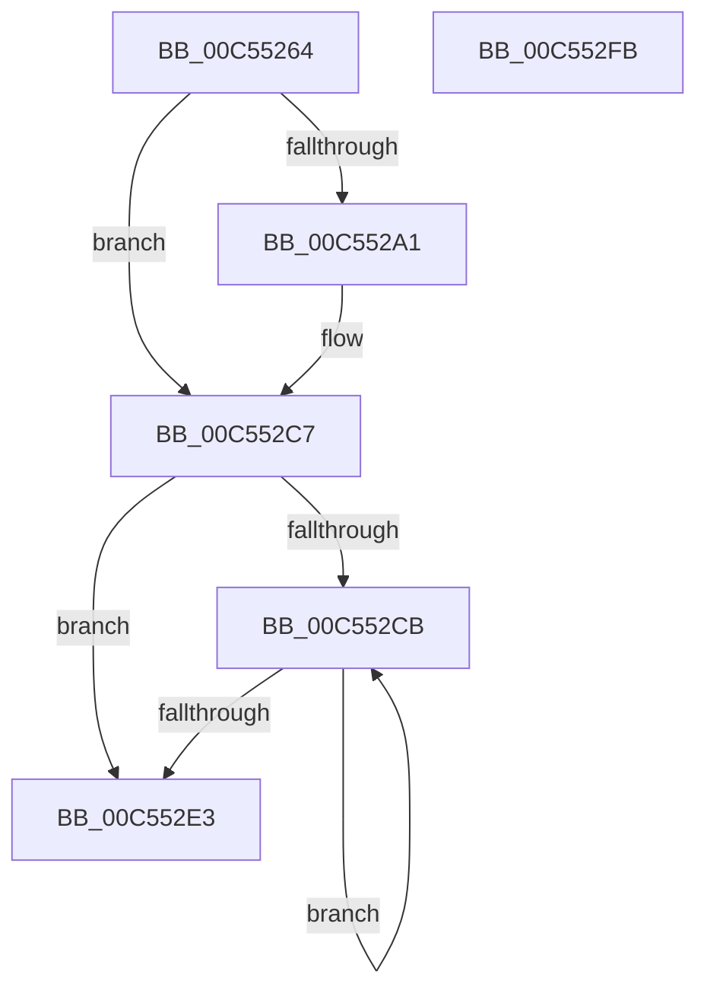

# WheapCreatePerProcessorInfo

- RVA: `0x00C55264`–`0x00C552FC` (길이 `152` bytes)
- VA: `0x0000000140C55264`
- 실행 섹션: `INIT`
- PDB 이름 있음: `예`; PDB Function 태그: `아니요`
- unwind 정보 RVA: `0x0009B270`
- 디코드: `41`개 명령, `152/152` bytes 표시
- 미해석 바이트: `0` (있으면 어셈블리에 `.byte`로 보존)

> 이 문서는 커널 이미지의 기계어와 PDB 기호를 분석해 생성했습니다. 4번과 5번은 함수 원형과 자료형을 바이너리 사용 방식에서 추정한 C 해석이며 원본 소스 복구 결과는 아닙니다.

## 1. Dependencies

- 직접 호출 지점: **3**; 고유 호출 대상: **3**
- 직접 호출자로 확인된 함수: **1**
- RIP 상대 이미지 참조: **3**

### Outgoing calls
- `0x00C55292` → [ExAllocatePool2](../../poolcode/B8/ExAllocatePool2_function_00B820F0.md) (function, `0x00B820F0`)
- `0x00C552C1` → [KeBugCheckEx](../../text/4F/KeBugCheckEx_function_004FD660.md) (function, `0x004FD660`)
- `0x00C552CD` → [KeGetPrcb](../../text/2D/KeGetPrcb_function_002D85D0.md) (function, `0x002D85D0`)

### Direct callers
- [WheaInitialize](WheaInitialize_function_00C54C08.md) at `0x00C54CAD`

### Static image references
- `0x00C55279` → RVA `0x00FC6A80` (`ALMOSTRO`; read)
- `0x00C552A1` → RVA `0x00EFA070` (`.data`; read/write)
- `0x00C552AA` → RVA `0x00EFA074` (`.data`; read/write)

## 2. Other-region calls and transfers

- 다른 실행 섹션으로 향하는 call: **3**
  - `0x00C55292` → [ExAllocatePool2](../../poolcode/B8/ExAllocatePool2_function_00B820F0.md) (`INIT` → `POOLCODE`)
  - `0x00C552C1` → [KeBugCheckEx](../../text/4F/KeBugCheckEx_function_004FD660.md) (`INIT` → `.text`)
  - `0x00C552CD` → [KeGetPrcb](../../text/2D/KeGetPrcb_function_002D85D0.md) (`INIT` → `.text`)
- 별도 외부 분기/꼬리 이동을 확인하지 못했습니다.

## 3. Assembly (complete function range)

```asm
00C55264  48 89 5C 24 08                  mov qword ptr [rsp + 8], rbx
00C55269  48 89 74 24 10                  mov qword ptr [rsp + 0x10], rsi
00C5526E  48 89 7C 24 18                  mov qword ptr [rsp + 0x18], rdi
00C55273  41 56                           push r14
00C55275  48 83 EC 30                     sub rsp, 0x30
00C55279  8B 35 01 18 37 00               mov esi, dword ptr [rip + 0x371801]
00C5527F  B9 40 00 00 00                  mov ecx, 0x40
00C55284  41 B8 57 68 65 61               mov r8d, 0x61656857
00C5528A  48 8D 14 76                     lea rdx, [rsi + rsi*2]
00C5528E  48 C1 E2 03                     shl rdx, 3
00C55292  E8 59 CE F2 FF                  call 0x140b820f0
00C55297  33 DB                           xor ebx, ebx
00C55299  48 8B F8                        mov rdi, rax
00C5529C  48 85 C0                        test rax, rax
00C5529F  75 26                           jne 0x140c552c7
00C552A1  FF 05 C9 4D 2A 00               inc dword ptr [rip + 0x2a4dc9]
00C552A7  8D 50 02                        lea edx, [rax + 2]
00C552AA  83 0D C3 4D 2A 00 10            or dword ptr [rip + 0x2a4dc3], 0x10
00C552B1  45 33 C9                        xor r9d, r9d
00C552B4  44 8B C6                        mov r8d, esi
00C552B7  48 89 5C 24 20                  mov qword ptr [rsp + 0x20], rbx
00C552BC  B9 22 01 00 00                  mov ecx, 0x122
00C552C1  E8 9A 83 8A FF                  call 0x1404fd660
00C552C6  CC                              int3
00C552C7  85 F6                           test esi, esi
00C552C9  74 18                           je 0x140c552e3
00C552CB  8B CB                           mov ecx, ebx
00C552CD  E8 FE 32 68 FF                  call 0x1402d85d0
00C552D2  FF C3                           inc ebx
00C552D4  48 89 B8 A0 8B 00 00            mov qword ptr [rax + 0x8ba0], rdi
00C552DB  48 83 C7 18                     add rdi, 0x18
00C552DF  3B DE                           cmp ebx, esi
00C552E1  72 E8                           jb 0x140c552cb
00C552E3  48 8B 5C 24 40                  mov rbx, qword ptr [rsp + 0x40]
00C552E8  33 C0                           xor eax, eax
00C552EA  48 8B 74 24 48                  mov rsi, qword ptr [rsp + 0x48]
00C552EF  48 8B 7C 24 50                  mov rdi, qword ptr [rsp + 0x50]
00C552F4  48 83 C4 30                     add rsp, 0x30
00C552F8  41 5E                           pop r14
00C552FA  C3                              ret
00C552FB  CC                              int3
```

## 4. C-style interpretation (structured pseudocode)

```c
__int64 __fastcall WheapCreatePerProcessorInfo(__int64 a1, __int64 a2, __int64 a3, int a4)
{
    __int64 result;
    __int64 v_rbx;
    __int64 v_rdi;
    __int64 v_rsp;
    unsigned __int64 v_stack_m18;
    unsigned __int64 v_stack_p10;
    unsigned __int64 v_stack_p18;
    unsigned __int64 v_stack_p8;

    v_stack_p8 = v_rbx;
    v_stack_p10 = v_rsi;
    v_stack_p18 = v_rdi;
    v_rsp = (v_rsp) - (48);
    a2 = ((unsigned int)(*(unsigned int *)(v_rip + 3610625)) + (unsigned int)(*(unsigned int *)(v_rip + 3610625)) * 2) << (3);
    result = ExAllocatePool2(64, a2, (unsigned int)(0x61656857ULL), a4);
    v_rbx = 0;
    if (result == 0) {
        a2 = result + 2;
        a4 = 0;
        a3 = (unsigned int)((unsigned int)(*(unsigned int *)(v_rip + 3610625)));
        v_stack_m18 = 0;
        a1 = 290;
        result = KeBugCheckEx(a1, a2, a3, a4);
    }
    if ((unsigned int)((unsigned int)(*(unsigned int *)(v_rip + 3610625))) == 0) goto loc_00C552E3;
loc_00C552CB:
    result = KeGetPrcb(0, a2, a3, a4);
    v_rbx = (unsigned int)((v_rbx) + 1);
    *(unsigned __int64 *)(result + 35744) = result;
    v_rdi = (result) + (24);
    if (((unsigned int)(v_rbx)) < ((unsigned int)((unsigned int)(*(unsigned int *)(v_rip + 3610625))))) goto loc_00C552CB;
loc_00C552E3:
    result = 0;
    v_rsp = (v_rsp) + (48);
    return result;
}
```

## 5. (Beta) C Style

```c
int64_t WheapCreatePerProcessorInfo(int64_t Arg1, int64_t Arg2, int64_t Arg3, int32_t Arg4)
{
    int64_t result;
    int64_t local_rbx;
    int64_t local_rdi;
    int64_t local_rsp;
    uint64_t v_stack_m18;
    uint64_t v_stack_p10;
    uint64_t v_stack_p18;
    uint64_t v_stack_p8;

    v_stack_p8 = local_rbx;
    v_stack_p10 = local_rsi;
    v_stack_p18 = local_rdi;
    local_rsp = (local_rsp) - (48);
    Arg2 = ((uint32_t)(*(uint32_t *)(v_rip + 0x371801)) + (uint32_t)(*(uint32_t *)(v_rip + 0x371801)) * 2) << (3);
    result = ExAllocatePool2(64, Arg2, (uint32_t)(0x61656857ULL), Arg4);
    local_rbx = 0;
    if (result == 0) {
        Arg2 = result + 2;
        Arg4 = 0;
        Arg3 = (uint32_t)((uint32_t)(*(uint32_t *)(v_rip + 0x371801)));
        v_stack_m18 = 0;
        Arg1 = 290;
        result = KeBugCheckEx(Arg1, Arg2, Arg3, Arg4);
    }
    if ((uint32_t)((uint32_t)(*(uint32_t *)(v_rip + 0x371801))) == 0) goto loc_00C552E3;
loc_00C552CB:
    result = KeGetPrcb(0, Arg2, Arg3, Arg4);
    local_rbx = (uint32_t)((local_rbx) + 1);
    *(uint64_t *)(result + 0x8BA0) = result;
    local_rdi = (result) + (24);
    if (((uint32_t)(local_rbx)) < ((uint32_t)((uint32_t)(*(uint32_t *)(v_rip + 0x371801))))) goto loc_00C552CB;
loc_00C552E3:
    result = 0;
    local_rsp = (local_rsp) + (48);
    return result;
}
```

## 6. Execution-region graph

[열기: 2D/3D 그래프와 함수 탐색 컨트롤 패널](../../../control-panel.html?section=init&rva=0x00C55264&view=graph)

- 2D 그래프는 위에서 아래로 흐르고, 3D 그래프는 빈 공간을 드래그해 회전합니다. Shift+드래그는 이동, 휠은 확대·축소, 함수 노드 선택은 대상 보고서 이동입니다.

### Static fallback


