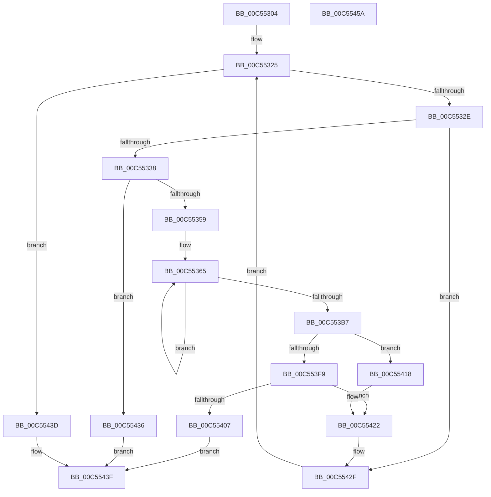

# WheapInitializeErrorSourceTable

- RVA: `0x00C55304`–`0x00C5545B` (길이 `343` bytes)
- VA: `0x0000000140C55304`
- 실행 섹션: `INIT`
- PDB 이름 있음: `예`; PDB Function 태그: `아니요`
- unwind 정보 RVA: `0x0005E6B4`
- 디코드: `92`개 명령, `343/343` bytes 표시
- 미해석 바이트: `0` (있으면 어셈블리에 `.byte`로 보존)

> 이 문서는 커널 이미지의 기계어와 PDB 기호를 분석해 생성했습니다. 4번과 5번은 함수 원형과 자료형을 바이너리 사용 방식에서 추정한 C 해석이며 원본 소스 복구 결과는 아닙니다.

## 1. Dependencies

- 직접 호출 지점: **4**; 고유 호출 대상: **4**
- 직접 호출자로 확인된 함수: **1**
- RIP 상대 이미지 참조: **1**

### Outgoing calls
- `0x00C55348` → [ExAllocatePool2](../../poolcode/B8/ExAllocatePool2_function_00B820F0.md) (function, `0x00B820F0`)
- `0x00C553FC` → [WheapInitializeErrorSource](../../page/7D/WheapInitializeErrorSource_function_007D68E0.md) (function, `0x007D68E0`)
- `0x00C5540F` → [ExFreePoolWithTag](../../poolcode/B8/ExFreePoolWithTag_function_00B82870.md) (function, `0x00B82870`)
- `0x00C55425` → [WheapAddErrorSource](../../text/65/WheapAddErrorSource_function_0065E178.md) (function, `0x0065E178`)

### Direct callers
- [WheaInitialize](WheaInitialize_function_00C54C08.md) at `0x00C54F1D`

### Static image references
- `0x00C553E3` → RVA `0x00EEF098` (`.data`; read)

## 2. Other-region calls and transfers

- 다른 실행 섹션으로 향하는 call: **4**
  - `0x00C55348` → [ExAllocatePool2](../../poolcode/B8/ExAllocatePool2_function_00B820F0.md) (`INIT` → `POOLCODE`)
  - `0x00C553FC` → [WheapInitializeErrorSource](../../page/7D/WheapInitializeErrorSource_function_007D68E0.md) (`INIT` → `PAGE`)
  - `0x00C5540F` → [ExFreePoolWithTag](../../poolcode/B8/ExFreePoolWithTag_function_00B82870.md) (`INIT` → `POOLCODE`)
  - `0x00C55425` → [WheapAddErrorSource](../../text/65/WheapAddErrorSource_function_0065E178.md) (`INIT` → `.text`)
- 별도 외부 분기/꼬리 이동을 확인하지 못했습니다.

## 3. Assembly (complete function range)

```asm
00C55304  48 8B C4                        mov rax, rsp
00C55307  48 89 58 08                     mov qword ptr [rax + 8], rbx
00C5530B  48 89 68 10                     mov qword ptr [rax + 0x10], rbp
00C5530F  48 89 70 18                     mov qword ptr [rax + 0x18], rsi
00C55313  48 89 78 20                     mov qword ptr [rax + 0x20], rdi
00C55317  41 56                           push r14
00C55319  48 83 EC 20                     sub rsp, 0x20
00C5531D  48 8B FA                        mov rdi, rdx
00C55320  44 8B F1                        mov r14d, ecx
00C55323  33 F6                           xor esi, esi
00C55325  41 3B F6                        cmp esi, r14d
00C55328  0F 83 0F 01 00 00               jae 0x140c5543d
00C5532E  83 7F 08 12                     cmp dword ptr [rdi + 8], 0x12
00C55332  0F 87 F7 00 00 00               ja 0x140c5542f
00C55338  BA 30 04 00 00                  mov edx, 0x430
00C5533D  B9 40 00 00 00                  mov ecx, 0x40
00C55342  41 B8 57 68 65 61               mov r8d, 0x61656857
00C55348  E8 A3 CD F2 FF                  call 0x140b820f0
00C5534D  48 8B D8                        mov rbx, rax
00C55350  48 85 C0                        test rax, rax
00C55353  0F 84 DD 00 00 00               je 0x140c55436
00C55359  48 8D 48 60                     lea rcx, [rax + 0x60]
00C5535D  48 8B D7                        mov rdx, rdi
00C55360  B8 07 00 00 00                  mov eax, 7
00C55365  0F 10 02                        movups xmm0, xmmword ptr [rdx]
00C55368  48 8D 92 80 00 00 00            lea rdx, [rdx + 0x80]
00C5536F  0F 11 01                        movups xmmword ptr [rcx], xmm0
00C55372  48 8D 89 80 00 00 00            lea rcx, [rcx + 0x80]
00C55379  0F 10 4A 90                     movups xmm1, xmmword ptr [rdx - 0x70]
00C5537D  0F 11 49 90                     movups xmmword ptr [rcx - 0x70], xmm1
00C55381  0F 10 42 A0                     movups xmm0, xmmword ptr [rdx - 0x60]
00C55385  0F 11 41 A0                     movups xmmword ptr [rcx - 0x60], xmm0
00C55389  0F 10 4A B0                     movups xmm1, xmmword ptr [rdx - 0x50]
00C5538D  0F 11 49 B0                     movups xmmword ptr [rcx - 0x50], xmm1
00C55391  0F 10 42 C0                     movups xmm0, xmmword ptr [rdx - 0x40]
00C55395  0F 11 41 C0                     movups xmmword ptr [rcx - 0x40], xmm0
00C55399  0F 10 4A D0                     movups xmm1, xmmword ptr [rdx - 0x30]
00C5539D  0F 11 49 D0                     movups xmmword ptr [rcx - 0x30], xmm1
00C553A1  0F 10 42 E0                     movups xmm0, xmmword ptr [rdx - 0x20]
00C553A5  0F 11 41 E0                     movups xmmword ptr [rcx - 0x20], xmm0
00C553A9  0F 10 4A F0                     movups xmm1, xmmword ptr [rdx - 0x10]
00C553AD  0F 11 49 F0                     movups xmmword ptr [rcx - 0x10], xmm1
00C553B1  48 83 E8 01                     sub rax, 1
00C553B5  75 AE                           jne 0x140c55365
00C553B7  0F 10 02                        movups xmm0, xmmword ptr [rdx]
00C553BA  0F 11 01                        movups xmmword ptr [rcx], xmm0
00C553BD  0F 10 4A 10                     movups xmm1, xmmword ptr [rdx + 0x10]
00C553C1  0F 11 49 10                     movups xmmword ptr [rcx + 0x10], xmm1
00C553C5  0F 10 42 20                     movups xmm0, xmmword ptr [rdx + 0x20]
00C553C9  0F 11 41 20                     movups xmmword ptr [rcx + 0x20], xmm0
00C553CD  0F 10 4A 30                     movups xmm1, xmmword ptr [rdx + 0x30]
00C553D1  0F 11 49 30                     movups xmmword ptr [rcx + 0x30], xmm1
00C553D5  48 8B 42 40                     mov rax, qword ptr [rdx + 0x40]
00C553D9  48 89 41 40                     mov qword ptr [rcx + 0x40], rax
00C553DD  8B 42 48                        mov eax, dword ptr [rdx + 0x48]
00C553E0  89 41 48                        mov dword ptr [rcx + 0x48], eax
00C553E3  48 8D 0D AE 9C 29 00            lea rcx, [rip + 0x299cae]
00C553EA  48 63 47 08                     movsxd rax, dword ptr [rdi + 8]
00C553EE  48 C1 E0 06                     shl rax, 6
00C553F2  8A 04 08                        mov al, byte ptr [rax + rcx]
00C553F5  84 C0                           test al, al
00C553F7  74 1F                           je 0x140c55418
00C553F9  48 8B CB                        mov rcx, rbx
00C553FC  E8 DF 14 B8 FF                  call 0x1407d68e0
00C55401  8B E8                           mov ebp, eax
00C55403  85 C0                           test eax, eax
00C55405  79 1B                           jns 0x140c55422
00C55407  BA 57 68 65 61                  mov edx, 0x61656857
00C5540C  48 8B CB                        mov rcx, rbx
00C5540F  E8 5C D4 F2 FF                  call 0x140b82870
00C55414  8B C5                           mov eax, ebp
00C55416  EB 27                           jmp 0x140c5543f
00C55418  8B 47 08                        mov eax, dword ptr [rdi + 8]
00C5541B  89 43 28                        mov dword ptr [rbx + 0x28], eax
00C5541E  C6 43 58 01                     mov byte ptr [rbx + 0x58], 1
00C55422  48 8B D3                        mov rdx, rbx
00C55425  E8 4E 8D A0 FF                  call 0x14065e178
00C5542A  8B 07                           mov eax, dword ptr [rdi]
00C5542C  48 03 F8                        add rdi, rax
00C5542F  FF C6                           inc esi
00C55431  E9 EF FE FF FF                  jmp 0x140c55325
00C55436  B8 9A 00 00 C0                  mov eax, 0xc000009a
00C5543B  EB 02                           jmp 0x140c5543f
00C5543D  33 C0                           xor eax, eax
00C5543F  48 8B 5C 24 30                  mov rbx, qword ptr [rsp + 0x30]
00C55444  48 8B 6C 24 38                  mov rbp, qword ptr [rsp + 0x38]
00C55449  48 8B 74 24 40                  mov rsi, qword ptr [rsp + 0x40]
00C5544E  48 8B 7C 24 48                  mov rdi, qword ptr [rsp + 0x48]
00C55453  48 83 C4 20                     add rsp, 0x20
00C55457  41 5E                           pop r14
00C55459  C3                              ret
00C5545A  CC                              int3
```

## 4. C-style interpretation (structured pseudocode)

```c
__int64 __fastcall WheapInitializeErrorSourceTable(int a1, __int64 a2)
{
    __int64 result;
    __int64 v_rdi;
    __int64 v_rsi;
    __int64 v_rsp;
    unsigned __int64 v_stack_p10;
    unsigned __int64 v_stack_p18;
    unsigned __int64 v_stack_p20;
    unsigned __int64 v_stack_p8;

    *(unsigned __int64 *)(v_rsp + 8) = v_rbx;
    *(unsigned __int64 *)(v_rsp + 16) = v_rbp;
    *(unsigned __int64 *)(v_rsp + 24) = v_rsi;
    *(unsigned __int64 *)(v_rsp + 32) = v_rdi;
    v_rsp = (v_rsp) - (32);
    v_rsi = 0;
loc_00C55325:
    if (0 >= ((unsigned int)((unsigned int)(a1)))) goto loc_00C5543D;
    if ((*(unsigned int *)(a2 + 8)) > 18) goto loc_00C5542F;
    result = ExAllocatePool2(64, (unsigned int)(0x430ULL), (unsigned int)(0x61656857ULL), a4);
    if (result == 0) goto loc_00C55436;
loc_00C55365:
    *(unsigned __int64 *)(result + 96) = v_xmm0;
    *(unsigned __int64 *)(result + 96 + 128 - 112) = v_xmm1;
    *(unsigned __int64 *)(result + 96 + 128 - 96) = v_xmm0;
    *(unsigned __int64 *)(result + 96 + 128 - 80) = v_xmm1;
    *(unsigned __int64 *)(result + 96 + 128 - 64) = v_xmm0;
    *(unsigned __int64 *)(result + 96 + 128 - 48) = v_xmm1;
    *(unsigned __int64 *)(result + 96 + 128 - 32) = v_xmm0;
    *(unsigned __int64 *)(result + 96 + 128 - 16) = v_xmm1;
    result = (7) - (1);
    if (condition_is_not_equal) goto loc_00C55365;
    *(unsigned __int64 *)(result + 96 + 128) = v_xmm0;
    *(unsigned __int64 *)(result + 96 + 128 + 16) = v_xmm1;
    *(unsigned __int64 *)(result + 96 + 128 + 32) = v_xmm0;
    *(unsigned __int64 *)(result + 96 + 128 + 48) = v_xmm1;
    *(unsigned __int64 *)(result + 96 + 128 + 64) = *(unsigned __int64 *)(a2 + 128 + 64);
    *(unsigned int *)(result + 96 + 128 + 72) = (unsigned int)((unsigned int)(*(unsigned int *)(a2 + 128 + 72)));
    result = ((int)(*(unsigned int *)(a2 + 8))) << (6);
    if ((unsigned __int8)(*(unsigned __int8 *)(result + v_rip + 2727086 * 1)) == 0) goto loc_00C55418;
    result = WheapInitializeErrorSource(result, a2 + 128, (unsigned int)(0x61656857ULL), a4);
    if (!sign_flag) goto loc_00C55422;
    result = ExFreePoolWithTag(result, (unsigned int)(0x61656857ULL), (unsigned int)(0x61656857ULL), a4);
    goto loc_00C5543F;
loc_00C55418:
    *(unsigned int *)(result + 40) = (unsigned int)((unsigned int)(*(unsigned int *)(a2 + 8)));
    *(unsigned __int8 *)(result + 88) = 1;
loc_00C55422:
    result = WheapAddErrorSource(result, result, (unsigned int)(0x61656857ULL), a4);
    v_rdi = (a2) + ((unsigned int)(*(unsigned int *)(a2)));
loc_00C5542F:
    v_rsi = (unsigned int)((v_rsi) + 1);
    goto loc_00C55325;
loc_00C55436:
    goto loc_00C5543F;
loc_00C5543D:
    result = 0;
loc_00C5543F:
    v_rsp = (v_rsp) + (32);
    return result;
}
```

## 5. (Beta) C Style

```c
int64_t WheapInitializeErrorSourceTable(int32_t Arg1, void *Arg2)
{
    uint8_t *arg2 = (uint8_t *)Arg2;

    int64_t result;
    int64_t local_rdi;
    int64_t local_rsi;
    int64_t local_rsp;
    uint64_t v_stack_p10;
    uint64_t v_stack_p18;
    uint64_t v_stack_p20;
    uint64_t v_stack_p8;

    *(uint64_t *)(local_rsp + 0x8) = local_rbx;
    *(uint64_t *)(local_rsp + 0x10) = local_rbp;
    *(uint64_t *)(local_rsp + 0x18) = local_rsi;
    *(uint64_t *)(local_rsp + 0x20) = local_rdi;
    local_rsp = (local_rsp) - (32);
    local_rsi = 0;
loc_00C55325:
    if (0 >= ((uint32_t)((uint32_t)(Arg1)))) goto loc_00C5543D;
    if ((*(uint32_t *)(arg2 + 0x8)) > 18) goto loc_00C5542F;
    result = ExAllocatePool2(64, (uint32_t)(0x430ULL), (uint32_t)(0x61656857ULL), a4);
    if (result == 0) goto loc_00C55436;
loc_00C55365:
    *(uint64_t *)(result + 0x60) = v_xmm0;
    *(uint64_t *)(result + 0x60 + 0x80 - 0x70) = v_xmm1;
    *(uint64_t *)(result + 0x60 + 0x80 - 0x60) = v_xmm0;
    *(uint64_t *)(result + 0x60 + 0x80 - 0x50) = v_xmm1;
    *(uint64_t *)(result + 0x60 + 0x80 - 0x40) = v_xmm0;
    *(uint64_t *)(result + 0x60 + 0x80 - 0x30) = v_xmm1;
    *(uint64_t *)(result + 0x60 + 0x80 - 0x20) = v_xmm0;
    *(uint64_t *)(result + 0x60 + 0x80 - 0x10) = v_xmm1;
    result = (7) - (1);
    if (condition_is_not_equal) goto loc_00C55365;
    *(uint64_t *)(result + 0x60 + 0x80) = v_xmm0;
    *(uint64_t *)(result + 0x60 + 0x80 + 0x10) = v_xmm1;
    *(uint64_t *)(result + 0x60 + 0x80 + 0x20) = v_xmm0;
    *(uint64_t *)(result + 0x60 + 0x80 + 0x30) = v_xmm1;
    *(uint64_t *)(result + 0x60 + 0x80 + 0x40) = *(uint64_t *)(arg2 + 0x80 + 0x40);
    *(uint32_t *)(result + 0x60 + 0x80 + 0x48) = (uint32_t)((uint32_t)(*(uint32_t *)(arg2 + 0x80 + 0x48)));
    result = ((int32_t)(*(uint32_t *)(arg2 + 0x8))) << (6);
    if ((uint8_t)(*(uint8_t *)(result + v_rip + 0x299CAE * 1)) == 0) goto loc_00C55418;
    result = WheapInitializeErrorSource(result, Arg2 + 128, (uint32_t)(0x61656857ULL), a4);
    if (!sign_flag) goto loc_00C55422;
    result = ExFreePoolWithTag(result, (uint32_t)(0x61656857ULL), (uint32_t)(0x61656857ULL), a4);
    goto loc_00C5543F;
loc_00C55418:
    *(uint32_t *)(result + 0x28) = (uint32_t)((uint32_t)(*(uint32_t *)(arg2 + 0x8)));
    *(uint8_t *)(result + 0x58) = 1;
loc_00C55422:
    result = WheapAddErrorSource(result, result, (uint32_t)(0x61656857ULL), a4);
    local_rdi = (Arg2) + ((uint32_t)(*(uint32_t *)(arg2)));
loc_00C5542F:
    local_rsi = (uint32_t)((local_rsi) + 1);
    goto loc_00C55325;
loc_00C55436:
    goto loc_00C5543F;
loc_00C5543D:
    result = 0;
loc_00C5543F:
    local_rsp = (local_rsp) + (32);
    return result;
}
```

### 관측된 메모리 오프셋

구조체 형식이 확인되지 않은 접근은 인자 기준의 오프셋으로만 기록했습니다.

| 기준 인자 | 오프셋 표현 | 폭 (bit) | 접근 |
|---|---:|---:|---|
| `Arg2` | `- 0x70` | `128` | `R` |
| `Arg2` | `- 0x60` | `128` | `R` |
| `Arg2` | `- 0x50` | `128` | `R` |
| `Arg2` | `- 0x40` | `128` | `R` |
| `Arg2` | `- 0x30` | `128` | `R` |
| `Arg2` | `- 0x20` | `128` | `R` |
| `Arg2` | `- 0x10` | `128` | `R` |
| `Arg2` | `+ 0x0` | `32` | `R` |
| `Arg2` | `+ 0x0` | `128` | `R` |
| `Arg2` | `+ 0x8` | `32` | `R` |
| `Arg2` | `+ 0x10` | `128` | `R` |
| `Arg2` | `+ 0x20` | `128` | `R` |
| `Arg2` | `+ 0x30` | `128` | `R` |
| `Arg2` | `+ 0x40` | `64` | `R` |
| `Arg2` | `+ 0x48` | `32` | `R` |
| `Arg2` | `+ 0x80` | `64` | `R` |

## 6. Execution-region graph

[열기: 2D/3D 그래프와 함수 탐색 컨트롤 패널](../../../control-panel.html?section=init&rva=0x00C55304&view=graph)

- 2D 그래프는 위에서 아래로 흐르고, 3D 그래프는 빈 공간을 드래그해 회전합니다. Shift+드래그는 이동, 휠은 확대·축소, 함수 노드 선택은 대상 보고서 이동입니다.

### Static fallback


