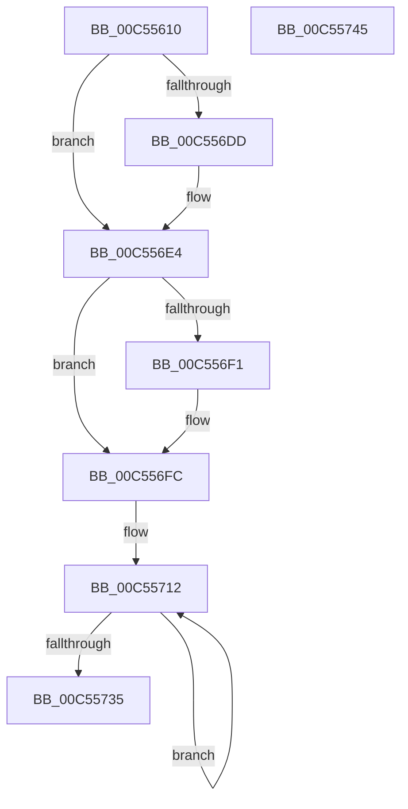

# WheapInitializeEventing

- RVA: `0x00C55610`–`0x00C55746` (길이 `310` bytes)
- VA: `0x0000000140C55610`
- 실행 섹션: `INIT`
- PDB 이름 있음: `예`; PDB Function 태그: `아니요`
- unwind 정보 RVA: `0x00060BC4`
- 디코드: `61`개 명령, `310/310` bytes 표시
- 미해석 바이트: `0` (있으면 어셈블리에 `.byte`로 보존)

> 이 문서는 커널 이미지의 기계어와 PDB 기호를 분석해 생성했습니다. 4번과 5번은 함수 원형과 자료형을 바이너리 사용 방식에서 추정한 C 해석이며 원본 소스 복구 결과는 아닙니다.

## 1. Dependencies

- 직접 호출 지점: **4**; 고유 호출 대상: **4**
- 직접 호출자로 확인된 함수: **1**
- RIP 상대 이미지 참조: **27**

### Outgoing calls
- `0x00C556D4` → [EtwRegister](../../page/92/EtwRegister_function_00920960.md) (function, `0x00920960`)
- `0x00C556F6` → [RtlRaiseStatus](../../text/2F/RtlRaiseStatus_function_002F6A50.md) (function, `0x002F6A50`)
- `0x00C5571B` → [memset](../../text/6C/memset_function_006C6C40.md) (function, `0x006C6C40`)
- `0x00C55726` → [ExpInterlockedPushEntrySList](../../text/6B/ExpInterlockedPushEntrySList_function_006BA5B0.md) (function, `0x006BA5B0`)

### Direct callers
- [WheaInitialize](WheaInitialize_function_00C54C08.md) at `0x00C54D4D`

### Static image references
- `0x00C5561F` → RVA `0x00EF9F40` (`.data`; read)
- `0x00C55626` → RVA `0x00EF9F20` (`.data`; write)
- `0x00C5562F` → RVA `0x00EF9F48` (`.data`; write)
- `0x00C55636` → RVA `0x00EF9EF0` (`.data`; read)
- `0x00C5563D` → RVA `0x00EF9F40` (`.data`; write)
- `0x00C55644` → RVA `0x007D83D0` (`WheapEtwEnableCallback`; read)
- `0x00C5564B` → RVA `0x00EF9EE0` (`.data`; read)
- `0x00C55652` → RVA `0x00EF9F22` (`.data`; write)
- `0x00C55659` → RVA `0x00EF9EE8` (`.data`; write)
- `0x00C55660` → RVA `0x00039600` (`.rdata`; read)
- `0x00C55667` → RVA `0x00EF9EE0` (`.data`; write)
- `0x00C55671` → RVA `0x00EF9F28` (`.data`; read)
- `0x00C55678` → RVA `0x00EF9F24` (`.data`; write)
- `0x00C55682` → RVA `0x00EF9F30` (`.data`; write)
- `0x00C5568C` → RVA `0x00EF9F28` (`.data`; write)
- `0x00C55695` → RVA `0x00EF7E48` (`.data`; read)
- `0x00C5569C` → RVA `0x00EF7E40` (`.data`; write)
- `0x00C556A5` → RVA `0x00EF7E50` (`.data`; write)
- `0x00C556AC` → RVA `0x00EF7E48` (`.data`; write)
- `0x00C556B5` → RVA `0x00EF9F10` (`.data`; write)
- `0x00C556BC` → RVA `0x00EF7E42` (`.data`; write)
- `0x00C556C3` → RVA `0x00EF7E44` (`.data`; write)
- `0x00C556CD` → RVA `0x00EF9F00` (`.data`; read)
- `0x00C556DD` → RVA `0x00EF9EF0` (`.data`; write)
- `0x00C556E4` → RVA `0x00E29170` (`.data`; read)
- `0x00C556FF` → RVA `0x00E29180` (`.data`; read)
- `0x00C55706` → RVA `0x00E29170` (`.data`; write)

## 2. Other-region calls and transfers

- 다른 실행 섹션으로 향하는 call: **4**
  - `0x00C556D4` → [EtwRegister](../../page/92/EtwRegister_function_00920960.md) (`INIT` → `PAGE`)
  - `0x00C556F6` → [RtlRaiseStatus](../../text/2F/RtlRaiseStatus_function_002F6A50.md) (`INIT` → `.text`)
  - `0x00C5571B` → [memset](../../text/6C/memset_function_006C6C40.md) (`INIT` → `.text`)
  - `0x00C55726` → [ExpInterlockedPushEntrySList](../../text/6B/ExpInterlockedPushEntrySList_function_006BA5B0.md) (`INIT` → `.text`)
- 별도 외부 분기/꼬리 이동을 확인하지 못했습니다.

## 3. Assembly (complete function range)

```asm
00C55610  48 89 5C 24 08                  mov qword ptr [rsp + 8], rbx
00C55615  48 89 74 24 10                  mov qword ptr [rsp + 0x10], rsi
00C5561A  57                              push rdi
00C5561B  48 83 EC 20                     sub rsp, 0x20
00C5561F  48 8D 05 1A 49 2A 00            lea rax, [rip + 0x2a491a]
00C55626  66 C7 05 F1 48 2A 00 01 00      mov word ptr [rip + 0x2a48f1], 1
00C5562F  48 89 05 12 49 2A 00            mov qword ptr [rip + 0x2a4912], rax
00C55636  4C 8D 0D B3 48 2A 00            lea r9, [rip + 0x2a48b3]
00C5563D  48 89 05 FC 48 2A 00            mov qword ptr [rip + 0x2a48fc], rax
00C55644  48 8D 15 85 2D B8 FF            lea rdx, [rip - 0x47d27b]
00C5564B  48 8D 05 8E 48 2A 00            lea rax, [rip + 0x2a488e]
00C55652  C6 05 C9 48 2A 00 06            mov byte ptr [rip + 0x2a48c9], 6
00C55659  48 89 05 88 48 2A 00            mov qword ptr [rip + 0x2a4888], rax
00C55660  48 8D 0D 99 3F 3E FF            lea rcx, [rip - 0xc1c067]
00C55667  48 89 05 72 48 2A 00            mov qword ptr [rip + 0x2a4872], rax
00C5566E  0F 57 C0                        xorps xmm0, xmm0
00C55671  48 8D 05 B0 48 2A 00            lea rax, [rip + 0x2a48b0]
00C55678  C7 05 A2 48 2A 00 01 00 00 00   mov dword ptr [rip + 0x2a48a2], 1
00C55682  48 89 05 A7 48 2A 00            mov qword ptr [rip + 0x2a48a7], rax
00C55689  45 33 C0                        xor r8d, r8d
00C5568C  48 89 05 95 48 2A 00            mov qword ptr [rip + 0x2a4895], rax
00C55693  33 DB                           xor ebx, ebx
00C55695  48 8D 05 AC 27 2A 00            lea rax, [rip + 0x2a27ac]
00C5569C  66 C7 05 9B 27 2A 00 01 00      mov word ptr [rip + 0x2a279b], 1
00C556A5  48 89 05 A4 27 2A 00            mov qword ptr [rip + 0x2a27a4], rax
00C556AC  48 89 05 95 27 2A 00            mov qword ptr [rip + 0x2a2795], rax
00C556B3  33 C0                           xor eax, eax
00C556B5  48 89 05 54 48 2A 00            mov qword ptr [rip + 0x2a4854], rax
00C556BC  C6 05 7F 27 2A 00 06            mov byte ptr [rip + 0x2a277f], 6
00C556C3  C7 05 77 27 2A 00 01 00 00 00   mov dword ptr [rip + 0x2a2777], 1
00C556CD  0F 11 05 2C 48 2A 00            movups xmmword ptr [rip + 0x2a482c], xmm0
00C556D4  E8 87 B2 CC FF                  call 0x140920960
00C556D9  85 C0                           test eax, eax
00C556DB  74 07                           je 0x140c556e4
00C556DD  48 89 1D 0C 48 2A 00            mov qword ptr [rip + 0x2a480c], rbx
00C556E4  48 8D 35 85 3A 1D 00            lea rsi, [rip + 0x1d3a85]
00C556EB  40 F6 C6 0F                     test sil, 0xf
00C556EF  74 0B                           je 0x140c556fc
00C556F1  B9 02 00 00 80                  mov ecx, 0x80000002
00C556F6  E8 55 13 6A FF                  call 0x1402f6a50
00C556FB  CC                              int3
00C556FC  0F 57 C0                        xorps xmm0, xmm0
00C556FF  48 8D 1D 7A 3A 1D 00            lea rbx, [rip + 0x1d3a7a]
00C55706  0F 29 05 63 3A 1D 00            movaps xmmword ptr [rip + 0x1d3a63], xmm0
00C5570D  BF 80 00 00 00                  mov edi, 0x80
00C55712  33 D2                           xor edx, edx
00C55714  48 8B CB                        mov rcx, rbx
00C55717  44 8D 42 70                     lea r8d, [rdx + 0x70]
00C5571B  E8 20 15 A7 FF                  call 0x1406c6c40
00C55720  48 8B D3                        mov rdx, rbx
00C55723  48 8B CE                        mov rcx, rsi
00C55726  E8 85 4E A6 FF                  call 0x1406ba5b0
00C5572B  48 83 C3 70                     add rbx, 0x70
00C5572F  48 83 EF 01                     sub rdi, 1
00C55733  75 DD                           jne 0x140c55712
00C55735  48 8B 5C 24 30                  mov rbx, qword ptr [rsp + 0x30]
00C5573A  48 8B 74 24 38                  mov rsi, qword ptr [rsp + 0x38]
00C5573F  48 83 C4 20                     add rsp, 0x20
00C55743  5F                              pop rdi
00C55744  C3                              ret
00C55745  CC                              int3
```

## 4. C-style interpretation (structured pseudocode)

```c
__int64 __fastcall WheapInitializeEventing(__int64 a1, __int64 a2, int a3)
{
    __int64 result;
    __int64 v_rbx;
    __int64 v_rdi;
    __int64 v_rsp;
    unsigned __int64 v_stack_p10;
    unsigned __int64 v_stack_p8;

    v_stack_p8 = v_rbx;
    v_stack_p10 = v_rsi;
    v_rsp = (v_rsp) - (32);
    *(unsigned __int16 *)(v_rip + 2771185) = 1;
    *(unsigned __int64 *)(v_rip + 2771218) = v_rip + 2771226;
    *(unsigned __int64 *)(v_rip + 2771196) = v_rip + 2771226;
    *(unsigned __int8 *)(v_rip + 2771145) = 6;
    *(unsigned __int64 *)(v_rip + 2771080) = v_rip + 2771086;
    *(unsigned __int64 *)(v_rip + 2771058) = v_rip + 2771086;
    *(unsigned int *)(v_rip + 2771106) = 1;
    *(unsigned __int64 *)(v_rip + 2771111) = v_rip + 2771120;
    a3 = 0;
    *(unsigned __int64 *)(v_rip + 2771093) = v_rip + 2771120;
    v_rbx = 0;
    *(unsigned __int16 *)(v_rip + 2762651) = 1;
    *(unsigned __int64 *)(v_rip + 2762660) = v_rip + 2762668;
    *(unsigned __int64 *)(v_rip + 2762645) = v_rip + 2762668;
    result = 0;
    *(unsigned __int64 *)(v_rip + 2771028) = 0;
    *(unsigned __int8 *)(v_rip + 2762623) = 6;
    *(unsigned int *)(v_rip + 2762615) = 1;
    *(unsigned __int64 *)(v_rip + 2770988) = v_xmm0;
    result = EtwRegister(v_rip - 12697703, v_rip - 4706939, a3, v_rip + 2771123);
    if ((unsigned int)(result) != 0) {
        *(unsigned __int64 *)(v_rip + 2770956) = 0;
    }
    if ((((unsigned __int8)(v_rip + 1915525)) & (15)) != 0) {
        a1 = 0x80000002ULL;
        result = RtlRaiseStatus(a1, v_rip - 4706939, a3, v_rip + 2771123);
    }
    *(unsigned __int64 *)(v_rip + 1915491) = v_xmm0;
loc_00C55712:
    a2 = 0;
    result = memset(v_rip + 1915514, a2, a2 + 112, v_rip + 2771123);
    result = ExpInterlockedPushEntrySList(v_rip + 1915525, v_rip + 1915514, a2 + 112, v_rip + 2771123);
    v_rbx = (v_rip + 1915514) + (112);
    v_rdi = (128) - (1);
    if (condition_is_not_equal) goto loc_00C55712;
    v_rsp = (v_rsp) + (32);
    return result;
}
```

## 5. (Beta) C Style

```c
int64_t WheapInitializeEventing(int64_t Arg1, int64_t Arg2, int32_t Arg3)
{
    int64_t result;
    int64_t local_rbx;
    int64_t local_rdi;
    int64_t local_rsp;
    uint64_t v_stack_p10;
    uint64_t v_stack_p8;

    v_stack_p8 = local_rbx;
    v_stack_p10 = local_rsi;
    local_rsp = (local_rsp) - (32);
    *(uint16_t *)(v_rip + 0x2A48F1) = 1;
    *(uint64_t *)(v_rip + 0x2A4912) = v_rip + 2771226;
    *(uint64_t *)(v_rip + 0x2A48FC) = v_rip + 2771226;
    *(uint8_t *)(v_rip + 0x2A48C9) = 6;
    *(uint64_t *)(v_rip + 0x2A4888) = v_rip + 2771086;
    *(uint64_t *)(v_rip + 0x2A4872) = v_rip + 2771086;
    *(uint32_t *)(v_rip + 0x2A48A2) = 1;
    *(uint64_t *)(v_rip + 0x2A48A7) = v_rip + 2771120;
    Arg3 = 0;
    *(uint64_t *)(v_rip + 0x2A4895) = v_rip + 2771120;
    local_rbx = 0;
    *(uint16_t *)(v_rip + 0x2A279B) = 1;
    *(uint64_t *)(v_rip + 0x2A27A4) = v_rip + 2762668;
    *(uint64_t *)(v_rip + 0x2A2795) = v_rip + 2762668;
    result = 0;
    *(uint64_t *)(v_rip + 0x2A4854) = 0;
    *(uint8_t *)(v_rip + 0x2A277F) = 6;
    *(uint32_t *)(v_rip + 0x2A2777) = 1;
    *(uint64_t *)(v_rip + 0x2A482C) = v_xmm0;
    result = EtwRegister(v_rip - 12697703, v_rip - 4706939, Arg3, v_rip + 2771123);
    if ((uint32_t)(result) != 0) {
        *(uint64_t *)(v_rip + 0x2A480C) = 0;
    }
    if ((((uint8_t)(v_rip + 1915525)) & (15)) != 0) {
        Arg1 = 0x80000002ULL;
        result = RtlRaiseStatus(Arg1, v_rip - 4706939, Arg3, v_rip + 2771123);
    }
    *(uint64_t *)(v_rip + 0x1D3A63) = v_xmm0;
loc_00C55712:
    Arg2 = 0;
    result = memset(v_rip + 1915514, Arg2, Arg2 + 112, v_rip + 2771123);
    result = ExpInterlockedPushEntrySList(v_rip + 1915525, v_rip + 1915514, Arg2 + 112, v_rip + 2771123);
    local_rbx = (v_rip + 1915514) + (112);
    local_rdi = (128) - (1);
    if (condition_is_not_equal) goto loc_00C55712;
    local_rsp = (local_rsp) + (32);
    return result;
}
```

## 6. Execution-region graph

[열기: 2D/3D 그래프와 함수 탐색 컨트롤 패널](../../../control-panel.html?section=init&rva=0x00C55610&view=graph)

- 2D 그래프는 위에서 아래로 흐르고, 3D 그래프는 빈 공간을 드래그해 회전합니다. Shift+드래그는 이동, 휠은 확대·축소, 함수 노드 선택은 대상 보고서 이동입니다.

### Static fallback


