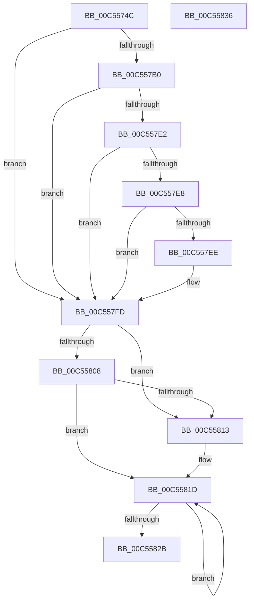

# WheapLoadPolicy

- RVA: `0x00C5574C`–`0x00C55837` (길이 `235` bytes)
- VA: `0x0000000140C5574C`
- 실행 섹션: `INIT`
- PDB 이름 있음: `예`; PDB Function 태그: `아니요`
- unwind 정보 RVA: `0x000CBCFC`
- 디코드: `59`개 명령, `235/235` bytes 표시
- 미해석 바이트: `0` (있으면 어셈블리에 `.byte`로 보존)

> 이 문서는 커널 이미지의 기계어와 PDB 기호를 분석해 생성했습니다. 4번과 5번은 함수 원형과 자료형을 바이너리 사용 방식에서 추정한 C 해석이며 원본 소스 복구 결과는 아닙니다.

## 1. Dependencies

- 직접 호출 지점: **5**; 고유 호출 대상: **5**
- 직접 호출자로 확인된 함수: **1**
- RIP 상대 이미지 참조: **13**

### Outgoing calls
- `0x00C5579E` → [WheapOpenPolicyRegistryKey](WheapOpenPolicyRegistryKey_function_00C55840.md) (function, `0x00C55840`)
- `0x00C557A3` → [WheapScanRegistryForPolicyChanges](../../page/7D/WheapScanRegistryForPolicyChanges_function_007D8D58.md) (function, `0x007D8D58`)
- `0x00C557BB` → [RtlInitUnicodeString](../../text/42/RtlInitUnicodeString_function_0042A780.md) (function, `0x0042A780`)
- `0x00C557D9` → [ZwQueryLicenseValue](../../text/6A/ZwQueryLicenseValue_function_006AFCF0.md) (function, `0x006AFCF0`)
- `0x00C5581F` → [WheapPropagatePolicyToHal](../../page/AC/WheapPropagatePolicyToHal_function_00AC1B2C.md) (function, `0x00AC1B2C`)

### Direct callers
- [WheaInitialize](WheaInitialize_function_00C54C08.md) at `0x00C54C5A`

### Static image references
- `0x00C5575B` → RVA `0x00EF7D82` (`.data`; write)
- `0x00C55762` → RVA `0x00EF7D88` (`.data`; read)
- `0x00C55779` → RVA `0x00EF7D30` (`.data`; write)
- `0x00C5577F` → RVA `0x00EF7D80` (`.data`; write)
- `0x00C55786` → RVA `0x00EF7D90` (`.data`; write)
- `0x00C5578D` → RVA `0x00EF7D88` (`.data`; write)
- `0x00C55794` → RVA `0x00EF7D84` (`.data`; write)
- `0x00C557A8` → RVA `0x00E095DC` (`.data`; read)
- `0x00C557B0` → RVA `0x00C7DF30` (` ?? ::PBOPGDP::`string'`; read)
- `0x00C557F1` → RVA `0x00E095C8` (`.data`; read)
- `0x00C557FD` → RVA `0x00E09608` (`.data`; read)
- `0x00C55808` → RVA `0x00E09628` (`.data`; read)
- `0x00C55813` → RVA `0x00E095E8` (`.data`; read)

## 2. Other-region calls and transfers

- 다른 실행 섹션으로 향하는 call: **4**
  - `0x00C557A3` → [WheapScanRegistryForPolicyChanges](../../page/7D/WheapScanRegistryForPolicyChanges_function_007D8D58.md) (`INIT` → `PAGE`)
  - `0x00C557BB` → [RtlInitUnicodeString](../../text/42/RtlInitUnicodeString_function_0042A780.md) (`INIT` → `.text`)
  - `0x00C557D9` → [ZwQueryLicenseValue](../../text/6A/ZwQueryLicenseValue_function_006AFCF0.md) (`INIT` → `.text`)
  - `0x00C5581F` → [WheapPropagatePolicyToHal](../../page/AC/WheapPropagatePolicyToHal_function_00AC1B2C.md) (`INIT` → `PAGE`)
- 별도 외부 분기/꼬리 이동을 확인하지 못했습니다.

## 3. Assembly (complete function range)

```asm
00C5574C  48 89 5C 24 20                  mov qword ptr [rsp + 0x20], rbx
00C55751  55                              push rbp
00C55752  48 8B EC                        mov rbp, rsp
00C55755  48 83 EC 40                     sub rsp, 0x40
00C55759  33 DB                           xor ebx, ebx
00C5575B  C6 05 20 26 2A 00 06            mov byte ptr [rip + 0x2a2620], 6
00C55762  48 8D 05 1F 26 2A 00            lea rax, [rip + 0x2a261f]
00C55769  89 5D 18                        mov dword ptr [rbp + 0x18], ebx
00C5576C  0F 57 C0                        xorps xmm0, xmm0
00C5576F  89 5D 10                        mov dword ptr [rbp + 0x10], ebx
00C55772  89 5D 20                        mov dword ptr [rbp + 0x20], ebx
00C55775  0F 11 45 F0                     movups xmmword ptr [rbp - 0x10], xmm0
00C55779  89 1D B1 25 2A 00               mov dword ptr [rip + 0x2a25b1], ebx
00C5577F  66 89 1D FA 25 2A 00            mov word ptr [rip + 0x2a25fa], bx
00C55786  48 89 05 03 26 2A 00            mov qword ptr [rip + 0x2a2603], rax
00C5578D  48 89 05 F4 25 2A 00            mov qword ptr [rip + 0x2a25f4], rax
00C55794  C7 05 E6 25 2A 00 01 00 00 00   mov dword ptr [rip + 0x2a25e6], 1
00C5579E  E8 9D 00 00 00                  call 0x140c55840
00C557A3  E8 B0 35 B8 FF                  call 0x1407d8d58
00C557A8  38 1D 2E 3E 1B 00               cmp byte ptr [rip + 0x1b3e2e], bl
00C557AE  75 4D                           jne 0x140c557fd
00C557B0  48 8D 15 79 87 02 00            lea rdx, [rip + 0x28779]
00C557B7  48 8D 4D F0                     lea rcx, [rbp - 0x10]
00C557BB  E8 C0 4F 7D FF                  call 0x14042a780
00C557C0  48 8D 45 18                     lea rax, [rbp + 0x18]
00C557C4  44 8D 4B 04                     lea r9d, [rbx + 4]
00C557C8  48 89 44 24 20                  mov qword ptr [rsp + 0x20], rax
00C557CD  4C 8D 45 20                     lea r8, [rbp + 0x20]
00C557D1  48 8D 55 10                     lea rdx, [rbp + 0x10]
00C557D5  48 8D 4D F0                     lea rcx, [rbp - 0x10]
00C557D9  E8 12 A5 A5 FF                  call 0x1406afcf0
00C557DE  85 C0                           test eax, eax
00C557E0  78 1B                           js 0x140c557fd
00C557E2  83 7D 10 04                     cmp dword ptr [rbp + 0x10], 4
00C557E6  75 15                           jne 0x140c557fd
00C557E8  83 7D 18 04                     cmp dword ptr [rbp + 0x18], 4
00C557EC  75 0F                           jne 0x140c557fd
00C557EE  39 5D 20                        cmp dword ptr [rbp + 0x20], ebx
00C557F1  48 8B 05 D0 3D 1B 00            mov rax, qword ptr [rip + 0x1b3dd0]
00C557F8  0F 95 C1                        setne cl
00C557FB  88 08                           mov byte ptr [rax], cl
00C557FD  48 8B 05 04 3E 1B 00            mov rax, qword ptr [rip + 0x1b3e04]
00C55804  39 18                           cmp dword ptr [rax], ebx
00C55806  74 0B                           je 0x140c55813
00C55808  48 8B 05 19 3E 1B 00            mov rax, qword ptr [rip + 0x1b3e19]
00C5580F  39 18                           cmp dword ptr [rax], ebx
00C55811  75 0A                           jne 0x140c5581d
00C55813  48 8B 05 CE 3D 1B 00            mov rax, qword ptr [rip + 0x1b3dce]
00C5581A  C6 00 01                        mov byte ptr [rax], 1
00C5581D  8B CB                           mov ecx, ebx
00C5581F  E8 08 C3 E6 FF                  call 0x140ac1b2c
00C55824  FF C3                           inc ebx
00C55826  83 FB 16                        cmp ebx, 0x16
00C55829  72 F2                           jb 0x140c5581d
00C5582B  48 8B 5C 24 68                  mov rbx, qword ptr [rsp + 0x68]
00C55830  48 83 C4 40                     add rsp, 0x40
00C55834  5D                              pop rbp
00C55835  C3                              ret
00C55836  CC                              int3
```

## 4. C-style interpretation (structured pseudocode)

```c
__int64 __fastcall WheapLoadPolicy(void)
{
    __int64 result;
    __int64 v_rbx;
    __int64 v_rsp;
    unsigned __int64 v_stack_m18;
    unsigned __int64 v_stack_m28;
    unsigned int v_stack_p10;
    unsigned int v_stack_p18;
    unsigned __int64 v_stack_p20;
    unsigned int v_stack_p8;

    v_stack_p20 = v_rbx;
    v_rsp = (v_rsp) - (64);
    v_rbx = 0;
    *(unsigned __int8 *)(v_rip + 2762272) = 6;
    v_stack_p10 = 0;
    v_stack_p8 = 0;
    v_stack_p18 = 0;
    v_stack_m18 = v_xmm0;
    *(unsigned int *)(v_rip + 2762161) = 0;
    *(unsigned __int16 *)(v_rip + 2762234) = 0;
    *(unsigned __int64 *)(v_rip + 2762243) = v_rip + 2762271;
    *(unsigned __int64 *)(v_rip + 2762228) = v_rip + 2762271;
    *(unsigned int *)(v_rip + 2762214) = 1;
    result = WheapOpenPolicyRegistryKey(a1, a2, a3, a4);
    result = WheapScanRegistryForPolicyChanges(a1, a2, a3, a4);
    if ((*(unsigned __int8 *)(v_rip + 1785390)) != 0) goto loc_00C557FD;
    result = RtlInitUnicodeString(v_stack_m18, v_rip + 165753, a3, a4);
    v_stack_m28 = v_stack_p10;
    result = ZwQueryLicenseValue(v_stack_m18, v_stack_p8, v_stack_p18, v_rbx + 4);
    if (sign_flag) goto loc_00C557FD;
    if (v_stack_p8 != 4) goto loc_00C557FD;
    if (v_stack_p10 == 4) {
        result = *(unsigned __int64 *)(v_rip + 1785296);
        a1 = (v_stack_p18 != 0) ? 1 : 0;
        *(unsigned __int8 *)(result) = (unsigned __int8)(a1);
    }
    if ((*(unsigned int *)(*(unsigned __int64 *)(v_rip + 1785348))) == 0) goto loc_00C55813;
    result = *(unsigned __int64 *)(v_rip + 1785369);
    if ((*(unsigned int *)(*(unsigned __int64 *)(v_rip + 1785369))) == 0) {
        result = *(unsigned __int64 *)(v_rip + 1785294);
        *(unsigned __int8 *)(result) = 1;
    }
    result = WheapPropagatePolicyToHal(0, v_stack_p8, v_stack_p18, v_rbx + 4);
    v_rbx = (unsigned int)((v_rbx) + 1);
    if (((unsigned int)(v_rbx)) < 22) goto loc_00C5581D;
    v_rsp = (v_rsp) + (64);
    return result;
}
```

## 5. (Beta) C Style

```c
void WheapLoadPolicy(void)
{
    int64_t result;
    int64_t local_rbx;
    int64_t local_rsp;
    uint64_t v_stack_m18;
    uint64_t v_stack_m28;
    uint32_t v_stack_p10;
    uint32_t v_stack_p18;
    uint64_t v_stack_p20;
    uint32_t v_stack_p8;

    v_stack_p20 = local_rbx;
    local_rsp = (local_rsp) - (64);
    local_rbx = 0;
    *(uint8_t *)(v_rip + 0x2A2620) = 6;
    v_stack_p10 = 0;
    v_stack_p8 = 0;
    v_stack_p18 = 0;
    v_stack_m18 = v_xmm0;
    *(uint32_t *)(v_rip + 0x2A25B1) = 0;
    *(uint16_t *)(v_rip + 0x2A25FA) = 0;
    *(uint64_t *)(v_rip + 0x2A2603) = v_rip + 2762271;
    *(uint64_t *)(v_rip + 0x2A25F4) = v_rip + 2762271;
    *(uint32_t *)(v_rip + 0x2A25E6) = 1;
    result = WheapOpenPolicyRegistryKey(a1, a2, a3, a4);
    result = WheapScanRegistryForPolicyChanges(a1, a2, a3, a4);
    if ((*(uint8_t *)(v_rip + 0x1B3E2E)) != 0) goto loc_00C557FD;
    result = RtlInitUnicodeString(v_stack_m18, v_rip + 165753, a3, a4);
    v_stack_m28 = v_stack_p10;
    result = ZwQueryLicenseValue(v_stack_m18, v_stack_p8, v_stack_p18, local_rbx + 4);
    if (sign_flag) goto loc_00C557FD;
    if (v_stack_p8 != 4) goto loc_00C557FD;
    if (v_stack_p10 == 4) {
        result = *(uint64_t *)(v_rip + 0x1B3DD0);
        a1 = (v_stack_p18 != 0) ? 1 : 0;
        *(uint8_t *)(result) = (uint8_t)(a1);
    }
    if ((*(uint32_t *)(*(uint64_t *)(v_rip + 0x1B3E04))) == 0) goto loc_00C55813;
    result = *(uint64_t *)(v_rip + 0x1B3E19);
    if ((*(uint32_t *)(*(uint64_t *)(v_rip + 0x1B3E19))) == 0) {
        result = *(uint64_t *)(v_rip + 0x1B3DCE);
        *(uint8_t *)(result) = 1;
    }
    result = WheapPropagatePolicyToHal(0, v_stack_p8, v_stack_p18, local_rbx + 4);
    local_rbx = (uint32_t)((local_rbx) + 1);
    if (((uint32_t)(local_rbx)) < 22) goto loc_00C5581D;
    local_rsp = (local_rsp) + (64);
    return result;
}
```

## 6. Execution-region graph

[열기: 2D/3D 그래프와 함수 탐색 컨트롤 패널](../../../control-panel.html?section=init&rva=0x00C5574C&view=graph)

- 2D 그래프는 위에서 아래로 흐르고, 3D 그래프는 빈 공간을 드래그해 회전합니다. Shift+드래그는 이동, 휠은 확대·축소, 함수 노드 선택은 대상 보고서 이동입니다.

### Static fallback


