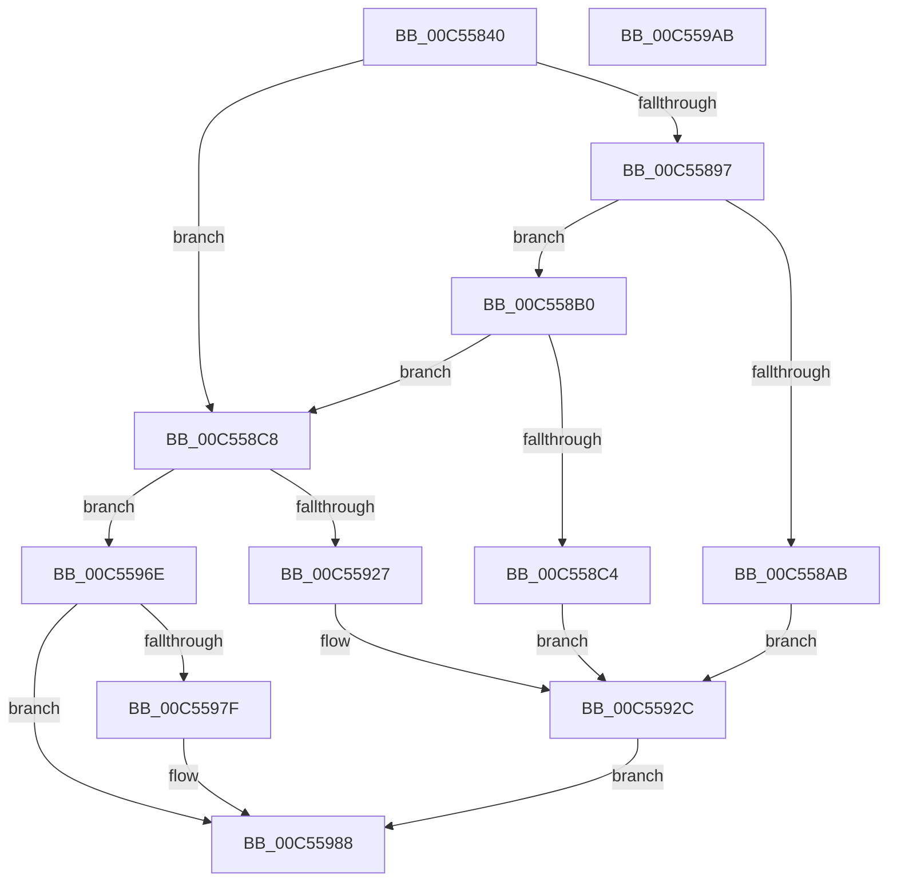

# WheapOpenPolicyRegistryKey

- RVA: `0x00C55840`–`0x00C559AC` (길이 `364` bytes)
- VA: `0x0000000140C55840`
- 실행 섹션: `INIT`
- PDB 이름 있음: `예`; PDB Function 태그: `아니요`
- unwind 정보 RVA: `0x000D32F4`
- 디코드: `90`개 명령, `364/364` bytes 표시
- 미해석 바이트: `0` (있으면 어셈블리에 `.byte`로 보존)

> 이 문서는 커널 이미지의 기계어와 PDB 기호를 분석해 생성했습니다. 4번과 5번은 함수 원형과 자료형을 바이너리 사용 방식에서 추정한 C 해석이며 원본 소스 복구 결과는 아닙니다.

## 1. Dependencies

- 직접 호출 지점: **8**; 고유 호출 대상: **7**
- 직접 호출자로 확인된 함수: **2**
- RIP 상대 이미지 참조: **5**

### Outgoing calls
- `0x00C5588E` → [RtlCheckRegistryKey](../../page/8C/RtlCheckRegistryKey_function_008C9010.md) (function, `0x008C9010`)
- `0x00C558A0` → [RtlCreateRegistryKey](../../page/78/RtlCreateRegistryKey_function_0078F900.md) (function, `0x0078F900`)
- `0x00C558B9` → [RtlCreateRegistryKey](../../page/78/RtlCreateRegistryKey_function_0078F900.md) (function, `0x0078F900`)
- `0x00C558D3` → [RtlInitUnicodeString](../../text/42/RtlInitUnicodeString_function_0042A780.md) (function, `0x0042A780`)
- `0x00C5591C` → [ZwCreateKey](../../text/6A/ZwCreateKey_function_006AD470.md) (function, `0x006AD470`)
- `0x00C55967` → [WheaLogInternalEvent](../../text/66/WheaLogInternalEvent_function_006605B0.md) (function, `0x006605B0`)
- `0x00C55983` → [ZwClose](../../text/6A/ZwClose_function_006AD2B0.md) (function, `0x006AD2B0`)
- `0x00C55991` → [_security_check_cookie](../../text/6A/_security_check_cookie_function_006AC640.md) (function, `0x006AC640`)

### Direct callers
- [WheapSetPolicyValue](../../page/7D/WheapSetPolicyValue_function_007D8E3C.md) at `0x007D8E5B`
- [WheapLoadPolicy](WheapLoadPolicy_function_00C5574C.md) at `0x00C5579E`

### Static image references
- `0x00C55857` → RVA `0x00E0A740` (`.data`; read)
- `0x00C5586A` → RVA `0x00C7DF90` (` ?? ::PBOPGDP::`string'`; read)
- `0x00C55897` → RVA `0x00C7DF80` (` ?? ::PBOPGDP::`string'`; read)
- `0x00C558C8` → RVA `0x00C7DEB0` (` ?? ::PBOPGDP::`string'`; read)
- `0x00C55974` → RVA `0x00EF7D38` (`.data`; read)

## 2. Other-region calls and transfers

- 다른 실행 섹션으로 향하는 call: **8**
  - `0x00C5588E` → [RtlCheckRegistryKey](../../page/8C/RtlCheckRegistryKey_function_008C9010.md) (`INIT` → `PAGE`)
  - `0x00C558A0` → [RtlCreateRegistryKey](../../page/78/RtlCreateRegistryKey_function_0078F900.md) (`INIT` → `PAGE`)
  - `0x00C558B9` → [RtlCreateRegistryKey](../../page/78/RtlCreateRegistryKey_function_0078F900.md) (`INIT` → `PAGE`)
  - `0x00C558D3` → [RtlInitUnicodeString](../../text/42/RtlInitUnicodeString_function_0042A780.md) (`INIT` → `.text`)
  - `0x00C5591C` → [ZwCreateKey](../../text/6A/ZwCreateKey_function_006AD470.md) (`INIT` → `.text`)
  - `0x00C55967` → [WheaLogInternalEvent](../../text/66/WheaLogInternalEvent_function_006605B0.md) (`INIT` → `.text`)
  - `0x00C55983` → [ZwClose](../../text/6A/ZwClose_function_006AD2B0.md) (`INIT` → `.text`)
  - `0x00C55991` → [_security_check_cookie](../../text/6A/_security_check_cookie_function_006AC640.md) (`INIT` → `.text`)
- 별도 외부 분기/꼬리 이동을 확인하지 못했습니다.

## 3. Assembly (complete function range)

```asm
00C55840  48 89 5C 24 08                  mov qword ptr [rsp + 8], rbx
00C55845  48 89 74 24 10                  mov qword ptr [rsp + 0x10], rsi
00C5584A  55                              push rbp
00C5584B  48 8D 6C 24 A9                  lea rbp, [rsp - 0x57]
00C55850  48 81 EC C0 00 00 00            sub rsp, 0xc0
00C55857  48 8B 05 E2 4E 1B 00            mov rax, qword ptr [rip + 0x1b4ee2]
00C5585E  48 33 C4                        xor rax, rsp
00C55861  48 89 45 47                     mov qword ptr [rbp + 0x47], rax
00C55865  48 83 65 D7 00                  and qword ptr [rbp - 0x29], 0
00C5586A  48 8D 15 1F 87 02 00            lea rdx, [rip + 0x2871f]
00C55871  33 C0                           xor eax, eax
00C55873  0F 57 C0                        xorps xmm0, xmm0
00C55876  0F 11 45 0F                     movups xmmword ptr [rbp + 0xf], xmm0
00C5587A  48 89 45 FF                     mov qword ptr [rbp - 1], rax
00C5587E  0F 11 45 DF                     movups xmmword ptr [rbp - 0x21], xmm0
00C55882  8D 70 02                        lea esi, [rax + 2]
00C55885  89 45 07                        mov dword ptr [rbp + 7], eax
00C55888  8B CE                           mov ecx, esi
00C5588A  0F 11 45 EF                     movups xmmword ptr [rbp - 0x11], xmm0
00C5588E  E8 7D 37 C7 FF                  call 0x1408c9010
00C55893  85 C0                           test eax, eax
00C55895  79 31                           jns 0x140c558c8
00C55897  48 8D 15 E2 86 02 00            lea rdx, [rip + 0x286e2]
00C5589E  8B CE                           mov ecx, esi
00C558A0  E8 5B A0 B3 FF                  call 0x14078f900
00C558A5  8B D8                           mov ebx, eax
00C558A7  85 C0                           test eax, eax
00C558A9  79 05                           jns 0x140c558b0
00C558AB  8D 46 FF                        lea eax, [rsi - 1]
00C558AE  EB 7C                           jmp 0x140c5592c
00C558B0  48 8D 15 D9 86 02 00            lea rdx, [rip + 0x286d9]
00C558B7  8B CE                           mov ecx, esi
00C558B9  E8 42 A0 B3 FF                  call 0x14078f900
00C558BE  8B D8                           mov ebx, eax
00C558C0  85 C0                           test eax, eax
00C558C2  79 04                           jns 0x140c558c8
00C558C4  8B C6                           mov eax, esi
00C558C6  EB 64                           jmp 0x140c5592c
00C558C8  48 8D 15 E1 85 02 00            lea rdx, [rip + 0x285e1]
00C558CF  48 8D 4D 0F                     lea rcx, [rbp + 0xf]
00C558D3  E8 A8 4E 7D FF                  call 0x14042a780
00C558D8  48 83 64 24 30 00               and qword ptr [rsp + 0x30], 0
00C558DE  48 8D 45 0F                     lea rax, [rbp + 0xf]
00C558E2  83 64 24 28 00                  and dword ptr [rsp + 0x28], 0
00C558E7  4C 8D 45 DF                     lea r8, [rbp - 0x21]
00C558EB  48 83 65 E7 00                  and qword ptr [rbp - 0x19], 0
00C558F0  48 8D 4D D7                     lea rcx, [rbp - 0x29]
00C558F4  48 83 64 24 20 00               and qword ptr [rsp + 0x20], 0
00C558FA  0F 57 C0                        xorps xmm0, xmm0
00C558FD  45 33 C9                        xor r9d, r9d
00C55900  48 89 45 EF                     mov qword ptr [rbp - 0x11], rax
00C55904  BA 11 02 00 00                  mov edx, 0x211
00C55909  C7 45 DF 30 00 00 00            mov dword ptr [rbp - 0x21], 0x30
00C55910  F3 0F 7F 45 FF                  movdqu xmmword ptr [rbp - 1], xmm0
00C55915  C7 45 F7 40 02 00 00            mov dword ptr [rbp - 9], 0x240
00C5591C  E8 4F 7B A5 FF                  call 0x1406ad470
00C55921  8B D8                           mov ebx, eax
00C55923  85 C0                           test eax, eax
00C55925  79 47                           jns 0x140c5596e
00C55927  B8 03 00 00 00                  mov eax, 3
00C5592C  83 65 2B 00                     and dword ptr [rbp + 0x2b], 0
00C55930  48 8D 4D 1F                     lea rcx, [rbp + 0x1f]
00C55934  C7 45 1F 57 68 4C 67            mov dword ptr [rbp + 0x1f], 0x674c6857
00C5593B  C7 45 23 01 00 00 00            mov dword ptr [rbp + 0x23], 1
00C55942  C7 45 27 28 00 00 00            mov dword ptr [rbp + 0x27], 0x28
00C55949  C7 45 33 63 00 00 80            mov dword ptr [rbp + 0x33], 0x80000063
00C55950  C7 45 2F 4B 52 4E 4C            mov dword ptr [rbp + 0x2f], 0x4c4e524b
00C55957  89 75 37                        mov dword ptr [rbp + 0x37], esi
00C5595A  C7 45 3B 08 00 00 00            mov dword ptr [rbp + 0x3b], 8
00C55961  89 45 3F                        mov dword ptr [rbp + 0x3f], eax
00C55964  89 5D 43                        mov dword ptr [rbp + 0x43], ebx
00C55967  E8 44 AC A0 FF                  call 0x1406605b0
00C5596C  EB 1A                           jmp 0x140c55988
00C5596E  48 8B 4D D7                     mov rcx, qword ptr [rbp - 0x29]
00C55972  33 C0                           xor eax, eax
00C55974  F0 48 0F B1 0D BB 23 2A 00      lock cmpxchg qword ptr [rip + 0x2a23bb], rcx
00C5597D  74 09                           je 0x140c55988
00C5597F  48 8B 4D D7                     mov rcx, qword ptr [rbp - 0x29]
00C55983  E8 28 79 A5 FF                  call 0x1406ad2b0
00C55988  8B C3                           mov eax, ebx
00C5598A  48 8B 4D 47                     mov rcx, qword ptr [rbp + 0x47]
00C5598E  48 33 CC                        xor rcx, rsp
00C55991  E8 AA 6C A5 FF                  call 0x1406ac640
00C55996  4C 8D 9C 24 C0 00 00 00         lea r11, [rsp + 0xc0]
00C5599E  49 8B 5B 10                     mov rbx, qword ptr [r11 + 0x10]
00C559A2  49 8B 73 18                     mov rsi, qword ptr [r11 + 0x18]
00C559A6  49 8B E3                        mov rsp, r11
00C559A9  5D                              pop rbp
00C559AA  C3                              ret
00C559AB  CC                              int3
```

## 4. C-style interpretation (structured pseudocode)

```c
__int64 __fastcall WheapOpenPolicyRegistryKey(__int64 a1, __int64 a2, __int64 a3, int a4)
{
    __int64 result;
    __int64 v_rsp;
    unsigned __int64 v_stack_m18;
    unsigned int v_stack_m1C;
    unsigned int v_stack_m20;
    unsigned int v_stack_m24;
    unsigned int v_stack_m28;
    unsigned int v_stack_m2C;
    unsigned int v_stack_m30;
    unsigned int v_stack_m34;
    unsigned int v_stack_m38;
    unsigned int v_stack_m3C;
    unsigned __int64 v_stack_m40;
    unsigned __int64 v_stack_m50;
    unsigned int v_stack_m58;
    unsigned __int64 v_stack_m5F;
    unsigned __int64 v_stack_m60;
    unsigned int v_stack_m68;
    unsigned __int64 v_stack_m70;
    unsigned __int64 v_stack_m78;
    unsigned __int64 v_stack_m8;
    unsigned __int64 v_stack_m80;
    unsigned __int64 v_stack_m88;
    unsigned __int64 v_stack_m98;
    unsigned int v_stack_mA0;
    unsigned __int64 v_stack_mA8;
    unsigned __int64 v_stack_p10;
    unsigned __int64 v_stack_p8;

    v_stack_p8 = v_rbx;
    v_stack_p10 = v_rsi;
    v_rsp = (v_rsp) - (192);
    result = (*(unsigned __int64 *)(v_rip + 1789666)) ^ (v_rsp);
    v_stack_m18 = result;
    result = 0;
    v_stack_m50 = v_xmm0;
    v_stack_m60 = 0;
    v_stack_m80 = v_xmm0;
    v_stack_m58 = 0;
    v_stack_m70 = v_xmm0;
    result = RtlCheckRegistryKey((unsigned int)((unsigned int)(result + 2)), v_rip + 165663, a3, a4);
    if (!sign_flag) goto loc_00C558C8;
    result = RtlCreateRegistryKey((unsigned int)((unsigned int)(result + 2)), v_rip + 165602, a3, a4);
    if (!sign_flag) goto loc_00C558B0;
    goto loc_00C5592C;
loc_00C558B0:
    result = RtlCreateRegistryKey((unsigned int)((unsigned int)(result + 2)), v_rip + 165593, a3, a4);
    if (!sign_flag) goto loc_00C558C8;
    goto loc_00C5592C;
loc_00C558C8:
    result = RtlInitUnicodeString(v_stack_m50, v_rip + 165345, a3, a4);
    a4 = 0;
    v_stack_m70 = v_stack_m50;
    v_stack_m80 = 48;
    v_stack_m60 = v_xmm0;
    v_stack_m68 = 576;
    result = ZwCreateKey(v_stack_m88, 529, v_stack_m80, a4);
    if (!sign_flag) goto loc_00C5596E;
loc_00C5592C:
    v_stack_m40 = 0x674C6857ULL;
    v_stack_m3C = 1;
    v_stack_m38 = 40;
    v_stack_m2C = 0x80000063ULL;
    v_stack_m30 = 0x4C4E524BULL;
    v_stack_m28 = (unsigned int)(result + 2);
    v_stack_m24 = 8;
    v_stack_m20 = 3;
    v_stack_m1C = (unsigned int)((unsigned int)((unsigned int)(result)));
    result = WheaLogInternalEvent(v_stack_m40, 529, v_stack_m80, a4);
    goto loc_00C55988;
loc_00C5596E:
    result = 0;
    if (!(condition_is_equal)) {
        a1 = v_stack_m88;
        result = ZwClose(a1, 529, v_stack_m80, a4);
    }
    a1 = (v_stack_m18) ^ (v_rsp);
    result = _security_check_cookie(a1, 529, v_stack_m80, a4);
    return result;
}
```

## 5. (Beta) C Style

```c
int64_t WheapOpenPolicyRegistryKey(int64_t Arg1, int64_t Arg2, int64_t Arg3, int32_t Arg4)
{
    int64_t result;
    int64_t local_rsp;
    uint64_t v_stack_m18;
    uint32_t v_stack_m1C;
    uint32_t v_stack_m20;
    uint32_t v_stack_m24;
    uint32_t v_stack_m28;
    uint32_t v_stack_m2C;
    uint32_t v_stack_m30;
    uint32_t v_stack_m34;
    uint32_t v_stack_m38;
    uint32_t v_stack_m3C;
    uint64_t v_stack_m40;
    uint64_t v_stack_m50;
    uint32_t v_stack_m58;
    uint64_t v_stack_m5F;
    uint64_t v_stack_m60;
    uint32_t v_stack_m68;
    uint64_t v_stack_m70;
    uint64_t v_stack_m78;
    uint64_t v_stack_m8;
    uint64_t v_stack_m80;
    uint64_t v_stack_m88;
    uint64_t v_stack_m98;
    uint32_t v_stack_mA0;
    uint64_t v_stack_mA8;
    uint64_t v_stack_p10;
    uint64_t v_stack_p8;

    v_stack_p8 = local_rbx;
    v_stack_p10 = local_rsi;
    local_rsp = (local_rsp) - (192);
    result = (*(uint64_t *)(v_rip + 0x1B4EE2)) ^ (local_rsp);
    v_stack_m18 = result;
    result = 0;
    v_stack_m50 = v_xmm0;
    v_stack_m60 = 0;
    v_stack_m80 = v_xmm0;
    v_stack_m58 = 0;
    v_stack_m70 = v_xmm0;
    result = RtlCheckRegistryKey((uint32_t)((uint32_t)(result + 2)), v_rip + 165663, Arg3, Arg4);
    if (!sign_flag) goto loc_00C558C8;
    result = RtlCreateRegistryKey((uint32_t)((uint32_t)(result + 2)), v_rip + 165602, Arg3, Arg4);
    if (!sign_flag) goto loc_00C558B0;
    goto loc_00C5592C;
loc_00C558B0:
    result = RtlCreateRegistryKey((uint32_t)((uint32_t)(result + 2)), v_rip + 165593, Arg3, Arg4);
    if (!sign_flag) goto loc_00C558C8;
    goto loc_00C5592C;
loc_00C558C8:
    result = RtlInitUnicodeString(v_stack_m50, v_rip + 165345, Arg3, Arg4);
    Arg4 = 0;
    v_stack_m70 = v_stack_m50;
    v_stack_m80 = 48;
    v_stack_m60 = v_xmm0;
    v_stack_m68 = 576;
    result = ZwCreateKey(v_stack_m88, 529, v_stack_m80, Arg4);
    if (!sign_flag) goto loc_00C5596E;
loc_00C5592C:
    v_stack_m40 = 0x674C6857ULL;
    v_stack_m3C = 1;
    v_stack_m38 = 40;
    v_stack_m2C = 0x80000063ULL;
    v_stack_m30 = 0x4C4E524BULL;
    v_stack_m28 = (uint32_t)(result + 2);
    v_stack_m24 = 8;
    v_stack_m20 = 3;
    v_stack_m1C = (uint32_t)((uint32_t)((uint32_t)(result)));
    result = WheaLogInternalEvent(v_stack_m40, 529, v_stack_m80, Arg4);
    goto loc_00C55988;
loc_00C5596E:
    result = 0;
    if (!(condition_is_equal)) {
        Arg1 = v_stack_m88;
        result = ZwClose(Arg1, 529, v_stack_m80, Arg4);
    }
    Arg1 = (v_stack_m18) ^ (local_rsp);
    result = _security_check_cookie(Arg1, 529, v_stack_m80, Arg4);
    return result;
}
```

## 6. Execution-region graph

[열기: 2D/3D 그래프와 함수 탐색 컨트롤 패널](../../../control-panel.html?section=init&rva=0x00C55840&view=graph)

- 2D 그래프는 위에서 아래로 흐르고, 3D 그래프는 빈 공간을 드래그해 회전합니다. Shift+드래그는 이동, 휠은 확대·축소, 함수 노드 선택은 대상 보고서 이동입니다.

### Static fallback


