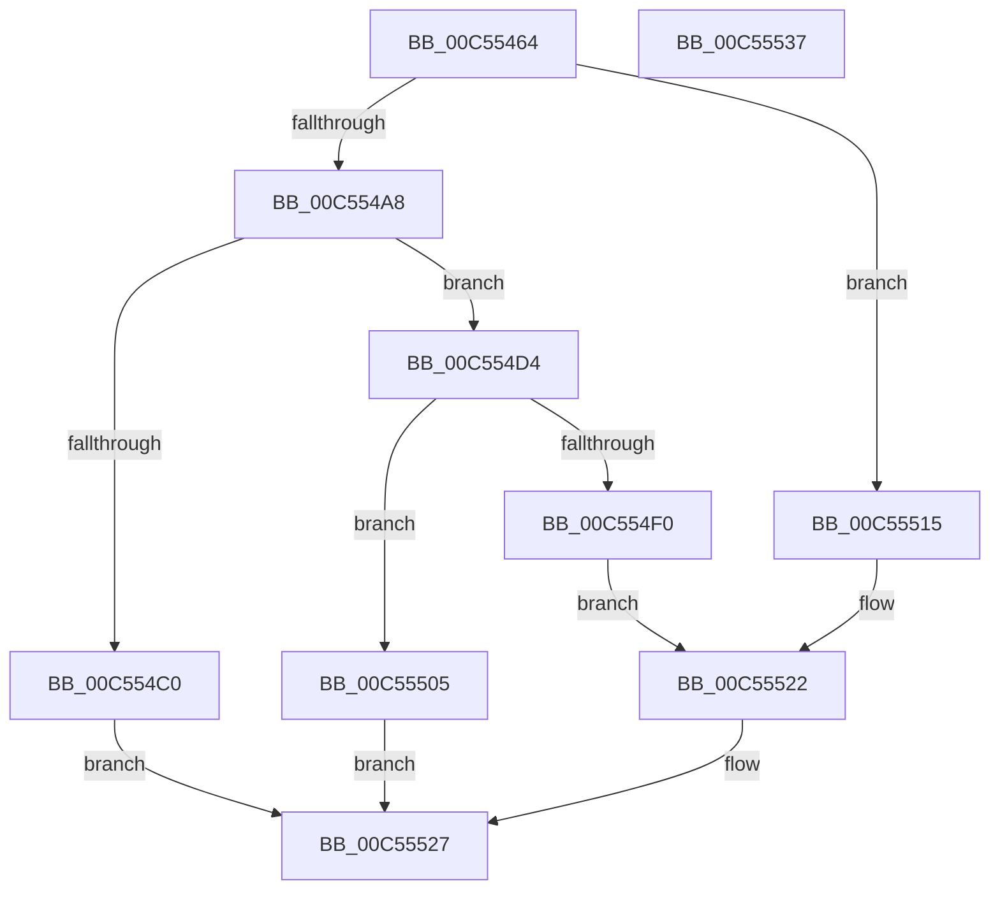

# WheapQueryPshedForErrorSources

- RVA: `0x00C55464`–`0x00C55538` (길이 `212` bytes)
- VA: `0x0000000140C55464`
- 실행 섹션: `INIT`
- PDB 이름 있음: `예`; PDB Function 태그: `아니요`
- unwind 정보 RVA: `0x000D5DD0`
- 디코드: `53`개 명령, `212/212` bytes 표시
- 미해석 바이트: `0` (있으면 어셈블리에 `.byte`로 보존)

> 이 문서는 커널 이미지의 기계어와 PDB 기호를 분석해 생성했습니다. 4번과 5번은 함수 원형과 자료형을 바이너리 사용 방식에서 추정한 C 해석이며 원본 소스 복구 결과는 아닙니다.

## 1. Dependencies

- 직접 호출 지점: **3**; 고유 호출 대상: **2**
- 직접 호출자로 확인된 함수: **1**
- RIP 상대 이미지 참조: **5**

### Outgoing calls
- `0x00C55495` → `PSHED.dll!PshedGetAllErrorSources` (import, 간접 대상; import `PSHED.dll!PshedGetAllErrorSources`)
- `0x00C554AB` → `PSHED.dll!PshedAllocateMemory` (import, 간접 대상; import `PSHED.dll!PshedAllocateMemory`)
- `0x00C554E0` → `PSHED.dll!PshedGetAllErrorSources` (import, 간접 대상; import `PSHED.dll!PshedGetAllErrorSources`)

### Direct callers
- [WheaInitialize](WheaInitialize_function_00C54C08.md) at `0x00C54CD8`
- [WheaInitialize](WheaInitialize_function_00C54C08.md) at `0x00C54EA0`

### Static image references
- `0x00C55495` → RVA `0x00151088` (`PSHED.dll!PshedGetAllErrorSources (IAT)`; read)
- `0x00C554AB` → RVA `0x00151070` (`PSHED.dll!PshedAllocateMemory (IAT)`; read)
- `0x00C554C0` → RVA `0x00EFA070` (`.data`; read/write)
- `0x00C554CB` → RVA `0x00EFA074` (`.data`; read/write)
- `0x00C554FD` → RVA `0x00EFA078` (`.data`; write)

## 2. Other-region calls and transfers

- 다른 실행 섹션으로 향하는 call: **0**
- 별도 외부 분기/꼬리 이동을 확인하지 못했습니다.

## 3. Assembly (complete function range)

```asm
00C55464  48 89 5C 24 08                  mov qword ptr [rsp + 8], rbx
00C55469  48 89 7C 24 10                  mov qword ptr [rsp + 0x10], rdi
00C5546E  55                              push rbp
00C5546F  48 8B EC                        mov rbp, rsp
00C55472  48 83 EC 30                     sub rsp, 0x30
00C55476  48 83 65 F0 00                  and qword ptr [rbp - 0x10], 0
00C5547B  4C 8D 45 20                     lea r8, [rbp + 0x20]
00C5547F  83 65 20 00                     and dword ptr [rbp + 0x20], 0
00C55483  48 8B DA                        mov rbx, rdx
00C55486  83 65 28 00                     and dword ptr [rbp + 0x28], 0
00C5548A  48 8D 55 F0                     lea rdx, [rbp - 0x10]
00C5548E  48 8B F9                        mov rdi, rcx
00C55491  48 8D 4D 28                     lea rcx, [rbp + 0x28]
00C55495  48 FF 15 EC BB 4F FF            call qword ptr [rip - 0xb04414]
00C5549C  0F 1F 44 00 00                  nop dword ptr [rax + rax]
00C554A1  3D 23 00 00 C0                  cmp eax, 0xc0000023
00C554A6  75 6D                           jne 0x140c55515
00C554A8  8B 4D 20                        mov ecx, dword ptr [rbp + 0x20]
00C554AB  48 FF 15 BE BB 4F FF            call qword ptr [rip - 0xb04442]
00C554B2  0F 1F 44 00 00                  nop dword ptr [rax + rax]
00C554B7  48 89 45 F0                     mov qword ptr [rbp - 0x10], rax
00C554BB  48 85 C0                        test rax, rax
00C554BE  75 14                           jne 0x140c554d4
00C554C0  FF 05 AA 4B 2A 00               inc dword ptr [rip + 0x2a4baa]
00C554C6  B8 9A 00 00 C0                  mov eax, 0xc000009a
00C554CB  83 0D A2 4B 2A 00 01            or dword ptr [rip + 0x2a4ba2], 1
00C554D2  EB 53                           jmp 0x140c55527
00C554D4  4C 8D 45 20                     lea r8, [rbp + 0x20]
00C554D8  48 8D 55 F0                     lea rdx, [rbp - 0x10]
00C554DC  48 8D 4D 28                     lea rcx, [rbp + 0x28]
00C554E0  48 FF 15 A1 BB 4F FF            call qword ptr [rip - 0xb0445f]
00C554E7  0F 1F 44 00 00                  nop dword ptr [rax + rax]
00C554EC  85 C0                           test eax, eax
00C554EE  79 15                           jns 0x140c55505
00C554F0  FF 05 7A 4B 2A 00               inc dword ptr [rip + 0x2a4b7a]
00C554F6  83 0D 77 4B 2A 00 20            or dword ptr [rip + 0x2a4b77], 0x20
00C554FD  89 05 75 4B 2A 00               mov dword ptr [rip + 0x2a4b75], eax
00C55503  EB 1D                           jmp 0x140c55522
00C55505  48 8B 45 F0                     mov rax, qword ptr [rbp - 0x10]
00C55509  48 89 03                        mov qword ptr [rbx], rax
00C5550C  8B 45 28                        mov eax, dword ptr [rbp + 0x28]
00C5550F  89 07                           mov dword ptr [rdi], eax
00C55511  33 C0                           xor eax, eax
00C55513  EB 12                           jmp 0x140c55527
00C55515  FF 05 55 4B 2A 00               inc dword ptr [rip + 0x2a4b55]
00C5551B  83 0D 52 4B 2A 00 04            or dword ptr [rip + 0x2a4b52], 4
00C55522  B8 01 00 00 C0                  mov eax, 0xc0000001
00C55527  48 8B 5C 24 40                  mov rbx, qword ptr [rsp + 0x40]
00C5552C  48 8B 7C 24 48                  mov rdi, qword ptr [rsp + 0x48]
00C55531  48 83 C4 30                     add rsp, 0x30
00C55535  5D                              pop rbp
00C55536  C3                              ret
00C55537  CC                              int3
```

## 4. C-style interpretation (structured pseudocode)

```c
__int64 __fastcall WheapQueryPshedForErrorSources(__int64 a1, __int64 a2)
{
    __int64 result;
    __int64 v_rsp;
    unsigned __int64 v_stack_m18;
    unsigned __int64 v_stack_p10;
    unsigned __int64 v_stack_p18;
    unsigned int v_stack_p20;
    unsigned __int64 v_stack_p8;

    v_stack_p8 = v_rbx;
    v_stack_p10 = v_rdi;
    v_rsp = (v_rsp) - (48);
    result = PSHED_dll_PshedGetAllErrorSources(v_stack_p20, v_stack_m18, v_stack_p18, a4);
    if (((unsigned int)(result)) != 0xC0000023ULL) goto loc_00C55515;
    result = PSHED_dll_PshedAllocateMemory((unsigned int)(v_stack_p18), v_stack_m18, v_stack_p18, a4);
    v_stack_m18 = result;
    if (result != 0) goto loc_00C554D4;
    goto loc_00C55527;
loc_00C554D4:
    result = PSHED_dll_PshedGetAllErrorSources(v_stack_p20, v_stack_m18, v_stack_p18, a4);
    if (!sign_flag) goto loc_00C55505;
    *(unsigned int *)(v_rip + 2771829) = (unsigned int)(result);
    goto loc_00C55522;
loc_00C55505:
    *(unsigned __int64 *)(a2) = v_stack_m18;
    *(unsigned int *)(a1) = (unsigned int)((unsigned int)(v_stack_p20));
    result = 0;
    goto loc_00C55527;
loc_00C55515:
loc_00C55522:
loc_00C55527:
    v_rsp = (v_rsp) + (48);
    return (unsigned int)(0xC0000001ULL);
}
```

## 5. (Beta) C Style

```c
int64_t WheapQueryPshedForErrorSources(void *Arg1, void *Arg2)
{
    uint8_t *arg1 = (uint8_t *)Arg1;
    uint8_t *arg2 = (uint8_t *)Arg2;

    int64_t result;
    int64_t local_rsp;
    uint64_t v_stack_m18;
    uint64_t v_stack_p10;
    uint64_t v_stack_p18;
    uint32_t v_stack_p20;
    uint64_t v_stack_p8;

    v_stack_p8 = local_rbx;
    v_stack_p10 = local_rdi;
    local_rsp = (local_rsp) - (48);
    result = kernel_indirect_call(v_stack_p20, v_stack_m18, v_stack_p18, a4);
    if (((uint32_t)(result)) != 0xC0000023ULL) goto loc_00C55515;
    result = kernel_indirect_call((uint32_t)(v_stack_p18), v_stack_m18, v_stack_p18, a4);
    v_stack_m18 = result;
    if (result != 0) goto loc_00C554D4;
    goto loc_00C55527;
loc_00C554D4:
    result = kernel_indirect_call(v_stack_p20, v_stack_m18, v_stack_p18, a4);
    if (!sign_flag) goto loc_00C55505;
    *(uint32_t *)(v_rip + 0x2A4B75) = (uint32_t)(result);
    goto loc_00C55522;
loc_00C55505:
    *(uint64_t *)(arg2) = v_stack_m18;
    *(uint32_t *)(arg1) = (uint32_t)((uint32_t)(v_stack_p20));
    result = 0;
    goto loc_00C55527;
loc_00C55515:
loc_00C55522:
loc_00C55527:
    local_rsp = (local_rsp) + (48);
    return (uint32_t)(0xC0000001ULL);
}
```

### 관측된 메모리 오프셋

구조체 형식이 확인되지 않은 접근은 인자 기준의 오프셋으로만 기록했습니다.

| 기준 인자 | 오프셋 표현 | 폭 (bit) | 접근 |
|---|---:|---:|---|
| `Arg1` | `+ 0x0` | `32` | `W` |
| `Arg2` | `+ 0x0` | `64` | `W` |

## 6. Execution-region graph

[열기: 2D/3D 그래프와 함수 탐색 컨트롤 패널](../../../control-panel.html?section=init&rva=0x00C55464&view=graph)

- 2D 그래프는 위에서 아래로 흐르고, 3D 그래프는 빈 공간을 드래그해 회전합니다. Shift+드래그는 이동, 휠은 확대·축소, 함수 노드 선택은 대상 보고서 이동입니다.

### Static fallback


