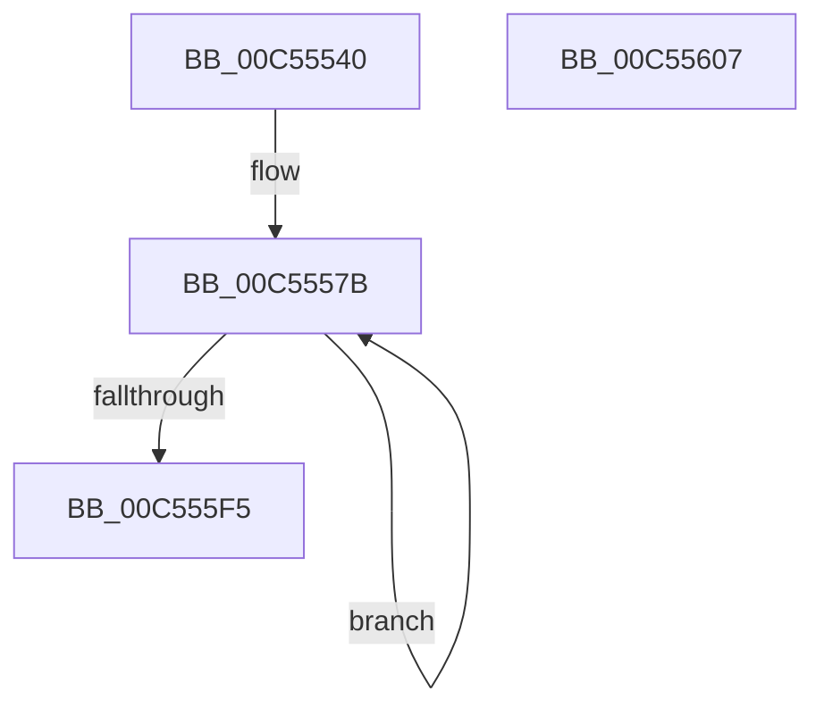

# WheapSetDefaultErrorSourceConfiguration

- RVA: `0x00C55540`–`0x00C55608` (길이 `200` bytes)
- VA: `0x0000000140C55540`
- 실행 섹션: `INIT`
- PDB 이름 있음: `예`; PDB Function 태그: `아니요`
- unwind 정보 RVA: `0x000950EC`
- 디코드: `33`개 명령, `200/200` bytes 표시
- 미해석 바이트: `0` (있으면 어셈블리에 `.byte`로 보존)

> 이 문서는 커널 이미지의 기계어와 PDB 기호를 분석해 생성했습니다. 4번과 5번은 함수 원형과 자료형을 바이너리 사용 방식에서 추정한 C 해석이며 원본 소스 복구 결과는 아닙니다.

## 1. Dependencies

- 직접 호출 지점: **0**; 고유 호출 대상: **0**
- 직접 호출자로 확인된 함수: **1**
- RIP 상대 이미지 참조: **6**

### Outgoing calls
- 직접 디코드된 call 명령이 없습니다.

### Direct callers
- [WheaInitializeServices](WheaInitializeServices_function_00C5516C.md) at `0x00C55170`

### Static image references
- `0x00C5554C` → RVA `0x00000000` (`image boundary/outside`; read)
- `0x00C55555` → RVA `0x0048FDC0` (`HalAdjustResourceList`; read)
- `0x00C5555C` → RVA `0x00B5D700` (`HalpQosInitSystem`; read)
- `0x00C55563` → RVA `0x00660050` (`WheapDefaultErrSrcCreateRecord`; read)
- `0x00C55574` → RVA `0x0049E550` (`EmpCheckErrataList`; read)
- `0x00C555FF` → RVA `0x00EF9FC8` (`.data`; write)

## 2. Other-region calls and transfers

- 다른 실행 섹션으로 향하는 call: **0**
- 별도 외부 분기/꼬리 이동을 확인하지 못했습니다.

## 3. Assembly (complete function range)

```asm
00C55540  48 89 5C 24 08                  mov qword ptr [rsp + 8], rbx
00C55545  48 89 7C 24 10                  mov qword ptr [rsp + 0x10], rdi
00C5554A  33 D2                           xor edx, edx
00C5554C  4C 8D 05 AD AA 3A FF            lea r8, [rip - 0xc55553]
00C55553  8B C2                           mov eax, edx
00C55555  4C 8D 0D 64 A8 83 FF            lea r9, [rip - 0x7c579c]
00C5555C  4C 8D 15 9D 81 F0 FF            lea r10, [rip - 0xf7e63]
00C55563  4C 8D 1D E6 AA A0 FF            lea r11, [rip - 0x5f551a]
00C5556A  8D 4A 13                        lea ecx, [rdx + 0x13]
00C5556D  48 8D 1D 4C A8 83 FF            lea rbx, [rip - 0x7c57b4]
00C55574  48 8D 3D D5 8F 84 FF            lea rdi, [rip - 0x7b702b]
00C5557B  4A 89 94 00 90 F0 EE 00         mov qword ptr [rax + r8 + 0xeef090], rdx
00C55583  4A 89 94 00 90 F5 EE 00         mov qword ptr [rax + r8 + 0xeef590], rdx
00C5558B  4E 89 8C 00 A0 F0 EE 00         mov qword ptr [rax + r8 + 0xeef0a0], r9
00C55593  4E 89 94 00 A8 F0 EE 00         mov qword ptr [rax + r8 + 0xeef0a8], r10
00C5559B  4E 89 9C 00 B0 F0 EE 00         mov qword ptr [rax + r8 + 0xeef0b0], r11
00C555A3  4A 89 9C 00 B8 F0 EE 00         mov qword ptr [rax + r8 + 0xeef0b8], rbx
00C555AB  4A 89 BC 00 C0 F0 EE 00         mov qword ptr [rax + r8 + 0xeef0c0], rdi
00C555B3  4A 89 94 00 C8 F0 EE 00         mov qword ptr [rax + r8 + 0xeef0c8], rdx
00C555BB  4E 89 8C 00 A0 F5 EE 00         mov qword ptr [rax + r8 + 0xeef5a0], r9
00C555C3  4E 89 94 00 A8 F5 EE 00         mov qword ptr [rax + r8 + 0xeef5a8], r10
00C555CB  4E 89 9C 00 B0 F5 EE 00         mov qword ptr [rax + r8 + 0xeef5b0], r11
00C555D3  4A 89 9C 00 B8 F5 EE 00         mov qword ptr [rax + r8 + 0xeef5b8], rbx
00C555DB  4A 89 BC 00 C0 F5 EE 00         mov qword ptr [rax + r8 + 0xeef5c0], rdi
00C555E3  4A 89 94 00 C8 F5 EE 00         mov qword ptr [rax + r8 + 0xeef5c8], rdx
00C555EB  48 8D 40 40                     lea rax, [rax + 0x40]
00C555EF  48 83 E9 01                     sub rcx, 1
00C555F3  75 86                           jne 0x140c5557b
00C555F5  48 8B 5C 24 08                  mov rbx, qword ptr [rsp + 8]
00C555FA  48 8B 7C 24 10                  mov rdi, qword ptr [rsp + 0x10]
00C555FF  48 89 15 C2 49 2A 00            mov qword ptr [rip + 0x2a49c2], rdx
00C55606  C3                              ret
00C55607  CC                              int3
```

## 4. C-style interpretation (structured pseudocode)

```c
__int64 __fastcall WheapSetDefaultErrorSourceConfiguration(__int64 a1, int a2)
{
    unsigned __int64 v_stack_p10;
    unsigned __int64 v_stack_p8;

    v_stack_p8 = v_rbx;
    v_stack_p10 = v_rdi;
    a2 = 0;
loc_00C5557B:
    *(unsigned __int64 *)(0 + v_rip - 12932435 * 1 + 15659152) = 0;
    *(unsigned __int64 *)(0 + v_rip - 12932435 * 1 + 15660432) = 0;
    *(unsigned __int64 *)(0 + v_rip - 12932435 * 1 + 15659168) = v_rip - 8148892;
    *(unsigned __int64 *)(0 + v_rip - 12932435 * 1 + 15659176) = v_rip - 1015395;
    *(unsigned __int64 *)(0 + v_rip - 12932435 * 1 + 15659184) = v_rip - 6247706;
    *(unsigned __int64 *)(0 + v_rip - 12932435 * 1 + 15659192) = v_rip - 8148916;
    *(unsigned __int64 *)(0 + v_rip - 12932435 * 1 + 15659200) = v_rip - 8089643;
    *(unsigned __int64 *)(0 + v_rip - 12932435 * 1 + 15659208) = 0;
    *(unsigned __int64 *)(0 + v_rip - 12932435 * 1 + 15660448) = v_rip - 8148892;
    *(unsigned __int64 *)(0 + v_rip - 12932435 * 1 + 15660456) = v_rip - 1015395;
    *(unsigned __int64 *)(0 + v_rip - 12932435 * 1 + 15660464) = v_rip - 6247706;
    *(unsigned __int64 *)(0 + v_rip - 12932435 * 1 + 15660472) = v_rip - 8148916;
    *(unsigned __int64 *)(0 + v_rip - 12932435 * 1 + 15660480) = v_rip - 8089643;
    *(unsigned __int64 *)(0 + v_rip - 12932435 * 1 + 15660488) = 0;
    a1 = (a2 + 19) - (1);
    if (condition_is_not_equal) goto loc_00C5557B;
    *(unsigned __int64 *)(v_rip + 2771394) = 0;
    return 0 + 64;
}
```

## 5. (Beta) C Style

```c
int64_t WheapSetDefaultErrorSourceConfiguration(int64_t Arg1, int32_t Arg2)
{
    uint64_t v_stack_p10;
    uint64_t v_stack_p8;

    v_stack_p8 = local_rbx;
    v_stack_p10 = local_rdi;
    Arg2 = 0;
loc_00C5557B:
    *(uint64_t *)(0 + v_rip - 0xC55553 * 1 + 0xEEF090) = 0;
    *(uint64_t *)(0 + v_rip - 0xC55553 * 1 + 0xEEF590) = 0;
    *(uint64_t *)(0 + v_rip - 0xC55553 * 1 + 0xEEF0A0) = v_rip - 8148892;
    *(uint64_t *)(0 + v_rip - 0xC55553 * 1 + 0xEEF0A8) = v_rip - 1015395;
    *(uint64_t *)(0 + v_rip - 0xC55553 * 1 + 0xEEF0B0) = v_rip - 6247706;
    *(uint64_t *)(0 + v_rip - 0xC55553 * 1 + 0xEEF0B8) = v_rip - 8148916;
    *(uint64_t *)(0 + v_rip - 0xC55553 * 1 + 0xEEF0C0) = v_rip - 8089643;
    *(uint64_t *)(0 + v_rip - 0xC55553 * 1 + 0xEEF0C8) = 0;
    *(uint64_t *)(0 + v_rip - 0xC55553 * 1 + 0xEEF5A0) = v_rip - 8148892;
    *(uint64_t *)(0 + v_rip - 0xC55553 * 1 + 0xEEF5A8) = v_rip - 1015395;
    *(uint64_t *)(0 + v_rip - 0xC55553 * 1 + 0xEEF5B0) = v_rip - 6247706;
    *(uint64_t *)(0 + v_rip - 0xC55553 * 1 + 0xEEF5B8) = v_rip - 8148916;
    *(uint64_t *)(0 + v_rip - 0xC55553 * 1 + 0xEEF5C0) = v_rip - 8089643;
    *(uint64_t *)(0 + v_rip - 0xC55553 * 1 + 0xEEF5C8) = 0;
    Arg1 = (Arg2 + 19) - (1);
    if (condition_is_not_equal) goto loc_00C5557B;
    *(uint64_t *)(v_rip + 0x2A49C2) = 0;
    return 0 + 64;
}
```

## 6. Execution-region graph

[열기: 2D/3D 그래프와 함수 탐색 컨트롤 패널](../../../control-panel.html?section=init&rva=0x00C55540&view=graph)

- 2D 그래프는 위에서 아래로 흐르고, 3D 그래프는 빈 공간을 드래그해 회전합니다. Shift+드래그는 이동, 휠은 확대·축소, 함수 노드 선택은 대상 보고서 이동입니다.

### Static fallback


