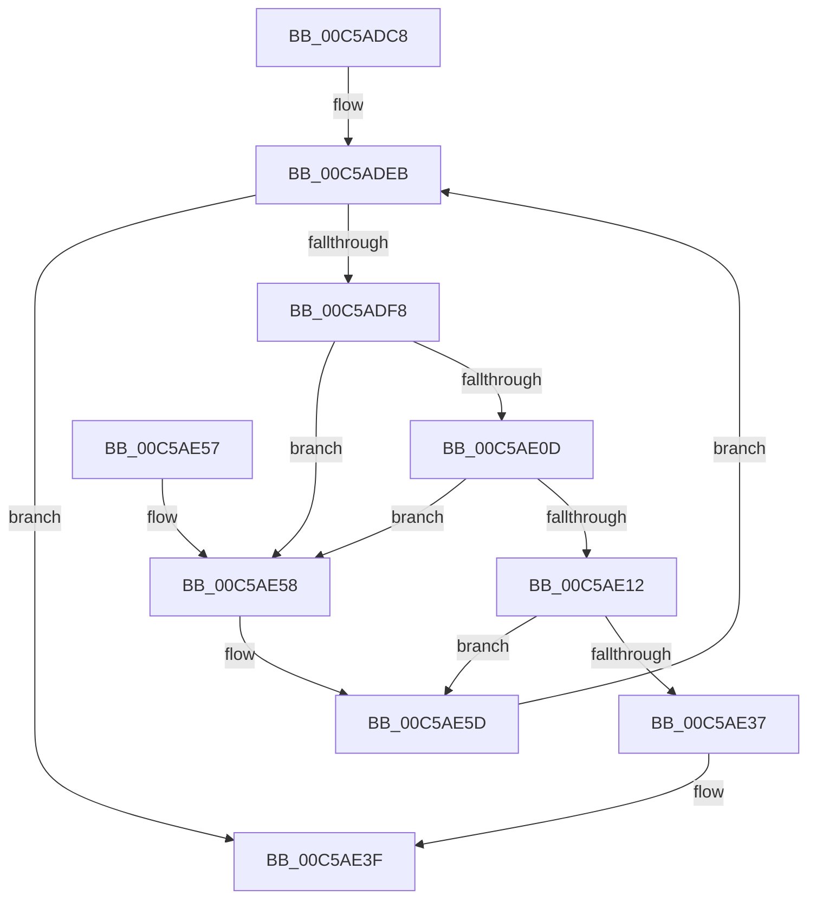

# wil_details_PopulateInitialConfiguredFeatureStatesFromBuffers

- RVA: `0x00C5ADC8`–`0x00C5AE82` (길이 `186` bytes)
- VA: `0x0000000140C5ADC8`
- 실행 섹션: `INIT`
- PDB 이름 있음: `예`; PDB Function 태그: `아니요`
- unwind 정보 RVA: `0x000D6BB4`
- 디코드: `51`개 명령, `186/186` bytes 표시
- 미해석 바이트: `0` (있으면 어셈블리에 `.byte`로 보존)

> 이 문서는 커널 이미지의 기계어와 PDB 기호를 분석해 생성했습니다. 4번과 5번은 함수 원형과 자료형을 바이너리 사용 방식에서 추정한 C 해석이며 원본 소스 복구 결과는 아닙니다.

## 1. Dependencies

- 직접 호출 지점: **5**; 고유 호출 대상: **5**
- 직접 호출자로 확인된 함수: **1**
- RIP 상대 이미지 참조: **2**

### Outgoing calls
- `0x00C5ADEB` → [wil_details_FeatureDescriptors_SkipPadding](../../text/4C/wil_details_FeatureDescriptors_SkipPadding_function_004C9934.md) (function, `0x004C9934`)
- `0x00C5AE2B` → [RtlQueryFeatureConfigurationFromBuffers](../../text/5E/RtlQueryFeatureConfigurationFromBuffers_function_005E7414.md) (function, `0x005E7414`)
- `0x00C5AE3A` → [wil_details_PopulateInitialConfiguredFeatureStatesWithDefaults](wil_details_PopulateInitialConfiguredFeatureStatesWithDefaults_function_00C5AE88.md) (function, `0x00C5AE88`)
- `0x00C5AE47` → [_security_check_cookie](../../text/6A/_security_check_cookie_function_006AC640.md) (function, `0x006AC640`)
- `0x00C5AE69` → [wil_details_BuildFeatureStateCacheFromQueryResults](../../page/70/wil_details_BuildFeatureStateCacheFromQueryResults_function_0070437C.md) (function, `0x0070437C`)

### Direct callers
- [CmFcInitSystem0](CmFcInitSystem0_function_00C5AC60.md) at `0x00C5AC96`

### Static image references
- `0x00C5ADD2` → RVA `0x00E0A740` (`.data`; read)
- `0x00C5ADE4` → RVA `0x000DC0C0` (`.rdata`; read)

## 2. Other-region calls and transfers

- 다른 실행 섹션으로 향하는 call: **4**
  - `0x00C5ADEB` → [wil_details_FeatureDescriptors_SkipPadding](../../text/4C/wil_details_FeatureDescriptors_SkipPadding_function_004C9934.md) (`INIT` → `.text`)
  - `0x00C5AE2B` → [RtlQueryFeatureConfigurationFromBuffers](../../text/5E/RtlQueryFeatureConfigurationFromBuffers_function_005E7414.md) (`INIT` → `.text`)
  - `0x00C5AE47` → [_security_check_cookie](../../text/6A/_security_check_cookie_function_006AC640.md) (`INIT` → `.text`)
  - `0x00C5AE69` → [wil_details_BuildFeatureStateCacheFromQueryResults](../../page/70/wil_details_BuildFeatureStateCacheFromQueryResults_function_0070437C.md) (`INIT` → `PAGE`)
- 별도 외부 분기/꼬리 이동을 확인하지 못했습니다.

## 3. Assembly (complete function range)

```asm
00C5ADC8  48 89 5C 24 10                  mov qword ptr [rsp + 0x10], rbx
00C5ADCD  57                              push rdi
00C5ADCE  48 83 EC 40                     sub rsp, 0x40
00C5ADD2  48 8B 05 67 F9 1A 00            mov rax, qword ptr [rip + 0x1af967]
00C5ADD9  48 33 C4                        xor rax, rsp
00C5ADDC  48 89 44 24 38                  mov qword ptr [rsp + 0x38], rax
00C5ADE1  48 8B F9                        mov rdi, rcx
00C5ADE4  48 8D 0D D5 12 48 FF            lea rcx, [rip - 0xb7ed2b]
00C5ADEB  E8 44 EB 86 FF                  call 0x1404c9934
00C5ADF0  48 8B D8                        mov rbx, rax
00C5ADF3  48 85 C0                        test rax, rax
00C5ADF6  74 47                           je 0x140c5ae3f
00C5ADF8  33 C0                           xor eax, eax
00C5ADFA  48 21 44 24 20                  and qword ptr [rsp + 0x20], rax
00C5ADFF  48 89 44 24 28                  mov qword ptr [rsp + 0x28], rax
00C5AE04  89 44 24 30                     mov dword ptr [rsp + 0x30], eax
00C5AE08  38 43 1D                        cmp byte ptr [rbx + 0x1d], al
00C5AE0B  75 4B                           jne 0x140c5ae58
00C5AE0D  38 43 1E                        cmp byte ptr [rbx + 0x1e], al
00C5AE10  75 46                           jne 0x140c5ae58
00C5AE12  8A 43 1C                        mov al, byte ptr [rbx + 0x1c]
00C5AE15  4C 8D 4C 24 28                  lea r9, [rsp + 0x28]
00C5AE1A  8B 53 18                        mov edx, dword ptr [rbx + 0x18]
00C5AE1D  45 33 C0                        xor r8d, r8d
00C5AE20  2C 02                           sub al, 2
00C5AE22  48 8B CF                        mov rcx, rdi
00C5AE25  3C 01                           cmp al, 1
00C5AE27  41 0F 97 C0                     seta r8b
00C5AE2B  E8 E4 C5 98 FF                  call 0x1405e7414
00C5AE30  3D 22 00 00 80                  cmp eax, 0x80000022
00C5AE35  75 26                           jne 0x140c5ae5d
00C5AE37  48 8B CB                        mov rcx, rbx
00C5AE3A  E8 49 00 00 00                  call 0x140c5ae88
00C5AE3F  48 8B 4C 24 38                  mov rcx, qword ptr [rsp + 0x38]
00C5AE44  48 33 CC                        xor rcx, rsp
00C5AE47  E8 F4 17 A5 FF                  call 0x1406ac640
00C5AE4C  48 8B 5C 24 58                  mov rbx, qword ptr [rsp + 0x58]
00C5AE51  48 83 C4 40                     add rsp, 0x40
00C5AE55  5F                              pop rdi
00C5AE56  C3                              ret
00C5AE57  CC                              int3
00C5AE58  B8 25 02 00 C0                  mov eax, 0xc0000225
00C5AE5D  4C 8D 44 24 20                  lea r8, [rsp + 0x20]
00C5AE62  8B C8                           mov ecx, eax
00C5AE64  48 8D 54 24 28                  lea rdx, [rsp + 0x28]
00C5AE69  E8 0E 95 AA FF                  call 0x14070437c
00C5AE6E  4C 8B 03                        mov r8, qword ptr [rbx]
00C5AE71  48 8D 4B 38                     lea rcx, [rbx + 0x38]
00C5AE75  48 8B 44 24 20                  mov rax, qword ptr [rsp + 0x20]
00C5AE7A  49 89 00                        mov qword ptr [r8], rax
00C5AE7D  E9 69 FF FF FF                  jmp 0x140c5adeb
```

## 4. C-style interpretation (structured pseudocode)

```c
__int64 __fastcall wil_details_PopulateInitialConfiguredFeatureStatesFromBuffers(__int64 a1, __int64 a2, int a3)
{
    __int64 result;
    __int64 v_rsp;
    unsigned __int64 v_stack_m10;
    unsigned int v_stack_m18;
    unsigned __int64 v_stack_m20;
    unsigned __int64 v_stack_m28;
    unsigned __int64 v_stack_p10;
    unsigned __int64 v_stack_p20;
    unsigned __int64 v_stack_p28;

    v_stack_p10 = v_rbx;
    v_rsp = (v_rsp) - (64);
    result = (*(unsigned __int64 *)(v_rip + 1767783)) ^ (v_rsp);
    v_stack_m10 = result;
loc_00C5ADEB:
    result = wil_details_FeatureDescriptors_SkipPadding(v_rip - 12053803, a2, a3, a4);
    if (result == 0) goto loc_00C5AE3F;
    result = 0;
    v_stack_m20 = 0;
    v_stack_m18 = 0;
    if ((*(unsigned __int8 *)(result + 29)) != 0) goto loc_00C5AE58;
    if ((*(unsigned __int8 *)(result + 30)) != 0) goto loc_00C5AE58;
    a3 = 0;
    result = (unsigned __int8)((*(unsigned __int8 *)(result + 28)) - (2));
    a3 = (((unsigned __int8)(result)) > 1) ? 1 : 0;
    result = RtlQueryFeatureConfigurationFromBuffers(a1, (unsigned int)(*(unsigned int *)(result + 24)), a3, v_stack_m20);
    if (((unsigned int)(result)) != 0x80000022ULL) goto loc_00C5AE5D;
    result = wil_details_PopulateInitialConfiguredFeatureStatesWithDefaults(result, (unsigned int)(*(unsigned int *)(result + 24)), a3, v_stack_m20);
loc_00C5AE3F:
    a1 = (v_stack_m10) ^ (v_rsp);
    result = _security_check_cookie(a1, (unsigned int)(*(unsigned int *)(result + 24)), a3, v_stack_m20);
    v_rsp = (v_rsp) + (64);
    return result;
loc_00C5AE58:
loc_00C5AE5D:
    result = wil_details_BuildFeatureStateCacheFromQueryResults((unsigned int)((unsigned int)((unsigned int)(0xC0000225ULL))), v_stack_p28, v_stack_p20, v_stack_m20);
    *(unsigned __int64 *)(*(unsigned __int64 *)(v_stack_p10)) = v_stack_p20;
    goto loc_00C5ADEB;
}
```

## 5. (Beta) C Style

```c
int64_t wil_details_PopulateInitialConfiguredFeatureStatesFromBuffers(int64_t Arg1, int64_t Arg2, int32_t Arg3)
{
    int64_t result;
    int64_t local_rsp;
    uint64_t v_stack_m10;
    uint32_t v_stack_m18;
    uint64_t v_stack_m20;
    uint64_t v_stack_m28;
    uint64_t v_stack_p10;
    uint64_t v_stack_p20;
    uint64_t v_stack_p28;

    v_stack_p10 = local_rbx;
    local_rsp = (local_rsp) - (64);
    result = (*(uint64_t *)(v_rip + 0x1AF967)) ^ (local_rsp);
    v_stack_m10 = result;
loc_00C5ADEB:
    result = wil_details_FeatureDescriptors_SkipPadding(v_rip - 12053803, Arg2, Arg3, a4);
    if (result == 0) goto loc_00C5AE3F;
    result = 0;
    v_stack_m20 = 0;
    v_stack_m18 = 0;
    if ((*(uint8_t *)(result + 0x1D)) != 0) goto loc_00C5AE58;
    if ((*(uint8_t *)(result + 0x1E)) != 0) goto loc_00C5AE58;
    Arg3 = 0;
    result = (uint8_t)((*(uint8_t *)(result + 0x1C)) - (2));
    Arg3 = (((uint8_t)(result)) > 1) ? 1 : 0;
    result = RtlQueryFeatureConfigurationFromBuffers(Arg1, (uint32_t)(*(uint32_t *)(result + 0x18)), Arg3, v_stack_m20);
    if (((uint32_t)(result)) != 0x80000022ULL) goto loc_00C5AE5D;
    result = wil_details_PopulateInitialConfiguredFeatureStatesWithDefaults(result, (uint32_t)(*(uint32_t *)(result + 0x18)), Arg3, v_stack_m20);
loc_00C5AE3F:
    Arg1 = (v_stack_m10) ^ (local_rsp);
    result = _security_check_cookie(Arg1, (uint32_t)(*(uint32_t *)(result + 0x18)), Arg3, v_stack_m20);
    local_rsp = (local_rsp) + (64);
    return result;
loc_00C5AE58:
loc_00C5AE5D:
    result = wil_details_BuildFeatureStateCacheFromQueryResults((uint32_t)((uint32_t)((uint32_t)(0xC0000225ULL))), v_stack_p28, v_stack_p20, v_stack_m20);
    *(uint64_t *)(*(uint64_t *)(v_stack_p10)) = v_stack_p20;
    goto loc_00C5ADEB;
}
```

## 6. Execution-region graph

[열기: 2D/3D 그래프와 함수 탐색 컨트롤 패널](../../../control-panel.html?section=init&rva=0x00C5ADC8&view=graph)

- 2D 그래프는 위에서 아래로 흐르고, 3D 그래프는 빈 공간을 드래그해 회전합니다. Shift+드래그는 이동, 휠은 확대·축소, 함수 노드 선택은 대상 보고서 이동입니다.

### Static fallback


