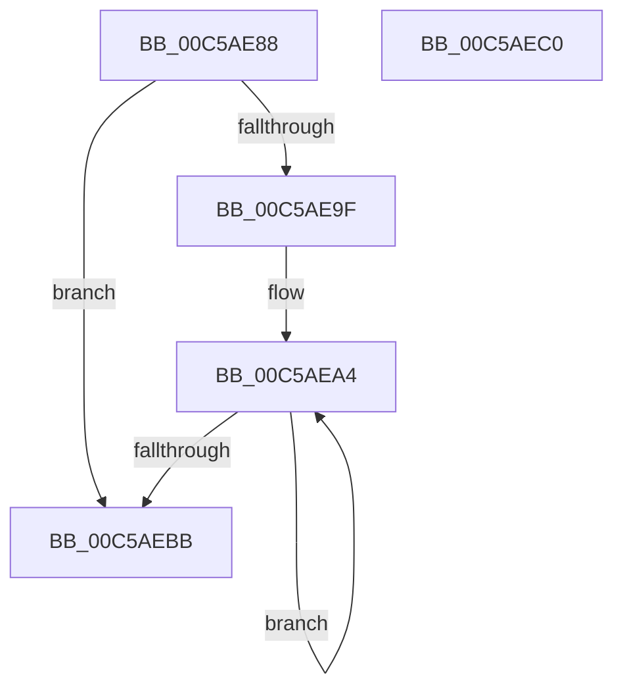

# wil_details_PopulateInitialConfiguredFeatureStatesWithDefaults

- RVA: `0x00C5AE88`–`0x00C5AEC1` (길이 `57` bytes)
- VA: `0x0000000140C5AE88`
- 실행 섹션: `INIT`
- PDB 이름 있음: `예`; PDB Function 태그: `아니요`
- unwind 정보 RVA: `0x0005C788`
- 디코드: `16`개 명령, `57/57` bytes 표시
- 미해석 바이트: `0` (있으면 어셈블리에 `.byte`로 보존)

> 이 문서는 커널 이미지의 기계어와 PDB 기호를 분석해 생성했습니다. 4번과 5번은 함수 원형과 자료형을 바이너리 사용 방식에서 추정한 C 해석이며 원본 소스 복구 결과는 아닙니다.

## 1. Dependencies

- 직접 호출 지점: **1**; 고유 호출 대상: **1**
- 직접 호출자로 확인된 함수: **1**
- RIP 상대 이미지 참조: **0**

### Outgoing calls
- `0x00C5AEAE` → [wil_details_FeatureDescriptors_SkipPadding](../../text/4C/wil_details_FeatureDescriptors_SkipPadding_function_004C9934.md) (function, `0x004C9934`)

### Direct callers
- [wil_details_PopulateInitialConfiguredFeatureStatesFromBuffers](wil_details_PopulateInitialConfiguredFeatureStatesFromBuffers_function_00C5ADC8.md) at `0x00C5AE3A`

### Static image references
- 디코드된 RIP-relative 메모리 참조가 없습니다.

## 2. Other-region calls and transfers

- 다른 실행 섹션으로 향하는 call: **1**
  - `0x00C5AEAE` → [wil_details_FeatureDescriptors_SkipPadding](../../text/4C/wil_details_FeatureDescriptors_SkipPadding_function_004C9934.md) (`INIT` → `.text`)
- 별도 외부 분기/꼬리 이동을 확인하지 못했습니다.

## 3. Assembly (complete function range)

```asm
00C5AE88  48 83 EC 28                     sub rsp, 0x28
00C5AE8C  48 83 64 24 30 00               and qword ptr [rsp + 0x30], 0
00C5AE92  C7 44 24 30 06 02 00 00         mov dword ptr [rsp + 0x30], 0x206
00C5AE9A  48 85 C9                        test rcx, rcx
00C5AE9D  74 1C                           je 0x140c5aebb
00C5AE9F  48 8B 54 24 30                  mov rdx, qword ptr [rsp + 0x30]
00C5AEA4  48 8B 01                        mov rax, qword ptr [rcx]
00C5AEA7  48 83 C1 38                     add rcx, 0x38
00C5AEAB  48 89 10                        mov qword ptr [rax], rdx
00C5AEAE  E8 81 EA 86 FF                  call 0x1404c9934
00C5AEB3  48 8B C8                        mov rcx, rax
00C5AEB6  48 85 C0                        test rax, rax
00C5AEB9  75 E9                           jne 0x140c5aea4
00C5AEBB  48 83 C4 28                     add rsp, 0x28
00C5AEBF  C3                              ret
00C5AEC0  CC                              int3
```

## 4. C-style interpretation (structured pseudocode)

```c
__int64 __fastcall wil_details_PopulateInitialConfiguredFeatureStatesWithDefaults(__int64 a1)
{
    __int64 result;
    __int64 v_rsp;
    unsigned __int64 v_stack_p8;

    v_rsp = (v_rsp) - (40);
    v_stack_p8 = 518;
    if (a1 == 0) goto loc_00C5AEBB;
loc_00C5AEA4:
    a1 = (a1) + (56);
    *(unsigned __int64 *)(*(unsigned __int64 *)(a1)) = v_stack_p8;
    result = wil_details_FeatureDescriptors_SkipPadding(a1, v_stack_p8, a3, a4);
    if (result != 0) goto loc_00C5AEA4;
loc_00C5AEBB:
    v_rsp = (v_rsp) + (40);
    return result;
}
```

## 5. (Beta) C Style

```c
int64_t wil_details_PopulateInitialConfiguredFeatureStatesWithDefaults(int64_t Arg1)
{
    int64_t result;
    int64_t local_rsp;
    uint64_t v_stack_p8;

    local_rsp = (local_rsp) - (40);
    v_stack_p8 = 518;
    if (Arg1 == 0) goto loc_00C5AEBB;
loc_00C5AEA4:
    Arg1 = (Arg1) + (56);
    *(uint64_t *)(*(uint64_t *)(Arg1)) = v_stack_p8;
    result = wil_details_FeatureDescriptors_SkipPadding(Arg1, v_stack_p8, a3, a4);
    if (result != 0) goto loc_00C5AEA4;
loc_00C5AEBB:
    local_rsp = (local_rsp) + (40);
    return result;
}
```

## 6. Execution-region graph

[열기: 2D/3D 그래프와 함수 탐색 컨트롤 패널](../../../control-panel.html?section=init&rva=0x00C5AE88&view=graph)

- 2D 그래프는 위에서 아래로 흐르고, 3D 그래프는 빈 공간을 드래그해 회전합니다. Shift+드래그는 이동, 휠은 확대·축소, 함수 노드 선택은 대상 보고서 이동입니다.

### Static fallback


