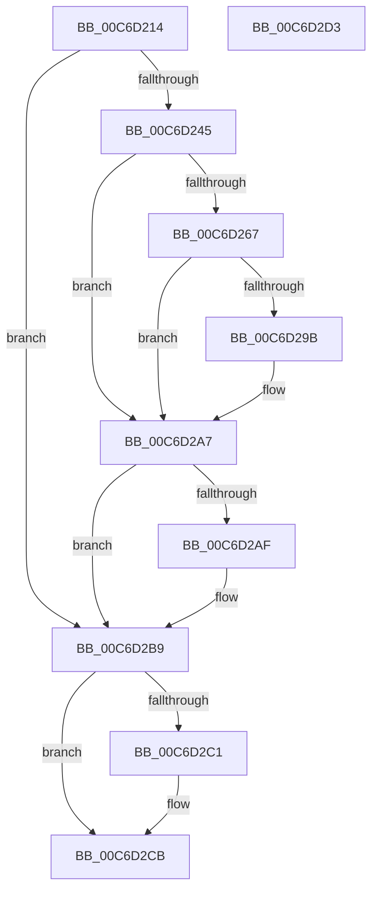

# BcdSetBootBcdAsSystemStore

- RVA: `0x00C6D214`–`0x00C6D2D4` (길이 `192` bytes)
- VA: `0x0000000140C6D214`
- 실행 섹션: `INIT`
- PDB 이름 있음: `예`; PDB Function 태그: `아니요`
- unwind 정보 RVA: `0x00064C80`
- 디코드: `47`개 명령, `192/192` bytes 표시
- 미해석 바이트: `0` (있으면 어셈블리에 `.byte`로 보존)

> 이 문서는 커널 이미지의 기계어와 PDB 기호를 분석해 생성했습니다. 4번과 5번은 함수 원형과 자료형을 바이너리 사용 방식에서 추정한 C 해석이며 원본 소스 복구 결과는 아닙니다.

## 1. Dependencies

- 직접 호출 지점: **6**; 고유 호출 대상: **5**
- 직접 호출자로 확인된 함수: **1**
- RIP 상대 이미지 참조: **4**

### Outgoing calls
- `0x00C6D23A` → [BiOpenKeyNonBcd](../../page/A4/BiOpenKeyNonBcd_function_00A40B48.md) (function, `0x00A40B48`)
- `0x00C6D25C` → [BiOpenKey](../../page/A3/BiOpenKey_function_00A3F60C.md) (function, `0x00A3F60C`)
- `0x00C6D290` → [BiSetRegistryValue](../../page/A3/BiSetRegistryValue_function_00A3E3B0.md) (function, `0x00A3E3B0`)
- `0x00C6D2A0` → [BcdSetSystemStore](../../page/82/BcdSetSystemStore_function_00823478.md) (function, `0x00823478`)
- `0x00C6D2B4` → [BiCloseKey](../../page/91/BiCloseKey_function_00916A00.md) (function, `0x00916A00`)
- `0x00C6D2C6` → [BiCloseKey](../../page/91/BiCloseKey_function_00916A00.md) (function, `0x00916A00`)

### Direct callers
- [CmpSetSystemValues](../C5/CmpSetSystemValues_function_00C58BB0.md) at `0x00C58E39`

### Static image references
- `0x00C6D22B` → RVA `0x00C7E6D0` (` ?? ::PBOPGDP::`string'`; read)
- `0x00C6D255` → RVA `0x00C7E710` (` ?? ::PBOPGDP::`string'`; read)
- `0x00C6D26C` → RVA `0x00C7E730` (` ?? ::PBOPGDP::`string'`; read)
- `0x00C6D27B` → RVA `0x00C7E750` (` ?? ::PBOPGDP::`string'`; read)

## 2. Other-region calls and transfers

- 다른 실행 섹션으로 향하는 call: **6**
  - `0x00C6D23A` → [BiOpenKeyNonBcd](../../page/A4/BiOpenKeyNonBcd_function_00A40B48.md) (`INIT` → `PAGE`)
  - `0x00C6D25C` → [BiOpenKey](../../page/A3/BiOpenKey_function_00A3F60C.md) (`INIT` → `PAGE`)
  - `0x00C6D290` → [BiSetRegistryValue](../../page/A3/BiSetRegistryValue_function_00A3E3B0.md) (`INIT` → `PAGE`)
  - `0x00C6D2A0` → [BcdSetSystemStore](../../page/82/BcdSetSystemStore_function_00823478.md) (`INIT` → `PAGE`)
  - `0x00C6D2B4` → [BiCloseKey](../../page/91/BiCloseKey_function_00916A00.md) (`INIT` → `PAGE`)
  - `0x00C6D2C6` → [BiCloseKey](../../page/91/BiCloseKey_function_00916A00.md) (`INIT` → `PAGE`)
- 별도 외부 분기/꼬리 이동을 확인하지 못했습니다.

## 3. Assembly (complete function range)

```asm
00C6D214  40 53                           push rbx
00C6D216  48 83 EC 30                     sub rsp, 0x30
00C6D21A  48 83 64 24 40 00               and qword ptr [rsp + 0x40], 0
00C6D220  4C 8D 4C 24 40                  lea r9, [rsp + 0x40]
00C6D225  48 83 64 24 48 00               and qword ptr [rsp + 0x48], 0
00C6D22B  48 8D 15 9E 14 01 00            lea rdx, [rip + 0x1149e]
00C6D232  41 B8 3F 00 0F 00               mov r8d, 0xf003f
00C6D238  33 C9                           xor ecx, ecx
00C6D23A  E8 09 39 DD FF                  call 0x140a40b48
00C6D23F  8B D8                           mov ebx, eax
00C6D241  85 C0                           test eax, eax
00C6D243  78 74                           js 0x140c6d2b9
00C6D245  48 8B 4C 24 40                  mov rcx, qword ptr [rsp + 0x40]
00C6D24A  4C 8D 4C 24 48                  lea r9, [rsp + 0x48]
00C6D24F  41 B8 1F 00 02 00               mov r8d, 0x2001f
00C6D255  48 8D 15 B4 14 01 00            lea rdx, [rip + 0x114b4]
00C6D25C  E8 AB 23 DD FF                  call 0x140a3f60c
00C6D261  8B D8                           mov ebx, eax
00C6D263  85 C0                           test eax, eax
00C6D265  78 40                           js 0x140c6d2a7
00C6D267  48 8B 4C 24 48                  mov rcx, qword ptr [rsp + 0x48]
00C6D26C  48 8D 05 BD 14 01 00            lea rax, [rip + 0x114bd]
00C6D273  C7 44 24 28 18 00 00 00         mov dword ptr [rsp + 0x28], 0x18
00C6D27B  48 8D 15 CE 14 01 00            lea rdx, [rip + 0x114ce]
00C6D282  41 B9 01 00 00 00               mov r9d, 1
00C6D288  48 89 44 24 20                  mov qword ptr [rsp + 0x20], rax
00C6D28D  45 33 C0                        xor r8d, r8d
00C6D290  E8 1B 11 DD FF                  call 0x140a3e3b0
00C6D295  8B D8                           mov ebx, eax
00C6D297  85 C0                           test eax, eax
00C6D299  78 0C                           js 0x140c6d2a7
00C6D29B  48 8B 4C 24 40                  mov rcx, qword ptr [rsp + 0x40]
00C6D2A0  E8 D3 61 BB FF                  call 0x140823478
00C6D2A5  8B D8                           mov ebx, eax
00C6D2A7  48 83 7C 24 48 00               cmp qword ptr [rsp + 0x48], 0
00C6D2AD  74 0A                           je 0x140c6d2b9
00C6D2AF  48 8B 4C 24 48                  mov rcx, qword ptr [rsp + 0x48]
00C6D2B4  E8 47 97 CA FF                  call 0x140916a00
00C6D2B9  48 83 7C 24 40 00               cmp qword ptr [rsp + 0x40], 0
00C6D2BF  74 0A                           je 0x140c6d2cb
00C6D2C1  48 8B 4C 24 40                  mov rcx, qword ptr [rsp + 0x40]
00C6D2C6  E8 35 97 CA FF                  call 0x140916a00
00C6D2CB  8B C3                           mov eax, ebx
00C6D2CD  48 83 C4 30                     add rsp, 0x30
00C6D2D1  5B                              pop rbx
00C6D2D2  C3                              ret
00C6D2D3  CC                              int3
```

## 4. C-style interpretation (structured pseudocode)

```c
__int64 __fastcall BcdSetBootBcdAsSystemStore(int a1)
{
    __int64 result;
    __int64 v_rbx;
    __int64 v_rsp;
    unsigned int v_stack_m10;
    unsigned __int64 v_stack_m18;
    unsigned __int64 v_stack_p10;
    unsigned __int64 v_stack_p8;

    v_rsp = (v_rsp) - (48);
    a1 = 0;
    result = BiOpenKeyNonBcd(a1, v_rip + 70814, (unsigned int)(0xF003FULL), v_stack_p8);
    if (sign_flag) goto loc_00C6D2B9;
    result = BiOpenKey(v_stack_p8, v_rip + 70836, (unsigned int)(0x2001FULL), v_stack_p10);
    if (sign_flag) goto loc_00C6D2A7;
    v_stack_m10 = 24;
    v_stack_m18 = v_rip + 70845;
    a3 = 0;
    result = BiSetRegistryValue(v_stack_p10, v_rip + 70862, a3, 1);
    v_rbx = (unsigned int)((unsigned int)(result));
    if (!(sign_flag)) {
        a1 = v_stack_p8;
        result = BcdSetSystemStore(a1, v_rip + 70862, a3, 1);
        v_rbx = (unsigned int)(result);
    }
    if (v_stack_p10 != 0) {
        a1 = v_stack_p10;
        result = BiCloseKey(a1, v_rip + 70862, a3, 1);
    }
    if (v_stack_p8 != 0) {
        a1 = v_stack_p8;
        result = BiCloseKey(a1, v_rip + 70862, a3, 1);
    }
    v_rsp = (v_rsp) + (48);
    return (unsigned int)((unsigned int)(v_rbx));
}
```

## 5. (Beta) C Style

```c
int64_t BcdSetBootBcdAsSystemStore(int32_t Arg1)
{
    int64_t result;
    int64_t local_rbx;
    int64_t local_rsp;
    uint32_t v_stack_m10;
    uint64_t v_stack_m18;
    uint64_t v_stack_p10;
    uint64_t v_stack_p8;

    local_rsp = (local_rsp) - (48);
    Arg1 = 0;
    result = BiOpenKeyNonBcd(Arg1, v_rip + 70814, (uint32_t)(0xF003FULL), v_stack_p8);
    if (sign_flag) goto loc_00C6D2B9;
    result = BiOpenKey(v_stack_p8, v_rip + 70836, (uint32_t)(0x2001FULL), v_stack_p10);
    if (sign_flag) goto loc_00C6D2A7;
    v_stack_m10 = 24;
    v_stack_m18 = v_rip + 70845;
    a3 = 0;
    result = BiSetRegistryValue(v_stack_p10, v_rip + 70862, a3, 1);
    local_rbx = (uint32_t)((uint32_t)(result));
    if (!(sign_flag)) {
        Arg1 = v_stack_p8;
        result = BcdSetSystemStore(Arg1, v_rip + 70862, a3, 1);
        local_rbx = (uint32_t)(result);
    }
    if (v_stack_p10 != 0) {
        Arg1 = v_stack_p10;
        result = BiCloseKey(Arg1, v_rip + 70862, a3, 1);
    }
    if (v_stack_p8 != 0) {
        Arg1 = v_stack_p8;
        result = BiCloseKey(Arg1, v_rip + 70862, a3, 1);
    }
    local_rsp = (local_rsp) + (48);
    return (uint32_t)((uint32_t)(local_rbx));
}
```

## 6. Execution-region graph

[열기: 2D/3D 그래프와 함수 탐색 컨트롤 패널](../../../control-panel.html?section=init&rva=0x00C6D214&view=graph)

- 2D 그래프는 위에서 아래로 흐르고, 3D 그래프는 빈 공간을 드래그해 회전합니다. Shift+드래그는 이동, 휠은 확대·축소, 함수 노드 선택은 대상 보고서 이동입니다.

### Static fallback


