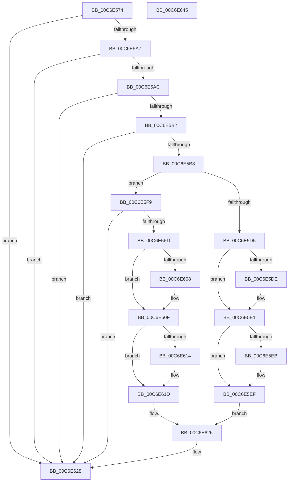

# CimfsGetDiskParameters

- RVA: `0x00C6E574`–`0x00C6E646` (길이 `210` bytes)
- VA: `0x0000000140C6E574`
- 실행 섹션: `INIT`
- PDB 이름 있음: `예`; PDB Function 태그: `아니요`
- unwind 정보 RVA: `0x0005E6B4`
- 디코드: `64`개 명령, `210/210` bytes 표시
- 미해석 바이트: `0` (있으면 어셈블리에 `.byte`로 보존)

> 이 문서는 커널 이미지의 기계어와 PDB 기호를 분석해 생성했습니다. 4번과 5번은 함수 원형과 자료형을 바이너리 사용 방식에서 추정한 C 해석이며 원본 소스 복구 결과는 아닙니다.

## 1. Dependencies

- 직접 호출 지점: **1**; 고유 호출 대상: **1**
- 직접 호출자로 확인된 함수: **2**
- RIP 상대 이미지 참조: **0**

### Outgoing calls
- `0x00C6E5C3` → [memset](../../text/6C/memset_function_006C6C40.md) (function, `0x006C6C40`)

### Direct callers
- [IopGetBootDiskInformationLite](../C2/IopGetBootDiskInformationLite_function_00C2DF64.md) at `0x00C2E18F`
- [CimfsInitialize](CimfsInitialize_function_00C6E64C.md) at `0x00C6E76B`

### Static image references
- 디코드된 RIP-relative 메모리 참조가 없습니다.

## 2. Other-region calls and transfers

- 다른 실행 섹션으로 향하는 call: **1**
  - `0x00C6E5C3` → [memset](../../text/6C/memset_function_006C6C40.md) (`INIT` → `.text`)
- 별도 외부 분기/꼬리 이동을 확인하지 못했습니다.

## 3. Assembly (complete function range)

```asm
00C6E574  48 8B C4                        mov rax, rsp
00C6E577  48 89 58 08                     mov qword ptr [rax + 8], rbx
00C6E57B  48 89 68 10                     mov qword ptr [rax + 0x10], rbp
00C6E57F  48 89 70 18                     mov qword ptr [rax + 0x18], rsi
00C6E583  48 89 78 20                     mov qword ptr [rax + 0x20], rdi
00C6E587  41 56                           push r14
00C6E589  48 83 EC 20                     sub rsp, 0x20
00C6E58D  4D 8B F1                        mov r14, r9
00C6E590  49 8B F0                        mov rsi, r8
00C6E593  48 8B FA                        mov rdi, rdx
00C6E596  48 8B D9                        mov rbx, rcx
00C6E599  BD 0D 00 00 C0                  mov ebp, 0xc000000d
00C6E59E  48 85 C9                        test rcx, rcx
00C6E5A1  0F 84 81 00 00 00               je 0x140c6e628
00C6E5A7  48 85 D2                        test rdx, rdx
00C6E5AA  74 7C                           je 0x140c6e628
00C6E5AC  83 79 04 06                     cmp dword ptr [rcx + 4], 6
00C6E5B0  75 76                           jne 0x140c6e628
00C6E5B2  83 79 24 00                     cmp dword ptr [rcx + 0x24], 0
00C6E5B6  75 70                           jne 0x140c6e628
00C6E5B8  33 D2                           xor edx, edx
00C6E5BA  41 B8 90 00 00 00               mov r8d, 0x90
00C6E5C0  48 8B CF                        mov rcx, rdi
00C6E5C3  E8 78 86 A5 FF                  call 0x1406c6c40
00C6E5C8  8B 03                           mov eax, dword ptr [rbx]
00C6E5CA  89 47 18                        mov dword ptr [rdi + 0x18], eax
00C6E5CD  8B 43 28                        mov eax, dword ptr [rbx + 0x28]
00C6E5D0  83 F8 01                        cmp eax, 1
00C6E5D3  75 24                           jne 0x140c6e5f9
00C6E5D5  48 8D 43 2C                     lea rax, [rbx + 0x2c]
00C6E5D9  48 85 F6                        test rsi, rsi
00C6E5DC  74 03                           je 0x140c6e5e1
00C6E5DE  48 89 06                        mov qword ptr [rsi], rax
00C6E5E1  48 8B 4C 24 50                  mov rcx, qword ptr [rsp + 0x50]
00C6E5E6  48 85 C9                        test rcx, rcx
00C6E5E9  74 04                           je 0x140c6e5ef
00C6E5EB  8B 00                           mov eax, dword ptr [rax]
00C6E5ED  89 01                           mov dword ptr [rcx], eax
00C6E5EF  48 8B 43 14                     mov rax, qword ptr [rbx + 0x14]
00C6E5F3  48 89 47 08                     mov qword ptr [rdi + 8], rax
00C6E5F7  EB 2D                           jmp 0x140c6e626
00C6E5F9  85 C0                           test eax, eax
00C6E5FB  75 2B                           jne 0x140c6e628
00C6E5FD  C7 07 01 00 00 00               mov dword ptr [rdi], 1
00C6E603  48 85 F6                        test rsi, rsi
00C6E606  74 07                           je 0x140c6e60f
00C6E608  48 8D 43 2C                     lea rax, [rbx + 0x2c]
00C6E60C  48 89 06                        mov qword ptr [rsi], rax
00C6E60F  4D 85 F6                        test r14, r14
00C6E612  74 09                           je 0x140c6e61d
00C6E614  0F 10 43 2C                     movups xmm0, xmmword ptr [rbx + 0x2c]
00C6E618  F3 41 0F 7F 06                  movdqu xmmword ptr [r14], xmm0
00C6E61D  0F 10 43 14                     movups xmm0, xmmword ptr [rbx + 0x14]
00C6E621  F3 0F 7F 47 30                  movdqu xmmword ptr [rdi + 0x30], xmm0
00C6E626  33 ED                           xor ebp, ebp
00C6E628  48 8B 5C 24 30                  mov rbx, qword ptr [rsp + 0x30]
00C6E62D  8B C5                           mov eax, ebp
00C6E62F  48 8B 6C 24 38                  mov rbp, qword ptr [rsp + 0x38]
00C6E634  48 8B 74 24 40                  mov rsi, qword ptr [rsp + 0x40]
00C6E639  48 8B 7C 24 48                  mov rdi, qword ptr [rsp + 0x48]
00C6E63E  48 83 C4 20                     add rsp, 0x20
00C6E642  41 5E                           pop r14
00C6E644  C3                              ret
00C6E645  CC                              int3
```

## 4. C-style interpretation (structured pseudocode)

```c
__int64 __fastcall CimfsGetDiskParameters(__int64 a1, __int64 a2, __int64 a3, __int64 a4, __int64 a5)
{
    __int64 result;
    __int64 v_rbp;
    __int64 v_rsp;
    unsigned __int64 v_stack_p10;
    unsigned __int64 v_stack_p18;
    unsigned __int64 v_stack_p20;
    unsigned __int64 v_stack_p8;

    *(unsigned __int64 *)(v_rsp + 8) = v_rbx;
    *(unsigned __int64 *)(v_rsp + 16) = v_rbp;
    *(unsigned __int64 *)(v_rsp + 24) = v_rsi;
    *(unsigned __int64 *)(v_rsp + 32) = v_rdi;
    v_rsp = (v_rsp) - (32);
    if (a1 == 0) goto loc_00C6E628;
    if (a2 == 0) goto loc_00C6E628;
    if ((*(unsigned int *)(a1 + 4)) != 6) goto loc_00C6E628;
    if ((*(unsigned int *)(a1 + 36)) != 0) goto loc_00C6E628;
    a2 = 0;
    result = memset(0, a2, 144, a4);
    *(unsigned int *)(a2 + 24) = (unsigned int)((unsigned int)(*(unsigned int *)(a1)));
    if (((unsigned int)((unsigned int)(*(unsigned int *)(a1 + 40)))) != 1) goto loc_00C6E5F9;
    if (a3 != 0) {
        *(unsigned __int64 *)(a3) = a1 + 44;
    }
    result = a1 + 44;
    if (a5 != 0) {
        result = *(unsigned int *)(a1 + 44);
        *(unsigned int *)(a5) = (unsigned int)(result);
    }
    *(unsigned __int64 *)(a2 + 8) = *(unsigned __int64 *)(a1 + 20);
    goto loc_00C6E626;
loc_00C6E5F9:
    if ((unsigned int)(*(unsigned __int64 *)(a1 + 20)) != 0) goto loc_00C6E628;
    *(unsigned int *)(a2) = 1;
    result = *(unsigned __int64 *)(a1 + 20);
    if (a3 != 0) {
        result = a1 + 44;
        *(unsigned __int64 *)(a3) = result;
    }
    if (a4 != 0) {
        *(unsigned __int64 *)(a4) = v_xmm0;
    }
    *(unsigned __int64 *)(a2 + 48) = v_xmm0;
loc_00C6E626:
    v_rbp = 0;
loc_00C6E628:
    v_rsp = (v_rsp) + (32);
    return 0;
}
```

## 5. (Beta) C Style

```c
int64_t CimfsGetDiskParameters(void *Arg1, void *Arg2, int64_t Arg3, int64_t Arg4, int64_t Arg5)
{
    uint8_t *arg1 = (uint8_t *)Arg1;
    uint8_t *arg2 = (uint8_t *)Arg2;

    int64_t result;
    int64_t local_rbp;
    int64_t local_rsp;
    uint64_t v_stack_p10;
    uint64_t v_stack_p18;
    uint64_t v_stack_p20;
    uint64_t v_stack_p8;

    *(uint64_t *)(local_rsp + 0x8) = local_rbx;
    *(uint64_t *)(local_rsp + 0x10) = local_rbp;
    *(uint64_t *)(local_rsp + 0x18) = local_rsi;
    *(uint64_t *)(local_rsp + 0x20) = local_rdi;
    local_rsp = (local_rsp) - (32);
    if (Arg1 == NULL) goto loc_00C6E628;
    if (Arg2 == NULL) goto loc_00C6E628;
    if ((*(uint32_t *)(arg1 + 0x4)) != 6) goto loc_00C6E628;
    if ((*(uint32_t *)(arg1 + 0x24)) != 0) goto loc_00C6E628;
    Arg2 = 0;
    result = memset(0, Arg2, 144, Arg4);
    *(uint32_t *)(arg2 + 0x18) = (uint32_t)((uint32_t)(*(uint32_t *)(arg1)));
    if (((uint32_t)((uint32_t)(*(uint32_t *)(arg1 + 0x28)))) != 1) goto loc_00C6E5F9;
    if (Arg3 != 0) {
        *(void **)(Arg3) = Arg1 + 44;
    }
    result = Arg1 + 44;
    if (Arg5 != 0) {
        result = *(uint32_t *)(arg1 + 0x2C);
        *(uint32_t *)(Arg5) = (uint32_t)(result);
    }
    *(uint64_t *)(arg2 + 0x8) = *(uint64_t *)(arg1 + 0x14);
    goto loc_00C6E626;
loc_00C6E5F9:
    if ((uint32_t)(*(uint64_t *)(arg1 + 0x14)) != 0) goto loc_00C6E628;
    *(uint32_t *)(arg2) = 1;
    result = *(uint64_t *)(arg1 + 0x14);
    if (Arg3 != 0) {
        result = Arg1 + 44;
        *(uint64_t *)(Arg3) = result;
    }
    if (Arg4 != 0) {
        *(uint64_t *)(Arg4) = v_xmm0;
    }
    *(uint64_t *)(arg2 + 0x30) = v_xmm0;
loc_00C6E626:
    local_rbp = 0;
loc_00C6E628:
    local_rsp = (local_rsp) + (32);
    return 0;
}
```

### 관측된 메모리 오프셋

구조체 형식이 확인되지 않은 접근은 인자 기준의 오프셋으로만 기록했습니다.

| 기준 인자 | 오프셋 표현 | 폭 (bit) | 접근 |
|---|---:|---:|---|
| `Arg1` | `+ 0x0` | `32` | `R` |
| `Arg1` | `+ 0x14` | `64` | `R` |
| `Arg1` | `+ 0x14` | `128` | `R` |
| `Arg1` | `+ 0x28` | `32` | `R` |
| `Arg1` | `+ 0x2C` | `64` | `R` |
| `Arg1` | `+ 0x2C` | `128` | `R` |
| `Arg2` | `+ 0x0` | `32` | `W` |
| `Arg2` | `+ 0x8` | `64` | `W` |
| `Arg2` | `+ 0x18` | `32` | `W` |
| `Arg2` | `+ 0x30` | `128` | `W` |

## 6. Execution-region graph

[열기: 2D/3D 그래프와 함수 탐색 컨트롤 패널](../../../control-panel.html?section=init&rva=0x00C6E574&view=graph)

- 2D 그래프는 위에서 아래로 흐르고, 3D 그래프는 빈 공간을 드래그해 회전합니다. Shift+드래그는 이동, 휠은 확대·축소, 함수 노드 선택은 대상 보고서 이동입니다.

### Static fallback


