# CimfsInitializeBootDisk

- RVA: `0x00C6E9D0`–`0x00C6EDB2` (길이 `994` bytes)
- VA: `0x0000000140C6E9D0`
- 실행 섹션: `INIT`
- PDB 이름 있음: `예`; PDB Function 태그: `아니요`
- unwind 정보 RVA: `0x000DB2B8`
- 디코드: `250`개 명령, `994/994` bytes 표시
- 미해석 바이트: `0` (있으면 어셈블리에 `.byte`로 보존)

> 이 문서는 커널 이미지의 기계어와 PDB 기호를 분석해 생성했습니다. 4번과 5번은 함수 원형과 자료형을 바이너리 사용 방식에서 추정한 C 해석이며 원본 소스 복구 결과는 아닙니다.

## 1. Dependencies

- 직접 호출 지점: **20**; 고유 호출 대상: **11**
- 직접 호출자로 확인된 함수: **0**
- RIP 상대 이미지 참조: **3**

### Outgoing calls
- `0x00C6EA5E` → [RtlCreateUnicodeStringFromAsciiz](../../page/78/RtlCreateUnicodeStringFromAsciiz_function_0078B990.md) (function, `0x0078B990`)
- `0x00C6EA71` → [IoGetConfigurationInformation](../../page/71/IoGetConfigurationInformation_function_0071D5A0.md) (function, `0x0071D5A0`)
- `0x00C6EAA2` → [RtlStringCbPrintfW](../../text/40/RtlStringCbPrintfW_function_0040FB40.md) (function, `0x0040FB40`)
- `0x00C6EABC` → [RtlInitUnicodeStringEx](../../text/46/RtlInitUnicodeStringEx_function_00463960.md) (function, `0x00463960`)
- `0x00C6EAFB` → [ZwClose](../../text/6A/ZwClose_function_006AD2B0.md) (function, `0x006AD2B0`)
- `0x00C6EB29` → [ZwOpenFile](../../text/6A/ZwOpenFile_function_006AD730.md) (function, `0x006AD730`)
- `0x00C6EB42` → [ExFreePoolWithTag](../../poolcode/B8/ExFreePoolWithTag_function_00B82870.md) (function, `0x00B82870`)
- `0x00C6EB59` → [ExAllocatePool2](../../poolcode/B8/ExAllocatePool2_function_00B820F0.md) (function, `0x00B820F0`)
- `0x00C6EB9C` → [ZwDeviceIoControlFile](../../text/6A/ZwDeviceIoControlFile_function_006AD1B0.md) (function, `0x006AD1B0`)
- `0x00C6EBAF` → [ExFreePoolWithTag](../../poolcode/B8/ExFreePoolWithTag_function_00B82870.md) (function, `0x00B82870`)
- `0x00C6EBE9` → [RtlCompareMemory](../../text/6B/RtlCompareMemory_function_006BA670.md) (function, `0x006BA670`)
- `0x00C6EC03` → [RtlCompareMemory](../../text/6B/RtlCompareMemory_function_006BA670.md) (function, `0x006BA670`)
- `0x00C6EC84` → [ExFreePoolWithTag](../../poolcode/B8/ExFreePoolWithTag_function_00B82870.md) (function, `0x00B82870`)
- `0x00C6EC93` → [ZwClose](../../text/6A/ZwClose_function_006AD2B0.md) (function, `0x006AD2B0`)
- `0x00C6ECA2` → [ZwClose](../../text/6A/ZwClose_function_006AD2B0.md) (function, `0x006AD2B0`)
- `0x00C6ECCC` → [RtlStringCbPrintfW](../../text/40/RtlStringCbPrintfW_function_0040FB40.md) (function, `0x0040FB40`)
- `0x00C6ECEB` → [RtlStringCbPrintfW](../../text/40/RtlStringCbPrintfW_function_0040FB40.md) (function, `0x0040FB40`)
- `0x00C6ED18` → [RtlInitUnicodeStringEx](../../text/46/RtlInitUnicodeStringEx_function_00463960.md) (function, `0x00463960`)
- `0x00C6ED6E` → [ZwOpenFile](../../text/6A/ZwOpenFile_function_006AD730.md) (function, `0x006AD730`)
- `0x00C6ED91` → [_security_check_cookie](../../text/6A/_security_check_cookie_function_006AC640.md) (function, `0x006AC640`)

### Direct callers
- 이 함수 시작 RVA로 연결되는 직접 call은 확인되지 않았습니다. 간접 호출은 완전히 역산할 수 없습니다.

### Static image references
- `0x00C6E9EF` → RVA `0x00E0A740` (`.data`; read)
- `0x00C6EA92` → RVA `0x00C79990` (` ?? ::PBOPGDP::`string'`; read)
- `0x00C6ECB2` → RVA `0x00C7E7F0` (` ?? ::PBOPGDP::`string'`; read)

## 2. Other-region calls and transfers

- 다른 실행 섹션으로 향하는 call: **20**
  - `0x00C6EA5E` → [RtlCreateUnicodeStringFromAsciiz](../../page/78/RtlCreateUnicodeStringFromAsciiz_function_0078B990.md) (`INIT` → `PAGE`)
  - `0x00C6EA71` → [IoGetConfigurationInformation](../../page/71/IoGetConfigurationInformation_function_0071D5A0.md) (`INIT` → `PAGE`)
  - `0x00C6EAA2` → [RtlStringCbPrintfW](../../text/40/RtlStringCbPrintfW_function_0040FB40.md) (`INIT` → `.text`)
  - `0x00C6EABC` → [RtlInitUnicodeStringEx](../../text/46/RtlInitUnicodeStringEx_function_00463960.md) (`INIT` → `.text`)
  - `0x00C6EAFB` → [ZwClose](../../text/6A/ZwClose_function_006AD2B0.md) (`INIT` → `.text`)
  - `0x00C6EB29` → [ZwOpenFile](../../text/6A/ZwOpenFile_function_006AD730.md) (`INIT` → `.text`)
  - `0x00C6EB42` → [ExFreePoolWithTag](../../poolcode/B8/ExFreePoolWithTag_function_00B82870.md) (`INIT` → `POOLCODE`)
  - `0x00C6EB59` → [ExAllocatePool2](../../poolcode/B8/ExAllocatePool2_function_00B820F0.md) (`INIT` → `POOLCODE`)
  - `0x00C6EB9C` → [ZwDeviceIoControlFile](../../text/6A/ZwDeviceIoControlFile_function_006AD1B0.md) (`INIT` → `.text`)
  - `0x00C6EBAF` → [ExFreePoolWithTag](../../poolcode/B8/ExFreePoolWithTag_function_00B82870.md) (`INIT` → `POOLCODE`)
  - `0x00C6EBE9` → [RtlCompareMemory](../../text/6B/RtlCompareMemory_function_006BA670.md) (`INIT` → `.text`)
  - `0x00C6EC03` → [RtlCompareMemory](../../text/6B/RtlCompareMemory_function_006BA670.md) (`INIT` → `.text`)
  - `0x00C6EC84` → [ExFreePoolWithTag](../../poolcode/B8/ExFreePoolWithTag_function_00B82870.md) (`INIT` → `POOLCODE`)
  - `0x00C6EC93` → [ZwClose](../../text/6A/ZwClose_function_006AD2B0.md) (`INIT` → `.text`)
  - `0x00C6ECA2` → [ZwClose](../../text/6A/ZwClose_function_006AD2B0.md) (`INIT` → `.text`)
  - `0x00C6ECCC` → [RtlStringCbPrintfW](../../text/40/RtlStringCbPrintfW_function_0040FB40.md) (`INIT` → `.text`)
  - `0x00C6ECEB` → [RtlStringCbPrintfW](../../text/40/RtlStringCbPrintfW_function_0040FB40.md) (`INIT` → `.text`)
  - `0x00C6ED18` → [RtlInitUnicodeStringEx](../../text/46/RtlInitUnicodeStringEx_function_00463960.md) (`INIT` → `.text`)
  - `0x00C6ED6E` → [ZwOpenFile](../../text/6A/ZwOpenFile_function_006AD730.md) (`INIT` → `.text`)
  - `0x00C6ED91` → [_security_check_cookie](../../text/6A/_security_check_cookie_function_006AC640.md) (`INIT` → `.text`)
- 별도 외부 분기/꼬리 이동을 확인하지 못했습니다.

## 3. Assembly (complete function range)

```asm
00C6E9D0  48 89 5C 24 20                  mov qword ptr [rsp + 0x20], rbx
00C6E9D5  55                              push rbp
00C6E9D6  56                              push rsi
00C6E9D7  57                              push rdi
00C6E9D8  41 54                           push r12
00C6E9DA  41 55                           push r13
00C6E9DC  41 56                           push r14
00C6E9DE  41 57                           push r15
00C6E9E0  48 8D AC 24 30 FF FF FF         lea rbp, [rsp - 0xd0]
00C6E9E8  48 81 EC D0 01 00 00            sub rsp, 0x1d0
00C6E9EF  48 8B 05 4A BD 19 00            mov rax, qword ptr [rip + 0x19bd4a]
00C6E9F6  48 33 C4                        xor rax, rsp
00C6E9F9  48 89 85 C0 00 00 00            mov qword ptr [rbp + 0xc0], rax
00C6EA00  33 C0                           xor eax, eax
00C6EA02  0F 57 C0                        xorps xmm0, xmm0
00C6EA05  48 21 44 24 60                  and qword ptr [rsp + 0x60], rax
00C6EA0A  0F 57 C9                        xorps xmm1, xmm1
00C6EA0D  48 89 45 88                     mov qword ptr [rbp - 0x78], rax
00C6EA11  4C 8B E2                        mov r12, rdx
00C6EA14  89 45 90                        mov dword ptr [rbp - 0x70], eax
00C6EA17  0F 11 45 A8                     movups xmmword ptr [rbp - 0x58], xmm0
00C6EA1B  0F 11 4D 98                     movups xmmword ptr [rbp - 0x68], xmm1
00C6EA1F  0F 11 44 24 68                  movups xmmword ptr [rsp + 0x68], xmm0
00C6EA24  0F 11 44 24 78                  movups xmmword ptr [rsp + 0x78], xmm0
00C6EA29  0F 11 45 B8                     movups xmmword ptr [rbp - 0x48], xmm0
00C6EA2D  48 85 C9                        test rcx, rcx
00C6EA30  0F 84 4C 03 00 00               je 0x140c6ed82
00C6EA36  48 85 D2                        test rdx, rdx
00C6EA39  0F 84 43 03 00 00               je 0x140c6ed82
00C6EA3F  4D 85 C0                        test r8, r8
00C6EA42  0F 84 3A 03 00 00               je 0x140c6ed82
00C6EA48  4C 8B 3A                        mov r15, qword ptr [rdx]
00C6EA4B  4D 85 FF                        test r15, r15
00C6EA4E  0F 84 2E 03 00 00               je 0x140c6ed82
00C6EA54  48 8B 91 B8 00 00 00            mov rdx, qword ptr [rcx + 0xb8]
00C6EA5B  49 8B C8                        mov rcx, r8
00C6EA5E  E8 2D CF B1 FF                  call 0x14078b990
00C6EA63  84 C0                           test al, al
00C6EA65  75 0A                           jne 0x140c6ea71
00C6EA67  B8 01 00 00 C0                  mov eax, 0xc0000001
00C6EA6C  E9 16 03 00 00                  jmp 0x140c6ed87
00C6EA71  E8 2A EB AA FF                  call 0x14071d5a0
00C6EA76  33 FF                           xor edi, edi
00C6EA78  45 33 ED                        xor r13d, r13d
00C6EA7B  8B 00                           mov eax, dword ptr [rax]
00C6EA7D  48 83 64 24 50 00               and qword ptr [rsp + 0x50], 0
00C6EA83  89 44 24 58                     mov dword ptr [rsp + 0x58], eax
00C6EA87  85 C0                           test eax, eax
00C6EA89  0F 84 E3 01 00 00               je 0x140c6ec72
00C6EA8F  45 8B CD                        mov r9d, r13d
00C6EA92  4C 8D 05 F7 AE 00 00            lea r8, [rip + 0xaef7]
00C6EA99  BA 80 00 00 00                  mov edx, 0x80
00C6EA9E  48 8D 4D 40                     lea rcx, [rbp + 0x40]
00C6EAA2  E8 99 10 7A FF                  call 0x14040fb40
00C6EAA7  45 32 F6                        xor r14b, r14b
00C6EAAA  8B F0                           mov esi, eax
00C6EAAC  85 C0                           test eax, eax
00C6EAAE  0F 88 AB 01 00 00               js 0x140c6ec5f
00C6EAB4  48 8D 55 40                     lea rdx, [rbp + 0x40]
00C6EAB8  48 8D 4D A8                     lea rcx, [rbp - 0x58]
00C6EABC  E8 9F 4E 7F FF                  call 0x140463960
00C6EAC1  8B F0                           mov esi, eax
00C6EAC3  85 C0                           test eax, eax
00C6EAC5  0F 88 94 01 00 00               js 0x140c6ec5f
00C6EACB  48 83 64 24 70 00               and qword ptr [rsp + 0x70], 0
00C6EAD1  48 8D 45 A8                     lea rax, [rbp - 0x58]
00C6EAD5  48 8B 4C 24 50                  mov rcx, qword ptr [rsp + 0x50]
00C6EADA  0F 57 C0                        xorps xmm0, xmm0
00C6EADD  C7 44 24 68 30 00 00 00         mov dword ptr [rsp + 0x68], 0x30
00C6EAE5  C7 45 80 40 02 00 00            mov dword ptr [rbp - 0x80], 0x240
00C6EAEC  48 89 44 24 78                  mov qword ptr [rsp + 0x78], rax
00C6EAF1  F3 0F 7F 45 88                  movdqu xmmword ptr [rbp - 0x78], xmm0
00C6EAF6  48 85 C9                        test rcx, rcx
00C6EAF9  74 0B                           je 0x140c6eb06
00C6EAFB  E8 B0 E7 A3 FF                  call 0x1406ad2b0
00C6EB00  48 83 64 24 50 00               and qword ptr [rsp + 0x50], 0
00C6EB06  C7 44 24 28 20 00 00 00         mov dword ptr [rsp + 0x28], 0x20
00C6EB0E  4C 8D 4D 98                     lea r9, [rbp - 0x68]
00C6EB12  4C 8D 44 24 68                  lea r8, [rsp + 0x68]
00C6EB17  C7 44 24 20 03 00 00 00         mov dword ptr [rsp + 0x20], 3
00C6EB1F  BA 00 00 10 C0                  mov edx, 0xc0100000
00C6EB24  48 8D 4C 24 50                  lea rcx, [rsp + 0x50]
00C6EB29  E8 02 EC A3 FF                  call 0x1406ad730
00C6EB2E  8B F0                           mov esi, eax
00C6EB30  85 C0                           test eax, eax
00C6EB32  0F 88 27 01 00 00               js 0x140c6ec5f
00C6EB38  48 85 FF                        test rdi, rdi
00C6EB3B  74 0A                           je 0x140c6eb47
00C6EB3D  33 D2                           xor edx, edx
00C6EB3F  48 8B CF                        mov rcx, rdi
00C6EB42  E8 29 3D F1 FF                  call 0x140b82870
00C6EB47  BE 00 10 00 00                  mov esi, 0x1000
00C6EB4C  8B D6                           mov edx, esi
00C6EB4E  B9 40 00 00 00                  mov ecx, 0x40
00C6EB53  41 B8 43 69 6D 42               mov r8d, 0x426d6943
00C6EB59  E8 92 35 F1 FF                  call 0x140b820f0
00C6EB5E  48 8B F8                        mov rdi, rax
00C6EB61  48 85 C0                        test rax, rax
00C6EB64  0F 84 F0 00 00 00               je 0x140c6ec5a
00C6EB6A  48 8B 4C 24 50                  mov rcx, qword ptr [rsp + 0x50]
00C6EB6F  45 33 C9                        xor r9d, r9d
00C6EB72  89 74 24 48                     mov dword ptr [rsp + 0x48], esi
00C6EB76  45 33 C0                        xor r8d, r8d
00C6EB79  48 89 44 24 40                  mov qword ptr [rsp + 0x40], rax
00C6EB7E  33 D2                           xor edx, edx
00C6EB80  83 64 24 38 00                  and dword ptr [rsp + 0x38], 0
00C6EB85  48 8D 45 98                     lea rax, [rbp - 0x68]
00C6EB89  48 83 64 24 30 00               and qword ptr [rsp + 0x30], 0
00C6EB8F  C7 44 24 28 50 00 07 00         mov dword ptr [rsp + 0x28], 0x70050
00C6EB97  48 89 44 24 20                  mov qword ptr [rsp + 0x20], rax
00C6EB9C  E8 0F E6 A3 FF                  call 0x1406ad1b0
00C6EBA1  8B D8                           mov ebx, eax
00C6EBA3  3D 23 00 00 C0                  cmp eax, 0xc0000023
00C6EBA8  75 0E                           jne 0x140c6ebb8
00C6EBAA  33 D2                           xor edx, edx
00C6EBAC  48 8B CF                        mov rcx, rdi
00C6EBAF  E8 BC 3C F1 FF                  call 0x140b82870
00C6EBB4  03 F6                           add esi, esi
00C6EBB6  EB 94                           jmp 0x140c6eb4c
00C6EBB8  8B F3                           mov esi, ebx
00C6EBBA  85 DB                           test ebx, ebx
00C6EBBC  0F 88 9D 00 00 00               js 0x140c6ec5f
00C6EBC2  41 8B 0F                        mov ecx, dword ptr [r15]
00C6EBC5  39 0F                           cmp dword ptr [rdi], ecx
00C6EBC7  0F 85 92 00 00 00               jne 0x140c6ec5f
00C6EBCD  85 C9                           test ecx, ecx
00C6EBCF  74 23                           je 0x140c6ebf4
00C6EBD1  83 F9 01                        cmp ecx, 1
00C6EBD4  0F 85 85 00 00 00               jne 0x140c6ec5f
00C6EBDA  49 8D 54 24 08                  lea rdx, [r12 + 8]
00C6EBDF  41 B8 10 00 00 00               mov r8d, 0x10
00C6EBE5  48 8D 4F 08                     lea rcx, [rdi + 8]
00C6EBE9  E8 82 BA A4 FF                  call 0x1406ba670
00C6EBEE  48 83 F8 10                     cmp rax, 0x10
00C6EBF2  EB 18                           jmp 0x140c6ec0c
00C6EBF4  49 8D 54 24 18                  lea rdx, [r12 + 0x18]
00C6EBF9  41 B8 04 00 00 00               mov r8d, 4
00C6EBFF  48 8D 4F 08                     lea rcx, [rdi + 8]
00C6EC03  E8 68 BA A4 FF                  call 0x1406ba670
00C6EC08  48 83 F8 04                     cmp rax, 4
00C6EC0C  75 51                           jne 0x140c6ec5f
00C6EC0E  44 8B 4F 04                     mov r9d, dword ptr [rdi + 4]
00C6EC12  45 33 C0                        xor r8d, r8d
00C6EC15  8B F3                           mov esi, ebx
00C6EC17  45 32 F6                        xor r14b, r14b
00C6EC1A  45 3B C1                        cmp r8d, r9d
00C6EC1D  73 40                           jae 0x140c6ec5f
00C6EC1F  8B 07                           mov eax, dword ptr [rdi]
00C6EC21  4B 8D 0C C0                     lea rcx, [r8 + r8*8]
00C6EC25  48 03 C9                        add rcx, rcx
00C6EC28  85 C0                           test eax, eax
00C6EC2A  75 0B                           jne 0x140c6ec37
00C6EC2C  49 8B 47 08                     mov rax, qword ptr [r15 + 8]
00C6EC30  48 39 44 CF 38                  cmp qword ptr [rdi + rcx*8 + 0x38], rax
00C6EC35  EB 1C                           jmp 0x140c6ec53
00C6EC37  83 F8 01                        cmp eax, 1
00C6EC3A  75 19                           jne 0x140c6ec55
00C6EC3C  48 8B 54 CF 60                  mov rdx, qword ptr [rdi + rcx*8 + 0x60]
00C6EC41  49 2B 57 30                     sub rdx, qword ptr [r15 + 0x30]
00C6EC45  75 09                           jne 0x140c6ec50
00C6EC47  48 8B 54 CF 68                  mov rdx, qword ptr [rdi + rcx*8 + 0x68]
00C6EC4C  49 2B 57 38                     sub rdx, qword ptr [r15 + 0x38]
00C6EC50  48 85 D2                        test rdx, rdx
00C6EC53  74 59                           je 0x140c6ecae
00C6EC55  41 FF C0                        inc r8d
00C6EC58  EB BD                           jmp 0x140c6ec17
00C6EC5A  BE 17 00 00 C0                  mov esi, 0xc0000017
00C6EC5F  41 FF C5                        inc r13d
00C6EC62  44 3B 6C 24 58                  cmp r13d, dword ptr [rsp + 0x58]
00C6EC67  0F 82 22 FE FF FF               jb 0x140c6ea8f
00C6EC6D  45 84 F6                        test r14b, r14b
00C6EC70  75 05                           jne 0x140c6ec77
00C6EC72  BE 0E 00 00 C0                  mov esi, 0xc000000e
00C6EC77  48 85 FF                        test rdi, rdi
00C6EC7A  74 0D                           je 0x140c6ec89
00C6EC7C  BA 43 69 6D 42                  mov edx, 0x426d6943
00C6EC81  48 8B CF                        mov rcx, rdi
00C6EC84  E8 E7 3B F1 FF                  call 0x140b82870
00C6EC89  48 8B 4C 24 50                  mov rcx, qword ptr [rsp + 0x50]
00C6EC8E  48 85 C9                        test rcx, rcx
00C6EC91  74 05                           je 0x140c6ec98
00C6EC93  E8 18 E6 A3 FF                  call 0x1406ad2b0
00C6EC98  48 8B 4C 24 60                  mov rcx, qword ptr [rsp + 0x60]
00C6EC9D  48 85 C9                        test rcx, rcx
00C6ECA0  74 05                           je 0x140c6eca7
00C6ECA2  E8 09 E6 A3 FF                  call 0x1406ad2b0
00C6ECA7  8B C6                           mov eax, esi
00C6ECA9  E9 D9 00 00 00                  jmp 0x140c6ed87
00C6ECAE  8B 74 CF 48                     mov esi, dword ptr [rdi + rcx*8 + 0x48]
00C6ECB2  4C 8D 05 37 FB 00 00            lea r8, [rip + 0xfb37]
00C6ECB9  48 8D 4D D0                     lea rcx, [rbp - 0x30]
00C6ECBD  89 74 24 20                     mov dword ptr [rsp + 0x20], esi
00C6ECC1  45 8B CD                        mov r9d, r13d
00C6ECC4  BA 64 00 00 00                  mov edx, 0x64
00C6ECC9  41 B7 01                        mov r15b, 1
00C6ECCC  E8 6F 0E 7A FF                  call 0x14040fb40
00C6ECD1  49 8D 4C 24 1C                  lea rcx, [r12 + 0x1c]
00C6ECD6  89 74 24 20                     mov dword ptr [rsp + 0x20], esi
00C6ECDA  45 8B CD                        mov r9d, r13d
00C6ECDD  4C 8D 05 0C FB 00 00            lea r8, [rip + 0xfb0c]
00C6ECE4  BA 50 00 00 00                  mov edx, 0x50
00C6ECE9  8B D8                           mov ebx, eax
00C6ECEB  E8 50 0E 7A FF                  call 0x14040fb40
00C6ECF0  45 33 F6                        xor r14d, r14d
00C6ECF3  41 0F B6 CF                     movzx ecx, r15b
00C6ECF7  85 DB                           test ebx, ebx
00C6ECF9  8B F0                           mov esi, eax
00C6ECFB  44 0F 49 F1                     cmovns r14d, ecx
00C6ECFF  85 C0                           test eax, eax
00C6ED01  0F 88 6B FF FF FF               js 0x140c6ec72
00C6ED07  45 3A F7                        cmp r14b, r15b
00C6ED0A  0F 85 5D FF FF FF               jne 0x140c6ec6d
00C6ED10  48 8D 55 D0                     lea rdx, [rbp - 0x30]
00C6ED14  48 8D 4D B8                     lea rcx, [rbp - 0x48]
00C6ED18  E8 43 4C 7F FF                  call 0x140463960
00C6ED1D  85 C0                           test eax, eax
00C6ED1F  0F 88 4D FF FF FF               js 0x140c6ec72
00C6ED25  48 83 64 24 70 00               and qword ptr [rsp + 0x70], 0
00C6ED2B  48 8D 45 B8                     lea rax, [rbp - 0x48]
00C6ED2F  0F 57 C0                        xorps xmm0, xmm0
00C6ED32  C7 44 24 28 20 00 00 00         mov dword ptr [rsp + 0x28], 0x20
00C6ED3A  4C 8D 4D 98                     lea r9, [rbp - 0x68]
00C6ED3E  48 89 44 24 78                  mov qword ptr [rsp + 0x78], rax
00C6ED43  4C 8D 44 24 68                  lea r8, [rsp + 0x68]
00C6ED48  C7 44 24 68 30 00 00 00         mov dword ptr [rsp + 0x68], 0x30
00C6ED50  BA 00 00 10 C0                  mov edx, 0xc0100000
00C6ED55  C7 45 80 40 02 00 00            mov dword ptr [rbp - 0x80], 0x240
00C6ED5C  48 8D 4C 24 60                  lea rcx, [rsp + 0x60]
00C6ED61  C7 44 24 20 03 00 00 00         mov dword ptr [rsp + 0x20], 3
00C6ED69  F3 0F 7F 45 88                  movdqu xmmword ptr [rbp - 0x78], xmm0
00C6ED6E  E8 BD E9 A3 FF                  call 0x1406ad730
00C6ED73  8B F0                           mov esi, eax
00C6ED75  85 C0                           test eax, eax
00C6ED77  0F 89 FF FE FF FF               jns 0x140c6ec7c
00C6ED7D  E9 F0 FE FF FF                  jmp 0x140c6ec72
00C6ED82  B8 0D 00 00 C0                  mov eax, 0xc000000d
00C6ED87  48 8B 8D C0 00 00 00            mov rcx, qword ptr [rbp + 0xc0]
00C6ED8E  48 33 CC                        xor rcx, rsp
00C6ED91  E8 AA D8 A3 FF                  call 0x1406ac640
00C6ED96  48 8B 9C 24 28 02 00 00         mov rbx, qword ptr [rsp + 0x228]
00C6ED9E  48 81 C4 D0 01 00 00            add rsp, 0x1d0
00C6EDA5  41 5F                           pop r15
00C6EDA7  41 5E                           pop r14
00C6EDA9  41 5D                           pop r13
00C6EDAB  41 5C                           pop r12
00C6EDAD  5F                              pop rdi
00C6EDAE  5E                              pop rsi
00C6EDAF  5D                              pop rbp
00C6EDB0  C3                              ret
00C6EDB1  CC                              int3
```

## 4. C-style interpretation (structured pseudocode)

```c
__int64 __fastcall CimfsInitializeBootDisk(__int64 a1, __int64 a2, __int64 a3)
{
    __int64 result;
    __int64 v_r13;
    __int64 v_r14;
    __int64 v_rdi;
    __int64 v_rsi;
    __int64 v_rsp;
    unsigned __int64 v_stack_m108;
    unsigned __int64 v_stack_m138;
    unsigned __int64 v_stack_m150;
    unsigned __int64 v_stack_m160;
    unsigned __int64 v_stack_m170;
    unsigned int v_stack_m178;
    unsigned __int64 v_stack_m180;
    unsigned int v_stack_m188;
    unsigned __int64 v_stack_m190;
    unsigned __int64 v_stack_m198;
    unsigned __int64 v_stack_m1A0;
    unsigned __int64 v_stack_m1A8;
    unsigned int v_stack_m1B0;
    unsigned __int64 v_stack_m1B8;
    unsigned int v_stack_m1C0;
    unsigned __int64 v_stack_m1C8;
    unsigned int v_stack_m1D0;
    unsigned __int64 v_stack_m1D8;
    unsigned int v_stack_m1E0;
    unsigned int v_stack_m1E8;
    unsigned __int64 v_stack_m48;
    unsigned __int64 v_stack_mC8;
    unsigned __int64 v_stack_p20;

    v_stack_p20 = v_rbx;
    v_rsp = (v_rsp) - (464);
    result = (*(unsigned __int64 *)(v_rip + 1686858)) ^ (v_rsp);
    v_stack_m48 = result;
    result = 0;
    v_stack_m180 = 0;
    v_stack_m178 = 0;
    v_stack_m160 = v_xmm0;
    v_stack_m170 = v_xmm1;
    v_stack_m1A0 = v_xmm0;
    v_stack_m190 = v_xmm0;
    v_stack_m150 = v_xmm0;
    if (a1 == 0) goto loc_00C6ED82;
    if (a2 == 0) goto loc_00C6ED82;
    if (a3 == 0) goto loc_00C6ED82;
    if (*(unsigned __int64 *)(a2) == 0) goto loc_00C6ED82;
    result = RtlCreateUnicodeStringFromAsciiz(a3, *(unsigned __int64 *)(a1 + 184), a3, a4);
    if ((unsigned __int8)(result) != 0) goto loc_00C6EA71;
    goto loc_00C6ED87;
loc_00C6EA71:
    result = IoGetConfigurationInformation(a3, *(unsigned __int64 *)(a1 + 184), a3, a4);
    v_rdi = 0;
    v_r13 = 0;
    v_stack_m1B0 = (unsigned int)((unsigned int)(*(unsigned int *)(result)));
    if ((unsigned int)((unsigned int)(*(unsigned int *)(result))) == 0) goto loc_00C6EC72;
loc_00C6EA8F:
    result = RtlStringCbPrintfW(v_stack_mC8, 128, v_rip + 44791, 0);
    v_r14 = 0;
    if (sign_flag) goto loc_00C6EC5F;
    result = RtlInitUnicodeStringEx(v_stack_m160, v_stack_mC8, v_rip + 44791, 0);
    if (sign_flag) goto loc_00C6EC5F;
    v_stack_m1A0 = 48;
    v_stack_m188 = 576;
    v_stack_m190 = v_stack_m160;
    v_stack_m180 = v_xmm0;
    result = v_stack_m160;
    if (v_stack_m1B8 != 0) {
        result = ZwClose(v_stack_m1B8, v_stack_mC8, v_rip + 44791, 0);
    }
    v_stack_m1E0 = 32;
    v_stack_m1E8 = 3;
    result = ZwOpenFile(v_stack_m1B8, (unsigned int)(0xC0100000ULL), v_stack_m1A0, v_stack_m170);
    if (sign_flag) goto loc_00C6EC5F;
    if (0 != 0) {
        a2 = 0;
        a1 = 0;
        result = ExFreePoolWithTag(a1, a2, v_stack_m1A0, v_stack_m170);
    }
loc_00C6EB4C:
    result = ExAllocatePool2(64, (unsigned int)((unsigned int)((unsigned int)(0x1000ULL))), (unsigned int)(0x426D6943ULL), v_stack_m170);
    if (result == 0) goto loc_00C6EC5A;
    a4 = 0;
    v_stack_m1C0 = (unsigned int)((unsigned int)(0x1000ULL));
    a3 = 0;
    v_stack_m1C8 = result;
    a2 = 0;
    v_stack_m1E0 = 0x70050ULL;
    v_stack_m1E8 = v_stack_m170;
    result = ZwDeviceIoControlFile(v_stack_m1B8, a2, a3, a4);
    if (((unsigned int)(result)) != 0xC0000023ULL) goto loc_00C6EBB8;
    a2 = 0;
    result = ExFreePoolWithTag(result, a2, a3, a4);
    v_rsi = (unsigned int)(((unsigned int)(0x1000ULL)) + ((unsigned int)((unsigned int)(0x1000ULL))));
    goto loc_00C6EB4C;
loc_00C6EBB8:
    if (sign_flag) goto loc_00C6EC5F;
    if ((*(unsigned int *)(result)) != ((unsigned int)((unsigned int)(*(unsigned int *)(*(unsigned __int64 *)(a2)))))) goto loc_00C6EC5F;
    if ((unsigned int)((unsigned int)(*(unsigned int *)(*(unsigned __int64 *)(a2)))) == 0) goto loc_00C6EBF4;
    if (((unsigned int)((unsigned int)(*(unsigned int *)(*(unsigned __int64 *)(a2))))) != 1) goto loc_00C6EC5F;
    result = RtlCompareMemory(result + 8, a2 + 8, 16, a4);
    goto loc_00C6EC0C;
loc_00C6EBF4:
    result = RtlCompareMemory(result + 8, a2 + 24, 4, a4);
loc_00C6EC0C:
    if (result != 4) goto loc_00C6EC5F;
    a3 = 0;
loc_00C6EC17:
    v_r14 = 0;
    if (0 >= ((unsigned int)((unsigned int)(*(unsigned int *)(result + 4))))) goto loc_00C6EC5F;
    a1 = (a3 + a3 * 8) + (a3 + a3 * 8);
    if ((unsigned int)((unsigned int)(*(unsigned int *)(result))) != 0) goto loc_00C6EC37;
    goto loc_00C6EC53;
loc_00C6EC37:
    if (((unsigned int)(*(unsigned __int64 *)(*(unsigned __int64 *)(a2) + 8))) != 1) goto loc_00C6EC55;
    a2 = (*(unsigned __int64 *)(result + a1 * 8 + 96)) - (*(unsigned __int64 *)(*(unsigned __int64 *)(a2) + 48));
    if (!(condition_is_not_equal)) {
        a2 = *(unsigned __int64 *)(result + a1 * 8 + 104);
        a2 = (a2) - (*(unsigned __int64 *)(*(unsigned __int64 *)(a2) + 56));
    }
loc_00C6EC53:
    if (a2 == 0) goto loc_00C6ECAE;
loc_00C6EC55:
    a3 = (unsigned int)((a3) + 1);
    goto loc_00C6EC17;
loc_00C6EC5A:
loc_00C6EC5F:
    v_r13 = (unsigned int)((v_r13) + 1);
    if (((unsigned int)(v_r13)) < v_stack_m1B0) goto loc_00C6EA8F;
loc_00C6EC6D:
    v_rsi = (unsigned int)(0xC0000017ULL);
    if (0 == 0) {
        v_rsi = 0xC000000EULL;
    }
    result = *(unsigned __int64 *)(*(unsigned __int64 *)(a2) + 8);
    if (result != 0) {
        a2 = 0x426D6943ULL;
        a1 = result;
        result = ExFreePoolWithTag(a1, a2, a3, (unsigned int)(*(unsigned int *)(result + 4)));
    }
    if (v_stack_m1B8 != 0) {
        result = ZwClose(v_stack_m1B8, a2, a3, (unsigned int)(*(unsigned int *)(result + 4)));
    }
    if (v_stack_m1A8 != 0) {
        result = ZwClose(v_stack_m1A8, a2, a3, (unsigned int)(*(unsigned int *)(result + 4)));
    }
    goto loc_00C6ED87;
loc_00C6ECAE:
    v_stack_m1E8 = (unsigned int)((unsigned int)(*(unsigned int *)(result + v_stack_m1A8 * 8 + 72)));
    result = RtlStringCbPrintfW(v_stack_m138, 100, v_rip + 64311, (unsigned int)((unsigned int)(v_r13)));
    v_stack_m1E8 = (unsigned int)((unsigned int)(*(unsigned int *)(result + v_stack_m1A8 * 8 + 72)));
    result = RtlStringCbPrintfW(a2 + 28, 80, v_rip + 64268, (unsigned int)((unsigned int)(v_r13)));
    v_r14 = 0;
    if (!sign_flag) { v_r14 = 1; }
    if (sign_flag) goto loc_00C6EC72;
    if (((unsigned __int8)(v_r14)) != 1) goto loc_00C6EC6D;
    result = RtlInitUnicodeStringEx(v_stack_m150, v_stack_m138, v_rip + 64268, (unsigned int)((unsigned int)(v_r13)));
    if (sign_flag) goto loc_00C6EC72;
    v_stack_m1E0 = 32;
    v_stack_m190 = v_stack_m150;
    v_stack_m1A0 = 48;
    v_stack_m188 = 576;
    v_stack_m1E8 = 3;
    v_stack_m180 = v_xmm0;
    result = ZwOpenFile(v_stack_m1A8, (unsigned int)(0xC0100000ULL), v_stack_m1A0, v_stack_m170);
    if (!sign_flag) goto loc_00C6EC7C;
    goto loc_00C6EC72;
loc_00C6ED82:
loc_00C6ED87:
    a1 = (v_stack_m48) ^ (v_rsp);
    result = _security_check_cookie(a1, (unsigned int)(0xC0100000ULL), v_stack_m1A0, v_stack_m170);
    v_rsp = (v_rsp) + (464);
    return result;
}
```

## 5. (Beta) C Style

```c
int64_t CimfsInitializeBootDisk(int64_t Arg1, void *Arg2, int64_t Arg3)
{
    uint8_t *arg2 = (uint8_t *)Arg2;

    int64_t result;
    int64_t local_r13;
    int64_t local_r14;
    int64_t local_rdi;
    int64_t local_rsi;
    int64_t local_rsp;
    uint64_t v_stack_m108;
    uint64_t v_stack_m138;
    uint64_t v_stack_m150;
    uint64_t v_stack_m160;
    uint64_t v_stack_m170;
    uint32_t v_stack_m178;
    uint64_t v_stack_m180;
    uint32_t v_stack_m188;
    uint64_t v_stack_m190;
    uint64_t v_stack_m198;
    uint64_t v_stack_m1A0;
    uint64_t v_stack_m1A8;
    uint32_t v_stack_m1B0;
    uint64_t v_stack_m1B8;
    uint32_t v_stack_m1C0;
    uint64_t v_stack_m1C8;
    uint32_t v_stack_m1D0;
    uint64_t v_stack_m1D8;
    uint32_t v_stack_m1E0;
    uint32_t v_stack_m1E8;
    uint64_t v_stack_m48;
    uint64_t v_stack_mC8;
    uint64_t v_stack_p20;

    v_stack_p20 = local_rbx;
    local_rsp = (local_rsp) - (464);
    result = (*(uint64_t *)(v_rip + 0x19BD4A)) ^ (local_rsp);
    v_stack_m48 = result;
    result = 0;
    v_stack_m180 = 0;
    v_stack_m178 = 0;
    v_stack_m160 = v_xmm0;
    v_stack_m170 = v_xmm1;
    v_stack_m1A0 = v_xmm0;
    v_stack_m190 = v_xmm0;
    v_stack_m150 = v_xmm0;
    if (Arg1 == 0) goto loc_00C6ED82;
    if (Arg2 == NULL) goto loc_00C6ED82;
    if (Arg3 == 0) goto loc_00C6ED82;
    if (*(uint64_t *)(arg2) == 0) goto loc_00C6ED82;
    result = RtlCreateUnicodeStringFromAsciiz(Arg3, *(uint64_t *)(Arg1 + 0xB8), Arg3, a4);
    if ((uint8_t)(result) != 0) goto loc_00C6EA71;
    goto loc_00C6ED87;
loc_00C6EA71:
    result = IoGetConfigurationInformation(Arg3, *(uint64_t *)(Arg1 + 0xB8), Arg3, a4);
    local_rdi = 0;
    local_r13 = 0;
    v_stack_m1B0 = (uint32_t)((uint32_t)(*(uint32_t *)(result)));
    if ((uint32_t)((uint32_t)(*(uint32_t *)(result))) == 0) goto loc_00C6EC72;
loc_00C6EA8F:
    result = RtlStringCbPrintfW(v_stack_mC8, 128, v_rip + 44791, 0);
    local_r14 = 0;
    if (sign_flag) goto loc_00C6EC5F;
    result = RtlInitUnicodeStringEx(v_stack_m160, v_stack_mC8, v_rip + 44791, 0);
    if (sign_flag) goto loc_00C6EC5F;
    v_stack_m1A0 = 48;
    v_stack_m188 = 576;
    v_stack_m190 = v_stack_m160;
    v_stack_m180 = v_xmm0;
    result = v_stack_m160;
    if (v_stack_m1B8 != 0) {
        result = ZwClose(v_stack_m1B8, v_stack_mC8, v_rip + 44791, 0);
    }
    v_stack_m1E0 = 32;
    v_stack_m1E8 = 3;
    result = ZwOpenFile(v_stack_m1B8, (uint32_t)(0xC0100000ULL), v_stack_m1A0, v_stack_m170);
    if (sign_flag) goto loc_00C6EC5F;
    if (0 != 0) {
        Arg2 = 0;
        Arg1 = 0;
        result = ExFreePoolWithTag(Arg1, Arg2, v_stack_m1A0, v_stack_m170);
    }
loc_00C6EB4C:
    result = ExAllocatePool2(64, (uint32_t)((uint32_t)((uint32_t)(0x1000ULL))), (uint32_t)(0x426D6943ULL), v_stack_m170);
    if (result == 0) goto loc_00C6EC5A;
    a4 = 0;
    v_stack_m1C0 = (uint32_t)((uint32_t)(0x1000ULL));
    Arg3 = 0;
    v_stack_m1C8 = result;
    Arg2 = 0;
    v_stack_m1E0 = 0x70050ULL;
    v_stack_m1E8 = v_stack_m170;
    result = ZwDeviceIoControlFile(v_stack_m1B8, Arg2, Arg3, a4);
    if (((uint32_t)(result)) != 0xC0000023ULL) goto loc_00C6EBB8;
    Arg2 = 0;
    result = ExFreePoolWithTag(result, Arg2, Arg3, a4);
    local_rsi = (uint32_t)(((uint32_t)(0x1000ULL)) + ((uint32_t)((uint32_t)(0x1000ULL))));
    goto loc_00C6EB4C;
loc_00C6EBB8:
    if (sign_flag) goto loc_00C6EC5F;
    if ((*(uint32_t *)(result)) != ((uint32_t)((uint32_t)(*(uint32_t *)(*(uint64_t *)(arg2)))))) goto loc_00C6EC5F;
    if ((uint32_t)((uint32_t)(*(uint32_t *)(*(uint64_t *)(arg2)))) == 0) goto loc_00C6EBF4;
    if (((uint32_t)((uint32_t)(*(uint32_t *)(*(uint64_t *)(arg2))))) != 1) goto loc_00C6EC5F;
    result = RtlCompareMemory(result + 8, Arg2 + 8, 16, a4);
    goto loc_00C6EC0C;
loc_00C6EBF4:
    result = RtlCompareMemory(result + 8, Arg2 + 24, 4, a4);
loc_00C6EC0C:
    if (result != 4) goto loc_00C6EC5F;
    Arg3 = 0;
loc_00C6EC17:
    local_r14 = 0;
    if (0 >= ((uint32_t)((uint32_t)(*(uint32_t *)(result + 0x4))))) goto loc_00C6EC5F;
    Arg1 = (Arg3 + Arg3 * 8) + (Arg3 + Arg3 * 8);
    if ((uint32_t)((uint32_t)(*(uint32_t *)(result))) != 0) goto loc_00C6EC37;
    goto loc_00C6EC53;
loc_00C6EC37:
    if (((uint32_t)(*(uint64_t *)(*(uint64_t *)(arg2) + 0x8))) != 1) goto loc_00C6EC55;
    Arg2 = (*(uint64_t *)(result + Arg1 * 8 + 0x60)) - (*(uint64_t *)(*(uint64_t *)(arg2) + 0x30));
    if (!(condition_is_not_equal)) {
        Arg2 = *(uint64_t *)(result + Arg1 * 8 + 0x68);
        Arg2 = (Arg2) - (*(uint64_t *)(*(uint64_t *)(arg2) + 0x38));
    }
loc_00C6EC53:
    if (Arg2 == NULL) goto loc_00C6ECAE;
loc_00C6EC55:
    Arg3 = (uint32_t)((Arg3) + 1);
    goto loc_00C6EC17;
loc_00C6EC5A:
loc_00C6EC5F:
    local_r13 = (uint32_t)((local_r13) + 1);
    if (((uint32_t)(local_r13)) < v_stack_m1B0) goto loc_00C6EA8F;
loc_00C6EC6D:
    local_rsi = (uint32_t)(0xC0000017ULL);
    if (0 == 0) {
        local_rsi = 0xC000000EULL;
    }
    result = *(uint64_t *)(*(uint64_t *)(arg2) + 0x8);
    if (result != 0) {
        Arg2 = 0x426D6943ULL;
        Arg1 = result;
        result = ExFreePoolWithTag(Arg1, Arg2, Arg3, (uint32_t)(*(uint32_t *)(result + 0x4)));
    }
    if (v_stack_m1B8 != 0) {
        result = ZwClose(v_stack_m1B8, Arg2, Arg3, (uint32_t)(*(uint32_t *)(result + 0x4)));
    }
    if (v_stack_m1A8 != 0) {
        result = ZwClose(v_stack_m1A8, Arg2, Arg3, (uint32_t)(*(uint32_t *)(result + 0x4)));
    }
    goto loc_00C6ED87;
loc_00C6ECAE:
    v_stack_m1E8 = (uint32_t)((uint32_t)(*(uint32_t *)(result + v_stack_m1A8 * 8 + 0x48)));
    result = RtlStringCbPrintfW(v_stack_m138, 100, v_rip + 64311, (uint32_t)((uint32_t)(local_r13)));
    v_stack_m1E8 = (uint32_t)((uint32_t)(*(uint32_t *)(result + v_stack_m1A8 * 8 + 0x48)));
    result = RtlStringCbPrintfW(Arg2 + 28, 80, v_rip + 64268, (uint32_t)((uint32_t)(local_r13)));
    local_r14 = 0;
    if (!sign_flag) { local_r14 = 1; }
    if (sign_flag) goto loc_00C6EC72;
    if (((uint8_t)(local_r14)) != 1) goto loc_00C6EC6D;
    result = RtlInitUnicodeStringEx(v_stack_m150, v_stack_m138, v_rip + 64268, (uint32_t)((uint32_t)(local_r13)));
    if (sign_flag) goto loc_00C6EC72;
    v_stack_m1E0 = 32;
    v_stack_m190 = v_stack_m150;
    v_stack_m1A0 = 48;
    v_stack_m188 = 576;
    v_stack_m1E8 = 3;
    v_stack_m180 = v_xmm0;
    result = ZwOpenFile(v_stack_m1A8, (uint32_t)(0xC0100000ULL), v_stack_m1A0, v_stack_m170);
    if (!sign_flag) goto loc_00C6EC7C;
    goto loc_00C6EC72;
loc_00C6ED82:
loc_00C6ED87:
    Arg1 = (v_stack_m48) ^ (local_rsp);
    result = _security_check_cookie(Arg1, (uint32_t)(0xC0100000ULL), v_stack_m1A0, v_stack_m170);
    local_rsp = (local_rsp) + (464);
    return result;
}
```

### 관측된 메모리 오프셋

구조체 형식이 확인되지 않은 접근은 인자 기준의 오프셋으로만 기록했습니다.

| 기준 인자 | 오프셋 표현 | 폭 (bit) | 접근 |
|---|---:|---:|---|
| `Arg2` | `+ 0x8` | `64` | `R` |
| `Arg2` | `+ 0x18` | `64` | `R` |
| `Arg2` | `+ 0x1C` | `64` | `R` |

## 6. Execution-region graph

[열기: 2D/3D 그래프와 함수 탐색 컨트롤 패널](../../../control-panel.html?section=init&rva=0x00C6E9D0&view=graph)

- 2D 그래프는 위에서 아래로 흐르고, 3D 그래프는 빈 공간을 드래그해 회전합니다. Shift+드래그는 이동, 휠은 확대·축소, 함수 노드 선택은 대상 보고서 이동입니다.

### Static fallback

```mermaid
flowchart TD
  bb_00C6E9D0[BB_00C6E9D0]
  bb_00C6EA36[BB_00C6EA36]
  bb_00C6EA3F[BB_00C6EA3F]
  bb_00C6EA48[BB_00C6EA48]
  bb_00C6EA54[BB_00C6EA54]
  bb_00C6EA67[BB_00C6EA67]
  bb_00C6EA71[BB_00C6EA71]
  bb_00C6EA8F[BB_00C6EA8F]
  bb_00C6EAB4[BB_00C6EAB4]
  bb_00C6EACB[BB_00C6EACB]
  bb_00C6EAFB[BB_00C6EAFB]
  bb_00C6EB06[BB_00C6EB06]
  bb_00C6EB38[BB_00C6EB38]
  bb_00C6EB3D[BB_00C6EB3D]
  bb_00C6EB47[BB_00C6EB47]
  bb_00C6EB4C[BB_00C6EB4C]
  bb_00C6EB6A[BB_00C6EB6A]
  bb_00C6EBAA[BB_00C6EBAA]
  bb_00C6EBB8[BB_00C6EBB8]
  bb_00C6EBC2[BB_00C6EBC2]
  bb_00C6EBCD[BB_00C6EBCD]
  bb_00C6EBD1[BB_00C6EBD1]
  bb_00C6EBDA[BB_00C6EBDA]
  bb_00C6EBF4[BB_00C6EBF4]
  bb_00C6EC0C[BB_00C6EC0C]
  bb_00C6EC0E[BB_00C6EC0E]
  bb_00C6EC17[BB_00C6EC17]
  bb_00C6EC1F[BB_00C6EC1F]
  bb_00C6EC2C[BB_00C6EC2C]
  bb_00C6EC37[BB_00C6EC37]
  bb_00C6EC3C[BB_00C6EC3C]
  bb_00C6EC47[BB_00C6EC47]
  bb_00C6EC50[BB_00C6EC50]
  bb_00C6EC53[BB_00C6EC53]
  bb_00C6EC55[BB_00C6EC55]
  bb_00C6EC5A[BB_00C6EC5A]
  bb_00C6EC5F[BB_00C6EC5F]
  bb_00C6EC6D[BB_00C6EC6D]
  bb_00C6EC72[BB_00C6EC72]
  bb_00C6EC77[BB_00C6EC77]
  bb_00C6EC7C[BB_00C6EC7C]
  bb_00C6EC89[BB_00C6EC89]
  bb_00C6EC93[BB_00C6EC93]
  bb_00C6EC98[BB_00C6EC98]
  bb_00C6ECA2[BB_00C6ECA2]
  bb_00C6ECA7[BB_00C6ECA7]
  bb_00C6ECAE[BB_00C6ECAE]
  bb_00C6ED07[BB_00C6ED07]
  bb_00C6ED10[BB_00C6ED10]
  bb_00C6ED25[BB_00C6ED25]
  bb_00C6ED7D[BB_00C6ED7D]
  bb_00C6ED82[BB_00C6ED82]
  bb_00C6ED87[BB_00C6ED87]
  bb_00C6EDB1[BB_00C6EDB1]
  bb_00C6E9D0 -->|branch| bb_00C6ED82
  bb_00C6E9D0 -->|fallthrough| bb_00C6EA36
  bb_00C6EA36 -->|branch| bb_00C6ED82
  bb_00C6EA36 -->|fallthrough| bb_00C6EA3F
  bb_00C6EA3F -->|branch| bb_00C6ED82
  bb_00C6EA3F -->|fallthrough| bb_00C6EA48
  bb_00C6EA48 -->|branch| bb_00C6ED82
  bb_00C6EA48 -->|fallthrough| bb_00C6EA54
  bb_00C6EA54 -->|branch| bb_00C6EA71
  bb_00C6EA54 -->|fallthrough| bb_00C6EA67
  bb_00C6EA67 -->|branch| bb_00C6ED87
  bb_00C6EA71 -->|branch| bb_00C6EC72
  bb_00C6EA71 -->|fallthrough| bb_00C6EA8F
  bb_00C6EA8F -->|branch| bb_00C6EC5F
  bb_00C6EA8F -->|fallthrough| bb_00C6EAB4
  bb_00C6EAB4 -->|branch| bb_00C6EC5F
  bb_00C6EAB4 -->|fallthrough| bb_00C6EACB
  bb_00C6EACB -->|branch| bb_00C6EB06
  bb_00C6EACB -->|fallthrough| bb_00C6EAFB
  bb_00C6EAFB -->|flow| bb_00C6EB06
  bb_00C6EB06 -->|branch| bb_00C6EC5F
  bb_00C6EB06 -->|fallthrough| bb_00C6EB38
  bb_00C6EB38 -->|branch| bb_00C6EB47
  bb_00C6EB38 -->|fallthrough| bb_00C6EB3D
  bb_00C6EB3D -->|flow| bb_00C6EB47
  bb_00C6EB47 -->|flow| bb_00C6EB4C
  bb_00C6EB4C -->|branch| bb_00C6EC5A
  bb_00C6EB4C -->|fallthrough| bb_00C6EB6A
  bb_00C6EB6A -->|branch| bb_00C6EBB8
  bb_00C6EB6A -->|fallthrough| bb_00C6EBAA
  bb_00C6EBAA -->|branch| bb_00C6EB4C
  bb_00C6EBB8 -->|branch| bb_00C6EC5F
  bb_00C6EBB8 -->|fallthrough| bb_00C6EBC2
  bb_00C6EBC2 -->|branch| bb_00C6EC5F
  bb_00C6EBC2 -->|fallthrough| bb_00C6EBCD
  bb_00C6EBCD -->|branch| bb_00C6EBF4
  bb_00C6EBCD -->|fallthrough| bb_00C6EBD1
  bb_00C6EBD1 -->|branch| bb_00C6EC5F
  bb_00C6EBD1 -->|fallthrough| bb_00C6EBDA
  bb_00C6EBDA -->|branch| bb_00C6EC0C
  bb_00C6EBF4 -->|flow| bb_00C6EC0C
  bb_00C6EC0C -->|branch| bb_00C6EC5F
  bb_00C6EC0C -->|fallthrough| bb_00C6EC0E
  bb_00C6EC0E -->|flow| bb_00C6EC17
  bb_00C6EC17 -->|branch| bb_00C6EC5F
  bb_00C6EC17 -->|fallthrough| bb_00C6EC1F
  bb_00C6EC1F -->|branch| bb_00C6EC37
  bb_00C6EC1F -->|fallthrough| bb_00C6EC2C
  bb_00C6EC2C -->|branch| bb_00C6EC53
  bb_00C6EC37 -->|branch| bb_00C6EC55
  bb_00C6EC37 -->|fallthrough| bb_00C6EC3C
  bb_00C6EC3C -->|branch| bb_00C6EC50
  bb_00C6EC3C -->|fallthrough| bb_00C6EC47
  bb_00C6EC47 -->|flow| bb_00C6EC50
  bb_00C6EC50 -->|flow| bb_00C6EC53
  bb_00C6EC53 -->|branch| bb_00C6ECAE
  bb_00C6EC53 -->|fallthrough| bb_00C6EC55
  bb_00C6EC55 -->|branch| bb_00C6EC17
  bb_00C6EC5A -->|flow| bb_00C6EC5F
  bb_00C6EC5F -->|branch| bb_00C6EA8F
  bb_00C6EC5F -->|fallthrough| bb_00C6EC6D
  bb_00C6EC6D -->|branch| bb_00C6EC77
  bb_00C6EC6D -->|fallthrough| bb_00C6EC72
  bb_00C6EC72 -->|flow| bb_00C6EC77
  bb_00C6EC77 -->|branch| bb_00C6EC89
  bb_00C6EC77 -->|fallthrough| bb_00C6EC7C
  bb_00C6EC7C -->|flow| bb_00C6EC89
  bb_00C6EC89 -->|branch| bb_00C6EC98
  bb_00C6EC89 -->|fallthrough| bb_00C6EC93
  bb_00C6EC93 -->|flow| bb_00C6EC98
  bb_00C6EC98 -->|branch| bb_00C6ECA7
  bb_00C6EC98 -->|fallthrough| bb_00C6ECA2
  bb_00C6ECA2 -->|flow| bb_00C6ECA7
  bb_00C6ECA7 -->|branch| bb_00C6ED87
  bb_00C6ECAE -->|branch| bb_00C6EC72
  bb_00C6ECAE -->|fallthrough| bb_00C6ED07
  bb_00C6ED07 -->|branch| bb_00C6EC6D
  bb_00C6ED07 -->|fallthrough| bb_00C6ED10
  bb_00C6ED10 -->|branch| bb_00C6EC72
  bb_00C6ED10 -->|fallthrough| bb_00C6ED25
  bb_00C6ED25 -->|branch| bb_00C6EC7C
  bb_00C6ED25 -->|fallthrough| bb_00C6ED7D
  bb_00C6ED7D -->|branch| bb_00C6EC72
  bb_00C6ED82 -->|flow| bb_00C6ED87
```


