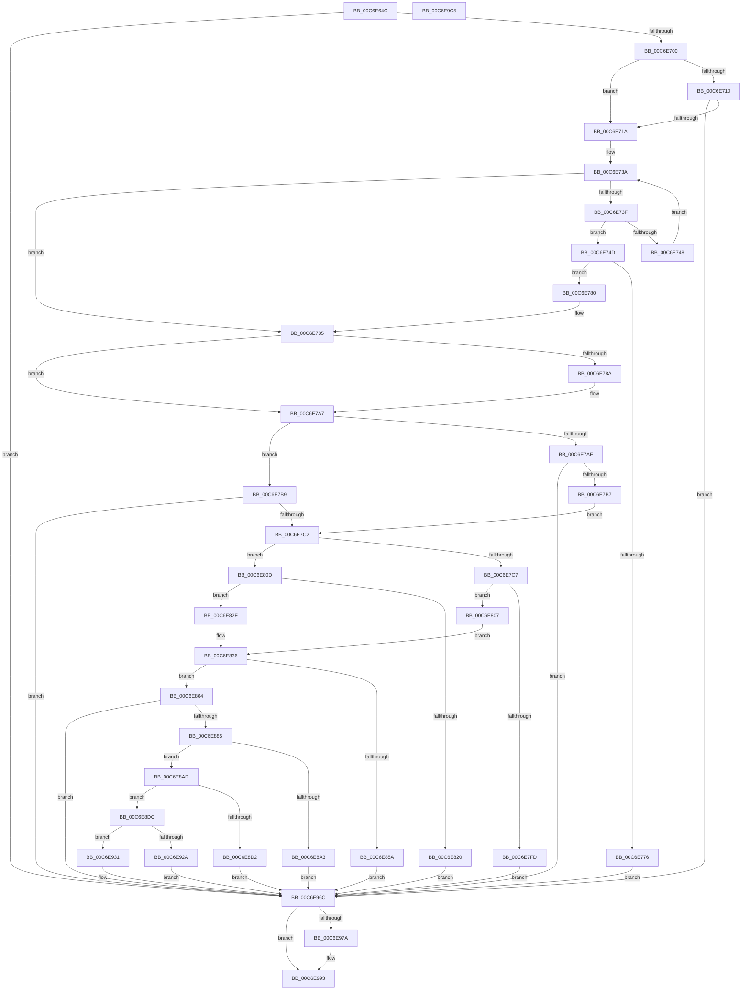

# CimfsInitialize

- RVA: `0x00C6E64C`–`0x00C6E9C6` (길이 `890` bytes)
- VA: `0x0000000140C6E64C`
- 실행 섹션: `INIT`
- PDB 이름 있음: `예`; PDB Function 태그: `아니요`
- unwind 정보 RVA: `0x000DB2E0`
- 디코드: `221`개 명령, `890/890` bytes 표시
- 미해석 바이트: `0` (있으면 어셈블리에 `.byte`로 보존)

> 이 문서는 커널 이미지의 기계어와 PDB 기호를 분석해 생성했습니다. 4번과 5번은 함수 원형과 자료형을 바이너리 사용 방식에서 추정한 C 해석이며 원본 소스 복구 결과는 아닙니다.

## 1. Dependencies

- 직접 호출 지점: **19**; 고유 호출 대상: **14**
- 직접 호출자로 확인된 함수: **1**
- RIP 상대 이미지 참조: **8**

### Outgoing calls
- `0x00C6E6B3` → [memset](../../text/6C/memset_function_006C6C40.md) (function, `0x006C6C40`)
- `0x00C6E6E4` → [memset](../../text/6C/memset_function_006C6C40.md) (function, `0x006C6C40`)
- `0x00C6E705` → [CompositefsBootIsEnabled](CompositefsBootIsEnabled_function_00C6F254.md) (function, `0x00C6F254`)
- `0x00C6E728` → [strstr](../../text/4F/strstr_function_004FF680.md) (function, `0x004FF680`)
- `0x00C6E76B` → [CimfsGetDiskParameters](CimfsGetDiskParameters_function_00C6E574.md) (function, `0x00C6E574`)
- `0x00C6E79B` → `ext-ms-win-ntos-globmerger-l1-1-0.dll!CimfsSetBootInformation` (import, 간접 대상; import `ext-ms-win-ntos-globmerger-l1-1-0.dll!CimfsSetBootInformation`)
- `0x00C6E7F2` → [PnpBootDeviceWait](../../text/5A/PnpBootDeviceWait_function_005A4D68.md) (function, `0x005A4D68`)
- `0x00C6E83B` → [RtlInitUnicodeString](../../text/42/RtlInitUnicodeString_function_0042A780.md) (function, `0x0042A780`)
- `0x00C6E848` → `ext-ms-win-ntos-globmerger-l1-1-0.dll!CimfsMountBootVolume` (import, 간접 대상; import `ext-ms-win-ntos-globmerger-l1-1-0.dll!CimfsMountBootVolume`)
- `0x00C6E86E` → `ext-ms-win-ntos-globmerger-l1-1-0.dll!CimfsSetBootInformation` (import, 간접 대상; import `ext-ms-win-ntos-globmerger-l1-1-0.dll!CimfsSetBootInformation`)
- `0x00C6E898` → [RtlStringFromGUID](../../page/91/RtlStringFromGUID_function_00914BA0.md) (function, `0x00914BA0`)
- `0x00C6E8C7` → [RtlStringCbPrintfW](../../text/40/RtlStringCbPrintfW_function_0040FB40.md) (function, `0x0040FB40`)
- `0x00C6E91F` → [RtlStringCbPrintfW](../../text/40/RtlStringCbPrintfW_function_0040FB40.md) (function, `0x0040FB40`)
- `0x00C6E93C` → [RtlInitUnicodeString](../../text/42/RtlInitUnicodeString_function_0042A780.md) (function, `0x0042A780`)
- `0x00C6E94D` → [RtlInitUnicodeString](../../text/42/RtlInitUnicodeString_function_0042A780.md) (function, `0x0042A780`)
- `0x00C6E95B` → [IoCreateSymbolicLink](../../page/A3/IoCreateSymbolicLink_function_00A33760.md) (function, `0x00A33760`)
- `0x00C6E971` → [RtlFreeAnsiString](../../page/9C/RtlFreeAnsiString_function_009C0800.md) (function, `0x009C0800`)
- `0x00C6E98D` → [KeBugCheckEx](../../text/4F/KeBugCheckEx_function_004FD660.md) (function, `0x004FD660`)
- `0x00C6E99F` → [_security_check_cookie](../../text/6A/_security_check_cookie_function_006AC640.md) (function, `0x006AC640`)

### Direct callers
- [IopInitializeBootDrivers](../C2/IopInitializeBootDrivers_function_00C2E6F4.md) at `0x00C2EE47`
- [IopInitializeBootDrivers](../C2/IopInitializeBootDrivers_function_00C2E6F4.md) at `0x00C2EF62`

### Static image references
- `0x00C6E672` → RVA `0x00E0A740` (`.data`; read)
- `0x00C6E721` → RVA `0x00C7E8F0` (` ?? ::PBOPGDP::`string'`; read)
- `0x00C6E79B` → RVA `0x00151298` (`ext-ms-win-ntos-globmerger-l1-1-0.dll!CimfsSetBootInformation (IAT)`; read)
- `0x00C6E7DE` → RVA `0x00C6E9D0` (`CimfsInitializeBootDisk`; read)
- `0x00C6E82F` → RVA `0x00C7E930` (` ?? ::PBOPGDP::`string'`; read)
- `0x00C6E848` → RVA `0x001512A0` (`ext-ms-win-ntos-globmerger-l1-1-0.dll!CimfsMountBootVolume (IAT)`; read)
- `0x00C6E8B9` → RVA `0x00C7E900` (` ?? ::PBOPGDP::`string'`; read)
- `0x00C6E8EC` → RVA `0x00C7E9B0` (` ?? ::PBOPGDP::`string'`; read)

## 2. Other-region calls and transfers

- 다른 실행 섹션으로 향하는 call: **14**
  - `0x00C6E6B3` → [memset](../../text/6C/memset_function_006C6C40.md) (`INIT` → `.text`)
  - `0x00C6E6E4` → [memset](../../text/6C/memset_function_006C6C40.md) (`INIT` → `.text`)
  - `0x00C6E728` → [strstr](../../text/4F/strstr_function_004FF680.md) (`INIT` → `.text`)
  - `0x00C6E7F2` → [PnpBootDeviceWait](../../text/5A/PnpBootDeviceWait_function_005A4D68.md) (`INIT` → `.text`)
  - `0x00C6E83B` → [RtlInitUnicodeString](../../text/42/RtlInitUnicodeString_function_0042A780.md) (`INIT` → `.text`)
  - `0x00C6E898` → [RtlStringFromGUID](../../page/91/RtlStringFromGUID_function_00914BA0.md) (`INIT` → `PAGE`)
  - `0x00C6E8C7` → [RtlStringCbPrintfW](../../text/40/RtlStringCbPrintfW_function_0040FB40.md) (`INIT` → `.text`)
  - `0x00C6E91F` → [RtlStringCbPrintfW](../../text/40/RtlStringCbPrintfW_function_0040FB40.md) (`INIT` → `.text`)
  - `0x00C6E93C` → [RtlInitUnicodeString](../../text/42/RtlInitUnicodeString_function_0042A780.md) (`INIT` → `.text`)
  - `0x00C6E94D` → [RtlInitUnicodeString](../../text/42/RtlInitUnicodeString_function_0042A780.md) (`INIT` → `.text`)
  - `0x00C6E95B` → [IoCreateSymbolicLink](../../page/A3/IoCreateSymbolicLink_function_00A33760.md) (`INIT` → `PAGE`)
  - `0x00C6E971` → [RtlFreeAnsiString](../../page/9C/RtlFreeAnsiString_function_009C0800.md) (`INIT` → `PAGE`)
  - `0x00C6E98D` → [KeBugCheckEx](../../text/4F/KeBugCheckEx_function_004FD660.md) (`INIT` → `.text`)
  - `0x00C6E99F` → [_security_check_cookie](../../text/6A/_security_check_cookie_function_006AC640.md) (`INIT` → `.text`)
- 별도 외부 분기/꼬리 이동을 확인하지 못했습니다.

## 3. Assembly (complete function range)

```asm
00C6E64C  48 8B C4                        mov rax, rsp
00C6E64F  48 89 58 10                     mov qword ptr [rax + 0x10], rbx
00C6E653  48 89 70 18                     mov qword ptr [rax + 0x18], rsi
00C6E657  48 89 78 20                     mov qword ptr [rax + 0x20], rdi
00C6E65B  55                              push rbp
00C6E65C  41 54                           push r12
00C6E65E  41 55                           push r13
00C6E660  41 56                           push r14
00C6E662  41 57                           push r15
00C6E664  48 8D A8 28 FE FF FF            lea rbp, [rax - 0x1d8]
00C6E66B  48 81 EC B0 02 00 00            sub rsp, 0x2b0
00C6E672  48 8B 05 C7 C0 19 00            mov rax, qword ptr [rip + 0x19c0c7]
00C6E679  48 33 C4                        xor rax, rsp
00C6E67C  48 89 85 A0 01 00 00            mov qword ptr [rbp + 0x1a0], rax
00C6E683  0F 57 C0                        xorps xmm0, xmm0
00C6E686  0F 57 C9                        xorps xmm1, xmm1
00C6E689  44 8A F2                        mov r14b, dl
00C6E68C  48 8B F1                        mov rsi, rcx
00C6E68F  33 C0                           xor eax, eax
00C6E691  48 8D 4D 90                     lea rcx, [rbp - 0x70]
00C6E695  33 D2                           xor edx, edx
00C6E697  89 45 94                        mov dword ptr [rbp - 0x6c], eax
00C6E69A  41 B8 8C 00 00 00               mov r8d, 0x8c
00C6E6A0  0F 11 45 80                     movups xmmword ptr [rbp - 0x80], xmm0
00C6E6A4  0F 11 4C 24 70                  movups xmmword ptr [rsp + 0x70], xmm1
00C6E6A9  0F 11 44 24 40                  movups xmmword ptr [rsp + 0x40], xmm0
00C6E6AE  0F 11 4C 24 60                  movups xmmword ptr [rsp + 0x60], xmm1
00C6E6B3  E8 88 85 A5 FF                  call 0x1406c6c40
00C6E6B8  33 DB                           xor ebx, ebx
00C6E6BA  48 8D 4D 20                     lea rcx, [rbp + 0x20]
00C6E6BE  0F 57 C0                        xorps xmm0, xmm0
00C6E6C1  89 5C 24 34                     mov dword ptr [rsp + 0x34], ebx
00C6E6C5  33 D2                           xor edx, edx
00C6E6C7  48 89 5C 24 50                  mov qword ptr [rsp + 0x50], rbx
00C6E6CC  0F 11 85 90 00 00 00            movups xmmword ptr [rbp + 0x90], xmm0
00C6E6D3  44 8D 43 70                     lea r8d, [rbx + 0x70]
00C6E6D7  48 89 5C 24 58                  mov qword ptr [rsp + 0x58], rbx
00C6E6DC  44 8B FB                        mov r15d, ebx
00C6E6DF  8B FB                           mov edi, ebx
00C6E6E1  44 8B EB                        mov r13d, ebx
00C6E6E4  E8 57 85 A5 FF                  call 0x1406c6c40
00C6E6E9  48 8B 86 F0 00 00 00            mov rax, qword ptr [rsi + 0xf0]
00C6E6F0  88 5C 24 30                     mov byte ptr [rsp + 0x30], bl
00C6E6F4  39 98 00 0F 00 00               cmp dword ptr [rax + 0xf00], ebx
00C6E6FA  0F 84 6C 02 00 00               je 0x140c6e96c
00C6E700  48 8D 4C 24 30                  lea rcx, [rsp + 0x30]
00C6E705  E8 4A 0B 00 00                  call 0x140c6f254
00C6E70A  8B F8                           mov edi, eax
00C6E70C  85 C0                           test eax, eax
00C6E70E  78 0A                           js 0x140c6e71a
00C6E710  38 5C 24 30                     cmp byte ptr [rsp + 0x30], bl
00C6E714  0F 85 52 02 00 00               jne 0x140c6e96c
00C6E71A  48 8B 8E B8 00 00 00            mov rcx, qword ptr [rsi + 0xb8]
00C6E721  48 8D 15 C8 01 01 00            lea rdx, [rip + 0x101c8]
00C6E728  E8 53 0F 89 FF                  call 0x1404ff680
00C6E72D  48 8B 96 E8 00 00 00            mov rdx, qword ptr [rsi + 0xe8]
00C6E734  4C 8B E0                        mov r12, rax
00C6E737  48 8B 0A                        mov rcx, qword ptr [rdx]
00C6E73A  48 3B CA                        cmp rcx, rdx
00C6E73D  74 46                           je 0x140c6e785
00C6E73F  4C 8B 51 38                     mov r10, qword ptr [rcx + 0x38]
00C6E743  4D 85 D2                        test r10, r10
00C6E746  75 05                           jne 0x140c6e74d
00C6E748  48 8B 09                        mov rcx, qword ptr [rcx]
00C6E74B  EB ED                           jmp 0x140c6e73a
00C6E74D  4C 8B E9                        mov r13, rcx
00C6E750  48 8D 44 24 34                  lea rax, [rsp + 0x34]
00C6E755  49 8B CA                        mov rcx, r10
00C6E758  48 89 44 24 20                  mov qword ptr [rsp + 0x20], rax
00C6E75D  4C 8D 8D 90 00 00 00            lea r9, [rbp + 0x90]
00C6E764  45 33 C0                        xor r8d, r8d
00C6E767  48 8D 55 90                     lea rdx, [rbp - 0x70]
00C6E76B  E8 04 FE FF FF                  call 0x140c6e574
00C6E770  8B F8                           mov edi, eax
00C6E772  85 C0                           test eax, eax
00C6E774  79 0A                           jns 0x140c6e780
00C6E776  BB 01 00 00 00                  mov ebx, 1
00C6E77B  E9 EC 01 00 00                  jmp 0x140c6e96c
00C6E780  44 8B 7C 24 34                  mov r15d, dword ptr [rsp + 0x34]
00C6E785  45 84 F6                        test r14b, r14b
00C6E788  74 1D                           je 0x140c6e7a7
00C6E78A  45 8B CF                        mov r9d, r15d
00C6E78D  4C 8D 85 90 00 00 00            lea r8, [rbp + 0x90]
00C6E794  48 8D 55 90                     lea rdx, [rbp - 0x70]
00C6E798  48 8B CE                        mov rcx, rsi
00C6E79B  48 FF 15 F6 2A 4E FF            call qword ptr [rip - 0xb1d50a]
00C6E7A2  0F 1F 44 00 00                  nop dword ptr [rax + rax]
00C6E7A7  33 DB                           xor ebx, ebx
00C6E7A9  4D 85 E4                        test r12, r12
00C6E7AC  75 0B                           jne 0x140c6e7b9
00C6E7AE  45 84 F6                        test r14b, r14b
00C6E7B1  0F 85 B5 01 00 00               jne 0x140c6e96c
00C6E7B7  EB 09                           jmp 0x140c6e7c2
00C6E7B9  45 84 F6                        test r14b, r14b
00C6E7BC  0F 84 AA 01 00 00               je 0x140c6e96c
00C6E7C2  4D 85 ED                        test r13, r13
00C6E7C5  74 46                           je 0x140c6e80d
00C6E7C7  0F 10 85 90 00 00 00            movups xmm0, xmmword ptr [rbp + 0x90]
00C6E7CE  48 8D 45 90                     lea rax, [rbp - 0x70]
00C6E7D2  44 89 7D 38                     mov dword ptr [rbp + 0x38], r15d
00C6E7D6  4C 8D 4D 20                     lea r9, [rbp + 0x20]
00C6E7DA  48 89 45 20                     mov qword ptr [rbp + 0x20], rax
00C6E7DE  4C 8D 05 EB 01 00 00            lea r8, [rip + 0x1eb]
00C6E7E5  BA 01 00 00 00                  mov edx, 1
00C6E7EA  48 8B CE                        mov rcx, rsi
00C6E7ED  F3 0F 7F 45 28                  movdqu xmmword ptr [rbp + 0x28], xmm0
00C6E7F2  E8 71 65 93 FF                  call 0x1405a4d68
00C6E7F7  8B F8                           mov edi, eax
00C6E7F9  85 C0                           test eax, eax
00C6E7FB  79 0A                           jns 0x140c6e807
00C6E7FD  BB 02 00 00 00                  mov ebx, 2
00C6E802  E9 65 01 00 00                  jmp 0x140c6e96c
00C6E807  48 8D 55 3C                     lea rdx, [rbp + 0x3c]
00C6E80B  EB 29                           jmp 0x140c6e836
00C6E80D  48 8B 86 F0 00 00 00            mov rax, qword ptr [rsi + 0xf0]
00C6E814  F7 80 84 00 00 00 00 04 00 00   test dword ptr [rax + 0x84], 0x400
00C6E81E  75 0F                           jne 0x140c6e82f
00C6E820  BF 0D 00 00 C0                  mov edi, 0xc000000d
00C6E825  BB 08 00 00 00                  mov ebx, 8
00C6E82A  E9 3D 01 00 00                  jmp 0x140c6e96c
00C6E82F  48 8D 15 FA 00 01 00            lea rdx, [rip + 0x100fa]
00C6E836  48 8D 4C 24 60                  lea rcx, [rsp + 0x60]
00C6E83B  E8 40 BF 7B FF                  call 0x14042a780
00C6E840  48 8D 54 24 60                  lea rdx, [rsp + 0x60]
00C6E845  48 8B CE                        mov rcx, rsi
00C6E848  48 FF 15 51 2A 4E FF            call qword ptr [rip - 0xb1d5af]
00C6E84F  0F 1F 44 00 00                  nop dword ptr [rax + rax]
00C6E854  8B F8                           mov edi, eax
00C6E856  85 C0                           test eax, eax
00C6E858  79 0A                           jns 0x140c6e864
00C6E85A  BB 03 00 00 00                  mov ebx, 3
00C6E85F  E9 08 01 00 00                  jmp 0x140c6e96c
00C6E864  45 33 C9                        xor r9d, r9d
00C6E867  45 33 C0                        xor r8d, r8d
00C6E86A  33 D2                           xor edx, edx
00C6E86C  33 C9                           xor ecx, ecx
00C6E86E  48 FF 15 23 2A 4E FF            call qword ptr [rip - 0xb1d5dd]
00C6E875  0F 1F 44 00 00                  nop dword ptr [rax + rax]
00C6E87A  33 DB                           xor ebx, ebx
00C6E87C  4D 85 E4                        test r12, r12
00C6E87F  0F 84 E7 00 00 00               je 0x140c6e96c
00C6E885  48 8B 8E F0 00 00 00            mov rcx, qword ptr [rsi + 0xf0]
00C6E88C  48 8D 54 24 50                  lea rdx, [rsp + 0x50]
00C6E891  48 81 C1 E8 0E 00 00            add rcx, 0xee8
00C6E898  E8 03 63 CA FF                  call 0x140914ba0
00C6E89D  8B F8                           mov edi, eax
00C6E89F  85 C0                           test eax, eax
00C6E8A1  79 0A                           jns 0x140c6e8ad
00C6E8A3  BB 04 00 00 00                  mov ebx, 4
00C6E8A8  E9 BF 00 00 00                  jmp 0x140c6e96c
00C6E8AD  BB 78 00 00 00                  mov ebx, 0x78
00C6E8B2  4C 8D 4C 24 50                  lea r9, [rsp + 0x50]
00C6E8B7  8B D3                           mov edx, ebx
00C6E8B9  4C 8D 05 40 00 01 00            lea r8, [rip + 0x10040]
00C6E8C0  48 8D 8D A0 00 00 00            lea rcx, [rbp + 0xa0]
00C6E8C7  E8 74 12 7A FF                  call 0x14040fb40
00C6E8CC  8B F8                           mov edi, eax
00C6E8CE  85 C0                           test eax, eax
00C6E8D0  79 0A                           jns 0x140c6e8dc
00C6E8D2  BB 05 00 00 00                  mov ebx, 5
00C6E8D7  E9 90 00 00 00                  jmp 0x140c6e96c
00C6E8DC  0F 28 44 24 50                  movaps xmm0, xmmword ptr [rsp + 0x50]
00C6E8E1  4C 8D 4C 24 40                  lea r9, [rsp + 0x40]
00C6E8E6  66 0F 7F 44 24 40               movdqa xmmword ptr [rsp + 0x40], xmm0
00C6E8EC  4C 8D 05 BD 00 01 00            lea r8, [rip + 0x100bd]
00C6E8F3  66 0F 73 D8 08                  psrldq xmm0, 8
00C6E8F8  48 8D 8D 20 01 00 00            lea rcx, [rbp + 0x120]
00C6E8FF  66 48 0F 7E C0                  movq rax, xmm0
00C6E904  48 8B D3                        mov rdx, rbx
00C6E907  48 83 C0 02                     add rax, 2
00C6E90B  48 89 44 24 48                  mov qword ptr [rsp + 0x48], rax
00C6E910  B8 FC FF 00 00                  mov eax, 0xfffc
00C6E915  66 01 44 24 40                  add word ptr [rsp + 0x40], ax
00C6E91A  66 01 44 24 42                  add word ptr [rsp + 0x42], ax
00C6E91F  E8 1C 12 7A FF                  call 0x14040fb40
00C6E924  8B F8                           mov edi, eax
00C6E926  85 C0                           test eax, eax
00C6E928  79 07                           jns 0x140c6e931
00C6E92A  BB 06 00 00 00                  mov ebx, 6
00C6E92F  EB 3B                           jmp 0x140c6e96c
00C6E931  48 8D 95 A0 00 00 00            lea rdx, [rbp + 0xa0]
00C6E938  48 8D 4D 80                     lea rcx, [rbp - 0x80]
00C6E93C  E8 3F BE 7B FF                  call 0x14042a780
00C6E941  48 8D 95 20 01 00 00            lea rdx, [rbp + 0x120]
00C6E948  48 8D 4C 24 70                  lea rcx, [rsp + 0x70]
00C6E94D  E8 2E BE 7B FF                  call 0x14042a780
00C6E952  48 8D 54 24 70                  lea rdx, [rsp + 0x70]
00C6E957  48 8D 4D 80                     lea rcx, [rbp - 0x80]
00C6E95B  E8 00 4E DC FF                  call 0x140a33760
00C6E960  33 DB                           xor ebx, ebx
00C6E962  8B F8                           mov edi, eax
00C6E964  85 FF                           test edi, edi
00C6E966  8D 43 07                        lea eax, [rbx + 7]
00C6E969  0F 48 D8                        cmovs ebx, eax
00C6E96C  48 8D 4C 24 50                  lea rcx, [rsp + 0x50]
00C6E971  E8 8A 1E D5 FF                  call 0x1409c0800
00C6E976  85 FF                           test edi, edi
00C6E978  79 19                           jns 0x140c6e993
00C6E97A  48 83 64 24 20 00               and qword ptr [rsp + 0x20], 0
00C6E980  45 33 C9                        xor r9d, r9d
00C6E983  4C 63 C7                        movsxd r8, edi
00C6E986  48 8B D3                        mov rdx, rbx
00C6E989  41 8D 49 7B                     lea ecx, [r9 + 0x7b]
00C6E98D  E8 CE EC 88 FF                  call 0x1404fd660
00C6E992  CC                              int3
00C6E993  8B C7                           mov eax, edi
00C6E995  48 8B 8D A0 01 00 00            mov rcx, qword ptr [rbp + 0x1a0]
00C6E99C  48 33 CC                        xor rcx, rsp
00C6E99F  E8 9C DC A3 FF                  call 0x1406ac640
00C6E9A4  4C 8D 9C 24 B0 02 00 00         lea r11, [rsp + 0x2b0]
00C6E9AC  49 8B 5B 38                     mov rbx, qword ptr [r11 + 0x38]
00C6E9B0  49 8B 73 40                     mov rsi, qword ptr [r11 + 0x40]
00C6E9B4  49 8B 7B 48                     mov rdi, qword ptr [r11 + 0x48]
00C6E9B8  49 8B E3                        mov rsp, r11
00C6E9BB  41 5F                           pop r15
00C6E9BD  41 5E                           pop r14
00C6E9BF  41 5D                           pop r13
00C6E9C1  41 5C                           pop r12
00C6E9C3  5D                              pop rbp
00C6E9C4  C3                              ret
00C6E9C5  CC                              int3
```

## 4. C-style interpretation (structured pseudocode)

```c
__int64 __fastcall CimfsInitialize(__int64 a1, int a2)
{
    __int64 result;
    __int64 v_rbx;
    __int64 v_rsp;
    unsigned __int64 v_stack_m268;
    unsigned __int64 v_stack_m278;
    unsigned __int64 v_stack_m28;
    unsigned __int64 v_stack_m280;
    unsigned __int64 v_stack_m288;
    unsigned __int64 v_stack_m290;
    unsigned __int16 v_stack_m296;
    unsigned __int64 v_stack_m298;
    unsigned int v_stack_m2A4;
    unsigned __int8 v_stack_m2A8;
    unsigned __int64 v_stack_m2B8;

    *(unsigned __int64 *)(v_rsp + 16) = v_rbx;
    *(unsigned __int64 *)(v_rsp + 24) = v_rsi;
    *(unsigned __int64 *)(v_rsp + 32) = v_rdi;
    v_rsp = (v_rsp) - (688);
    result = (*(unsigned __int64 *)(v_rip + 1687751)) ^ (v_rsp);
    *(unsigned __int64 *)(v_rsp - 472 + 416) = result;
    result = 0;
    a2 = 0;
    *(unsigned int *)(v_rsp - 472 - 108) = 0;
    *(unsigned __int64 *)(v_rsp - 472 - 128) = v_xmm0;
    v_stack_m268 = v_xmm1;
    v_stack_m298 = v_xmm0;
    v_stack_m278 = v_xmm1;
    result = memset(v_rsp - 472 - 112, a2, 140, a4);
    v_rbx = 0;
    v_stack_m2A4 = 0;
    a2 = 0;
    v_stack_m288 = 0;
    *(unsigned __int64 *)(v_rsp - 472 + 144) = v_xmm0;
    v_stack_m280 = 0;
    result = memset(v_rsp - 472 + 32, a2, v_rbx + 112, a4);
    v_stack_m2A8 = 0;
    if ((*(unsigned int *)(*(unsigned __int64 *)(a1 + 240) + 3840)) == 0) goto loc_00C6E96C;
    result = CompositefsBootIsEnabled(v_stack_m2A8, a2, v_rbx + 112, a4);
    if (sign_flag) goto loc_00C6E71A;
    if (v_stack_m2A8 != 0) goto loc_00C6E96C;
loc_00C6E71A:
    result = strstr(*(unsigned __int64 *)(a1 + 184), v_rip + 65992, v_rbx + 112, a4);
loc_00C6E73A:
    if ((*(unsigned __int64 *)(*(unsigned __int64 *)(a1 + 232))) == (*(unsigned __int64 *)(a1 + 232))) goto loc_00C6E785;
    if (*(unsigned __int64 *)(*(unsigned __int64 *)(*(unsigned __int64 *)(a1 + 232)) + 56) != 0) goto loc_00C6E74D;
    goto loc_00C6E73A;
loc_00C6E74D:
    v_stack_m2B8 = v_stack_m2A4;
    a3 = 0;
    result = CimfsGetDiskParameters(*(unsigned __int64 *)(*(unsigned __int64 *)(*(unsigned __int64 *)(a1 + 232)) + 56), v_rsp - 472 - 112, a3, v_rsp - 472 + 144);
    if (!sign_flag) goto loc_00C6E780;
    goto loc_00C6E96C;
loc_00C6E780:
loc_00C6E785:
    if ((unsigned __int8)((unsigned __int8)(a2)) != 0) {
        a4 = (unsigned int)((unsigned int)(v_stack_m2A4));
        a3 = v_rsp - 472 + 144;
        a2 = v_rsp - 472 - 112;
        a1 = a1;
        result = ext_ms_win_ntos_globmerger_l1_1_0_dll_CimfsSetBootInformation(a1, a2, a3, a4);
    }
    v_rbx = 0;
    if (result != 0) goto loc_00C6E7B9;
    if ((unsigned __int8)((unsigned __int8)(a2)) != 0) goto loc_00C6E96C;
    goto loc_00C6E7C2;
loc_00C6E7B9:
    if ((unsigned __int8)((unsigned __int8)(a2)) == 0) goto loc_00C6E96C;
loc_00C6E7C2:
    if (*(unsigned __int64 *)(*(unsigned __int64 *)(*(unsigned __int64 *)(a1 + 232))) == 0) goto loc_00C6E80D;
    *(unsigned int *)(v_rsp - 472 + 56) = (unsigned int)((unsigned int)(v_stack_m2A4));
    *(unsigned __int64 *)(v_rsp - 472 + 32) = v_rsp - 472 - 112;
    *(unsigned __int64 *)(v_rsp - 472 + 40) = v_xmm0;
    result = PnpBootDeviceWait(a1, 1, v_rip + 491, v_rsp - 472 + 32);
    if (!sign_flag) goto loc_00C6E807;
    goto loc_00C6E96C;
loc_00C6E807:
    goto loc_00C6E836;
loc_00C6E80D:
    if (((*(unsigned int *)(*(unsigned __int64 *)(a1 + 240) + 132)) & (0x400ULL)) != 0) goto loc_00C6E82F;
    goto loc_00C6E96C;
loc_00C6E82F:
loc_00C6E836:
    result = RtlInitUnicodeString(v_stack_m278, v_rip + 65786, v_rip + 491, v_rsp - 472 + 32);
    result = ext_ms_win_ntos_globmerger_l1_1_0_dll_CimfsMountBootVolume(a1, v_stack_m278, v_rip + 491, v_rsp - 472 + 32);
    if (!sign_flag) goto loc_00C6E864;
    goto loc_00C6E96C;
loc_00C6E864:
    a4 = 0;
    a3 = 0;
    a2 = 0;
    a1 = 0;
    result = ext_ms_win_ntos_globmerger_l1_1_0_dll_CimfsSetBootInformation(a1, a2, a3, a4);
    v_rbx = 0;
    if (result == 0) goto loc_00C6E96C;
    a1 = (*(unsigned __int64 *)(a1 + 240)) + (0xEE8ULL);
    result = RtlStringFromGUID(a1, v_stack_m288, a3, a4);
    if (!sign_flag) goto loc_00C6E8AD;
    goto loc_00C6E96C;
loc_00C6E8AD:
    result = RtlStringCbPrintfW(v_rsp - 472 + 160, 120, v_rip + 65600, v_stack_m288);
    if (!sign_flag) goto loc_00C6E8DC;
    goto loc_00C6E96C;
loc_00C6E8DC:
    v_stack_m298 = v_xmm0;
    result = (result) + (2);
    v_stack_m290 = result;
    result = RtlStringCbPrintfW(v_rsp - 472 + 288, 5, v_rip + 65725, v_stack_m298);
    if (!sign_flag) goto loc_00C6E931;
    goto loc_00C6E96C;
loc_00C6E931:
    result = RtlInitUnicodeString(v_rsp - 472 - 128, v_rsp - 472 + 160, v_rip + 65725, v_stack_m298);
    result = RtlInitUnicodeString(v_stack_m268, v_rsp - 472 + 288, v_rip + 65725, v_stack_m298);
    result = IoCreateSymbolicLink(v_rsp - 472 - 128, v_stack_m268, v_rip + 65725, v_stack_m298);
    v_rbx = 0;
    if (sign_flag) { v_rbx = (unsigned int)(v_rbx + 7); }
loc_00C6E96C:
    result = RtlFreeAnsiString(v_stack_m288, v_stack_m268, v_rip + 65725, v_stack_m298);
    if (sign_flag) {
        a4 = 0;
        a3 = (int)((unsigned int)((unsigned int)((unsigned int)(result))));
        a2 = v_rbx;
        a1 = a4 + 123;
        result = KeBugCheckEx(a1, a2, a3, a4);
    }
    a1 = (*(unsigned __int64 *)(v_rsp - 472 + 416)) ^ (v_rsp);
    result = _security_check_cookie(a1, a2, a3, a4);
    return result;
}
```

## 5. (Beta) C Style

```c
int64_t CimfsInitialize(void *Arg1, int32_t Arg2)
{
    uint8_t *arg1 = (uint8_t *)Arg1;

    int64_t result;
    int64_t local_rbx;
    int64_t local_rsp;
    uint64_t v_stack_m268;
    uint64_t v_stack_m278;
    uint64_t v_stack_m28;
    uint64_t v_stack_m280;
    uint64_t v_stack_m288;
    uint64_t v_stack_m290;
    uint16_t v_stack_m296;
    uint64_t v_stack_m298;
    uint32_t v_stack_m2A4;
    uint8_t v_stack_m2A8;
    uint64_t v_stack_m2B8;

    *(uint64_t *)(local_rsp + 0x10) = local_rbx;
    *(uint64_t *)(local_rsp + 0x18) = local_rsi;
    *(uint64_t *)(local_rsp + 0x20) = local_rdi;
    local_rsp = (local_rsp) - (688);
    result = (*(uint64_t *)(v_rip + 0x19C0C7)) ^ (local_rsp);
    *(uint64_t *)(local_rsp - 0x1D8 + 0x1A0) = result;
    result = 0;
    Arg2 = 0;
    *(uint32_t *)(local_rsp - 0x1D8 - 0x6C) = 0;
    *(uint64_t *)(local_rsp - 0x1D8 - 0x80) = v_xmm0;
    v_stack_m268 = v_xmm1;
    v_stack_m298 = v_xmm0;
    v_stack_m278 = v_xmm1;
    result = memset(local_rsp - 472 - 112, Arg2, 140, a4);
    local_rbx = 0;
    v_stack_m2A4 = 0;
    Arg2 = 0;
    v_stack_m288 = 0;
    *(uint64_t *)(local_rsp - 0x1D8 + 0x90) = v_xmm0;
    v_stack_m280 = 0;
    result = memset(local_rsp - 472 + 32, Arg2, local_rbx + 112, a4);
    v_stack_m2A8 = 0;
    if ((*(uint32_t *)(*(uint64_t *)(arg1 + 0xF0) + 0xF00)) == 0) goto loc_00C6E96C;
    result = CompositefsBootIsEnabled(v_stack_m2A8, Arg2, local_rbx + 112, a4);
    if (sign_flag) goto loc_00C6E71A;
    if (v_stack_m2A8 != 0) goto loc_00C6E96C;
loc_00C6E71A:
    result = strstr(*(uint64_t *)(arg1 + 0xB8), v_rip + 65992, local_rbx + 112, a4);
loc_00C6E73A:
    if ((*(uint64_t *)(*(uint64_t *)(arg1 + 0xE8))) == (*(uint64_t *)(arg1 + 0xE8))) goto loc_00C6E785;
    if (*(uint64_t *)(*(uint64_t *)(*(uint64_t *)(arg1 + 0xE8)) + 0x38) != 0) goto loc_00C6E74D;
    goto loc_00C6E73A;
loc_00C6E74D:
    v_stack_m2B8 = v_stack_m2A4;
    a3 = 0;
    result = CimfsGetDiskParameters(*(uint64_t *)(*(uint64_t *)(*(uint64_t *)(arg1 + 0xE8)) + 0x38), local_rsp - 472 - 112, a3, local_rsp - 472 + 144);
    if (!sign_flag) goto loc_00C6E780;
    goto loc_00C6E96C;
loc_00C6E780:
loc_00C6E785:
    if ((uint8_t)((uint8_t)(Arg2)) != 0) {
        a4 = (uint32_t)((uint32_t)(v_stack_m2A4));
        a3 = local_rsp - 472 + 144;
        Arg2 = local_rsp - 472 - 112;
        Arg1 = Arg1;
        result = kernel_indirect_call(Arg1, Arg2, a3, a4);
    }
    local_rbx = 0;
    if (result != 0) goto loc_00C6E7B9;
    if ((uint8_t)((uint8_t)(Arg2)) != 0) goto loc_00C6E96C;
    goto loc_00C6E7C2;
loc_00C6E7B9:
    if ((uint8_t)((uint8_t)(Arg2)) == 0) goto loc_00C6E96C;
loc_00C6E7C2:
    if (*(uint64_t *)(*(uint64_t *)(*(uint64_t *)(arg1 + 0xE8))) == 0) goto loc_00C6E80D;
    *(uint32_t *)(local_rsp - 0x1D8 + 0x38) = (uint32_t)((uint32_t)(v_stack_m2A4));
    *(uint64_t *)(local_rsp - 0x1D8 + 0x20) = local_rsp - 472 - 112;
    *(uint64_t *)(local_rsp - 0x1D8 + 0x28) = v_xmm0;
    result = PnpBootDeviceWait(Arg1, 1, v_rip + 491, local_rsp - 472 + 32);
    if (!sign_flag) goto loc_00C6E807;
    goto loc_00C6E96C;
loc_00C6E807:
    goto loc_00C6E836;
loc_00C6E80D:
    if (((*(uint32_t *)(*(uint64_t *)(arg1 + 0xF0) + 0x84)) & (0x400ULL)) != 0) goto loc_00C6E82F;
    goto loc_00C6E96C;
loc_00C6E82F:
loc_00C6E836:
    result = RtlInitUnicodeString(v_stack_m278, v_rip + 65786, v_rip + 491, local_rsp - 472 + 32);
    result = kernel_indirect_call(Arg1, v_stack_m278, v_rip + 491, local_rsp - 472 + 32);
    if (!sign_flag) goto loc_00C6E864;
    goto loc_00C6E96C;
loc_00C6E864:
    a4 = 0;
    a3 = 0;
    Arg2 = 0;
    Arg1 = 0;
    result = kernel_indirect_call(Arg1, Arg2, a3, a4);
    local_rbx = 0;
    if (result == 0) goto loc_00C6E96C;
    Arg1 = (*(uint64_t *)(arg1 + 0xF0)) + (0xEE8ULL);
    result = RtlStringFromGUID(Arg1, v_stack_m288, a3, a4);
    if (!sign_flag) goto loc_00C6E8AD;
    goto loc_00C6E96C;
loc_00C6E8AD:
    result = RtlStringCbPrintfW(local_rsp - 472 + 160, 120, v_rip + 65600, v_stack_m288);
    if (!sign_flag) goto loc_00C6E8DC;
    goto loc_00C6E96C;
loc_00C6E8DC:
    v_stack_m298 = v_xmm0;
    result = (result) + (2);
    v_stack_m290 = result;
    result = RtlStringCbPrintfW(local_rsp - 472 + 288, 5, v_rip + 65725, v_stack_m298);
    if (!sign_flag) goto loc_00C6E931;
    goto loc_00C6E96C;
loc_00C6E931:
    result = RtlInitUnicodeString(local_rsp - 472 - 128, local_rsp - 472 + 160, v_rip + 65725, v_stack_m298);
    result = RtlInitUnicodeString(v_stack_m268, local_rsp - 472 + 288, v_rip + 65725, v_stack_m298);
    result = IoCreateSymbolicLink(local_rsp - 472 - 128, v_stack_m268, v_rip + 65725, v_stack_m298);
    local_rbx = 0;
    if (sign_flag) { local_rbx = (uint32_t)(local_rbx + 7); }
loc_00C6E96C:
    result = RtlFreeAnsiString(v_stack_m288, v_stack_m268, v_rip + 65725, v_stack_m298);
    if (sign_flag) {
        a4 = 0;
        a3 = (int32_t)((uint32_t)((uint32_t)((uint32_t)(result))));
        Arg2 = local_rbx;
        Arg1 = a4 + 123;
        result = KeBugCheckEx(Arg1, Arg2, a3, a4);
    }
    Arg1 = (*(uint64_t *)(local_rsp - 0x1D8 + 0x1A0)) ^ (local_rsp);
    result = _security_check_cookie(Arg1, Arg2, a3, a4);
    return result;
}
```

### 관측된 메모리 오프셋

구조체 형식이 확인되지 않은 접근은 인자 기준의 오프셋으로만 기록했습니다.

| 기준 인자 | 오프셋 표현 | 폭 (bit) | 접근 |
|---|---:|---:|---|
| `Arg1` | `+ 0xB8` | `64` | `R` |
| `Arg1` | `+ 0xE8` | `64` | `R` |
| `Arg1` | `+ 0xF0` | `64` | `R` |

## 6. Execution-region graph

[열기: 2D/3D 그래프와 함수 탐색 컨트롤 패널](../../../control-panel.html?section=init&rva=0x00C6E64C&view=graph)

- 2D 그래프는 위에서 아래로 흐르고, 3D 그래프는 빈 공간을 드래그해 회전합니다. Shift+드래그는 이동, 휠은 확대·축소, 함수 노드 선택은 대상 보고서 이동입니다.

### Static fallback


