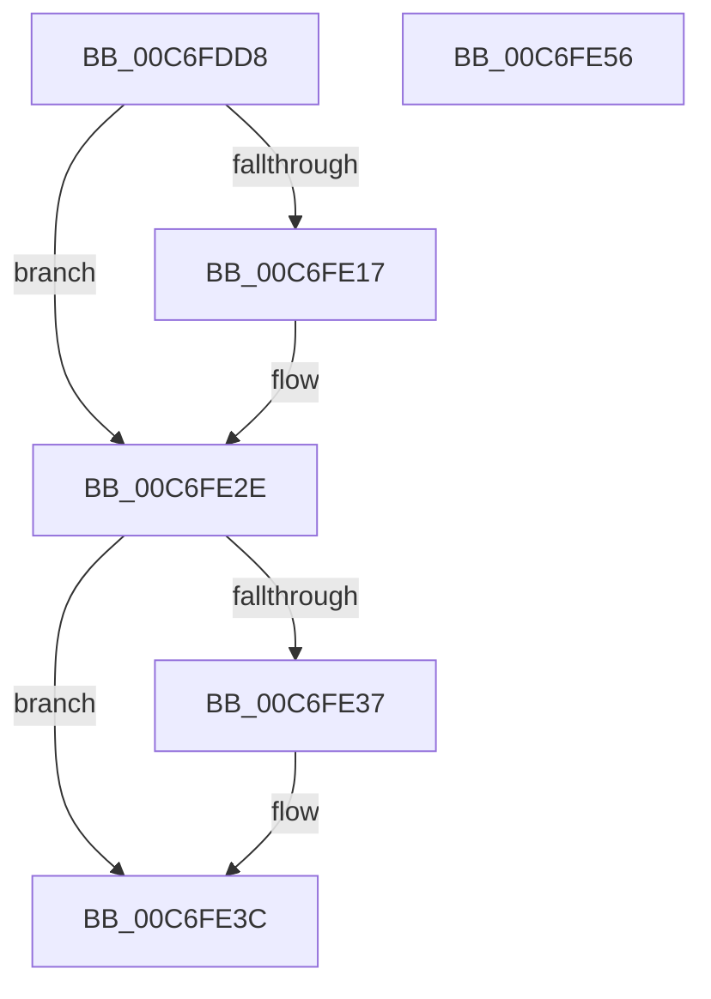

# CmInitSystem2

- RVA: `0x00C6FDD8`–`0x00C6FE57` (길이 `127` bytes)
- VA: `0x0000000140C6FDD8`
- 실행 섹션: `INIT`
- PDB 이름 있음: `예`; PDB Function 태그: `아니요`
- unwind 정보 RVA: `0x000697A4`
- 디코드: `31`개 명령, `127/127` bytes 표시
- 미해석 바이트: `0` (있으면 어셈블리에 `.byte`로 보존)

> 이 문서는 커널 이미지의 기계어와 PDB 기호를 분석해 생성했습니다. 4번과 5번은 함수 원형과 자료형을 바이너리 사용 방식에서 추정한 C 해석이며 원본 소스 복구 결과는 아닙니다.

## 1. Dependencies

- 직접 호출 지점: **9**; 고유 호출 대상: **9**
- 직접 호출자로 확인된 함수: **1**
- RIP 상대 이미지 참조: **3**

### Outgoing calls
- `0x00C6FDF8` → [CmpRegisterTraceLoggingProvider](../../page/70/CmpRegisterTraceLoggingProvider_function_00704D24.md) (function, `0x00704D24`)
- `0x00C6FDFD` → [CmFcInitSystem3](CmFcInitSystem3_function_00C6FAF0.md) (function, `0x00C6FAF0`)
- `0x00C6FE0E` → [IoCreateDriver](../../page/AC/IoCreateDriver_function_00AC9D70.md) (function, `0x00AC9D70`)
- `0x00C6FE28` → [KeBugCheckEx](../../text/4F/KeBugCheckEx_function_004FD660.md) (function, `0x004FD660`)
- `0x00C6FE37` → [MmLockRegistryRecoverySections](../../page/7F/MmLockRegistryRecoverySections_function_007F8F94.md) (function, `0x007F8F94`)
- `0x00C6FE3C` → [CmpVolumeManagerCreateContextsForWellKnownVolumes](../../page/70/CmpVolumeManagerCreateContextsForWellKnownVolumes_function_007023B0.md) (function, `0x007023B0`)
- `0x00C6FE41` → [CmpMachineHiveListInitialize](../../page/AD/CmpMachineHiveListInitialize_function_00AD4B98.md) (function, `0x00AD4B98`)
- `0x00C6FE46` → [Feature_MachineHiveCache__private_ReportDeviceUsage](../../text/4F/Feature_MachineHiveCache__private_ReportDeviceUsage_function_004F6E38.md) (function, `0x004F6E38`)
- `0x00C6FE4B` → [CmpBuildMachineHiveCache](../../page/7E/CmpBuildMachineHiveCache_function_007E8B74.md) (function, `0x007E8B74`)

### Direct callers
- [Phase1InitializationIoReady](../C7/Phase1InitializationIoReady_function_00C70458.md) at `0x00C704E3`

### Static image references
- `0x00C6FDDE` → RVA `0x00C7DFB0` (` ?? ::PBOPGDP::`string'`; read)
- `0x00C6FE02` → RVA `0x0083AE90` (`VRegSetup`; read)
- `0x00C6FE2E` → RVA `0x00EEFB58` (`.data`; read)

## 2. Other-region calls and transfers

- 다른 실행 섹션으로 향하는 call: **8**
  - `0x00C6FDF8` → [CmpRegisterTraceLoggingProvider](../../page/70/CmpRegisterTraceLoggingProvider_function_00704D24.md) (`INIT` → `PAGE`)
  - `0x00C6FE0E` → [IoCreateDriver](../../page/AC/IoCreateDriver_function_00AC9D70.md) (`INIT` → `PAGE`)
  - `0x00C6FE28` → [KeBugCheckEx](../../text/4F/KeBugCheckEx_function_004FD660.md) (`INIT` → `.text`)
  - `0x00C6FE37` → [MmLockRegistryRecoverySections](../../page/7F/MmLockRegistryRecoverySections_function_007F8F94.md) (`INIT` → `PAGE`)
  - `0x00C6FE3C` → [CmpVolumeManagerCreateContextsForWellKnownVolumes](../../page/70/CmpVolumeManagerCreateContextsForWellKnownVolumes_function_007023B0.md) (`INIT` → `PAGE`)
  - `0x00C6FE41` → [CmpMachineHiveListInitialize](../../page/AD/CmpMachineHiveListInitialize_function_00AD4B98.md) (`INIT` → `PAGE`)
  - `0x00C6FE46` → [Feature_MachineHiveCache__private_ReportDeviceUsage](../../text/4F/Feature_MachineHiveCache__private_ReportDeviceUsage_function_004F6E38.md) (`INIT` → `.text`)
  - `0x00C6FE4B` → [CmpBuildMachineHiveCache](../../page/7E/CmpBuildMachineHiveCache_function_007E8B74.md) (`INIT` → `PAGE`)
- 별도 외부 분기/꼬리 이동을 확인하지 못했습니다.

## 3. Assembly (complete function range)

```asm
00C6FDD8  40 53                           push rbx
00C6FDDA  48 83 EC 40                     sub rsp, 0x40
00C6FDDE  48 8D 05 CB E1 00 00            lea rax, [rip + 0xe1cb]
00C6FDE5  48 C7 44 24 30 1E 00 20 00      mov qword ptr [rsp + 0x30], 0x20001e
00C6FDEE  48 89 44 24 38                  mov qword ptr [rsp + 0x38], rax
00C6FDF3  BB 1E 00 00 00                  mov ebx, 0x1e
00C6FDF8  E8 27 4F A9 FF                  call 0x140704d24
00C6FDFD  E8 EE FC FF FF                  call 0x140c6faf0
00C6FE02  48 8D 15 87 B0 BC FF            lea rdx, [rip - 0x434f79]
00C6FE09  48 8D 4C 24 30                  lea rcx, [rsp + 0x30]
00C6FE0E  E8 5D 9F E5 FF                  call 0x140ac9d70
00C6FE13  85 C0                           test eax, eax
00C6FE15  79 17                           jns 0x140c6fe2e
00C6FE17  48 83 64 24 20 00               and qword ptr [rsp + 0x20], 0
00C6FE1D  8D 4B 33                        lea ecx, [rbx + 0x33]
00C6FE20  4C 63 C0                        movsxd r8, eax
00C6FE23  45 33 C9                        xor r9d, r9d
00C6FE26  8B D3                           mov edx, ebx
00C6FE28  E8 33 D8 88 FF                  call 0x1404fd660
00C6FE2D  CC                              int3
00C6FE2E  83 3D 23 FD 27 00 00            cmp dword ptr [rip + 0x27fd23], 0
00C6FE35  74 05                           je 0x140c6fe3c
00C6FE37  E8 58 91 B8 FF                  call 0x1407f8f94
00C6FE3C  E8 6F 25 A9 FF                  call 0x1407023b0
00C6FE41  E8 52 4D E6 FF                  call 0x140ad4b98
00C6FE46  E8 ED 6F 88 FF                  call 0x1404f6e38
00C6FE4B  E8 24 8D B7 FF                  call 0x1407e8b74
00C6FE50  48 83 C4 40                     add rsp, 0x40
00C6FE54  5B                              pop rbx
00C6FE55  C3                              ret
00C6FE56  CC                              int3
```

## 4. C-style interpretation (structured pseudocode)

```c
__int64 __fastcall CmInitSystem2(__int64 a1, __int64 a2, __int64 a3, int a4)
{
    __int64 result;
    __int64 v_rsp;
    unsigned __int64 v_stack_m10;
    unsigned __int64 v_stack_m18;
    unsigned __int64 v_stack_m28;

    v_rsp = (v_rsp) - (64);
    v_stack_m18 = 0x20001EULL;
    v_stack_m10 = v_rip + 57803;
    result = CmpRegisterTraceLoggingProvider(a1, a2, a3, a4);
    result = CmFcInitSystem3(a1, a2, a3, a4);
    result = IoCreateDriver(v_stack_m18, v_rip - 4411257, a3, a4);
    if (sign_flag) {
        a1 = 30 + 51;
        a3 = (int)((unsigned int)(result));
        a4 = 0;
        a2 = 30;
        result = KeBugCheckEx(a1, a2, a3, a4);
    }
    if ((*(unsigned int *)(v_rip + 2620707)) != 0) {
        result = MmLockRegistryRecoverySections(a1, a2, a3, a4);
    }
    result = CmpVolumeManagerCreateContextsForWellKnownVolumes(a1, a2, a3, a4);
    result = CmpMachineHiveListInitialize(a1, a2, a3, a4);
    result = Feature_MachineHiveCache__private_ReportDeviceUsage(a1, a2, a3, a4);
    result = CmpBuildMachineHiveCache(a1, a2, a3, a4);
    v_rsp = (v_rsp) + (64);
    return result;
}
```

## 5. (Beta) C Style

```c
int64_t CmInitSystem2(int64_t Arg1, int64_t Arg2, int64_t Arg3, int32_t Arg4)
{
    int64_t result;
    int64_t local_rsp;
    uint64_t v_stack_m10;
    uint64_t v_stack_m18;
    uint64_t v_stack_m28;

    local_rsp = (local_rsp) - (64);
    v_stack_m18 = 0x20001EULL;
    v_stack_m10 = v_rip + 57803;
    result = CmpRegisterTraceLoggingProvider(Arg1, Arg2, Arg3, Arg4);
    result = CmFcInitSystem3(Arg1, Arg2, Arg3, Arg4);
    result = IoCreateDriver(v_stack_m18, v_rip - 4411257, Arg3, Arg4);
    if (sign_flag) {
        Arg1 = 30 + 51;
        Arg3 = (int32_t)((uint32_t)(result));
        Arg4 = 0;
        Arg2 = 30;
        result = KeBugCheckEx(Arg1, Arg2, Arg3, Arg4);
    }
    if ((*(uint32_t *)(v_rip + 0x27FD23)) != 0) {
        result = MmLockRegistryRecoverySections(Arg1, Arg2, Arg3, Arg4);
    }
    result = CmpVolumeManagerCreateContextsForWellKnownVolumes(Arg1, Arg2, Arg3, Arg4);
    result = CmpMachineHiveListInitialize(Arg1, Arg2, Arg3, Arg4);
    result = Feature_MachineHiveCache__private_ReportDeviceUsage(Arg1, Arg2, Arg3, Arg4);
    result = CmpBuildMachineHiveCache(Arg1, Arg2, Arg3, Arg4);
    local_rsp = (local_rsp) + (64);
    return result;
}
```

## 6. Execution-region graph

[열기: 2D/3D 그래프와 함수 탐색 컨트롤 패널](../../../control-panel.html?section=init&rva=0x00C6FDD8&view=graph)

- 2D 그래프는 위에서 아래로 흐르고, 3D 그래프는 빈 공간을 드래그해 회전합니다. Shift+드래그는 이동, 휠은 확대·축소, 함수 노드 선택은 대상 보고서 이동입니다.

### Static fallback


