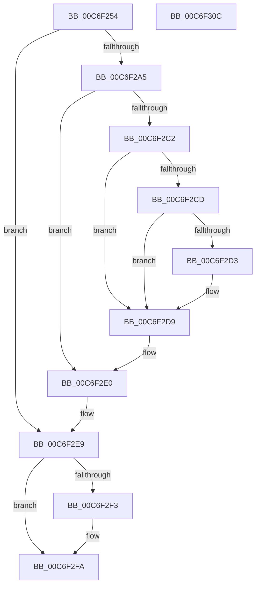

# CompositefsBootIsEnabled

- RVA: `0x00C6F254`–`0x00C6F30D` (길이 `185` bytes)
- VA: `0x0000000140C6F254`
- 실행 섹션: `INIT`
- PDB 이름 있음: `예`; PDB Function 태그: `아니요`
- unwind 정보 RVA: `0x000C3DF4`
- 디코드: `54`개 명령, `185/185` bytes 표시
- 미해석 바이트: `0` (있으면 어셈블리에 `.byte`로 보존)

> 이 문서는 커널 이미지의 기계어와 PDB 기호를 분석해 생성했습니다. 4번과 5번은 함수 원형과 자료형을 바이너리 사용 방식에서 추정한 C 해석이며 원본 소스 복구 결과는 아닙니다.

## 1. Dependencies

- 직접 호출 지점: **5**; 고유 호출 대상: **5**
- 직접 호출자로 확인된 함수: **2**
- RIP 상대 이미지 참조: **2**

### Outgoing calls
- `0x00C6F285` → [RtlInitUnicodeString](../../text/42/RtlInitUnicodeString_function_0042A780.md) (function, `0x0042A780`)
- `0x00C6F29A` → [IopOpenRegistryKeyEx](../../page/A5/IopOpenRegistryKeyEx_function_00A51B44.md) (function, `0x00A51B44`)
- `0x00C6F2B9` → [IopGetRegistryValue](../../page/99/IopGetRegistryValue_function_009990EC.md) (function, `0x009990EC`)
- `0x00C6F2DB` → [ExFreePoolWithTag](../../poolcode/B8/ExFreePoolWithTag_function_00B82870.md) (function, `0x00B82870`)
- `0x00C6F2F5` → [ObCloseHandle](../../page/8A/ObCloseHandle_function_008A1870.md) (function, `0x008A1870`)

### Direct callers
- [IopInitializeBootDrivers](../C2/IopInitializeBootDrivers_function_00C2E6F4.md) at `0x00C2EE8C`
- [CimfsInitialize](CimfsInitialize_function_00C6E64C.md) at `0x00C6E705`

### Static image references
- `0x00C6F269` → RVA `0x00C7EA60` (` ?? ::PBOPGDP::`string'`; read)
- `0x00C6F2B2` → RVA `0x00C7EAD0` (` ?? ::PBOPGDP::`string'`; read)

## 2. Other-region calls and transfers

- 다른 실행 섹션으로 향하는 call: **5**
  - `0x00C6F285` → [RtlInitUnicodeString](../../text/42/RtlInitUnicodeString_function_0042A780.md) (`INIT` → `.text`)
  - `0x00C6F29A` → [IopOpenRegistryKeyEx](../../page/A5/IopOpenRegistryKeyEx_function_00A51B44.md) (`INIT` → `PAGE`)
  - `0x00C6F2B9` → [IopGetRegistryValue](../../page/99/IopGetRegistryValue_function_009990EC.md) (`INIT` → `PAGE`)
  - `0x00C6F2DB` → [ExFreePoolWithTag](../../poolcode/B8/ExFreePoolWithTag_function_00B82870.md) (`INIT` → `POOLCODE`)
  - `0x00C6F2F5` → [ObCloseHandle](../../page/8A/ObCloseHandle_function_008A1870.md) (`INIT` → `PAGE`)
- 별도 외부 분기/꼬리 이동을 확인하지 못했습니다.

## 3. Assembly (complete function range)

```asm
00C6F254  48 8B C4                        mov rax, rsp
00C6F257  48 89 58 08                     mov qword ptr [rax + 8], rbx
00C6F25B  48 89 70 20                     mov qword ptr [rax + 0x20], rsi
00C6F25F  57                              push rdi
00C6F260  48 83 EC 30                     sub rsp, 0x30
00C6F264  48 83 60 18 00                  and qword ptr [rax + 0x18], 0
00C6F269  48 8D 15 F0 F7 00 00            lea rdx, [rip + 0xf7f0]
00C6F270  48 83 60 10 00                  and qword ptr [rax + 0x10], 0
00C6F275  48 8B F1                        mov rsi, rcx
00C6F278  0F 57 C0                        xorps xmm0, xmm0
00C6F27B  48 8D 48 E8                     lea rcx, [rax - 0x18]
00C6F27F  0F 11 40 E8                     movups xmmword ptr [rax - 0x18], xmm0
00C6F283  33 FF                           xor edi, edi
00C6F285  E8 F6 B4 7B FF                  call 0x14042a780
00C6F28A  44 8D 4F 01                     lea r9d, [rdi + 1]
00C6F28E  33 D2                           xor edx, edx
00C6F290  4C 8D 44 24 20                  lea r8, [rsp + 0x20]
00C6F295  48 8D 4C 24 48                  lea rcx, [rsp + 0x48]
00C6F29A  E8 A5 28 DE FF                  call 0x140a51b44
00C6F29F  8B D8                           mov ebx, eax
00C6F2A1  85 C0                           test eax, eax
00C6F2A3  78 44                           js 0x140c6f2e9
00C6F2A5  48 8B 4C 24 48                  mov rcx, qword ptr [rsp + 0x48]
00C6F2AA  4C 8D 4C 24 50                  lea r9, [rsp + 0x50]
00C6F2AF  45 33 C0                        xor r8d, r8d
00C6F2B2  48 8D 15 17 F8 00 00            lea rdx, [rip + 0xf817]
00C6F2B9  E8 2E 9E D2 FF                  call 0x1409990ec
00C6F2BE  85 C0                           test eax, eax
00C6F2C0  78 1E                           js 0x140c6f2e0
00C6F2C2  48 8B 4C 24 50                  mov rcx, qword ptr [rsp + 0x50]
00C6F2C7  83 79 04 04                     cmp dword ptr [rcx + 4], 4
00C6F2CB  75 0C                           jne 0x140c6f2d9
00C6F2CD  83 79 0C 04                     cmp dword ptr [rcx + 0xc], 4
00C6F2D1  75 06                           jne 0x140c6f2d9
00C6F2D3  8B 41 08                        mov eax, dword ptr [rcx + 8]
00C6F2D6  8B 3C 08                        mov edi, dword ptr [rax + rcx]
00C6F2D9  33 D2                           xor edx, edx
00C6F2DB  E8 90 35 F1 FF                  call 0x140b82870
00C6F2E0  33 DB                           xor ebx, ebx
00C6F2E2  85 FF                           test edi, edi
00C6F2E4  0F 95 C0                        setne al
00C6F2E7  88 06                           mov byte ptr [rsi], al
00C6F2E9  48 8B 4C 24 48                  mov rcx, qword ptr [rsp + 0x48]
00C6F2EE  48 85 C9                        test rcx, rcx
00C6F2F1  74 07                           je 0x140c6f2fa
00C6F2F3  33 D2                           xor edx, edx
00C6F2F5  E8 76 25 C3 FF                  call 0x1408a1870
00C6F2FA  48 8B 74 24 58                  mov rsi, qword ptr [rsp + 0x58]
00C6F2FF  8B C3                           mov eax, ebx
00C6F301  48 8B 5C 24 40                  mov rbx, qword ptr [rsp + 0x40]
00C6F306  48 83 C4 30                     add rsp, 0x30
00C6F30A  5F                              pop rdi
00C6F30B  C3                              ret
00C6F30C  CC                              int3
```

## 4. C-style interpretation (structured pseudocode)

```c
__int64 __fastcall CompositefsBootIsEnabled(__int64 a1)
{
    __int64 result;
    __int64 v_rbx;
    __int64 v_rdi;
    __int64 v_rsp;
    unsigned __int64 v_stack_m18;
    unsigned __int64 v_stack_p10;
    unsigned __int64 v_stack_p18;
    unsigned __int64 v_stack_p20;
    unsigned __int64 v_stack_p8;

    *(unsigned __int64 *)(v_rsp + 8) = v_rbx;
    *(unsigned __int64 *)(v_rsp + 32) = v_rsi;
    v_rsp = (v_rsp) - (48);
    *(unsigned __int64 *)(v_rsp - 24) = v_xmm0;
    v_rdi = 0;
    result = RtlInitUnicodeString(v_rsp - 24, v_rip + 63472, a3, a4);
    a2 = 0;
    result = IopOpenRegistryKeyEx(v_stack_p10, a2, v_stack_m18, v_rdi + 1);
    if (sign_flag) goto loc_00C6F2E9;
    a3 = 0;
    result = IopGetRegistryValue(v_stack_p10, v_rip + 63511, a3, v_stack_p18);
    if (sign_flag) goto loc_00C6F2E0;
    if ((*(unsigned int *)(v_stack_p18 + 4)) != 4) goto loc_00C6F2D9;
    if ((*(unsigned int *)(v_stack_p18 + 12)) == 4) {
        result = *(unsigned int *)(v_stack_p18 + 8);
        v_rdi = *(unsigned int *)(result + v_stack_p18 * 1);
    }
    a2 = 0;
    result = ExFreePoolWithTag(v_stack_p18, a2, a3, v_stack_p18);
loc_00C6F2E0:
    v_rbx = 0;
    result = ((unsigned int)(v_rdi) != 0) ? 1 : 0;
    *(unsigned __int8 *)(a1) = (unsigned __int8)(result);
loc_00C6F2E9:
    if (v_stack_p10 != 0) {
        a2 = 0;
        result = ObCloseHandle(v_stack_p10, a2, a3, v_stack_p18);
    }
    v_rsp = (v_rsp) + (48);
    return 0;
}
```

## 5. (Beta) C Style

```c
int64_t CompositefsBootIsEnabled(void *Arg1)
{
    uint8_t *arg1 = (uint8_t *)Arg1;

    int64_t result;
    int64_t local_rbx;
    int64_t local_rdi;
    int64_t local_rsp;
    uint64_t v_stack_m18;
    uint64_t v_stack_p10;
    uint64_t v_stack_p18;
    uint64_t v_stack_p20;
    uint64_t v_stack_p8;

    *(uint64_t *)(local_rsp + 0x8) = local_rbx;
    *(uint64_t *)(local_rsp + 0x20) = local_rsi;
    local_rsp = (local_rsp) - (48);
    *(uint64_t *)(local_rsp - 0x18) = v_xmm0;
    local_rdi = 0;
    result = RtlInitUnicodeString(local_rsp - 24, v_rip + 63472, a3, a4);
    a2 = 0;
    result = IopOpenRegistryKeyEx(v_stack_p10, a2, v_stack_m18, local_rdi + 1);
    if (sign_flag) goto loc_00C6F2E9;
    a3 = 0;
    result = IopGetRegistryValue(v_stack_p10, v_rip + 63511, a3, v_stack_p18);
    if (sign_flag) goto loc_00C6F2E0;
    if ((*(uint32_t *)(v_stack_p18 + 0x4)) != 4) goto loc_00C6F2D9;
    if ((*(uint32_t *)(v_stack_p18 + 0xC)) == 4) {
        result = *(uint32_t *)(v_stack_p18 + 0x8);
        local_rdi = *(uint32_t *)(result + v_stack_p18 * 1);
    }
    a2 = 0;
    result = ExFreePoolWithTag(v_stack_p18, a2, a3, v_stack_p18);
loc_00C6F2E0:
    local_rbx = 0;
    result = ((uint32_t)(local_rdi) != 0) ? 1 : 0;
    *(uint8_t *)(arg1) = (uint8_t)(result);
loc_00C6F2E9:
    if (v_stack_p10 != 0) {
        a2 = 0;
        result = ObCloseHandle(v_stack_p10, a2, a3, v_stack_p18);
    }
    local_rsp = (local_rsp) + (48);
    return 0;
}
```

### 관측된 메모리 오프셋

구조체 형식이 확인되지 않은 접근은 인자 기준의 오프셋으로만 기록했습니다.

| 기준 인자 | 오프셋 표현 | 폭 (bit) | 접근 |
|---|---:|---:|---|
| `Arg1` | `+ 0x0` | `8` | `W` |

## 6. Execution-region graph

[열기: 2D/3D 그래프와 함수 탐색 컨트롤 패널](../../../control-panel.html?section=init&rva=0x00C6F254&view=graph)

- 2D 그래프는 위에서 아래로 흐르고, 3D 그래프는 빈 공간을 드래그해 회전합니다. Shift+드래그는 이동, 휠은 확대·축소, 함수 노드 선택은 대상 보고서 이동입니다.

### Static fallback


