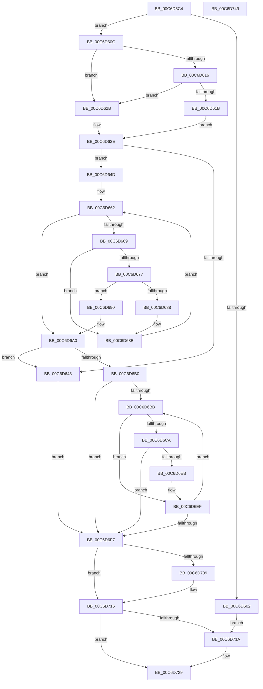

# IntPartCreate

- RVA: `0x00C6D5C4`–`0x00C6D74A` (길이 `390` bytes)
- VA: `0x0000000140C6D5C4`
- 실행 섹션: `INIT`
- PDB 이름 있음: `예`; PDB Function 태그: `아니요`
- unwind 정보 RVA: `0x000DA78C`
- 디코드: `120`개 명령, `390/390` bytes 표시
- 미해석 바이트: `0` (있으면 어셈블리에 `.byte`로 보존)

> 이 문서는 커널 이미지의 기계어와 PDB 기호를 분석해 생성했습니다. 4번과 5번은 함수 원형과 자료형을 바이너리 사용 방식에서 추정한 C 해석이며 원본 소스 복구 결과는 아닙니다.

## 1. Dependencies

- 직접 호출 지점: **9**; 고유 호출 대상: **7**
- 직접 호출자로 확인된 함수: **1**
- RIP 상대 이미지 참조: **1**

### Outgoing calls
- `0x00C6D5F5` → [IntpAllocateProcessorContext](IntpAllocateProcessorContext_function_00C6D844.md) (function, `0x00C6D844`)
- `0x00C6D636` → [IntpInitClassContext](IntpInitClassContext_function_00C6D3AC.md) (function, `0x00C6D3AC`)
- `0x00C6D657` → [IntpMergeClassContexts](IntpMergeClassContexts_function_00C6D4AC.md) (function, `0x00C6D4AC`)
- `0x00C6D69A` → [IntPartCriticalFailure](../../text/5C/IntPartCriticalFailure_function_005C0818.md) (function, `0x005C0818`)
- `0x00C6D6A3` → [IntpAllocateGroupContext](../../text/6A/IntpAllocateGroupContext_function_006A2D04.md) (function, `0x006A2D04`)
- `0x00C6D6E0` → [IntpAssignProcessorsToPartitions](IntpAssignProcessorsToPartitions_function_00C6D750.md) (function, `0x00C6D750`)
- `0x00C6D6FF` → [ExFreePoolWithTag](../../poolcode/B8/ExFreePoolWithTag_function_00B82870.md) (function, `0x00B82870`)
- `0x00C6D711` → [ExFreePoolWithTag](../../poolcode/B8/ExFreePoolWithTag_function_00B82870.md) (function, `0x00B82870`)
- `0x00C6D722` → [ExFreePoolWithTag](../../poolcode/B8/ExFreePoolWithTag_function_00B82870.md) (function, `0x00B82870`)

### Direct callers
- [KiIntSteerInit](../C3/KiIntSteerInit_function_00C3A1CC.md) at `0x00C3A36E`

### Static image references
- `0x00C6D729` → RVA `0x00F10E68` (`.data`; write)

## 2. Other-region calls and transfers

- 다른 실행 섹션으로 향하는 call: **5**
  - `0x00C6D69A` → [IntPartCriticalFailure](../../text/5C/IntPartCriticalFailure_function_005C0818.md) (`INIT` → `.text`)
  - `0x00C6D6A3` → [IntpAllocateGroupContext](../../text/6A/IntpAllocateGroupContext_function_006A2D04.md) (`INIT` → `.text`)
  - `0x00C6D6FF` → [ExFreePoolWithTag](../../poolcode/B8/ExFreePoolWithTag_function_00B82870.md) (`INIT` → `POOLCODE`)
  - `0x00C6D711` → [ExFreePoolWithTag](../../poolcode/B8/ExFreePoolWithTag_function_00B82870.md) (`INIT` → `POOLCODE`)
  - `0x00C6D722` → [ExFreePoolWithTag](../../poolcode/B8/ExFreePoolWithTag_function_00B82870.md) (`INIT` → `POOLCODE`)
- 별도 외부 분기/꼬리 이동을 확인하지 못했습니다.

## 3. Assembly (complete function range)

```asm
00C6D5C4  48 8B C4                        mov rax, rsp
00C6D5C7  48 89 58 10                     mov qword ptr [rax + 0x10], rbx
00C6D5CB  48 89 68 20                     mov qword ptr [rax + 0x20], rbp
00C6D5CF  4C 89 40 18                     mov qword ptr [rax + 0x18], r8
00C6D5D3  66 89 48 08                     mov word ptr [rax + 8], cx
00C6D5D7  56                              push rsi
00C6D5D8  57                              push rdi
00C6D5D9  41 54                           push r12
00C6D5DB  41 55                           push r13
00C6D5DD  41 57                           push r15
00C6D5DF  48 83 EC 20                     sub rsp, 0x20
00C6D5E3  83 60 18 00                     and dword ptr [rax + 0x18], 0
00C6D5E7  8B FA                           mov edi, edx
00C6D5E9  48 8D 50 08                     lea rdx, [rax + 8]
00C6D5ED  C6 40 08 00                     mov byte ptr [rax + 8], 0
00C6D5F1  33 ED                           xor ebp, ebp
00C6D5F3  33 DB                           xor ebx, ebx
00C6D5F5  E8 4A 02 00 00                  call 0x140c6d844
00C6D5FA  4C 8B E0                        mov r12, rax
00C6D5FD  48 85 C0                        test rax, rax
00C6D600  75 0A                           jne 0x140c6d60c
00C6D602  BB 9A 00 00 C0                  mov ebx, 0xc000009a
00C6D607  E9 0E 01 00 00                  jmp 0x140c6d71a
00C6D60C  8A 54 24 50                     mov dl, byte ptr [rsp + 0x50]
00C6D610  40 F6 C7 01                     test dil, 1
00C6D614  75 15                           jne 0x140c6d62b
00C6D616  80 FA 10                        cmp dl, 0x10
00C6D619  76 10                           jbe 0x140c6d62b
00C6D61B  BE 04 00 00 00                  mov esi, 4
00C6D620  80 FA 20                        cmp dl, 0x20
00C6D623  8D 46 FE                        lea eax, [rsi - 2]
00C6D626  0F 46 F0                        cmovbe esi, eax
00C6D629  EB 03                           jmp 0x140c6d62e
00C6D62B  40 B6 01                        mov sil, 1
00C6D62E  4C 8D 44 24 60                  lea r8, [rsp + 0x60]
00C6D633  49 8B CC                        mov rcx, r12
00C6D636  E8 71 FD FF FF                  call 0x140c6d3ac
00C6D63B  48 8B F8                        mov rdi, rax
00C6D63E  48 85 C0                        test rax, rax
00C6D641  75 0A                           jne 0x140c6d64d
00C6D643  BB 9A 00 00 C0                  mov ebx, 0xc000009a
00C6D648  E9 AA 00 00 00                  jmp 0x140c6d6f7
00C6D64D  8B 54 24 60                     mov edx, dword ptr [rsp + 0x60]
00C6D651  44 8A C6                        mov r8b, sil
00C6D654  48 8B CF                        mov rcx, rdi
00C6D657  E8 50 FE FF FF                  call 0x140c6d4ac
00C6D65C  45 32 D2                        xor r10b, r10b
00C6D65F  45 33 C0                        xor r8d, r8d
00C6D662  44 3B 44 24 60                  cmp r8d, dword ptr [rsp + 0x60]
00C6D667  73 37                           jae 0x140c6d6a0
00C6D669  4F 8D 0C 40                     lea r9, [r8 + r8*2]
00C6D66D  42 0F B6 44 CF 01               movzx eax, byte ptr [rdi + r9*8 + 1]
00C6D673  84 C0                           test al, al
00C6D675  74 14                           je 0x140c6d68b
00C6D677  33 D2                           xor edx, edx
00C6D679  40 0F B6 CE                     movzx ecx, sil
00C6D67D  F7 F1                           div ecx
00C6D67F  42 88 44 CF 10                  mov byte ptr [rdi + r9*8 + 0x10], al
00C6D684  84 C0                           test al, al
00C6D686  74 08                           je 0x140c6d690
00C6D688  44 02 D0                        add r10b, al
00C6D68B  41 FF C0                        inc r8d
00C6D68E  EB D2                           jmp 0x140c6d662
00C6D690  42 0F B6 14 CF                  movzx edx, byte ptr [rdi + r9*8]
00C6D695  B9 02 10 00 00                  mov ecx, 0x1002
00C6D69A  E8 79 31 95 FF                  call 0x1405c0818
00C6D69F  CC                              int3
00C6D6A0  41 8A D2                        mov dl, r10b
00C6D6A3  E8 5C 56 A3 FF                  call 0x1406a2d04
00C6D6A8  48 8B E8                        mov rbp, rax
00C6D6AB  48 85 C0                        test rax, rax
00C6D6AE  74 93                           je 0x140c6d643
00C6D6B0  45 32 FF                        xor r15b, r15b
00C6D6B3  33 F6                           xor esi, esi
00C6D6B5  39 5C 24 60                     cmp dword ptr [rsp + 0x60], ebx
00C6D6B9  76 3C                           jbe 0x140c6d6f7
00C6D6BB  48 8D 0C 76                     lea rcx, [rsi + rsi*2]
00C6D6BF  4C 8D 2C CF                     lea r13, [rdi + rcx*8]
00C6D6C3  41 80 7D 01 00                  cmp byte ptr [r13 + 1], 0
00C6D6C8  74 25                           je 0x140c6d6ef
00C6D6CA  45 8A 45 10                     mov r8b, byte ptr [r13 + 0x10]
00C6D6CE  49 8B CD                        mov rcx, r13
00C6D6D1  41 0F B6 D7                     movzx edx, r15b
00C6D6D5  48 C1 E2 04                     shl rdx, 4
00C6D6D9  48 83 C2 08                     add rdx, 8
00C6D6DD  48 03 D5                        add rdx, rbp
00C6D6E0  E8 6B 00 00 00                  call 0x140c6d750
00C6D6E5  8B D8                           mov ebx, eax
00C6D6E7  85 C0                           test eax, eax
00C6D6E9  78 0C                           js 0x140c6d6f7
00C6D6EB  45 02 7D 10                     add r15b, byte ptr [r13 + 0x10]
00C6D6EF  FF C6                           inc esi
00C6D6F1  3B 74 24 60                     cmp esi, dword ptr [rsp + 0x60]
00C6D6F5  72 C4                           jb 0x140c6d6bb
00C6D6F7  BA 4B 65 49 50                  mov edx, 0x5049654b
00C6D6FC  49 8B CC                        mov rcx, r12
00C6D6FF  E8 6C 51 F1 FF                  call 0x140b82870
00C6D704  48 85 FF                        test rdi, rdi
00C6D707  74 0D                           je 0x140c6d716
00C6D709  BA 4B 65 49 50                  mov edx, 0x5049654b
00C6D70E  48 8B CF                        mov rcx, rdi
00C6D711  E8 5A 51 F1 FF                  call 0x140b82870
00C6D716  85 DB                           test ebx, ebx
00C6D718  79 0F                           jns 0x140c6d729
00C6D71A  BA 4B 65 49 50                  mov edx, 0x5049654b
00C6D71F  48 8B CD                        mov rcx, rbp
00C6D722  E8 49 51 F1 FF                  call 0x140b82870
00C6D727  33 ED                           xor ebp, ebp
00C6D729  48 89 2D 38 37 2A 00            mov qword ptr [rip + 0x2a3738], rbp
00C6D730  8B C3                           mov eax, ebx
00C6D732  48 8B 5C 24 58                  mov rbx, qword ptr [rsp + 0x58]
00C6D737  48 8B 6C 24 68                  mov rbp, qword ptr [rsp + 0x68]
00C6D73C  48 83 C4 20                     add rsp, 0x20
00C6D740  41 5F                           pop r15
00C6D742  41 5D                           pop r13
00C6D744  41 5C                           pop r12
00C6D746  5F                              pop rdi
00C6D747  5E                              pop rsi
00C6D748  C3                              ret
00C6D749  CC                              int3
```

## 4. C-style interpretation (structured pseudocode)

```c
__int64 __fastcall IntPartCreate(unsigned __int16 a1, int a2, __int64 a3)
{
    __int64 result;
    __int64 v_r10;
    __int64 v_r15;
    __int64 v_rbp;
    __int64 v_rbx;
    __int64 v_rsi;
    __int64 v_rsp;
    unsigned __int64 v_stack_p10;
    unsigned __int64 v_stack_p18;
    unsigned __int64 v_stack_p20;
    unsigned __int8 v_stack_p8;

    *(unsigned __int64 *)(v_rsp + 16) = v_rbx;
    *(unsigned __int64 *)(v_rsp + 32) = v_rbp;
    *(unsigned __int64 *)(v_rsp + 24) = a3;
    *(unsigned __int16 *)(v_rsp + 8) = a1;
    v_rsp = (v_rsp) - (32);
    *(unsigned __int8 *)(v_rsp + 8) = 0;
    v_rbp = 0;
    v_rbx = 0;
    result = IntpAllocateProcessorContext(a1, v_rsp + 8, a3, a4);
    if (result != 0) goto loc_00C6D60C;
    goto loc_00C6D71A;
loc_00C6D60C:
    if ((((unsigned __int8)((unsigned int)(a2))) & (1)) != 0) goto loc_00C6D62B;
    if (((unsigned __int8)(v_stack_p8)) <= 16) goto loc_00C6D62B;
    v_rsi = 4;
    if (((unsigned __int8)(v_stack_p8)) <= 32) { v_rsi = (unsigned int)(4 - 2); }
    goto loc_00C6D62E;
loc_00C6D62B:
loc_00C6D62E:
    result = IntpInitClassContext(result, v_stack_p8, v_stack_p18, a4);
    if (result != 0) goto loc_00C6D64D;
loc_00C6D643:
    goto loc_00C6D6F7;
loc_00C6D64D:
    result = IntpMergeClassContexts(result, (unsigned int)(v_stack_p18), 1, a4);
    v_r10 = 0;
    a3 = 0;
loc_00C6D662:
    if (0 >= v_stack_p18) goto loc_00C6D6A0;
    if ((unsigned __int8)(*(unsigned __int8 *)(result + a3 + a3 * 2 * 8 + 1)) == 0) goto loc_00C6D68B;
    a2 = 0;
    *(unsigned __int8 *)(result + a3 + a3 * 2 * 8 + 16) = (unsigned __int8)(*(unsigned __int8 *)(result + a3 + a3 * 2 * 8 + 1));
    if ((unsigned __int8)(*(unsigned __int8 *)(result + a3 + a3 * 2 * 8 + 1)) == 0) goto loc_00C6D690;
    v_r10 = (unsigned __int8)((v_r10) + ((unsigned __int8)(*(unsigned __int8 *)(result + a3 + a3 * 2 * 8 + 1))));
loc_00C6D68B:
    a3 = (unsigned int)((a3) + 1);
    goto loc_00C6D662;
loc_00C6D690:
    result = IntPartCriticalFailure((unsigned int)(0x1002ULL), *(unsigned __int8 *)(result + a3 + a3 * 2 * 8), a3, a3 + a3 * 2);
loc_00C6D6A0:
    result = IntpAllocateGroupContext((unsigned int)(0x1002ULL), (unsigned __int8)(v_r10), a3, a3 + a3 * 2);
    if (result == 0) goto loc_00C6D643;
    v_r15 = 0;
    v_rsi = 0;
    if (v_stack_p18 <= ((unsigned int)((unsigned int)(0xC000009AULL)))) goto loc_00C6D6F7;
loc_00C6D6BB:
    if ((*(unsigned __int8 *)(result + v_rsi + v_rsi * 2 * 8 + 1)) == 0) goto loc_00C6D6EF;
    a2 = (0) << (4);
    a2 = (a2) + (8);
    a2 = (a2) + (result);
    result = IntpAssignProcessorsToPartitions(result + v_rsi + v_rsi * 2 * 8, a2, *(unsigned __int8 *)(result + v_rsi + v_rsi * 2 * 8 + 16), a3 + a3 * 2);
    if (sign_flag) goto loc_00C6D6F7;
    v_r15 = (unsigned __int8)((v_r15) + (*(unsigned __int8 *)(result + v_rsi + v_rsi * 2 * 8 + 16)));
loc_00C6D6EF:
    v_rsi = (unsigned int)((v_rsi) + 1);
    if (((unsigned int)(v_rsi)) < v_stack_p18) goto loc_00C6D6BB;
loc_00C6D6F7:
    result = ExFreePoolWithTag(result, (unsigned int)(0x5049654BULL), *(unsigned __int8 *)(result + v_rsi + v_rsi * 2 * 8 + 16), a3 + a3 * 2);
    if (result != 0) {
        a2 = 0x5049654BULL;
        a1 = result;
        result = ExFreePoolWithTag(a1, a2, *(unsigned __int8 *)(result + v_rsi + v_rsi * 2 * 8 + 16), a3 + a3 * 2);
    }
    v_rbp = result;
    if (sign_flag) {
        a2 = 0x5049654BULL;
        a1 = result;
        result = ExFreePoolWithTag(a1, a2, *(unsigned __int8 *)(result + v_rsi + v_rsi * 2 * 8 + 16), a3 + a3 * 2);
        v_rbp = 0;
    }
    *(unsigned __int64 *)(v_rip + 2766648) = 0;
    v_rsp = (v_rsp) + (32);
    return (unsigned int)((unsigned int)((unsigned int)((unsigned int)(result))));
}
```

## 5. (Beta) C Style

```c
int64_t IntPartCreate(uint16_t Arg1, int32_t Arg2, int64_t Arg3)
{
    int64_t result;
    int64_t local_r10;
    int64_t local_r15;
    int64_t local_rbp;
    int64_t local_rbx;
    int64_t local_rsi;
    int64_t local_rsp;
    uint64_t v_stack_p10;
    uint64_t v_stack_p18;
    uint64_t v_stack_p20;
    uint8_t v_stack_p8;

    *(uint64_t *)(local_rsp + 0x10) = local_rbx;
    *(uint64_t *)(local_rsp + 0x20) = local_rbp;
    *(uint64_t *)(local_rsp + 0x18) = Arg3;
    *(uint16_t *)(local_rsp + 0x8) = Arg1;
    local_rsp = (local_rsp) - (32);
    *(uint8_t *)(local_rsp + 0x8) = 0;
    local_rbp = 0;
    local_rbx = 0;
    result = IntpAllocateProcessorContext(Arg1, local_rsp + 8, Arg3, a4);
    if (result != 0) goto loc_00C6D60C;
    goto loc_00C6D71A;
loc_00C6D60C:
    if ((((uint8_t)((uint32_t)(Arg2))) & (1)) != 0) goto loc_00C6D62B;
    if (((uint8_t)(v_stack_p8)) <= 16) goto loc_00C6D62B;
    local_rsi = 4;
    if (((uint8_t)(v_stack_p8)) <= 32) { local_rsi = (uint32_t)(4 - 2); }
    goto loc_00C6D62E;
loc_00C6D62B:
loc_00C6D62E:
    result = IntpInitClassContext(result, v_stack_p8, v_stack_p18, a4);
    if (result != 0) goto loc_00C6D64D;
loc_00C6D643:
    goto loc_00C6D6F7;
loc_00C6D64D:
    result = IntpMergeClassContexts(result, (uint32_t)(v_stack_p18), 1, a4);
    local_r10 = 0;
    Arg3 = 0;
loc_00C6D662:
    if (0 >= v_stack_p18) goto loc_00C6D6A0;
    if ((uint8_t)(*(uint8_t *)(result + Arg3 + Arg3 * 2 * 8 + 0x1)) == 0) goto loc_00C6D68B;
    Arg2 = 0;
    *(uint8_t *)(result + Arg3 + Arg3 * 2 * 8 + 0x10) = (uint8_t)(*(uint8_t *)(result + Arg3 + Arg3 * 2 * 8 + 0x1));
    if ((uint8_t)(*(uint8_t *)(result + Arg3 + Arg3 * 2 * 8 + 0x1)) == 0) goto loc_00C6D690;
    local_r10 = (uint8_t)((local_r10) + ((uint8_t)(*(uint8_t *)(result + Arg3 + Arg3 * 2 * 8 + 0x1))));
loc_00C6D68B:
    Arg3 = (uint32_t)((Arg3) + 1);
    goto loc_00C6D662;
loc_00C6D690:
    result = IntPartCriticalFailure((uint32_t)(0x1002ULL), *(uint8_t *)(result + Arg3 + Arg3 * 2 * 8), Arg3, Arg3 + Arg3 * 2);
loc_00C6D6A0:
    result = IntpAllocateGroupContext((uint32_t)(0x1002ULL), (uint8_t)(local_r10), Arg3, Arg3 + Arg3 * 2);
    if (result == 0) goto loc_00C6D643;
    local_r15 = 0;
    local_rsi = 0;
    if (v_stack_p18 <= ((uint32_t)((uint32_t)(0xC000009AULL)))) goto loc_00C6D6F7;
loc_00C6D6BB:
    if ((*(uint8_t *)(result + local_rsi + local_rsi * 2 * 8 + 0x1)) == 0) goto loc_00C6D6EF;
    Arg2 = (0) << (4);
    Arg2 = (Arg2) + (8);
    Arg2 = (Arg2) + (result);
    result = IntpAssignProcessorsToPartitions(result + local_rsi + local_rsi * 2 * 8, Arg2, *(uint8_t *)(result + local_rsi + local_rsi * 2 * 8 + 0x10), Arg3 + Arg3 * 2);
    if (sign_flag) goto loc_00C6D6F7;
    local_r15 = (uint8_t)((local_r15) + (*(uint8_t *)(result + local_rsi + local_rsi * 2 * 8 + 0x10)));
loc_00C6D6EF:
    local_rsi = (uint32_t)((local_rsi) + 1);
    if (((uint32_t)(local_rsi)) < v_stack_p18) goto loc_00C6D6BB;
loc_00C6D6F7:
    result = ExFreePoolWithTag(result, (uint32_t)(0x5049654BULL), *(uint8_t *)(result + local_rsi + local_rsi * 2 * 8 + 0x10), Arg3 + Arg3 * 2);
    if (result != 0) {
        Arg2 = 0x5049654BULL;
        Arg1 = result;
        result = ExFreePoolWithTag(Arg1, Arg2, *(uint8_t *)(result + local_rsi + local_rsi * 2 * 8 + 0x10), Arg3 + Arg3 * 2);
    }
    local_rbp = result;
    if (sign_flag) {
        Arg2 = 0x5049654BULL;
        Arg1 = result;
        result = ExFreePoolWithTag(Arg1, Arg2, *(uint8_t *)(result + local_rsi + local_rsi * 2 * 8 + 0x10), Arg3 + Arg3 * 2);
        local_rbp = 0;
    }
    *(uint64_t *)(v_rip + 0x2A3738) = 0;
    local_rsp = (local_rsp) + (32);
    return (uint32_t)((uint32_t)((uint32_t)((uint32_t)(result))));
}
```

## 6. Execution-region graph

[열기: 2D/3D 그래프와 함수 탐색 컨트롤 패널](../../../control-panel.html?section=init&rva=0x00C6D5C4&view=graph)

- 2D 그래프는 위에서 아래로 흐르고, 3D 그래프는 빈 공간을 드래그해 회전합니다. Shift+드래그는 이동, 휠은 확대·축소, 함수 노드 선택은 대상 보고서 이동입니다.

### Static fallback


