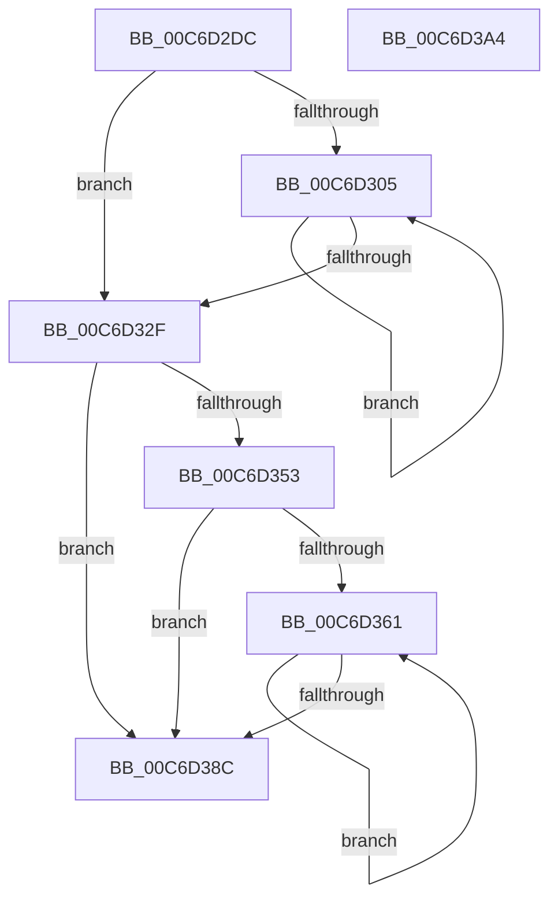

# IntPartGetClassAffinityGroup

- RVA: `0x00C6D2DC`–`0x00C6D3A5` (길이 `201` bytes)
- VA: `0x0000000140C6D2DC`
- 실행 섹션: `INIT`
- PDB 이름 있음: `예`; PDB Function 태그: `아니요`
- unwind 정보 RVA: `0x000C55E8`
- 디코드: `59`개 명령, `201/201` bytes 표시
- 미해석 바이트: `0` (있으면 어셈블리에 `.byte`로 보존)

> 이 문서는 커널 이미지의 기계어와 PDB 기호를 분석해 생성했습니다. 4번과 5번은 함수 원형과 자료형을 바이너리 사용 방식에서 추정한 C 해석이며 원본 소스 복구 결과는 아닙니다.

## 1. Dependencies

- 직접 호출 지점: **3**; 고유 호출 대상: **2**
- 직접 호출자로 확인된 함수: **1**
- RIP 상대 이미지 참조: **0**

### Outgoing calls
- `0x00C6D30F` → [IntPartGetProcessorEfficiencyClass](../../text/5C/IntPartGetProcessorEfficiencyClass_function_005C0840.md) (function, `0x005C0840`)
- `0x00C6D346` → [ExAllocatePool2](../../poolcode/B8/ExAllocatePool2_function_00B820F0.md) (function, `0x00B820F0`)
- `0x00C6D36A` → [IntPartGetProcessorEfficiencyClass](../../text/5C/IntPartGetProcessorEfficiencyClass_function_005C0840.md) (function, `0x005C0840`)

### Direct callers
- [KiIntSteerInit](../C3/KiIntSteerInit_function_00C3A1CC.md) at `0x00C3A348`

### Static image references
- 디코드된 RIP-relative 메모리 참조가 없습니다.

## 2. Other-region calls and transfers

- 다른 실행 섹션으로 향하는 call: **3**
  - `0x00C6D30F` → [IntPartGetProcessorEfficiencyClass](../../text/5C/IntPartGetProcessorEfficiencyClass_function_005C0840.md) (`INIT` → `.text`)
  - `0x00C6D346` → [ExAllocatePool2](../../poolcode/B8/ExAllocatePool2_function_00B820F0.md) (`INIT` → `POOLCODE`)
  - `0x00C6D36A` → [IntPartGetProcessorEfficiencyClass](../../text/5C/IntPartGetProcessorEfficiencyClass_function_005C0840.md) (`INIT` → `.text`)
- 별도 외부 분기/꼬리 이동을 확인하지 못했습니다.

## 3. Assembly (complete function range)

```asm
00C6D2DC  48 8B C4                        mov rax, rsp
00C6D2DF  48 89 58 10                     mov qword ptr [rax + 0x10], rbx
00C6D2E3  48 89 68 18                     mov qword ptr [rax + 0x18], rbp
00C6D2E7  48 89 70 20                     mov qword ptr [rax + 0x20], rsi
00C6D2EB  66 89 48 08                     mov word ptr [rax + 8], cx
00C6D2EF  57                              push rdi
00C6D2F0  48 83 EC 20                     sub rsp, 0x20
00C6D2F4  33 DB                           xor ebx, ebx
00C6D2F6  8B EA                           mov ebp, edx
00C6D2F8  89 58 08                        mov dword ptr [rax + 8], ebx
00C6D2FB  40 8A F3                        mov sil, bl
00C6D2FE  40 8A FB                        mov dil, bl
00C6D301  85 D2                           test edx, edx
00C6D303  74 2A                           je 0x140c6d32f
00C6D305  48 8D 4C 24 30                  lea rcx, [rsp + 0x30]
00C6D30A  40 88 7C 24 32                  mov byte ptr [rsp + 0x32], dil
00C6D30F  E8 2C 35 95 FF                  call 0x1405c0840
00C6D314  40 3A F0                        cmp sil, al
00C6D317  40 0F B6 D6                     movzx edx, sil
00C6D31B  0F B6 C8                        movzx ecx, al
00C6D31E  0F 42 D1                        cmovb edx, ecx
00C6D321  40 FE C7                        inc dil
00C6D324  40 0F B6 C7                     movzx eax, dil
00C6D328  40 8A F2                        mov sil, dl
00C6D32B  3B C5                           cmp eax, ebp
00C6D32D  72 D6                           jb 0x140c6d305
00C6D32F  40 0F B6 D6                     movzx edx, sil
00C6D333  B9 40 00 00 00                  mov ecx, 0x40
00C6D338  41 B8 4B 65 49 50               mov r8d, 0x5049654b
00C6D33E  48 8D 14 D5 10 00 00 00         lea rdx, [rdx*8 + 0x10]
00C6D346  E8 A5 4D F1 FF                  call 0x140b820f0
00C6D34B  48 8B F8                        mov rdi, rax
00C6D34E  48 85 C0                        test rax, rax
00C6D351  74 39                           je 0x140c6d38c
00C6D353  40 FE C6                        inc sil
00C6D356  66 89 58 02                     mov word ptr [rax + 2], bx
00C6D35A  40 88 30                        mov byte ptr [rax], sil
00C6D35D  85 ED                           test ebp, ebp
00C6D35F  74 2B                           je 0x140c6d38c
00C6D361  48 8D 4C 24 30                  lea rcx, [rsp + 0x30]
00C6D366  88 5C 24 32                     mov byte ptr [rsp + 0x32], bl
00C6D36A  E8 D1 34 95 FF                  call 0x1405c0840
00C6D36F  0F B6 D0                        movzx edx, al
00C6D372  0F B6 C3                        movzx eax, bl
00C6D375  FE C3                           inc bl
00C6D377  48 8B 4C D7 08                  mov rcx, qword ptr [rdi + rdx*8 + 8]
00C6D37C  48 0F AB C1                     bts rcx, rax
00C6D380  0F B6 C3                        movzx eax, bl
00C6D383  48 89 4C D7 08                  mov qword ptr [rdi + rdx*8 + 8], rcx
00C6D388  3B C5                           cmp eax, ebp
00C6D38A  72 D5                           jb 0x140c6d361
00C6D38C  48 8B 5C 24 38                  mov rbx, qword ptr [rsp + 0x38]
00C6D391  48 8B C7                        mov rax, rdi
00C6D394  48 8B 6C 24 40                  mov rbp, qword ptr [rsp + 0x40]
00C6D399  48 8B 74 24 48                  mov rsi, qword ptr [rsp + 0x48]
00C6D39E  48 83 C4 20                     add rsp, 0x20
00C6D3A2  5F                              pop rdi
00C6D3A3  C3                              ret
00C6D3A4  CC                              int3
```

## 4. C-style interpretation (structured pseudocode)

```c
__int64 __fastcall IntPartGetClassAffinityGroup(unsigned __int16 a1, int a2)
{
    __int64 result;
    __int64 v_rbx;
    __int64 v_rdi;
    __int64 v_rsi;
    __int64 v_rsp;
    unsigned __int64 v_stack_p10;
    unsigned __int64 v_stack_p18;
    unsigned __int64 v_stack_p20;
    unsigned __int64 v_stack_p8;
    unsigned __int8 v_stack_pA;

    *(unsigned __int64 *)(v_rsp + 16) = v_rbx;
    *(unsigned __int64 *)(v_rsp + 24) = v_rbp;
    *(unsigned __int64 *)(v_rsp + 32) = v_rsi;
    *(unsigned __int16 *)(v_rsp + 8) = a1;
    v_rsp = (v_rsp) - (32);
    v_rbx = 0;
    *(unsigned int *)(v_rsp + 8) = 0;
    if (a2 == 0) goto loc_00C6D32F;
loc_00C6D305:
    v_stack_pA = 0;
    result = IntPartGetProcessorEfficiencyClass(v_stack_p8, a2, a3, a4);
    a2 = 0;
    if (0 < ((unsigned __int8)(result))) { a2 = (unsigned int)((unsigned __int8)(result)); }
    v_rdi = (unsigned __int8)((0) + 1);
    if (((unsigned int)((unsigned __int8)(v_rdi))) < ((unsigned int)((unsigned int)(a2)))) goto loc_00C6D305;
loc_00C6D32F:
    result = ExAllocatePool2(64, (unsigned __int8)((unsigned __int8)(a2)) * 8 + 16, (unsigned int)(0x5049654BULL), a4);
    if (result == 0) goto loc_00C6D38C;
    v_rsi = (unsigned __int8)(((unsigned __int8)(a2)) + 1);
    *(unsigned __int16 *)(result + 2) = 0;
    *(unsigned __int8 *)(result) = (unsigned __int8)(v_rsi);
    if ((unsigned int)((unsigned int)(a2)) == 0) goto loc_00C6D38C;
loc_00C6D361:
    v_stack_pA = 0;
    result = IntPartGetProcessorEfficiencyClass(v_stack_p8, (unsigned __int8)((unsigned __int8)(a2)) * 8 + 16, (unsigned int)(0x5049654BULL), a4);
    v_rbx = (unsigned __int8)((v_rbx) + 1);
    *(unsigned __int64 *)(result + (unsigned __int8)(result) * 8 + 8) = *(unsigned __int64 *)(result + (unsigned __int8)(result) * 8 + 8);
    if (((unsigned int)((unsigned __int8)(v_rbx))) < ((unsigned int)((unsigned int)(a2)))) goto loc_00C6D361;
loc_00C6D38C:
    v_rsp = (v_rsp) + (32);
    return result;
}
```

## 5. (Beta) C Style

```c
int64_t IntPartGetClassAffinityGroup(uint16_t Arg1, int32_t Arg2)
{
    int64_t result;
    int64_t local_rbx;
    int64_t local_rdi;
    int64_t local_rsi;
    int64_t local_rsp;
    uint64_t v_stack_p10;
    uint64_t v_stack_p18;
    uint64_t v_stack_p20;
    uint64_t v_stack_p8;
    uint8_t v_stack_pA;

    *(uint64_t *)(local_rsp + 0x10) = local_rbx;
    *(uint64_t *)(local_rsp + 0x18) = local_rbp;
    *(uint64_t *)(local_rsp + 0x20) = local_rsi;
    *(uint16_t *)(local_rsp + 0x8) = Arg1;
    local_rsp = (local_rsp) - (32);
    local_rbx = 0;
    *(uint32_t *)(local_rsp + 0x8) = 0;
    if (Arg2 == 0) goto loc_00C6D32F;
loc_00C6D305:
    v_stack_pA = 0;
    result = IntPartGetProcessorEfficiencyClass(v_stack_p8, Arg2, a3, a4);
    Arg2 = 0;
    if (0 < ((uint8_t)(result))) { Arg2 = (uint32_t)((uint8_t)(result)); }
    local_rdi = (uint8_t)((0) + 1);
    if (((uint32_t)((uint8_t)(local_rdi))) < ((uint32_t)((uint32_t)(Arg2)))) goto loc_00C6D305;
loc_00C6D32F:
    result = ExAllocatePool2(64, (uint8_t)((uint8_t)(Arg2)) * 8 + 16, (uint32_t)(0x5049654BULL), a4);
    if (result == 0) goto loc_00C6D38C;
    local_rsi = (uint8_t)(((uint8_t)(Arg2)) + 1);
    *(uint16_t *)(result + 0x2) = 0;
    *(uint8_t *)(result) = (uint8_t)(local_rsi);
    if ((uint32_t)((uint32_t)(Arg2)) == 0) goto loc_00C6D38C;
loc_00C6D361:
    v_stack_pA = 0;
    result = IntPartGetProcessorEfficiencyClass(v_stack_p8, (uint8_t)((uint8_t)(Arg2)) * 8 + 16, (uint32_t)(0x5049654BULL), a4);
    local_rbx = (uint8_t)((local_rbx) + 1);
    *(uint64_t *)(result + (uint8_t)(result) * 8 + 0x8) = *(uint64_t *)(result + (uint8_t)(result) * 8 + 0x8);
    if (((uint32_t)((uint8_t)(local_rbx))) < ((uint32_t)((uint32_t)(Arg2)))) goto loc_00C6D361;
loc_00C6D38C:
    local_rsp = (local_rsp) + (32);
    return result;
}
```

## 6. Execution-region graph

[열기: 2D/3D 그래프와 함수 탐색 컨트롤 패널](../../../control-panel.html?section=init&rva=0x00C6D2DC&view=graph)

- 2D 그래프는 위에서 아래로 흐르고, 3D 그래프는 빈 공간을 드래그해 회전합니다. Shift+드래그는 이동, 휠은 확대·축소, 함수 노드 선택은 대상 보고서 이동입니다.

### Static fallback


