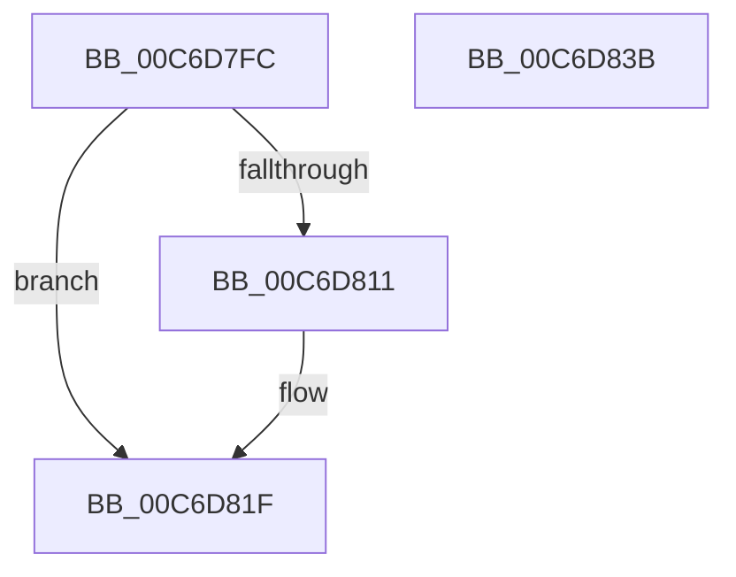

# IntpAddNextProcessorToPartition

- RVA: `0x00C6D7FC`–`0x00C6D83C` (길이 `64` bytes)
- VA: `0x0000000140C6D7FC`
- 실행 섹션: `INIT`
- PDB 이름 있음: `예`; PDB Function 태그: `아니요`
- unwind 정보 RVA: `0x0005C788`
- 디코드: `20`개 명령, `64/64` bytes 표시
- 미해석 바이트: `0` (있으면 어셈블리에 `.byte`로 보존)

> 이 문서는 커널 이미지의 기계어와 PDB 기호를 분석해 생성했습니다. 4번과 5번은 함수 원형과 자료형을 바이너리 사용 방식에서 추정한 C 해석이며 원본 소스 복구 결과는 아닙니다.

## 1. Dependencies

- 직접 호출 지점: **1**; 고유 호출 대상: **1**
- 직접 호출자로 확인된 함수: **1**
- RIP 상대 이미지 참조: **0**

### Outgoing calls
- `0x00C6D819` → [IntPartCriticalFailure](../../text/5C/IntPartCriticalFailure_function_005C0818.md) (function, `0x005C0818`)

### Direct callers
- [IntpAssignProcessorsToPartitions](IntpAssignProcessorsToPartitions_function_00C6D750.md) at `0x00C6D79F`
- [IntpAssignProcessorsToPartitions](IntpAssignProcessorsToPartitions_function_00C6D750.md) at `0x00C6D7B7`

### Static image references
- 디코드된 RIP-relative 메모리 참조가 없습니다.

## 2. Other-region calls and transfers

- 다른 실행 섹션으로 향하는 call: **1**
  - `0x00C6D819` → [IntPartCriticalFailure](../../text/5C/IntPartCriticalFailure_function_005C0818.md) (`INIT` → `.text`)
- 별도 외부 분기/꼬리 이동을 확인하지 못했습니다.

## 3. Assembly (complete function range)

```asm
00C6D7FC  48 83 EC 28                     sub rsp, 0x28
00C6D800  4C 8B 0A                        mov r9, qword ptr [rdx]
00C6D803  4C 8B C1                        mov r8, rcx
00C6D806  49 0F BC C9                     bsf rcx, r9
00C6D80A  0F 95 C0                        setne al
00C6D80D  84 C0                           test al, al
00C6D80F  75 0E                           jne 0x140c6d81f
00C6D811  49 8B D0                        mov rdx, r8
00C6D814  B9 03 10 00 00                  mov ecx, 0x1003
00C6D819  E8 FA 2F 95 FF                  call 0x1405c0818
00C6D81E  CC                              int3
00C6D81F  49 8B 40 08                     mov rax, qword ptr [r8 + 8]
00C6D823  49 0F B3 C9                     btr r9, rcx
00C6D827  48 0F AB C8                     bts rax, rcx
00C6D82B  4C 89 0A                        mov qword ptr [rdx], r9
00C6D82E  41 FE 40 01                     inc byte ptr [r8 + 1]
00C6D832  49 89 40 08                     mov qword ptr [r8 + 8], rax
00C6D836  48 83 C4 28                     add rsp, 0x28
00C6D83A  C3                              ret
00C6D83B  CC                              int3
```

## 4. C-style interpretation (structured pseudocode)

```c
__int64 __fastcall IntpAddNextProcessorToPartition(__int64 a1, __int64 a2)
{
    __int64 result;
    __int64 v_rsp;

    v_rsp = (v_rsp) - (40);
    result = (condition_is_not_equal) ? 1 : 0;
    if ((unsigned __int8)(result) == 0) {
        a2 = a1;
        a1 = 0x1003ULL;
        result = IntPartCriticalFailure(a1, a2, a1, *(unsigned __int64 *)(a2));
    }
    *(unsigned __int64 *)(a2) = *(unsigned __int64 *)(a2);
    *(unsigned __int64 *)(a1 + 8) = *(unsigned __int64 *)(a1 + 8);
    v_rsp = (v_rsp) + (40);
    return *(unsigned __int64 *)(a1 + 8);
}
```

## 5. (Beta) C Style

```c
int64_t IntpAddNextProcessorToPartition(int64_t Arg1, void *Arg2)
{
    uint8_t *arg2 = (uint8_t *)Arg2;

    int64_t result;
    int64_t local_rsp;

    local_rsp = (local_rsp) - (40);
    result = (condition_is_not_equal) ? 1 : 0;
    if ((uint8_t)(result) == 0) {
        Arg2 = Arg1;
        Arg1 = 0x1003ULL;
        result = IntPartCriticalFailure(Arg1, Arg2, Arg1, *(uint64_t *)(arg2));
    }
    *(uint64_t *)(arg2) = *(uint64_t *)(arg2);
    *(uint64_t *)(Arg1 + 0x8) = *(uint64_t *)(Arg1 + 0x8);
    local_rsp = (local_rsp) + (40);
    return *(uint64_t *)(Arg1 + 0x8);
}
```

### 관측된 메모리 오프셋

구조체 형식이 확인되지 않은 접근은 인자 기준의 오프셋으로만 기록했습니다.

| 기준 인자 | 오프셋 표현 | 폭 (bit) | 접근 |
|---|---:|---:|---|
| `Arg2` | `+ 0x0` | `64` | `R` |

## 6. Execution-region graph

[열기: 2D/3D 그래프와 함수 탐색 컨트롤 패널](../../../control-panel.html?section=init&rva=0x00C6D7FC&view=graph)

- 2D 그래프는 위에서 아래로 흐르고, 3D 그래프는 빈 공간을 드래그해 회전합니다. Shift+드래그는 이동, 휠은 확대·축소, 함수 노드 선택은 대상 보고서 이동입니다.

### Static fallback


