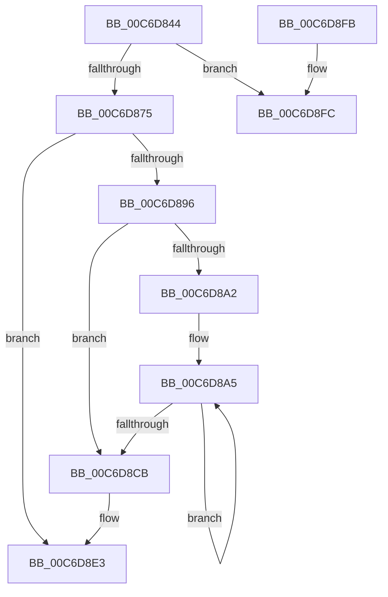

# IntpAllocateProcessorContext

- RVA: `0x00C6D844`–`0x00C6D909` (길이 `197` bytes)
- VA: `0x0000000140C6D844`
- 실행 섹션: `INIT`
- PDB 이름 있음: `예`; PDB Function 태그: `아니요`
- unwind 정보 RVA: `0x000DA7A8`
- 디코드: `54`개 명령, `197/197` bytes 표시
- 미해석 바이트: `0` (있으면 어셈블리에 `.byte`로 보존)

> 이 문서는 커널 이미지의 기계어와 PDB 기호를 분석해 생성했습니다. 4번과 5번은 함수 원형과 자료형을 바이너리 사용 방식에서 추정한 C 해석이며 원본 소스 복구 결과는 아닙니다.

## 1. Dependencies

- 직접 호출 지점: **5**; 고유 호출 대상: **5**
- 직접 호출자로 확인된 함수: **1**
- RIP 상대 이미지 참조: **1**

### Outgoing calls
- `0x00C6D861` → [KeQueryActiveProcessorCountEx](../../text/24/KeQueryActiveProcessorCountEx_function_00249EF0.md) (function, `0x00249EF0`)
- `0x00C6D889` → [ExAllocatePool2](../../poolcode/B8/ExAllocatePool2_function_00B820F0.md) (function, `0x00B820F0`)
- `0x00C6D8B7` → [IntPartGetProcessorEfficiencyClass](../../text/5C/IntPartGetProcessorEfficiencyClass_function_005C0840.md) (function, `0x005C0840`)
- `0x00C6D8DE` → [qsort](../../text/50/qsort_function_005009F0.md) (function, `0x005009F0`)
- `0x00C6D903` → [IntPartCriticalFailure](../../text/5C/IntPartCriticalFailure_function_005C0818.md) (function, `0x005C0818`)

### Direct callers
- [IntPartCreate](IntPartCreate_function_00C6D5C4.md) at `0x00C6D5F5`

### Static image references
- `0x00C6D8CE` → RVA `0x00C6D910` (`IntpProcessorCompareEfficiencyClass`; read)

## 2. Other-region calls and transfers

- 다른 실행 섹션으로 향하는 call: **5**
  - `0x00C6D861` → [KeQueryActiveProcessorCountEx](../../text/24/KeQueryActiveProcessorCountEx_function_00249EF0.md) (`INIT` → `.text`)
  - `0x00C6D889` → [ExAllocatePool2](../../poolcode/B8/ExAllocatePool2_function_00B820F0.md) (`INIT` → `POOLCODE`)
  - `0x00C6D8B7` → [IntPartGetProcessorEfficiencyClass](../../text/5C/IntPartGetProcessorEfficiencyClass_function_005C0840.md) (`INIT` → `.text`)
  - `0x00C6D8DE` → [qsort](../../text/50/qsort_function_005009F0.md) (`INIT` → `.text`)
  - `0x00C6D903` → [IntPartCriticalFailure](../../text/5C/IntPartCriticalFailure_function_005C0818.md) (`INIT` → `.text`)
- 별도 외부 분기/꼬리 이동을 확인하지 못했습니다.

## 3. Assembly (complete function range)

```asm
00C6D844  48 8B C4                        mov rax, rsp
00C6D847  48 89 58 10                     mov qword ptr [rax + 0x10], rbx
00C6D84B  48 89 68 18                     mov qword ptr [rax + 0x18], rbp
00C6D84F  48 89 70 20                     mov qword ptr [rax + 0x20], rsi
00C6D853  66 89 48 08                     mov word ptr [rax + 8], cx
00C6D857  57                              push rdi
00C6D858  48 83 EC 20                     sub rsp, 0x20
00C6D85C  33 C9                           xor ecx, ecx
00C6D85E  48 8B EA                        mov rbp, rdx
00C6D861  E8 8A C6 5D FF                  call 0x140249ef0
00C6D866  8D 48 FF                        lea ecx, [rax - 1]
00C6D869  81 F9 FD 00 00 00               cmp ecx, 0xfd
00C6D86F  0F 87 87 00 00 00               ja 0x140c6d8fc
00C6D875  0F B6 D0                        movzx edx, al
00C6D878  B9 40 00 00 00                  mov ecx, 0x40
00C6D87D  88 55 00                        mov byte ptr [rbp], dl
00C6D880  41 B8 4B 65 49 50               mov r8d, 0x5049654b
00C6D886  48 03 D2                        add rdx, rdx
00C6D889  E8 62 48 F1 FF                  call 0x140b820f0
00C6D88E  48 8B D8                        mov rbx, rax
00C6D891  48 85 C0                        test rax, rax
00C6D894  74 4D                           je 0x140c6d8e3
00C6D896  0F B6 6D 00                     movzx ebp, byte ptr [rbp]
00C6D89A  40 32 FF                        xor dil, dil
00C6D89D  40 84 ED                        test bpl, bpl
00C6D8A0  74 29                           je 0x140c6d8cb
00C6D8A2  48 8B F0                        mov rsi, rax
00C6D8A5  83 64 24 30 00                  and dword ptr [rsp + 0x30], 0
00C6D8AA  48 8D 4C 24 30                  lea rcx, [rsp + 0x30]
00C6D8AF  40 88 7C 24 32                  mov byte ptr [rsp + 0x32], dil
00C6D8B4  40 88 3E                        mov byte ptr [rsi], dil
00C6D8B7  E8 84 2F 95 FF                  call 0x1405c0840
00C6D8BC  40 FE C7                        inc dil
00C6D8BF  88 46 01                        mov byte ptr [rsi + 1], al
00C6D8C2  48 8D 76 02                     lea rsi, [rsi + 2]
00C6D8C6  40 3A FD                        cmp dil, bpl
00C6D8C9  72 DA                           jb 0x140c6d8a5
00C6D8CB  48 8B D5                        mov rdx, rbp
00C6D8CE  4C 8D 0D 3B 00 00 00            lea r9, [rip + 0x3b]
00C6D8D5  41 B8 02 00 00 00               mov r8d, 2
00C6D8DB  48 8B CB                        mov rcx, rbx
00C6D8DE  E8 0D 31 89 FF                  call 0x1405009f0
00C6D8E3  48 8B 6C 24 40                  mov rbp, qword ptr [rsp + 0x40]
00C6D8E8  48 8B C3                        mov rax, rbx
00C6D8EB  48 8B 5C 24 38                  mov rbx, qword ptr [rsp + 0x38]
00C6D8F0  48 8B 74 24 48                  mov rsi, qword ptr [rsp + 0x48]
00C6D8F5  48 83 C4 20                     add rsp, 0x20
00C6D8F9  5F                              pop rdi
00C6D8FA  C3                              ret
00C6D8FB  CC                              int3
00C6D8FC  8B D0                           mov edx, eax
00C6D8FE  B9 01 10 00 00                  mov ecx, 0x1001
00C6D903  E8 10 2F 95 FF                  call 0x1405c0818
00C6D908  CC                              int3
```

## 4. C-style interpretation (structured pseudocode)

```c
__int64 __fastcall IntpAllocateProcessorContext(int a1, __int64 a2)
{
    __int64 result;
    __int64 v_rdi;
    __int64 v_rsp;
    unsigned __int64 v_stack_p10;
    unsigned __int64 v_stack_p18;
    unsigned __int64 v_stack_p20;
    unsigned int v_stack_p8;
    unsigned __int8 v_stack_pA;

    *(unsigned __int64 *)(v_rsp + 16) = v_rbx;
    *(unsigned __int64 *)(v_rsp + 24) = v_rbp;
    *(unsigned __int64 *)(v_rsp + 32) = v_rsi;
    *(unsigned __int16 *)(v_rsp + 8) = (unsigned __int16)(a1);
    v_rsp = (v_rsp) - (32);
    a1 = 0;
    result = KeQueryActiveProcessorCountEx(a1, a2, a3, a4);
    if (((unsigned int)(result - 1)) > 253) goto loc_00C6D8FC;
    *(unsigned __int8 *)(a2) = (unsigned __int8)((unsigned __int8)(result));
    a2 = ((unsigned __int8)(result)) + ((unsigned __int8)(result));
    result = ExAllocatePool2(64, a2, (unsigned int)(0x5049654BULL), a4);
    if (result == 0) goto loc_00C6D8E3;
    v_rdi = 0;
    if ((unsigned __int8)(*(unsigned __int8 *)(a2)) == 0) goto loc_00C6D8CB;
loc_00C6D8A5:
    v_stack_pA = 0;
    *(unsigned __int8 *)(result) = 0;
    result = IntPartGetProcessorEfficiencyClass(v_stack_p8, a2, (unsigned int)(0x5049654BULL), a4);
    v_rdi = (unsigned __int8)((v_rdi) + 1);
    *(unsigned __int8 *)(result + 1) = (unsigned __int8)(result);
    if (((unsigned __int8)(v_rdi)) < ((unsigned __int8)(*(unsigned __int8 *)(a2)))) goto loc_00C6D8A5;
loc_00C6D8CB:
    result = qsort(result, *(unsigned __int8 *)(a2), 2, v_rip + 59);
loc_00C6D8E3:
    v_rsp = (v_rsp) + (32);
    return result;
loc_00C6D8FC:
    result = IntPartCriticalFailure((unsigned int)(0x1001ULL), (unsigned int)((unsigned int)(result)), 2, v_rip + 59);
    return result;
}
```

## 5. (Beta) C Style

```c
int64_t IntpAllocateProcessorContext(int32_t Arg1, void *Arg2)
{
    uint8_t *arg2 = (uint8_t *)Arg2;

    int64_t result;
    int64_t local_rdi;
    int64_t local_rsp;
    uint64_t v_stack_p10;
    uint64_t v_stack_p18;
    uint64_t v_stack_p20;
    uint32_t v_stack_p8;
    uint8_t v_stack_pA;

    *(uint64_t *)(local_rsp + 0x10) = local_rbx;
    *(uint64_t *)(local_rsp + 0x18) = local_rbp;
    *(uint64_t *)(local_rsp + 0x20) = local_rsi;
    *(uint16_t *)(local_rsp + 0x8) = (uint16_t)(Arg1);
    local_rsp = (local_rsp) - (32);
    Arg1 = 0;
    result = KeQueryActiveProcessorCountEx(Arg1, Arg2, a3, a4);
    if (((uint32_t)(result - 1)) > 253) goto loc_00C6D8FC;
    *(uint8_t *)(arg2) = (uint8_t)((uint8_t)(result));
    Arg2 = ((uint8_t)(result)) + ((uint8_t)(result));
    result = ExAllocatePool2(64, Arg2, (uint32_t)(0x5049654BULL), a4);
    if (result == 0) goto loc_00C6D8E3;
    local_rdi = 0;
    if ((uint8_t)(*(uint8_t *)(arg2)) == 0) goto loc_00C6D8CB;
loc_00C6D8A5:
    v_stack_pA = 0;
    *(uint8_t *)(result) = 0;
    result = IntPartGetProcessorEfficiencyClass(v_stack_p8, Arg2, (uint32_t)(0x5049654BULL), a4);
    local_rdi = (uint8_t)((local_rdi) + 1);
    *(uint8_t *)(result + 0x1) = (uint8_t)(result);
    if (((uint8_t)(local_rdi)) < ((uint8_t)(*(uint8_t *)(arg2)))) goto loc_00C6D8A5;
loc_00C6D8CB:
    result = qsort(result, *(uint8_t *)(arg2), 2, v_rip + 59);
loc_00C6D8E3:
    local_rsp = (local_rsp) + (32);
    return result;
loc_00C6D8FC:
    result = IntPartCriticalFailure((uint32_t)(0x1001ULL), (uint32_t)((uint32_t)(result)), 2, v_rip + 59);
    return result;
}
```

### 관측된 메모리 오프셋

구조체 형식이 확인되지 않은 접근은 인자 기준의 오프셋으로만 기록했습니다.

| 기준 인자 | 오프셋 표현 | 폭 (bit) | 접근 |
|---|---:|---:|---|
| `Arg2` | `+ 0x0` | `8` | `R` |
| `Arg2` | `+ 0x0` | `8` | `W` |

## 6. Execution-region graph

[열기: 2D/3D 그래프와 함수 탐색 컨트롤 패널](../../../control-panel.html?section=init&rva=0x00C6D844&view=graph)

- 2D 그래프는 위에서 아래로 흐르고, 3D 그래프는 빈 공간을 드래그해 회전합니다. Shift+드래그는 이동, 휠은 확대·축소, 함수 노드 선택은 대상 보고서 이동입니다.

### Static fallback


