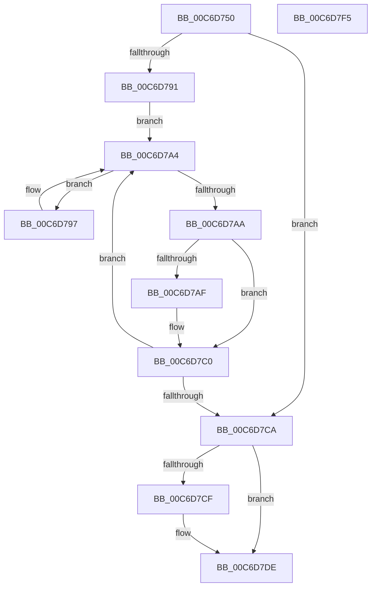

# IntpAssignProcessorsToPartitions

- RVA: `0x00C6D750`–`0x00C6D7F6` (길이 `166` bytes)
- VA: `0x0000000140C6D750`
- 실행 섹션: `INIT`
- PDB 이름 있음: `예`; PDB Function 태그: `아니요`
- unwind 정보 RVA: `0x0006C8E8`
- 디코드: `51`개 명령, `166/166` bytes 표시
- 미해석 바이트: `0` (있으면 어셈블리에 `.byte`로 보존)

> 이 문서는 커널 이미지의 기계어와 PDB 기호를 분석해 생성했습니다. 4번과 5번은 함수 원형과 자료형을 바이너리 사용 방식에서 추정한 C 해석이며 원본 소스 복구 결과는 아닙니다.

## 1. Dependencies

- 직접 호출 지점: **3**; 고유 호출 대상: **2**
- 직접 호출자로 확인된 함수: **1**
- RIP 상대 이미지 참조: **0**

### Outgoing calls
- `0x00C6D79F` → [IntpAddNextProcessorToPartition](IntpAddNextProcessorToPartition_function_00C6D7FC.md) (function, `0x00C6D7FC`)
- `0x00C6D7B7` → [IntpAddNextProcessorToPartition](IntpAddNextProcessorToPartition_function_00C6D7FC.md) (function, `0x00C6D7FC`)
- `0x00C6D7D8` → [IntPartCriticalFailure](../../text/5C/IntPartCriticalFailure_function_005C0818.md) (function, `0x005C0818`)

### Direct callers
- [IntPartCreate](IntPartCreate_function_00C6D5C4.md) at `0x00C6D6E0`

### Static image references
- 디코드된 RIP-relative 메모리 참조가 없습니다.

## 2. Other-region calls and transfers

- 다른 실행 섹션으로 향하는 call: **1**
  - `0x00C6D7D8` → [IntPartCriticalFailure](../../text/5C/IntPartCriticalFailure_function_005C0818.md) (`INIT` → `.text`)
- 별도 외부 분기/꼬리 이동을 확인하지 못했습니다.

## 3. Assembly (complete function range)

```asm
00C6D750  4C 8B DC                        mov r11, rsp
00C6D753  49 89 5B 10                     mov qword ptr [r11 + 0x10], rbx
00C6D757  49 89 6B 18                     mov qword ptr [r11 + 0x18], rbp
00C6D75B  49 89 73 20                     mov qword ptr [r11 + 0x20], rsi
00C6D75F  57                              push rdi
00C6D760  48 83 EC 20                     sub rsp, 0x20
00C6D764  44 0F B6 49 01                  movzx r9d, byte ptr [rcx + 1]
00C6D769  48 8B DA                        mov rbx, rdx
00C6D76C  48 8B 49 08                     mov rcx, qword ptr [rcx + 8]
00C6D770  33 D2                           xor edx, edx
00C6D772  45 0F B6 D0                     movzx r10d, r8b
00C6D776  41 8B C1                        mov eax, r9d
00C6D779  41 F7 F2                        div r10d
00C6D77C  33 D2                           xor edx, edx
00C6D77E  49 89 4B 08                     mov qword ptr [r11 + 8], rcx
00C6D782  8B E8                           mov ebp, eax
00C6D784  41 8B C1                        mov eax, r9d
00C6D787  41 F7 F2                        div r10d
00C6D78A  8B FA                           mov edi, edx
00C6D78C  45 84 C0                        test r8b, r8b
00C6D78F  74 39                           je 0x140c6d7ca
00C6D791  41 0F B6 F0                     movzx esi, r8b
00C6D795  EB 0D                           jmp 0x140c6d7a4
00C6D797  48 8D 54 24 30                  lea rdx, [rsp + 0x30]
00C6D79C  48 8B CB                        mov rcx, rbx
00C6D79F  E8 58 00 00 00                  call 0x140c6d7fc
00C6D7A4  40 38 6B 01                     cmp byte ptr [rbx + 1], bpl
00C6D7A8  72 ED                           jb 0x140c6d797
00C6D7AA  40 84 FF                        test dil, dil
00C6D7AD  74 11                           je 0x140c6d7c0
00C6D7AF  48 8D 54 24 30                  lea rdx, [rsp + 0x30]
00C6D7B4  48 8B CB                        mov rcx, rbx
00C6D7B7  E8 40 00 00 00                  call 0x140c6d7fc
00C6D7BC  40 80 C7 FF                     add dil, 0xff
00C6D7C0  48 83 C3 10                     add rbx, 0x10
00C6D7C4  48 83 EE 01                     sub rsi, 1
00C6D7C8  75 DA                           jne 0x140c6d7a4
00C6D7CA  40 84 FF                        test dil, dil
00C6D7CD  74 0F                           je 0x140c6d7de
00C6D7CF  40 0F B6 D7                     movzx edx, dil
00C6D7D3  B9 04 10 00 00                  mov ecx, 0x1004
00C6D7D8  E8 3B 30 95 FF                  call 0x1405c0818
00C6D7DD  CC                              int3
00C6D7DE  48 8B 5C 24 38                  mov rbx, qword ptr [rsp + 0x38]
00C6D7E3  33 C0                           xor eax, eax
00C6D7E5  48 8B 6C 24 40                  mov rbp, qword ptr [rsp + 0x40]
00C6D7EA  48 8B 74 24 48                  mov rsi, qword ptr [rsp + 0x48]
00C6D7EF  48 83 C4 20                     add rsp, 0x20
00C6D7F3  5F                              pop rdi
00C6D7F4  C3                              ret
00C6D7F5  CC                              int3
```

## 4. C-style interpretation (structured pseudocode)

```c
__int64 __fastcall IntpAssignProcessorsToPartitions(__int64 a1, __int64 a2, unsigned __int8 a3)
{
    __int64 result;
    __int64 v_rbx;
    __int64 v_rdi;
    __int64 v_rsi;
    __int64 v_rsp;
    unsigned __int64 v_stack_p10;
    unsigned __int64 v_stack_p18;
    unsigned __int64 v_stack_p20;
    unsigned __int64 v_stack_p8;

    *(unsigned __int64 *)(v_rsp + 16) = v_rbx;
    *(unsigned __int64 *)(v_rsp + 24) = v_rbp;
    *(unsigned __int64 *)(v_rsp + 32) = v_rsi;
    v_rsp = (v_rsp) - (32);
    a2 = 0;
    a2 = 0;
    *(unsigned __int64 *)(v_rsp + 8) = *(unsigned __int64 *)(a1 + 8);
    if (a3 == 0) goto loc_00C6D7CA;
    goto loc_00C6D7A4;
loc_00C6D797:
    result = IntpAddNextProcessorToPartition(0, v_stack_p8, a3, *(unsigned __int8 *)(a1 + 1));
loc_00C6D7A4:
    if ((*(unsigned __int8 *)(a2 + 1)) < ((unsigned __int8)((unsigned int)((unsigned int)((unsigned int)((unsigned int)(*(unsigned __int8 *)(a1 + 1)))))))) goto loc_00C6D797;
    v_rdi = 0;
    if (0 != 0) {
        a2 = v_stack_p8;
        a1 = a2;
        result = IntpAddNextProcessorToPartition(a1, a2, a3, *(unsigned __int8 *)(a1 + 1));
        v_rdi = (unsigned __int8)((0) + (255));
    }
    v_rbx = (a2) + (16);
    v_rsi = (a3) - (1);
    if (condition_is_not_equal) goto loc_00C6D7A4;
loc_00C6D7CA:
    if ((unsigned __int8)(v_rdi) != 0) {
        a2 = (unsigned __int8)(v_rdi);
        a1 = 0x1004ULL;
        result = IntPartCriticalFailure(a1, a2, a3, *(unsigned __int8 *)(a1 + 1));
    }
    result = 0;
    v_rsp = (v_rsp) + (32);
    return result;
}
```

## 5. (Beta) C Style

```c
int64_t IntpAssignProcessorsToPartitions(void *Arg1, void *Arg2, uint8_t Arg3)
{
    uint8_t *arg1 = (uint8_t *)Arg1;
    uint8_t *arg2 = (uint8_t *)Arg2;

    int64_t result;
    int64_t local_rbx;
    int64_t local_rdi;
    int64_t local_rsi;
    int64_t local_rsp;
    uint64_t v_stack_p10;
    uint64_t v_stack_p18;
    uint64_t v_stack_p20;
    uint64_t v_stack_p8;

    *(uint64_t *)(local_rsp + 0x10) = local_rbx;
    *(uint64_t *)(local_rsp + 0x18) = local_rbp;
    *(uint64_t *)(local_rsp + 0x20) = local_rsi;
    local_rsp = (local_rsp) - (32);
    Arg2 = 0;
    Arg2 = 0;
    *(uint64_t *)(local_rsp + 0x8) = *(uint64_t *)(arg1 + 0x8);
    if (Arg3 == 0) goto loc_00C6D7CA;
    goto loc_00C6D7A4;
loc_00C6D797:
    result = IntpAddNextProcessorToPartition(0, v_stack_p8, Arg3, *(uint8_t *)(arg1 + 0x1));
loc_00C6D7A4:
    if ((*(uint8_t *)(arg2 + 0x1)) < ((uint8_t)((uint32_t)((uint32_t)((uint32_t)((uint32_t)(*(uint8_t *)(arg1 + 0x1)))))))) goto loc_00C6D797;
    local_rdi = 0;
    if (0 != 0) {
        Arg2 = v_stack_p8;
        Arg1 = Arg2;
        result = IntpAddNextProcessorToPartition(Arg1, Arg2, Arg3, *(uint8_t *)(arg1 + 0x1));
        local_rdi = (uint8_t)((0) + (255));
    }
    local_rbx = (Arg2) + (16);
    local_rsi = (Arg3) - (1);
    if (condition_is_not_equal) goto loc_00C6D7A4;
loc_00C6D7CA:
    if ((uint8_t)(local_rdi) != 0) {
        Arg2 = (uint8_t)(local_rdi);
        Arg1 = 0x1004ULL;
        result = IntPartCriticalFailure(Arg1, Arg2, Arg3, *(uint8_t *)(arg1 + 0x1));
    }
    result = 0;
    local_rsp = (local_rsp) + (32);
    return result;
}
```

### 관측된 메모리 오프셋

구조체 형식이 확인되지 않은 접근은 인자 기준의 오프셋으로만 기록했습니다.

| 기준 인자 | 오프셋 표현 | 폭 (bit) | 접근 |
|---|---:|---:|---|
| `Arg1` | `+ 0x1` | `8` | `R` |
| `Arg1` | `+ 0x8` | `64` | `R` |
| `Arg2` | `+ 0x1` | `8` | `R` |

## 6. Execution-region graph

[열기: 2D/3D 그래프와 함수 탐색 컨트롤 패널](../../../control-panel.html?section=init&rva=0x00C6D750&view=graph)

- 2D 그래프는 위에서 아래로 흐르고, 3D 그래프는 빈 공간을 드래그해 회전합니다. Shift+드래그는 이동, 휠은 확대·축소, 함수 노드 선택은 대상 보고서 이동입니다.

### Static fallback


