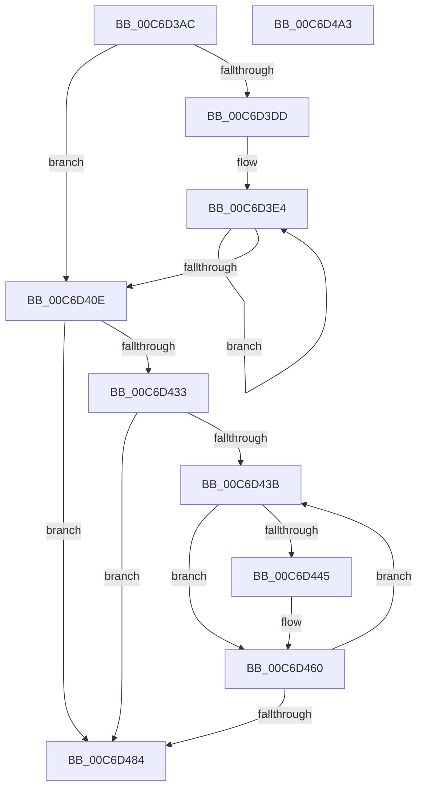

# IntpInitClassContext

- RVA: `0x00C6D3AC`–`0x00C6D4A4` (길이 `248` bytes)
- VA: `0x0000000140C6D3AC`
- 실행 섹션: `INIT`
- PDB 이름 있음: `예`; PDB Function 태그: `아니요`
- unwind 정보 RVA: `0x00060300`
- 디코드: `71`개 명령, `248/248` bytes 표시
- 미해석 바이트: `0` (있으면 어셈블리에 `.byte`로 보존)

> 이 문서는 커널 이미지의 기계어와 PDB 기호를 분석해 생성했습니다. 4번과 5번은 함수 원형과 자료형을 바이너리 사용 방식에서 추정한 C 해석이며 원본 소스 복구 결과는 아닙니다.

## 1. Dependencies

- 직접 호출 지점: **1**; 고유 호출 대상: **1**
- 직접 호출자로 확인된 함수: **1**
- RIP 상대 이미지 참조: **0**

### Outgoing calls
- `0x00C6D426` → [ExAllocatePool2](../../poolcode/B8/ExAllocatePool2_function_00B820F0.md) (function, `0x00B820F0`)

### Direct callers
- [IntPartCreate](IntPartCreate_function_00C6D5C4.md) at `0x00C6D636`

### Static image references
- 디코드된 RIP-relative 메모리 참조가 없습니다.

## 2. Other-region calls and transfers

- 다른 실행 섹션으로 향하는 call: **1**
  - `0x00C6D426` → [ExAllocatePool2](../../poolcode/B8/ExAllocatePool2_function_00B820F0.md) (`INIT` → `POOLCODE`)
- 별도 외부 분기/꼬리 이동을 확인하지 못했습니다.

## 3. Assembly (complete function range)

```asm
00C6D3AC  48 89 5C 24 08                  mov qword ptr [rsp + 8], rbx
00C6D3B1  48 89 6C 24 10                  mov qword ptr [rsp + 0x10], rbp
00C6D3B6  48 89 74 24 18                  mov qword ptr [rsp + 0x18], rsi
00C6D3BB  57                              push rdi
00C6D3BC  41 56                           push r14
00C6D3BE  41 57                           push r15
00C6D3C0  48 83 EC 20                     sub rsp, 0x20
00C6D3C4  33 FF                           xor edi, edi
00C6D3C6  0F B6 DA                        movzx ebx, dl
00C6D3C9  41 BE FF FF 00 00               mov r14d, 0xffff
00C6D3CF  4D 8B F8                        mov r15, r8
00C6D3D2  48 8B F1                        mov rsi, rcx
00C6D3D5  45 0F B7 CE                     movzx r9d, r14w
00C6D3D9  84 D2                           test dl, dl
00C6D3DB  74 31                           je 0x140c6d40e
00C6D3DD  4C 8D 41 01                     lea r8, [rcx + 1]
00C6D3E1  44 8B D3                        mov r10d, ebx
00C6D3E4  41 0F B6 08                     movzx ecx, byte ptr [r8]
00C6D3E8  8D 47 01                        lea eax, [rdi + 1]
00C6D3EB  66 41 3B C9                     cmp cx, r9w
00C6D3EF  4D 8D 40 02                     lea r8, [r8 + 2]
00C6D3F3  41 0F B7 D1                     movzx edx, r9w
00C6D3F7  44 0F B7 C9                     movzx r9d, cx
00C6D3FB  0F 44 C7                        cmove eax, edi
00C6D3FE  66 3B CA                        cmp cx, dx
00C6D401  8B F8                           mov edi, eax
00C6D403  66 44 0F 44 CA                  cmove r9w, dx
00C6D408  49 83 EA 01                     sub r10, 1
00C6D40C  75 D6                           jne 0x140c6d3e4
00C6D40E  8B C7                           mov eax, edi
00C6D410  B9 40 00 00 00                  mov ecx, 0x40
00C6D415  41 B8 4B 65 49 50               mov r8d, 0x5049654b
00C6D41B  48 8B EB                        mov rbp, rbx
00C6D41E  48 8D 14 40                     lea rdx, [rax + rax*2]
00C6D422  48 C1 E2 03                     shl rdx, 3
00C6D426  E8 C5 4C F1 FF                  call 0x140b820f0
00C6D42B  4C 8B C0                        mov r8, rax
00C6D42E  48 85 C0                        test rax, rax
00C6D431  74 51                           je 0x140c6d484
00C6D433  41 83 C9 FF                     or r9d, 0xffffffff
00C6D437  84 DB                           test bl, bl
00C6D439  74 49                           je 0x140c6d484
00C6D43B  0F B6 56 01                     movzx edx, byte ptr [rsi + 1]
00C6D43F  66 41 3B D6                     cmp dx, r14w
00C6D443  74 1B                           je 0x140c6d460
00C6D445  41 FF C1                        inc r9d
00C6D448  44 0F B7 F2                     movzx r14d, dx
00C6D44C  4B 8D 0C 49                     lea rcx, [r9 + r9*2]
00C6D450  49 83 64 C8 08 00               and qword ptr [r8 + rcx*8 + 8], 0
00C6D456  41 88 14 C8                     mov byte ptr [r8 + rcx*8], dl
00C6D45A  41 C6 44 C8 01 00               mov byte ptr [r8 + rcx*8 + 1], 0
00C6D460  4B 8D 14 49                     lea rdx, [r9 + r9*2]
00C6D464  41 FE 44 D0 01                  inc byte ptr [r8 + rdx*8 + 1]
00C6D469  0F B6 06                        movzx eax, byte ptr [rsi]
00C6D46C  48 83 C6 02                     add rsi, 2
00C6D470  49 8B 4C D0 08                  mov rcx, qword ptr [r8 + rdx*8 + 8]
00C6D475  48 0F AB C1                     bts rcx, rax
00C6D479  49 89 4C D0 08                  mov qword ptr [r8 + rdx*8 + 8], rcx
00C6D47E  48 83 ED 01                     sub rbp, 1
00C6D482  75 B7                           jne 0x140c6d43b
00C6D484  48 8B 5C 24 40                  mov rbx, qword ptr [rsp + 0x40]
00C6D489  49 8B C0                        mov rax, r8
00C6D48C  48 8B 6C 24 48                  mov rbp, qword ptr [rsp + 0x48]
00C6D491  48 8B 74 24 50                  mov rsi, qword ptr [rsp + 0x50]
00C6D496  41 89 3F                        mov dword ptr [r15], edi
00C6D499  48 83 C4 20                     add rsp, 0x20
00C6D49D  41 5F                           pop r15
00C6D49F  41 5E                           pop r14
00C6D4A1  5F                              pop rdi
00C6D4A2  C3                              ret
00C6D4A3  CC                              int3
```

## 4. C-style interpretation (structured pseudocode)

```c
__int64 __fastcall IntpInitClassContext(__int64 a1, unsigned __int8 a2, __int64 a3)
{
    __int64 result;
    __int64 v_r10;
    __int64 v_r14;
    __int64 v_rbp;
    __int64 v_rdi;
    __int64 v_rsi;
    __int64 v_rsp;
    unsigned __int64 v_stack_p10;
    unsigned __int64 v_stack_p18;
    unsigned __int64 v_stack_p8;

    v_stack_p8 = v_rbx;
    v_stack_p10 = v_rbp;
    v_stack_p18 = v_rsi;
    v_rsp = (v_rsp) - (32);
    v_rdi = 0;
    if (a2 == 0) goto loc_00C6D40E;
loc_00C6D3E4:
    result = v_rdi + 1;
    if (((unsigned __int16)(*(unsigned __int8 *)(a1 + 1))) == ((unsigned __int16)((unsigned __int16)((unsigned int)(0xFFFFULL))))) { result = 0; }
    a4 = (unsigned __int16)(*(unsigned __int8 *)(a1 + 1));
    if (((unsigned __int16)(*(unsigned __int8 *)(a1 + 1))) == ((unsigned __int16)((unsigned __int16)((unsigned __int16)((unsigned int)(0xFFFFULL)))))) { a4 = (unsigned __int16)((unsigned __int16)((unsigned __int16)((unsigned int)(0xFFFFULL)))); }
    v_r10 = ((unsigned int)(a2)) - (1);
    if (condition_is_not_equal) goto loc_00C6D3E4;
loc_00C6D40E:
    a2 = ((unsigned int)((unsigned int)((unsigned int)((unsigned int)(result)))) + (unsigned int)((unsigned int)((unsigned int)((unsigned int)(result)))) * 2) << (3);
    result = ExAllocatePool2(64, a2, (unsigned int)(0x5049654BULL), a4);
    if (result == 0) goto loc_00C6D484;
    a4 = (unsigned int)((a4) | (0xFFFFFFFFULL));
    if (a2 == 0) goto loc_00C6D484;
loc_00C6D43B:
    v_r14 = (unsigned int)(0xFFFFULL);
    if (((unsigned __int16)(*(unsigned __int8 *)(a1 + 1))) != ((unsigned __int16)((unsigned int)(0xFFFFULL)))) {
        a4 = (unsigned int)((a4) + 1);
        v_r14 = (unsigned __int16)(*(unsigned __int8 *)(a1 + 1));
        a1 = a4 + a4 * 2;
        *(unsigned __int8 *)(result + a1 * 8) = (unsigned __int8)(*(unsigned __int8 *)(a1 + 1));
        *(unsigned __int8 *)(result + a1 * 8 + 1) = 0;
    }
    v_rsi = (a1) + (2);
    *(unsigned __int64 *)(result + a4 + a4 * 2 * 8 + 8) = *(unsigned __int64 *)(result + a4 + a4 * 2 * 8 + 8);
    v_rbp = (a2) - (1);
    if (condition_is_not_equal) goto loc_00C6D43B;
loc_00C6D484:
    *(unsigned int *)(a3) = (unsigned int)((unsigned int)((unsigned int)(result)));
    v_rsp = (v_rsp) + (32);
    return result;
}
```

## 5. (Beta) C Style

```c
int64_t IntpInitClassContext(void *Arg1, uint8_t Arg2, void *Arg3)
{
    uint8_t *arg1 = (uint8_t *)Arg1;
    uint8_t *arg3 = (uint8_t *)Arg3;

    int64_t result;
    int64_t local_r10;
    int64_t local_r14;
    int64_t local_rbp;
    int64_t local_rdi;
    int64_t local_rsi;
    int64_t local_rsp;
    uint64_t v_stack_p10;
    uint64_t v_stack_p18;
    uint64_t v_stack_p8;

    v_stack_p8 = local_rbx;
    v_stack_p10 = local_rbp;
    v_stack_p18 = local_rsi;
    local_rsp = (local_rsp) - (32);
    local_rdi = 0;
    if (Arg2 == 0) goto loc_00C6D40E;
loc_00C6D3E4:
    result = local_rdi + 1;
    if (((uint16_t)(*(uint8_t *)(arg1 + 0x1))) == ((uint16_t)((uint16_t)((uint32_t)(0xFFFFULL))))) { result = 0; }
    a4 = (uint16_t)(*(uint8_t *)(arg1 + 0x1));
    if (((uint16_t)(*(uint8_t *)(arg1 + 0x1))) == ((uint16_t)((uint16_t)((uint16_t)((uint32_t)(0xFFFFULL)))))) { a4 = (uint16_t)((uint16_t)((uint16_t)((uint32_t)(0xFFFFULL)))); }
    local_r10 = ((uint32_t)(Arg2)) - (1);
    if (condition_is_not_equal) goto loc_00C6D3E4;
loc_00C6D40E:
    Arg2 = ((uint32_t)((uint32_t)((uint32_t)((uint32_t)(result)))) + (uint32_t)((uint32_t)((uint32_t)((uint32_t)(result)))) * 2) << (3);
    result = ExAllocatePool2(64, Arg2, (uint32_t)(0x5049654BULL), a4);
    if (result == 0) goto loc_00C6D484;
    a4 = (uint32_t)((a4) | (0xFFFFFFFFULL));
    if (Arg2 == 0) goto loc_00C6D484;
loc_00C6D43B:
    local_r14 = (uint32_t)(0xFFFFULL);
    if (((uint16_t)(*(uint8_t *)(arg1 + 0x1))) != ((uint16_t)((uint32_t)(0xFFFFULL)))) {
        a4 = (uint32_t)((a4) + 1);
        local_r14 = (uint16_t)(*(uint8_t *)(arg1 + 0x1));
        Arg1 = a4 + a4 * 2;
        *(uint8_t *)(result + arg1 * 8) = (uint8_t)(*(uint8_t *)(arg1 + 0x1));
        *(uint8_t *)(result + arg1 * 8 + 0x1) = 0;
    }
    local_rsi = (Arg1) + (2);
    *(uint64_t *)(result + a4 + a4 * 2 * 8 + 0x8) = *(uint64_t *)(result + a4 + a4 * 2 * 8 + 0x8);
    local_rbp = (Arg2) - (1);
    if (condition_is_not_equal) goto loc_00C6D43B;
loc_00C6D484:
    *(uint32_t *)(arg3) = (uint32_t)((uint32_t)((uint32_t)(result)));
    local_rsp = (local_rsp) + (32);
    return result;
}
```

### 관측된 메모리 오프셋

구조체 형식이 확인되지 않은 접근은 인자 기준의 오프셋으로만 기록했습니다.

| 기준 인자 | 오프셋 표현 | 폭 (bit) | 접근 |
|---|---:|---:|---|
| `Arg1` | `+ 0x0` | `8` | `R` |
| `Arg1` | `+ 0x1` | `8` | `R` |
| `Arg1` | `+ 0x1` | `64` | `R` |
| `Arg1` | `+ 0x2` | `64` | `R` |
| `Arg3` | `+ 0x0` | `32` | `W` |

## 6. Execution-region graph

[열기: 2D/3D 그래프와 함수 탐색 컨트롤 패널](../../../control-panel.html?section=init&rva=0x00C6D3AC&view=graph)

- 2D 그래프는 위에서 아래로 흐르고, 3D 그래프는 빈 공간을 드래그해 회전합니다. Shift+드래그는 이동, 휠은 확대·축소, 함수 노드 선택은 대상 보고서 이동입니다.

### Static fallback


