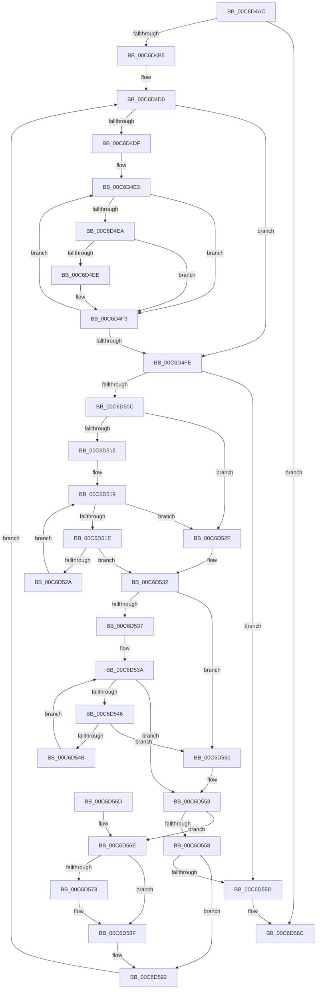

# IntpMergeClassContexts

- RVA: `0x00C6D4AC`–`0x00C6D5BE` (길이 `274` bytes)
- VA: `0x0000000140C6D4AC`
- 실행 섹션: `INIT`
- PDB 이름 있음: `예`; PDB Function 태그: `아니요`
- unwind 정보 RVA: `0x000DA778`
- 디코드: `81`개 명령, `274/274` bytes 표시
- 미해석 바이트: `0` (있으면 어셈블리에 `.byte`로 보존)

> 이 문서는 커널 이미지의 기계어와 PDB 기호를 분석해 생성했습니다. 4번과 5번은 함수 원형과 자료형을 바이너리 사용 방식에서 추정한 C 해석이며 원본 소스 복구 결과는 아닙니다.

## 1. Dependencies

- 직접 호출 지점: **0**; 고유 호출 대상: **0**
- 직접 호출자로 확인된 함수: **1**
- RIP 상대 이미지 참조: **0**

### Outgoing calls
- 직접 디코드된 call 명령이 없습니다.

### Direct callers
- [IntPartCreate](IntPartCreate_function_00C6D5C4.md) at `0x00C6D657`

### Static image references
- 디코드된 RIP-relative 메모리 참조가 없습니다.

## 2. Other-region calls and transfers

- 다른 실행 섹션으로 향하는 call: **0**
- 별도 외부 분기/꼬리 이동을 확인하지 못했습니다.

## 3. Assembly (complete function range)

```asm
00C6D4AC  83 FA 01                        cmp edx, 1
00C6D4AF  0F 84 B7 00 00 00               je 0x140c6d56c
00C6D4B5  48 89 5C 24 08                  mov qword ptr [rsp + 8], rbx
00C6D4BA  48 89 74 24 10                  mov qword ptr [rsp + 0x10], rsi
00C6D4BF  48 89 7C 24 18                  mov qword ptr [rsp + 0x18], rdi
00C6D4C4  41 8A F8                        mov dil, r8b
00C6D4C7  44 8B DA                        mov r11d, edx
00C6D4CA  4C 8B D1                        mov r10, rcx
00C6D4CD  83 CE FF                        or esi, 0xffffffff
00C6D4D0  33 C0                           xor eax, eax
00C6D4D2  41 B8 FF 00 00 00               mov r8d, 0xff
00C6D4D8  8B DE                           mov ebx, esi
00C6D4DA  45 85 DB                        test r11d, r11d
00C6D4DD  74 1F                           je 0x140c6d4fe
00C6D4DF  49 8D 4A 01                     lea rcx, [r10 + 1]
00C6D4E3  0F B6 11                        movzx edx, byte ptr [rcx]
00C6D4E6  84 D2                           test dl, dl
00C6D4E8  74 09                           je 0x140c6d4f3
00C6D4EA  3B D3                           cmp edx, ebx
00C6D4EC  77 05                           ja 0x140c6d4f3
00C6D4EE  44 8B C0                        mov r8d, eax
00C6D4F1  8B DA                           mov ebx, edx
00C6D4F3  FF C0                           inc eax
00C6D4F5  48 83 C1 18                     add rcx, 0x18
00C6D4F9  41 3B C3                        cmp eax, r11d
00C6D4FC  72 E5                           jb 0x140c6d4e3
00C6D4FE  41 8B C0                        mov eax, r8d
00C6D501  48 8D 1C 40                     lea rbx, [rax + rax*2]
00C6D505  41 3A 7C DA 01                  cmp dil, byte ptr [r10 + rbx*8 + 1]
00C6D50A  76 51                           jbe 0x140c6d55d
00C6D50C  41 8D 43 FF                     lea eax, [r11 - 1]
00C6D510  44 3B C0                        cmp r8d, eax
00C6D513  74 1A                           je 0x140c6d52f
00C6D515  45 8D 48 01                     lea r9d, [r8 + 1]
00C6D519  45 3B CB                        cmp r9d, r11d
00C6D51C  73 11                           jae 0x140c6d52f
00C6D51E  4B 8D 0C 49                     lea rcx, [r9 + r9*2]
00C6D522  41 80 7C CA 01 00               cmp byte ptr [r10 + rcx*8 + 1], 0
00C6D528  77 08                           ja 0x140c6d532
00C6D52A  41 FF C1                        inc r9d
00C6D52D  EB EA                           jmp 0x140c6d519
00C6D52F  44 8B CE                        mov r9d, esi
00C6D532  45 85 C0                        test r8d, r8d
00C6D535  74 19                           je 0x140c6d550
00C6D537  41 FF C8                        dec r8d
00C6D53A  4B 8D 0C 40                     lea rcx, [r8 + r8*2]
00C6D53E  41 80 7C CA 01 00               cmp byte ptr [r10 + rcx*8 + 1], 0
00C6D544  77 0D                           ja 0x140c6d553
00C6D546  45 85 C0                        test r8d, r8d
00C6D549  74 05                           je 0x140c6d550
00C6D54B  44 03 C6                        add r8d, esi
00C6D54E  EB EA                           jmp 0x140c6d53a
00C6D550  44 8B C6                        mov r8d, esi
00C6D553  44 3B CE                        cmp r9d, esi
00C6D556  75 16                           jne 0x140c6d56e
00C6D558  44 3B C6                        cmp r8d, esi
00C6D55B  75 35                           jne 0x140c6d592
00C6D55D  48 8B 5C 24 08                  mov rbx, qword ptr [rsp + 8]
00C6D562  48 8B 74 24 10                  mov rsi, qword ptr [rsp + 0x10]
00C6D567  48 8B 7C 24 18                  mov rdi, qword ptr [rsp + 0x18]
00C6D56C  C3                              ret
00C6D56D  CC                              int3
00C6D56E  44 3B C6                        cmp r8d, esi
00C6D571  74 1C                           je 0x140c6d58f
00C6D573  41 8B C0                        mov eax, r8d
00C6D576  41 8B C9                        mov ecx, r9d
00C6D579  48 8D 14 40                     lea rdx, [rax + rax*2]
00C6D57D  48 8D 04 49                     lea rax, [rcx + rcx*2]
00C6D581  41 8A 44 C2 01                  mov al, byte ptr [r10 + rax*8 + 1]
00C6D586  41 38 44 D2 01                  cmp byte ptr [r10 + rdx*8 + 1], al
00C6D58B  45 0F 46 C8                     cmovbe r9d, r8d
00C6D58F  45 8B C1                        mov r8d, r9d
00C6D592  41 8B C0                        mov eax, r8d
00C6D595  48 8D 0C 40                     lea rcx, [rax + rax*2]
00C6D599  49 8B 44 DA 08                  mov rax, qword ptr [r10 + rbx*8 + 8]
00C6D59E  49 09 44 CA 08                  or qword ptr [r10 + rcx*8 + 8], rax
00C6D5A3  41 8A 44 DA 01                  mov al, byte ptr [r10 + rbx*8 + 1]
00C6D5A8  41 00 44 CA 01                  add byte ptr [r10 + rcx*8 + 1], al
00C6D5AD  49 83 64 DA 08 00               and qword ptr [r10 + rbx*8 + 8], 0
00C6D5B3  41 C6 44 DA 01 00               mov byte ptr [r10 + rbx*8 + 1], 0
00C6D5B9  E9 12 FF FF FF                  jmp 0x140c6d4d0
```

## 4. C-style interpretation (structured pseudocode)

```c
__int64 __fastcall IntpMergeClassContexts(__int64 a1, int a2, unsigned __int8 a3)
{
    __int64 result;
    __int64 v_rbx;
    __int64 v_rsi;
    unsigned __int64 v_stack_p10;
    unsigned __int64 v_stack_p18;
    unsigned __int64 v_stack_p8;

    if (a2 == 1) goto loc_00C6D56C;
    v_stack_p8 = v_rbx;
    v_stack_p10 = v_rsi;
    v_stack_p18 = v_rdi;
    v_rsi = (unsigned int)((v_rsi) | (0xFFFFFFFFULL));
loc_00C6D4D0:
    result = 0;
    if ((unsigned int)((unsigned int)(a2)) == 0) goto loc_00C6D4FE;
loc_00C6D4E3:
    if ((unsigned __int8)(*(unsigned __int8 *)(a1 + 1)) == 0) goto loc_00C6D4F3;
    v_rbx = (unsigned int)((unsigned int)(v_rsi));
    if (((unsigned int)(*(unsigned __int8 *)(a1 + 1))) <= ((unsigned int)((unsigned int)((unsigned int)(v_rsi))))) {
        a3 = 0;
        v_rbx = (unsigned int)(*(unsigned __int8 *)(a1 + 1));
    }
    result = (unsigned int)((result) + 1);
    a1 = (a1 + 1) + (24);
    if (((unsigned int)(result)) < ((unsigned int)((unsigned int)(a2)))) goto loc_00C6D4E3;
loc_00C6D4FE:
    if (a3 <= (*(unsigned __int8 *)(a1 + (unsigned int)(a3) + (unsigned int)(a3) * 2 * 8 + 1))) goto loc_00C6D55D;
    if (a3 == ((unsigned int)((unsigned int)(a2) - 1))) goto loc_00C6D52F;
loc_00C6D519:
    if (((unsigned int)(a3 + 1)) >= ((unsigned int)((unsigned int)(a2)))) goto loc_00C6D52F;
    if ((*(unsigned __int8 *)(a1 + a3 + 1 + a3 + 1 * 2 * 8 + 1)) > 0) goto loc_00C6D532;
    a4 = (unsigned int)((a3 + 1) + 1);
    goto loc_00C6D519;
loc_00C6D52F:
loc_00C6D532:
    if (a3 == 0) goto loc_00C6D550;
    a3 = (unsigned int)((a3) - 1);
loc_00C6D53A:
    if ((*(unsigned __int8 *)(a1 + a3 + a3 * 2 * 8 + 1)) > 0) goto loc_00C6D553;
    if (a3 == 0) goto loc_00C6D550;
    a3 = (unsigned int)((a3) + ((unsigned int)(v_rsi)));
    goto loc_00C6D53A;
loc_00C6D550:
loc_00C6D553:
    if (((unsigned int)((unsigned int)((unsigned int)(v_rsi)))) != ((unsigned int)(v_rsi))) goto loc_00C6D56E;
    if (((unsigned int)((unsigned int)((unsigned int)(v_rsi)))) != ((unsigned int)(v_rsi))) goto loc_00C6D592;
loc_00C6D55D:
loc_00C6D56C:
    return (unsigned int)(a2) - 1;
loc_00C6D56E:
    result = (unsigned int)(a2) - 1;
    if (((unsigned int)((unsigned int)((unsigned int)(v_rsi)))) != ((unsigned int)(v_stack_p10))) {
        result = (unsigned int)((unsigned int)((unsigned int)(v_rsi)));
        a1 = (unsigned int)((unsigned int)((unsigned int)(v_rsi)));
        a2 = result + result * 2;
        result = a1 + a1 * 2;
        result = *(unsigned __int8 *)(a1 + result * 8 + 1);
        a4 = (unsigned int)((unsigned int)(v_rsi));
        if ((*(unsigned __int8 *)(a1 + a2 * 8 + 1)) <= ((unsigned __int8)(result))) { a4 = (unsigned int)((unsigned int)((unsigned int)(v_rsi))); }
    }
loc_00C6D592:
    *(unsigned __int8 *)(a1 + v_stack_p8 * 8 + 1) = 0;
    goto loc_00C6D4D0;
}
```

## 5. (Beta) C Style

```c
int64_t IntpMergeClassContexts(void *Arg1, int32_t Arg2, uint8_t Arg3)
{
    uint8_t *arg1 = (uint8_t *)Arg1;

    int64_t result;
    int64_t local_rbx;
    int64_t local_rsi;
    uint64_t v_stack_p10;
    uint64_t v_stack_p18;
    uint64_t v_stack_p8;

    if (Arg2 == 1) goto loc_00C6D56C;
    v_stack_p8 = local_rbx;
    v_stack_p10 = local_rsi;
    v_stack_p18 = local_rdi;
    local_rsi = (uint32_t)((local_rsi) | (0xFFFFFFFFULL));
loc_00C6D4D0:
    result = 0;
    if ((uint32_t)((uint32_t)(Arg2)) == 0) goto loc_00C6D4FE;
loc_00C6D4E3:
    if ((uint8_t)(*(uint8_t *)(arg1 + 0x1)) == 0) goto loc_00C6D4F3;
    local_rbx = (uint32_t)((uint32_t)(local_rsi));
    if (((uint32_t)(*(uint8_t *)(arg1 + 0x1))) <= ((uint32_t)((uint32_t)((uint32_t)(local_rsi))))) {
        Arg3 = 0;
        local_rbx = (uint32_t)(*(uint8_t *)(arg1 + 0x1));
    }
    result = (uint32_t)((result) + 1);
    Arg1 = (Arg1 + 1) + (24);
    if (((uint32_t)(result)) < ((uint32_t)((uint32_t)(Arg2)))) goto loc_00C6D4E3;
loc_00C6D4FE:
    if (Arg3 <= (*(uint8_t *)(arg1 + (uint32_t)(Arg3) + (uint32_t)(Arg3) * 2 * 8 + 0x1))) goto loc_00C6D55D;
    if (Arg3 == ((uint32_t)((uint32_t)(Arg2) - 1))) goto loc_00C6D52F;
loc_00C6D519:
    if (((uint32_t)(Arg3 + 1)) >= ((uint32_t)((uint32_t)(Arg2)))) goto loc_00C6D52F;
    if ((*(uint8_t *)(arg1 + Arg3 + 0x1 + Arg3 + 0x1 * 2 * 8 + 0x1)) > 0) goto loc_00C6D532;
    a4 = (uint32_t)((Arg3 + 1) + 1);
    goto loc_00C6D519;
loc_00C6D52F:
loc_00C6D532:
    if (Arg3 == 0) goto loc_00C6D550;
    Arg3 = (uint32_t)((Arg3) - 1);
loc_00C6D53A:
    if ((*(uint8_t *)(arg1 + Arg3 + Arg3 * 2 * 8 + 0x1)) > 0) goto loc_00C6D553;
    if (Arg3 == 0) goto loc_00C6D550;
    Arg3 = (uint32_t)((Arg3) + ((uint32_t)(local_rsi)));
    goto loc_00C6D53A;
loc_00C6D550:
loc_00C6D553:
    if (((uint32_t)((uint32_t)((uint32_t)(local_rsi)))) != ((uint32_t)(local_rsi))) goto loc_00C6D56E;
    if (((uint32_t)((uint32_t)((uint32_t)(local_rsi)))) != ((uint32_t)(local_rsi))) goto loc_00C6D592;
loc_00C6D55D:
loc_00C6D56C:
    return (uint32_t)(Arg2) - 1;
loc_00C6D56E:
    result = (uint32_t)(Arg2) - 1;
    if (((uint32_t)((uint32_t)((uint32_t)(local_rsi)))) != ((uint32_t)(v_stack_p10))) {
        result = (uint32_t)((uint32_t)((uint32_t)(local_rsi)));
        Arg1 = (uint32_t)((uint32_t)((uint32_t)(local_rsi)));
        Arg2 = result + result * 2;
        result = Arg1 + Arg1 * 2;
        result = *(uint8_t *)(arg1 + result * 8 + 0x1);
        a4 = (uint32_t)((uint32_t)(local_rsi));
        if ((*(uint8_t *)(arg1 + Arg2 * 8 + 0x1)) <= ((uint8_t)(result))) { a4 = (uint32_t)((uint32_t)((uint32_t)(local_rsi))); }
    }
loc_00C6D592:
    *(uint8_t *)(arg1 + v_stack_p8 * 8 + 0x1) = 0;
    goto loc_00C6D4D0;
}
```

### 관측된 메모리 오프셋

구조체 형식이 확인되지 않은 접근은 인자 기준의 오프셋으로만 기록했습니다.

| 기준 인자 | 오프셋 표현 | 폭 (bit) | 접근 |
|---|---:|---:|---|
| `Arg1` | `+ 0x0` | `8` | `R` |
| `Arg1` | `+ 0x1` | `64` | `R` |
| `Arg1` | `+ 0x1 + rax*8` | `8` | `R` |
| `Arg1` | `+ 0x1 + rbx*8` | `8` | `R` |
| `Arg1` | `+ 0x1 + rbx*8` | `8` | `W` |
| `Arg1` | `+ 0x1 + rcx*8` | `8` | `R` |
| `Arg1` | `+ 0x1 + rcx*8` | `8` | `R/W` |
| `Arg1` | `+ 0x1 + rdx*8` | `8` | `R` |
| `Arg1` | `+ 0x8 + rbx*8` | `64` | `R` |
| `Arg1` | `+ 0x8 + rbx*8` | `64` | `R/W` |
| `Arg1` | `+ 0x8 + rcx*8` | `64` | `R/W` |

## 6. Execution-region graph

[열기: 2D/3D 그래프와 함수 탐색 컨트롤 패널](../../../control-panel.html?section=init&rva=0x00C6D4AC&view=graph)

- 2D 그래프는 위에서 아래로 흐르고, 3D 그래프는 빈 공간을 드래그해 회전합니다. Shift+드래그는 이동, 휠은 확대·축소, 함수 노드 선택은 대상 보고서 이동입니다.

### Static fallback


