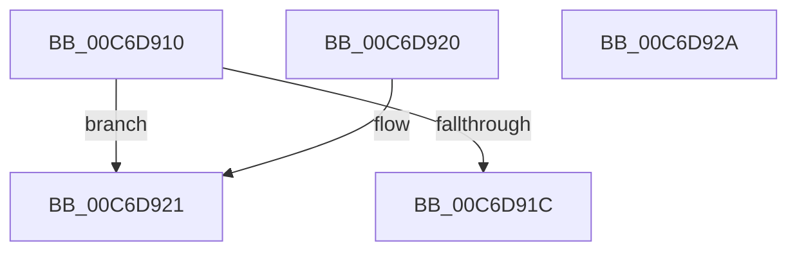

# IntpProcessorCompareEfficiencyClass

- RVA: `0x00C6D910`–`0x00C6D92B` (길이 `27` bytes)
- VA: `0x0000000140C6D910`
- 실행 섹션: `INIT`
- PDB 이름 있음: `예`; PDB Function 태그: `아니요`
- unwind 정보 RVA: `0x000DB714`
- 디코드: `12`개 명령, `27/27` bytes 표시
- 미해석 바이트: `0` (있으면 어셈블리에 `.byte`로 보존)

> 이 문서는 커널 이미지의 기계어와 PDB 기호를 분석해 생성했습니다. 4번과 5번은 함수 원형과 자료형을 바이너리 사용 방식에서 추정한 C 해석이며 원본 소스 복구 결과는 아닙니다.

## 1. Dependencies

- 직접 호출 지점: **0**; 고유 호출 대상: **0**
- 직접 호출자로 확인된 함수: **0**
- RIP 상대 이미지 참조: **0**

### Outgoing calls
- 직접 디코드된 call 명령이 없습니다.

### Direct callers
- 이 함수 시작 RVA로 연결되는 직접 call은 확인되지 않았습니다. 간접 호출은 완전히 역산할 수 없습니다.

### Static image references
- 디코드된 RIP-relative 메모리 참조가 없습니다.

## 2. Other-region calls and transfers

- 다른 실행 섹션으로 향하는 call: **0**
- 별도 외부 분기/꼬리 이동을 확인하지 못했습니다.

## 3. Assembly (complete function range)

```asm
00C6D910  44 8A 41 01                     mov r8b, byte ptr [rcx + 1]
00C6D914  8A 4A 01                        mov cl, byte ptr [rdx + 1]
00C6D917  44 3A C1                        cmp r8b, cl
00C6D91A  73 05                           jae 0x140c6d921
00C6D91C  83 C8 FF                        or eax, 0xffffffff
00C6D91F  C3                              ret
00C6D920  CC                              int3
00C6D921  33 C0                           xor eax, eax
00C6D923  44 3A C1                        cmp r8b, cl
00C6D926  0F 97 C0                        seta al
00C6D929  C3                              ret
00C6D92A  CC                              int3
```

## 4. C-style interpretation (structured pseudocode)

```c
__int64 __fastcall IntpProcessorCompareEfficiencyClass(__int64 a1, __int64 a2)
{
    __int64 result;

    if (((unsigned __int8)(*(unsigned __int8 *)(a1 + 1))) >= ((unsigned __int8)(*(unsigned __int8 *)(a2 + 1)))) goto loc_00C6D921;
    result = (unsigned int)((result) | (0xFFFFFFFFULL));
    return result;
loc_00C6D921:
    result = 0;
    result = (((unsigned __int8)(*(unsigned __int8 *)(a1 + 1))) > ((unsigned __int8)(*(unsigned __int8 *)(a2 + 1)))) ? 1 : 0;
    return result;
}
```

## 5. (Beta) C Style

```c
int64_t IntpProcessorCompareEfficiencyClass(void *Arg1, void *Arg2)
{
    uint8_t *arg1 = (uint8_t *)Arg1;
    uint8_t *arg2 = (uint8_t *)Arg2;

    int64_t result;

    if (((uint8_t)(*(uint8_t *)(arg1 + 0x1))) >= ((uint8_t)(*(uint8_t *)(arg2 + 0x1)))) goto loc_00C6D921;
    result = (uint32_t)((result) | (0xFFFFFFFFULL));
    return result;
loc_00C6D921:
    result = 0;
    result = (((uint8_t)(*(uint8_t *)(arg1 + 0x1))) > ((uint8_t)(*(uint8_t *)(arg2 + 0x1)))) ? 1 : 0;
    return result;
}
```

### 관측된 메모리 오프셋

구조체 형식이 확인되지 않은 접근은 인자 기준의 오프셋으로만 기록했습니다.

| 기준 인자 | 오프셋 표현 | 폭 (bit) | 접근 |
|---|---:|---:|---|
| `Arg1` | `+ 0x1` | `8` | `R` |
| `Arg2` | `+ 0x1` | `8` | `R` |

## 6. Execution-region graph

[열기: 2D/3D 그래프와 함수 탐색 컨트롤 패널](../../../control-panel.html?section=init&rva=0x00C6D910&view=graph)

- 2D 그래프는 위에서 아래로 흐르고, 3D 그래프는 빈 공간을 드래그해 회전합니다. Shift+드래그는 이동, 휠은 확대·축소, 함수 노드 선택은 대상 보고서 이동입니다.

### Static fallback


