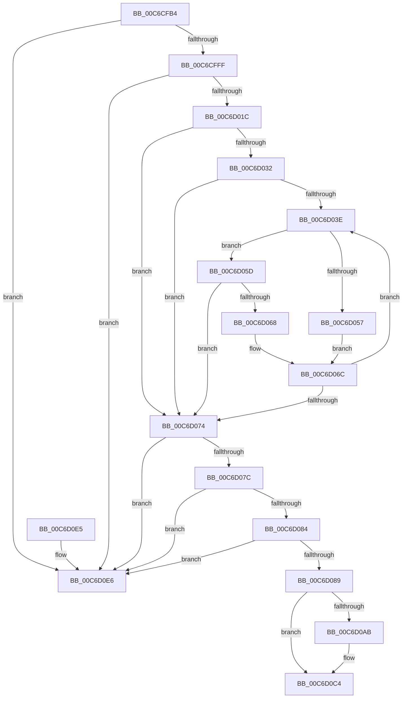

# KiFatalExceptionFilter

- RVA: `0x00C6CFB4`–`0x00C6D0F1` (길이 `317` bytes)
- VA: `0x0000000140C6CFB4`
- 실행 섹션: `INIT`
- PDB 이름 있음: `예`; PDB Function 태그: `아니요`
- unwind 정보 RVA: `0x000D9794`
- 디코드: `89`개 명령, `317/317` bytes 표시
- 미해석 바이트: `0` (있으면 어셈블리에 `.byte`로 보존)

> 이 문서는 커널 이미지의 기계어와 PDB 기호를 분석해 생성했습니다. 4번과 5번은 함수 원형과 자료형을 바이너리 사용 방식에서 추정한 C 해석이며 원본 소스 복구 결과는 아닙니다.

## 1. Dependencies

- 직접 호출 지점: **4**; 고유 호출 대상: **4**
- 직접 호출자로 확인된 함수: **1**
- RIP 상대 이미지 참조: **3**

### Outgoing calls
- `0x00C6CFEC` → [RtlCaptureImageExceptionValues](../../text/43/RtlCaptureImageExceptionValues_function_00432890.md) (function, `0x00432890`)
- `0x00C6D0A2` → [RtlLookupExceptionHandler](../../text/5E/RtlLookupExceptionHandler_function_005E6A48.md) (function, `0x005E6A48`)
- `0x00C6D0BE` → [KeBugCheckEx](../../text/4F/KeBugCheckEx_function_004FD660.md) (function, `0x004FD660`)
- `0x00C6D0EB` → [KeBugCheck](../../text/4F/KeBugCheck_function_004FD640.md) (function, `0x004FD640`)

### Direct callers
- [KiLockServiceTable$filt$0](../../text/6D/KiLockServiceTable_filt_0_function_006D6511.md) at `0x006D651A`

### Static image references
- `0x00C6CFCD` → RVA `0x00000000` (`image boundary/outside`; read)
- `0x00C6CFD4` → RVA `0x01008010` (`INITDATA`; read)
- `0x00C6D0D2` → RVA `0x00EF0E20` (`.data`; read/write)

## 2. Other-region calls and transfers

- 다른 실행 섹션으로 향하는 call: **4**
  - `0x00C6CFEC` → [RtlCaptureImageExceptionValues](../../text/43/RtlCaptureImageExceptionValues_function_00432890.md) (`INIT` → `.text`)
  - `0x00C6D0A2` → [RtlLookupExceptionHandler](../../text/5E/RtlLookupExceptionHandler_function_005E6A48.md) (`INIT` → `.text`)
  - `0x00C6D0BE` → [KeBugCheckEx](../../text/4F/KeBugCheckEx_function_004FD660.md) (`INIT` → `.text`)
  - `0x00C6D0EB` → [KeBugCheck](../../text/4F/KeBugCheck_function_004FD640.md) (`INIT` → `.text`)
- 별도 외부 분기/꼬리 이동을 확인하지 못했습니다.

## 3. Assembly (complete function range)

```asm
00C6CFB4  48 89 5C 24 20                  mov qword ptr [rsp + 0x20], rbx
00C6CFB9  56                              push rsi
00C6CFBA  57                              push rdi
00C6CFBB  41 56                           push r14
00C6CFBD  48 83 EC 30                     sub rsp, 0x30
00C6CFC1  0F AE E8                        lfence
00C6CFC4  65 48 8B 34 25 20 00 00 00      mov rsi, qword ptr gs:[0x20]
00C6CFCD  4C 8D 35 2C 30 39 FF            lea r14, [rip - 0xc6cfd4]
00C6CFD4  48 8D 1D 35 B0 39 00            lea rbx, [rip + 0x39b035]
00C6CFDB  49 8B CE                        mov rcx, r14
00C6CFDE  4C 8D 44 24 50                  lea r8, [rsp + 0x50]
00C6CFE3  48 8D 54 24 58                  lea rdx, [rsp + 0x58]
00C6CFE8  48 89 5E 78                     mov qword ptr [rsi + 0x78], rbx
00C6CFEC  E8 9F 58 7C FF                  call 0x140432890
00C6CFF1  48 8B 7C 24 58                  mov rdi, qword ptr [rsp + 0x58]
00C6CFF6  48 85 FF                        test rdi, rdi
00C6CFF9  0F 84 E7 00 00 00               je 0x140c6d0e6
00C6CFFF  8B 4C 24 50                     mov ecx, dword ptr [rsp + 0x50]
00C6D003  48 B8 AB AA AA AA AA AA AA AA   movabs rax, 0xaaaaaaaaaaaaaaab
00C6D00D  48 F7 E1                        mul rcx
00C6D010  48 C1 EA 03                     shr rdx, 3
00C6D014  85 D2                           test edx, edx
00C6D016  0F 84 CA 00 00 00               je 0x140c6d0e6
00C6D01C  8D 42 FF                        lea eax, [rdx - 1]
00C6D01F  49 2B DE                        sub rbx, r14
00C6D022  48 8D 04 40                     lea rax, [rax + rax*2]
00C6D026  48 8D 0C 87                     lea rcx, [rdi + rax*4]
00C6D02A  44 8B 01                        mov r8d, dword ptr [rcx]
00C6D02D  49 3B D8                        cmp rbx, r8
00C6D030  73 42                           jae 0x140c6d074
00C6D032  45 33 D2                        xor r10d, r10d
00C6D035  44 8D 4A FE                     lea r9d, [rdx - 2]
00C6D039  45 85 C9                        test r9d, r9d
00C6D03C  78 36                           js 0x140c6d074
00C6D03E  43 8D 14 0A                     lea edx, [r10 + r9]
00C6D042  D1 FA                           sar edx, 1
00C6D044  48 63 C2                        movsxd rax, edx
00C6D047  48 8D 0C 40                     lea rcx, [rax + rax*2]
00C6D04B  48 8D 0C 8F                     lea rcx, [rdi + rcx*4]
00C6D04F  44 8B 19                        mov r11d, dword ptr [rcx]
00C6D052  49 3B DB                        cmp rbx, r11
00C6D055  73 06                           jae 0x140c6d05d
00C6D057  44 8D 4A FF                     lea r9d, [rdx - 1]
00C6D05B  EB 0F                           jmp 0x140c6d06c
00C6D05D  8B 41 0C                        mov eax, dword ptr [rcx + 0xc]
00C6D060  45 8B C3                        mov r8d, r11d
00C6D063  48 3B D8                        cmp rbx, rax
00C6D066  72 0C                           jb 0x140c6d074
00C6D068  44 8D 52 01                     lea r10d, [rdx + 1]
00C6D06C  45 8B C3                        mov r8d, r11d
00C6D06F  45 3B CA                        cmp r9d, r10d
00C6D072  7D CA                           jge 0x140c6d03e
00C6D074  41 8B C0                        mov eax, r8d
00C6D077  48 3B D8                        cmp rbx, rax
00C6D07A  72 6A                           jb 0x140c6d0e6
00C6D07C  8B 41 04                        mov eax, dword ptr [rcx + 4]
00C6D07F  48 3B D8                        cmp rbx, rax
00C6D082  73 62                           jae 0x140c6d0e6
00C6D084  48 85 C9                        test rcx, rcx
00C6D087  74 5D                           je 0x140c6d0e6
00C6D089  48 83 64 24 28 00               and qword ptr [rsp + 0x28], 0
00C6D08F  48 8D 44 24 60                  lea rax, [rsp + 0x60]
00C6D094  41 B8 01 00 00 00               mov r8d, 1
00C6D09A  48 89 44 24 20                  mov qword ptr [rsp + 0x20], rax
00C6D09F  49 8B D6                        mov rdx, r14
00C6D0A2  E8 A1 99 97 FF                  call 0x1405e6a48
00C6D0A7  85 C0                           test eax, eax
00C6D0A9  79 19                           jns 0x140c6d0c4
00C6D0AB  48 83 64 24 20 00               and qword ptr [rsp + 0x20], 0
00C6D0B1  45 33 C9                        xor r9d, r9d
00C6D0B4  48 63 D0                        movsxd rdx, eax
00C6D0B7  45 33 C0                        xor r8d, r8d
00C6D0BA  41 8D 49 31                     lea ecx, [r9 + 0x31]
00C6D0BE  E8 9D 05 89 FF                  call 0x1404fd660
00C6D0C3  CC                              int3
00C6D0C4  48 8B 44 24 60                  mov rax, qword ptr [rsp + 0x60]
00C6D0C9  48 8B 5C 24 68                  mov rbx, qword ptr [rsp + 0x68]
00C6D0CE  48 89 46 70                     mov qword ptr [rsi + 0x70], rax
00C6D0D2  48 83 25 46 3D 28 00 00         and qword ptr [rip + 0x283d46], 0
00C6D0DA  33 C0                           xor eax, eax
00C6D0DC  48 83 C4 30                     add rsp, 0x30
00C6D0E0  41 5E                           pop r14
00C6D0E2  5F                              pop rdi
00C6D0E3  5E                              pop rsi
00C6D0E4  C3                              ret
00C6D0E5  CC                              int3
00C6D0E6  B9 31 00 00 00                  mov ecx, 0x31
00C6D0EB  E8 50 05 89 FF                  call 0x1404fd640
00C6D0F0  CC                              int3
```

## 4. C-style interpretation (structured pseudocode)

```c
__int64 __fastcall KiFatalExceptionFilter(void)
{
    __int64 result;
    __int64 v_r10;
    __int64 v_rbx;
    __int64 v_rsp;
    unsigned __int64 v_stack_m20;
    unsigned __int64 v_stack_m28;
    unsigned __int64 v_stack_p10;
    unsigned __int64 v_stack_p18;
    unsigned __int64 v_stack_p20;
    unsigned __int64 v_stack_p8;

    v_stack_p20 = v_rbx;
    v_rsp = (v_rsp) - (48);
    *(unsigned __int64 *)(*(unsigned __int64 *)(gs_base + (0 + 32)) + 120) = v_rip + 3780661;
    result = RtlCaptureImageExceptionValues(v_rip - 13029332, v_stack_p10, v_stack_p8, a4);
    if (v_stack_p10 == 0) goto loc_00C6D0E6;
    a2 = (v_stack_p10) >> (3);
    if ((unsigned int)(a2) == 0) goto loc_00C6D0E6;
    v_rbx = (v_rip + 3780661) - (v_rip - 13029332);
    if (v_rbx >= ((unsigned int)(*(unsigned int *)(v_stack_p10 + a2 - 1 + a2 - 1 * 2 * 4)))) goto loc_00C6D074;
    v_r10 = 0;
    if (sign_flag) goto loc_00C6D074;
loc_00C6D03E:
    a2 = (unsigned int)((v_r10 + a2 - 2 * 1) >> (1));
    if (v_rbx >= ((unsigned int)(*(unsigned int *)(v_stack_p10 + (int)((unsigned int)(a2)) + (int)((unsigned int)(a2)) * 2 * 4)))) goto loc_00C6D05D;
    goto loc_00C6D06C;
loc_00C6D05D:
    if (v_rbx < ((unsigned int)(*(unsigned int *)(v_stack_p10 + (int)((unsigned int)(a2)) + (int)((unsigned int)(a2)) * 2 * 4 + 12)))) goto loc_00C6D074;
loc_00C6D06C:
    if (((unsigned int)(a2 - 1)) >= ((unsigned int)(a2 + 1))) goto loc_00C6D03E;
loc_00C6D074:
    if (v_rbx < ((unsigned int)((unsigned int)((unsigned int)((unsigned int)((unsigned int)(*(unsigned int *)(v_stack_p10 + (int)((unsigned int)(a2)) + (int)((unsigned int)(a2)) * 2 * 4)))))))) goto loc_00C6D0E6;
    if (v_rbx >= ((unsigned int)(*(unsigned int *)(v_stack_p10 + (int)((unsigned int)(a2)) + (int)((unsigned int)(a2)) * 2 * 4 + 4)))) goto loc_00C6D0E6;
    if (v_stack_p10 + (int)((unsigned int)(a2)) + (int)((unsigned int)(a2)) * 2 * 4 == 0) goto loc_00C6D0E6;
    v_stack_m28 = v_stack_p18;
    result = RtlLookupExceptionHandler(v_stack_p10 + (int)((unsigned int)(a2)) + (int)((unsigned int)(a2)) * 2 * 4, v_rip - 13029332, 1, a2 - 1);
    if (sign_flag) {
        a4 = 0;
        a2 = (int)((unsigned int)(result));
        a3 = 0;
        a1 = a4 + 49;
        result = KeBugCheckEx(a1, a2, a3, a4);
    }
    *(unsigned __int64 *)(*(unsigned __int64 *)(gs_base + (0 + 32)) + 112) = v_stack_p18;
    result = 0;
    v_rsp = (v_rsp) + (48);
    return result;
loc_00C6D0E6:
    result = KeBugCheck(49, a2, a3, a4);
    return result;
}
```

## 5. (Beta) C Style

```c
void KiFatalExceptionFilter(void)
{
    int64_t result;
    int64_t local_r10;
    int64_t local_rbx;
    int64_t local_rsp;
    uint64_t v_stack_m20;
    uint64_t v_stack_m28;
    uint64_t v_stack_p10;
    uint64_t v_stack_p18;
    uint64_t v_stack_p20;
    uint64_t v_stack_p8;

    v_stack_p20 = local_rbx;
    local_rsp = (local_rsp) - (48);
    *(uint64_t *)(*(uint64_t *)(gs_base + (0 + 0x20)) + 0x78) = v_rip + 3780661;
    result = RtlCaptureImageExceptionValues(v_rip - 13029332, v_stack_p10, v_stack_p8, a4);
    if (v_stack_p10 == 0) goto loc_00C6D0E6;
    a2 = (v_stack_p10) >> (3);
    if ((uint32_t)(a2) == 0) goto loc_00C6D0E6;
    local_rbx = (v_rip + 3780661) - (v_rip - 13029332);
    if (local_rbx >= ((uint32_t)(*(uint32_t *)(v_stack_p10 + a2 - 0x1 + a2 - 0x1 * 2 * 4)))) goto loc_00C6D074;
    local_r10 = 0;
    if (sign_flag) goto loc_00C6D074;
loc_00C6D03E:
    a2 = (uint32_t)((local_r10 + a2 - 2 * 1) >> (1));
    if (local_rbx >= ((uint32_t)(*(uint32_t *)(v_stack_p10 + (int32_t)((uint32_t)(a2)) + (int32_t)((uint32_t)(a2)) * 2 * 4)))) goto loc_00C6D05D;
    goto loc_00C6D06C;
loc_00C6D05D:
    if (local_rbx < ((uint32_t)(*(uint32_t *)(v_stack_p10 + (int32_t)((uint32_t)(a2)) + (int32_t)((uint32_t)(a2)) * 2 * 4 + 0xC)))) goto loc_00C6D074;
loc_00C6D06C:
    if (((uint32_t)(a2 - 1)) >= ((uint32_t)(a2 + 1))) goto loc_00C6D03E;
loc_00C6D074:
    if (local_rbx < ((uint32_t)((uint32_t)((uint32_t)((uint32_t)((uint32_t)(*(uint32_t *)(v_stack_p10 + (int32_t)((uint32_t)(a2)) + (int32_t)((uint32_t)(a2)) * 2 * 4)))))))) goto loc_00C6D0E6;
    if (local_rbx >= ((uint32_t)(*(uint32_t *)(v_stack_p10 + (int32_t)((uint32_t)(a2)) + (int32_t)((uint32_t)(a2)) * 2 * 4 + 0x4)))) goto loc_00C6D0E6;
    if (v_stack_p10 + (int32_t)((uint32_t)(a2)) + (int32_t)((uint32_t)(a2)) * 2 * 4 == 0) goto loc_00C6D0E6;
    v_stack_m28 = v_stack_p18;
    result = RtlLookupExceptionHandler(v_stack_p10 + (int32_t)((uint32_t)(a2)) + (int32_t)((uint32_t)(a2)) * 2 * 4, v_rip - 13029332, 1, a2 - 1);
    if (sign_flag) {
        a4 = 0;
        a2 = (int32_t)((uint32_t)(result));
        a3 = 0;
        a1 = a4 + 49;
        result = KeBugCheckEx(a1, a2, a3, a4);
    }
    *(uint64_t *)(*(uint64_t *)(gs_base + (0 + 0x20)) + 0x70) = v_stack_p18;
    result = 0;
    local_rsp = (local_rsp) + (48);
    return result;
loc_00C6D0E6:
    result = KeBugCheck(49, a2, a3, a4);
    return result;
}
```

## 6. Execution-region graph

[열기: 2D/3D 그래프와 함수 탐색 컨트롤 패널](../../../control-panel.html?section=init&rva=0x00C6CFB4&view=graph)

- 2D 그래프는 위에서 아래로 흐르고, 3D 그래프는 빈 공간을 드래그해 회전합니다. Shift+드래그는 이동, 휠은 확대·축소, 함수 노드 선택은 대상 보고서 이동입니다.

### Static fallback


