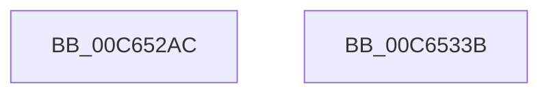

# MiAddSubRegionEntropy

- RVA: `0x00C652AC`–`0x00C6533C` (길이 `144` bytes)
- VA: `0x0000000140C652AC`
- 실행 섹션: `INIT`
- PDB 이름 있음: `예`; PDB Function 태그: `아니요`
- unwind 정보 RVA: `0x0005CAAC`
- 디코드: `32`개 명령, `144/144` bytes 표시
- 미해석 바이트: `0` (있으면 어셈블리에 `.byte`로 보존)

> 이 문서는 커널 이미지의 기계어와 PDB 기호를 분석해 생성했습니다. 4번과 5번은 함수 원형과 자료형을 바이너리 사용 방식에서 추정한 C 해석이며 원본 소스 복구 결과는 아닙니다.

## 1. Dependencies

- 직접 호출 지점: **3**; 고유 호출 대상: **1**
- 직접 호출자로 확인된 함수: **1**
- RIP 상대 이미지 참조: **6**

### Outgoing calls
- `0x00C652C2` → [ExGenRandom](../../text/41/ExGenRandom_function_0041B010.md) (function, `0x0041B010`)
- `0x00C652D2` → [ExGenRandom](../../text/41/ExGenRandom_function_0041B010.md) (function, `0x0041B010`)
- `0x00C6531A` → [ExGenRandom](../../text/41/ExGenRandom_function_0041B010.md) (function, `0x0041B010`)

### Direct callers
- [MiAssignTopLevelRanges](MiAssignTopLevelRanges_function_00C65560.md) at `0x00C6584E`

### Static image references
- `0x00C652B6` → RVA `0x00E38C18` (`.data`; read)
- `0x00C652EB` → RVA `0x00E38C28` (`.data`; read)
- `0x00C652F8` → RVA `0x00E2F380` (`.data`; write)
- `0x00C652FF` → RVA `0x00E38C18` (`.data`; write)
- `0x00C65313` → RVA `0x00E2F390` (`.data`; write)
- `0x00C6532E` → RVA `0x00E2F388` (`.data`; write)

## 2. Other-region calls and transfers

- 다른 실행 섹션으로 향하는 call: **3**
  - `0x00C652C2` → [ExGenRandom](../../text/41/ExGenRandom_function_0041B010.md) (`INIT` → `.text`)
  - `0x00C652D2` → [ExGenRandom](../../text/41/ExGenRandom_function_0041B010.md) (`INIT` → `.text`)
  - `0x00C6531A` → [ExGenRandom](../../text/41/ExGenRandom_function_0041B010.md) (`INIT` → `.text`)
- 별도 외부 분기/꼬리 이동을 확인하지 못했습니다.

## 3. Assembly (complete function range)

```asm
00C652AC  48 89 5C 24 08                  mov qword ptr [rsp + 8], rbx
00C652B1  57                              push rdi
00C652B2  48 83 EC 20                     sub rsp, 0x20
00C652B6  48 8B 3D 5B 39 1D 00            mov rdi, qword ptr [rip + 0x1d395b]
00C652BD  B9 01 00 00 00                  mov ecx, 1
00C652C2  E8 49 5D 7B FF                  call 0x14041b010
00C652C7  8B D8                           mov ebx, eax
00C652C9  B9 01 00 00 00                  mov ecx, 1
00C652CE  48 C1 E3 20                     shl rbx, 0x20
00C652D2  E8 39 5D 7B FF                  call 0x14041b010
00C652D7  8B C0                           mov eax, eax
00C652D9  48 BA F8 FF FF FF 7F 00 00 00   movabs rdx, 0x7ffffffff8
00C652E3  48 0B C3                        or rax, rbx
00C652E6  B9 01 00 00 00                  mov ecx, 1
00C652EB  48 8B 1D 36 39 1D 00            mov rbx, qword ptr [rip + 0x1d3936]
00C652F2  48 23 C2                        and rax, rdx
00C652F5  48 03 C7                        add rax, rdi
00C652F8  48 89 1D 81 A0 1C 00            mov qword ptr [rip + 0x1ca081], rbx
00C652FF  48 89 05 12 39 1D 00            mov qword ptr [rip + 0x1d3912], rax
00C65306  48 B8 FF FF FF FF 7F 00 00 00   movabs rax, 0x7fffffffff
00C65310  48 03 C3                        add rax, rbx
00C65313  48 89 05 76 A0 1C 00            mov qword ptr [rip + 0x1ca076], rax
00C6531A  E8 F1 5C 7B FF                  call 0x14041b010
00C6531F  0F B6 C8                        movzx ecx, al
00C65322  48 C1 E1 1E                     shl rcx, 0x1e
00C65326  48 03 CB                        add rcx, rbx
00C65329  48 8B 5C 24 30                  mov rbx, qword ptr [rsp + 0x30]
00C6532E  48 89 0D 53 A0 1C 00            mov qword ptr [rip + 0x1ca053], rcx
00C65335  48 83 C4 20                     add rsp, 0x20
00C65339  5F                              pop rdi
00C6533A  C3                              ret
00C6533B  CC                              int3
```

## 4. C-style interpretation (structured pseudocode)

```c
__int64 __fastcall MiAddSubRegionEntropy(void)
{
    __int64 result;
    __int64 v_rbx;
    __int64 v_rsp;
    unsigned __int64 v_stack_p8;

    v_stack_p8 = v_rbx;
    v_rsp = (v_rsp) - (32);
    result = ExGenRandom(1, a2, a3, a4);
    v_rbx = ((unsigned int)((unsigned int)(result))) << (32);
    result = ExGenRandom(1, a2, a3, a4);
    result = ((unsigned int)((unsigned int)(result))) | (v_rbx);
    result = (result) & (a2);
    result = (result) + (*(unsigned __int64 *)(v_rip + 1915227));
    *(unsigned __int64 *)(v_rip + 1876097) = *(unsigned __int64 *)(v_rip + 1915190);
    *(unsigned __int64 *)(v_rip + 1915154) = result;
    result = (result) + (*(unsigned __int64 *)(v_rip + 1915190));
    *(unsigned __int64 *)(v_rip + 1876086) = result;
    result = ExGenRandom(1, a2, a3, a4);
    a1 = ((unsigned __int8)(result)) << (30);
    a1 = (a1) + (*(unsigned __int64 *)(v_rip + 1915190));
    *(unsigned __int64 *)(v_rip + 1876051) = a1;
    v_rsp = (v_rsp) + (32);
    return result;
}
```

## 5. (Beta) C Style

```c
void MiAddSubRegionEntropy(void)
{
    int64_t result;
    int64_t local_rbx;
    int64_t local_rsp;
    uint64_t v_stack_p8;

    v_stack_p8 = local_rbx;
    local_rsp = (local_rsp) - (32);
    result = ExGenRandom(1, a2, a3, a4);
    local_rbx = ((uint32_t)((uint32_t)(result))) << (32);
    result = ExGenRandom(1, a2, a3, a4);
    result = ((uint32_t)((uint32_t)(result))) | (local_rbx);
    result = (result) & (a2);
    result = (result) + (*(uint64_t *)(v_rip + 0x1D395B));
    *(uint64_t *)(v_rip + 0x1CA081) = *(uint64_t *)(v_rip + 0x1D3936);
    *(uint64_t *)(v_rip + 0x1D3912) = result;
    result = (result) + (*(uint64_t *)(v_rip + 0x1D3936));
    *(uint64_t *)(v_rip + 0x1CA076) = result;
    result = ExGenRandom(1, a2, a3, a4);
    a1 = ((uint8_t)(result)) << (30);
    a1 = (a1) + (*(uint64_t *)(v_rip + 0x1D3936));
    *(uint64_t *)(v_rip + 0x1CA053) = a1;
    local_rsp = (local_rsp) + (32);
    return result;
}
```

## 6. Execution-region graph

[열기: 2D/3D 그래프와 함수 탐색 컨트롤 패널](../../../control-panel.html?section=init&rva=0x00C652AC&view=graph)

- 2D 그래프는 위에서 아래로 흐르고, 3D 그래프는 빈 공간을 드래그해 회전합니다. Shift+드래그는 이동, 휠은 확대·축소, 함수 노드 선택은 대상 보고서 이동입니다.

### Static fallback


