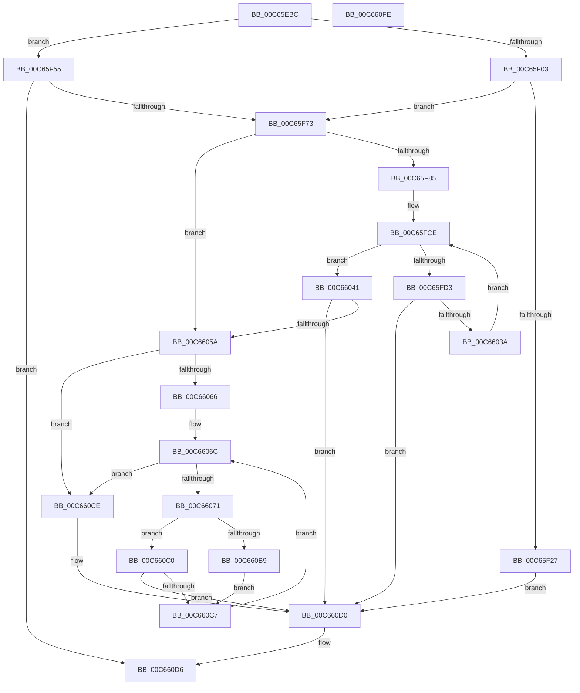

# MiApplyDynamicFixupsToKernelAndHal

- RVA: `0x00C65EBC`–`0x00C660FF` (길이 `579` bytes)
- VA: `0x0000000140C65EBC`
- 실행 섹션: `INIT`
- PDB 이름 있음: `예`; PDB Function 태그: `아니요`
- unwind 정보 RVA: `0x000D8358`
- 디코드: `148`개 명령, `579/579` bytes 표시
- 미해석 바이트: `0` (있으면 어셈블리에 `.byte`로 보존)

> 이 문서는 커널 이미지의 기계어와 PDB 기호를 분석해 생성했습니다. 4번과 5번은 함수 원형과 자료형을 바이너리 사용 방식에서 추정한 C 해석이며 원본 소스 복구 결과는 아닙니다.

## 1. Dependencies

- 직접 호출 지점: **10**; 고유 호출 대상: **9**
- 직접 호출자로 확인된 함수: **1**
- RIP 상대 이미지 참조: **10**

### Outgoing calls
- `0x00C65F32` → [memset](../../text/6C/memset_function_006C6C40.md) (function, `0x006C6C40`)
- `0x00C65F4B` → [VslpEnterIumSecureMode](../../text/23/VslpEnterIumSecureMode_function_00235E50.md) (function, `0x00235E50`)
- `0x00C65F66` → [RtlCopyKernelScpUnwindInfo](../../text/5E/RtlCopyKernelScpUnwindInfo_function_005EF038.md) (function, `0x005EF038`)
- `0x00C65FA4` → [RtlImageNtHeaderEx](../../text/41/RtlImageNtHeaderEx_function_0041EAA0.md) (function, `0x0041EAA0`)
- `0x00C65FB7` → [RtlLookupImageSectionByName](../../text/4B/RtlLookupImageSectionByName_function_004B4F20.md) (function, `0x004B4F20`)
- `0x00C65FE2` → [RtlLookupImageSectionByName](../../text/4B/RtlLookupImageSectionByName_function_004B4F20.md) (function, `0x004B4F20`)
- `0x00C6602D` → [RtlPerformRetpolineRelocationsOnImageEx](../../text/6A/RtlPerformRetpolineRelocationsOnImageEx_function_006A9AD4.md) (function, `0x006A9AD4`)
- `0x00C66051` → [RtlInitializeKscpCfgFunctions](../C4/RtlInitializeKscpCfgFunctions_function_00C477E8.md) (function, `0x00C477E8`)
- `0x00C660B0` → [RtlUpdateImportRelocationsInImage](../../text/6A/RtlUpdateImportRelocationsInImage_function_006A9E1C.md) (function, `0x006A9E1C`)
- `0x00C660DD` → [_security_check_cookie](../../text/6A/_security_check_cookie_function_006AC640.md) (function, `0x006AC640`)

### Direct callers
- [MiPrepareScpFixupsForNtAndHal](MiPrepareScpFixupsForNtAndHal_function_00C66734.md) at `0x00C667C5`

### Static image references
- `0x00C65EDA` → RVA `0x00E0A740` (`.data`; read)
- `0x00C65EEE` → RVA `0x00FC6A88` (`ALMOSTRO`; read)
- `0x00C65F03` → RVA `0x00FC6B48` (`ALMOSTRO`; read)
- `0x00C65F16` → RVA `0x00F10EC0` (`.data`; read)
- `0x00C65F59` → RVA `0x00E2D830` (`.data`; read)
- `0x00C65F92` → RVA `0x00C66670` (`MiIsBootImageTargetFullyRetpolined`; read)
- `0x00C65FAD` → RVA `0x00C7E6A0` (` ?? ::PBOPGDP::`string'`; read)
- `0x00C65FD8` → RVA `0x00C7E690` (` ?? ::PBOPGDP::`string'`; read)
- `0x00C66041` → RVA `0x00E2D83C` (`.data`; read)
- `0x00C660D0` → RVA `0x00E2D848` (`.data`; write)

## 2. Other-region calls and transfers

- 다른 실행 섹션으로 향하는 call: **9**
  - `0x00C65F32` → [memset](../../text/6C/memset_function_006C6C40.md) (`INIT` → `.text`)
  - `0x00C65F4B` → [VslpEnterIumSecureMode](../../text/23/VslpEnterIumSecureMode_function_00235E50.md) (`INIT` → `.text`)
  - `0x00C65F66` → [RtlCopyKernelScpUnwindInfo](../../text/5E/RtlCopyKernelScpUnwindInfo_function_005EF038.md) (`INIT` → `.text`)
  - `0x00C65FA4` → [RtlImageNtHeaderEx](../../text/41/RtlImageNtHeaderEx_function_0041EAA0.md) (`INIT` → `.text`)
  - `0x00C65FB7` → [RtlLookupImageSectionByName](../../text/4B/RtlLookupImageSectionByName_function_004B4F20.md) (`INIT` → `.text`)
  - `0x00C65FE2` → [RtlLookupImageSectionByName](../../text/4B/RtlLookupImageSectionByName_function_004B4F20.md) (`INIT` → `.text`)
  - `0x00C6602D` → [RtlPerformRetpolineRelocationsOnImageEx](../../text/6A/RtlPerformRetpolineRelocationsOnImageEx_function_006A9AD4.md) (`INIT` → `.text`)
  - `0x00C660B0` → [RtlUpdateImportRelocationsInImage](../../text/6A/RtlUpdateImportRelocationsInImage_function_006A9E1C.md) (`INIT` → `.text`)
  - `0x00C660DD` → [_security_check_cookie](../../text/6A/_security_check_cookie_function_006AC640.md) (`INIT` → `.text`)
- 별도 외부 분기/꼬리 이동을 확인하지 못했습니다.

## 3. Assembly (complete function range)

```asm
00C65EBC  48 89 5C 24 10                  mov qword ptr [rsp + 0x10], rbx
00C65EC1  48 89 74 24 18                  mov qword ptr [rsp + 0x18], rsi
00C65EC6  55                              push rbp
00C65EC7  57                              push rdi
00C65EC8  41 54                           push r12
00C65ECA  41 56                           push r14
00C65ECC  41 57                           push r15
00C65ECE  48 8D 6C 24 C9                  lea rbp, [rsp - 0x37]
00C65ED3  48 81 EC F0 00 00 00            sub rsp, 0xf0
00C65EDA  48 8B 05 5F 48 1A 00            mov rax, qword ptr [rip + 0x1a485f]
00C65EE1  48 33 C4                        xor rax, rsp
00C65EE4  48 89 45 27                     mov qword ptr [rbp + 0x27], rax
00C65EE8  4C 8B F1                        mov r14, rcx
00C65EEB  45 33 E4                        xor r12d, r12d
00C65EEE  48 F7 05 8F 0B 36 00 00 40 00 00  test qword ptr [rip + 0x360b8f], 0x4000
00C65EF9  48 8B 49 10                     mov rcx, qword ptr [rcx + 0x10]
00C65EFD  48 89 4D 9F                     mov qword ptr [rbp - 0x61], rcx
00C65F01  74 52                           je 0x140c65f55
00C65F03  48 8B 0D 3E 0C 36 00            mov rcx, qword ptr [rip + 0x360c3e]
00C65F0A  48 C1 E9 29                     shr rcx, 0x29
00C65F0E  83 E1 01                        and ecx, 1
00C65F11  8B D9                           mov ebx, ecx
00C65F13  83 CB 02                        or ebx, 2
00C65F16  F7 05 A0 AF 2A 00 00 00 02 00   test dword ptr [rip + 0x2aafa0], 0x20000
00C65F20  0F 45 D9                        cmovne ebx, ecx
00C65F23  85 DB                           test ebx, ebx
00C65F25  74 4C                           je 0x140c65f73
00C65F27  33 D2                           xor edx, edx
00C65F29  45 8D 44 24 68                  lea r8d, [r12 + 0x68]
00C65F2E  48 8D 4D B7                     lea rcx, [rbp - 0x49]
00C65F32  E8 09 0D A6 FF                  call 0x1406c6c40
00C65F37  8B C3                           mov eax, ebx
00C65F39  4C 8D 4D B7                     lea r9, [rbp - 0x49]
00C65F3D  BA DF 00 00 00                  mov edx, 0xdf
00C65F42  48 89 45 BF                     mov qword ptr [rbp - 0x41], rax
00C65F46  45 33 C0                        xor r8d, r8d
00C65F49  B1 02                           mov cl, 2
00C65F4B  E8 00 FF 5C FF                  call 0x140235e50
00C65F50  E9 7B 01 00 00                  jmp 0x140c660d0
00C65F55  48 8B 49 30                     mov rcx, qword ptr [rcx + 0x30]
00C65F59  4C 8B 05 D0 78 1C 00            mov r8, qword ptr [rip + 0x1c78d0]
00C65F60  48 8B D1                        mov rdx, rcx
00C65F63  4D 8B C8                        mov r9, r8
00C65F66  E8 CD 90 98 FF                  call 0x1405ef038
00C65F6B  85 C0                           test eax, eax
00C65F6D  0F 88 63 01 00 00               js 0x140c660d6
00C65F73  48 8B 05 CE 0B 36 00            mov rax, qword ptr [rip + 0x360bce]
00C65F7A  48 0F BA E0 29                  bt rax, 0x29
00C65F7F  0F 83 D5 00 00 00               jae 0x140c6605a
00C65F85  48 8B 55 9F                     mov rdx, qword ptr [rbp - 0x61]
00C65F89  4C 8D 4D 97                     lea r9, [rbp - 0x69]
00C65F8D  48 83 65 97 00                  and qword ptr [rbp - 0x69], 0
00C65F92  4C 8D 25 D7 06 00 00            lea r12, [rip + 0x6d7]
00C65F99  45 33 C0                        xor r8d, r8d
00C65F9C  48 8B 52 30                     mov rdx, qword ptr [rdx + 0x30]
00C65FA0  41 8D 48 01                     lea ecx, [r8 + 1]
00C65FA4  E8 F7 8A 7B FF                  call 0x14041eaa0
00C65FA9  48 8B 75 97                     mov rsi, qword ptr [rbp - 0x69]
00C65FAD  48 8D 15 EC 86 01 00            lea rdx, [rip + 0x186ec]
00C65FB4  48 8B CE                        mov rcx, rsi
00C65FB7  E8 64 EF 84 FF                  call 0x1404b4f20
00C65FBC  33 FF                           xor edi, edi
00C65FBE  8B 48 0C                        mov ecx, dword ptr [rax + 0xc]
00C65FC1  8B 40 08                        mov eax, dword ptr [rax + 8]
00C65FC4  44 8D 7F 01                     lea r15d, [rdi + 1]
00C65FC8  89 45 A7                        mov dword ptr [rbp - 0x59], eax
00C65FCB  89 4D AF                        mov dword ptr [rbp - 0x51], ecx
00C65FCE  83 FF 01                        cmp edi, 1
00C65FD1  73 6E                           jae 0x140c66041
00C65FD3  48 8B 5C FD 9F                  mov rbx, qword ptr [rbp + rdi*8 - 0x61]
00C65FD8  48 8D 15 B1 86 01 00            lea rdx, [rip + 0x186b1]
00C65FDF  48 8B CE                        mov rcx, rsi
00C65FE2  E8 39 EF 84 FF                  call 0x1404b4f20
00C65FE7  4C 8B 0D 42 78 1C 00            mov r9, qword ptr [rip + 0x1c7842]
00C65FEE  44 8B 43 40                     mov r8d, dword ptr [rbx + 0x40]
00C65FF2  41 8B D7                        mov edx, r15d
00C65FF5  8B 48 0C                        mov ecx, dword ptr [rax + 0xc]
00C65FF8  8B 40 08                        mov eax, dword ptr [rax + 8]
00C65FFB  89 44 95 A7                     mov dword ptr [rbp + rdx*4 - 0x59], eax
00C65FFF  41 8D 47 01                     lea eax, [r15 + 1]
00C66003  89 44 24 40                     mov dword ptr [rsp + 0x40], eax
00C66007  48 8D 45 A7                     lea rax, [rbp - 0x59]
00C6600B  48 89 44 24 38                  mov qword ptr [rsp + 0x38], rax
00C66010  48 8D 45 AF                     lea rax, [rbp - 0x51]
00C66014  89 4C 95 AF                     mov dword ptr [rbp + rdx*4 - 0x51], ecx
00C66018  49 8D 51 04                     lea rdx, [r9 + 4]
00C6601C  48 8B 4B 30                     mov rcx, qword ptr [rbx + 0x30]
00C66020  48 89 44 24 30                  mov qword ptr [rsp + 0x30], rax
00C66025  48 89 54 24 20                  mov qword ptr [rsp + 0x20], rdx
00C6602A  48 8B D1                        mov rdx, rcx
00C6602D  E8 A2 3A A4 FF                  call 0x1406a9ad4
00C66032  85 C0                           test eax, eax
00C66034  0F 88 96 00 00 00               js 0x140c660d0
00C6603A  45 33 FF                        xor r15d, r15d
00C6603D  FF C7                           inc edi
00C6603F  EB 8D                           jmp 0x140c65fce
00C66041  8B 15 F5 77 1C 00               mov edx, dword ptr [rip + 0x1c77f5]
00C66047  48 8B 0D E2 77 1C 00            mov rcx, qword ptr [rip + 0x1c77e2]
00C6604E  C1 E2 0C                        shl edx, 0xc
00C66051  E8 92 17 FE FF                  call 0x140c477e8
00C66056  85 C0                           test eax, eax
00C66058  78 76                           js 0x140c660d0
00C6605A  F7 05 5C AE 2A 00 00 00 02 00   test dword ptr [rip + 0x2aae5c], 0x20000
00C66064  75 68                           jne 0x140c660ce
00C66066  49 8B 5E 10                     mov rbx, qword ptr [r14 + 0x10]
00C6606A  33 FF                           xor edi, edi
00C6606C  83 FF 02                        cmp edi, 2
00C6606F  73 5D                           jae 0x140c660ce
00C66071  4C 8B 05 D0 0A 36 00            mov r8, qword ptr [rip + 0x360ad0]
00C66078  4D 8B CC                        mov r9, r12
00C6607B  48 8B 15 AE 77 1C 00            mov rdx, qword ptr [rip + 0x1c77ae]
00C66082  48 8B 4B 30                     mov rcx, qword ptr [rbx + 0x30]
00C66086  49 C1 E8 29                     shr r8, 0x29
00C6608A  41 F6 D0                        not r8b
00C6608D  41 80 E0 01                     and r8b, 1
00C66091  48 8D 42 04                     lea rax, [rdx + 4]
00C66095  44 88 44 24 38                  mov byte ptr [rsp + 0x38], r8b
00C6609A  44 8B 43 40                     mov r8d, dword ptr [rbx + 0x40]
00C6609E  C6 44 24 30 01                  mov byte ptr [rsp + 0x30], 1
00C660A3  48 89 44 24 28                  mov qword ptr [rsp + 0x28], rax
00C660A8  48 89 54 24 20                  mov qword ptr [rsp + 0x20], rdx
00C660AD  48 8B D1                        mov rdx, rcx
00C660B0  E8 67 3D A4 FF                  call 0x1406a9e1c
00C660B5  85 C0                           test eax, eax
00C660B7  78 07                           js 0x140c660c0
00C660B9  0F BA 6B 68 07                  bts dword ptr [rbx + 0x68], 7
00C660BE  EB 07                           jmp 0x140c660c7
00C660C0  3D BB 00 00 C0                  cmp eax, 0xc00000bb
00C660C5  75 09                           jne 0x140c660d0
00C660C7  48 8B 1B                        mov rbx, qword ptr [rbx]
00C660CA  FF C7                           inc edi
00C660CC  EB 9E                           jmp 0x140c6606c
00C660CE  33 C0                           xor eax, eax
00C660D0  89 05 72 77 1C 00               mov dword ptr [rip + 0x1c7772], eax
00C660D6  48 8B 4D 27                     mov rcx, qword ptr [rbp + 0x27]
00C660DA  48 33 CC                        xor rcx, rsp
00C660DD  E8 5E 65 A4 FF                  call 0x1406ac640
00C660E2  4C 8D 9C 24 F0 00 00 00         lea r11, [rsp + 0xf0]
00C660EA  49 8B 5B 38                     mov rbx, qword ptr [r11 + 0x38]
00C660EE  49 8B 73 40                     mov rsi, qword ptr [r11 + 0x40]
00C660F2  49 8B E3                        mov rsp, r11
00C660F5  41 5F                           pop r15
00C660F7  41 5E                           pop r14
00C660F9  41 5C                           pop r12
00C660FB  5F                              pop rdi
00C660FC  5D                              pop rbp
00C660FD  C3                              ret
00C660FE  CC                              int3
```

## 4. C-style interpretation (structured pseudocode)

```c
__int64 __fastcall MiApplyDynamicFixupsToKernelAndHal(__int64 a1, int a2)
{
    __int64 result;
    __int64 v_r12;
    __int64 v_r15;
    __int64 v_rbx;
    __int64 v_rdi;
    __int64 v_rsp;
    unsigned __int64 v_stack_m28;
    unsigned __int64 v_stack_m38;
    unsigned __int64 v_stack_m5F;
    unsigned __int64 v_stack_mA0;
    unsigned __int64 v_stack_mA8;
    unsigned int v_stack_mB0;
    unsigned int v_stack_mB8;
    unsigned __int64 v_stack_mC0;
    unsigned __int64 v_stack_mC8;
    unsigned int v_stack_mD8;
    unsigned __int64 v_stack_mE0;
    unsigned __int64 v_stack_mE8;
    unsigned __int64 v_stack_mF0;
    unsigned __int64 v_stack_mF8;
    unsigned __int64 v_stack_p10;
    unsigned __int64 v_stack_p18;

    v_stack_p10 = v_rbx;
    v_stack_p18 = v_rsi;
    v_rsp = (v_rsp) - (240);
    result = (*(unsigned __int64 *)(v_rip + 1722463)) ^ (v_rsp);
    v_stack_m38 = result;
    v_r12 = 0;
    v_stack_mC0 = *(unsigned __int64 *)(a1 + 16);
    if (((*(unsigned __int64 *)(v_rip + 3541903)) & (0x4000ULL)) == 0) goto loc_00C65F55;
    a1 = (*(unsigned __int64 *)(v_rip + 3542078)) >> (41);
    a1 = (unsigned int)((a1) & (1));
    v_rbx = (unsigned int)(((unsigned int)((unsigned int)(a1))) | (2));
    if (((*(unsigned int *)(v_rip + 2797472)) & (0x20000ULL)) != 0) { v_rbx = (unsigned int)(a1); }
    if ((unsigned int)(v_rbx) == 0) goto loc_00C65F73;
    a2 = 0;
    result = memset(v_stack_mA8, a2, v_r12 + 104, a4);
    v_stack_mA0 = (unsigned int)((unsigned int)(v_rbx));
    a3 = 0;
    result = VslpEnterIumSecureMode(2, 223, a3, v_stack_mA8);
    goto loc_00C660D0;
loc_00C65F55:
    result = RtlCopyKernelScpUnwindInfo(*(unsigned __int64 *)(2 + 48), *(unsigned __int64 *)(2 + 48), *(unsigned __int64 *)(v_rip + 1865936), *(unsigned __int64 *)(v_rip + 1865936));
    if (sign_flag) goto loc_00C660D6;
loc_00C65F73:
    if (condition_is_above_or_equal) goto loc_00C6605A;
    a3 = 0;
    result = RtlImageNtHeaderEx(a3 + 1, *(unsigned __int64 *)(v_stack_mC0 + 48), a3, v_stack_mC8);
    result = RtlLookupImageSectionByName(v_stack_mC8, v_rip + 100076, a3, v_stack_mC8);
    v_rdi = 0;
    v_stack_mB8 = (unsigned int)((unsigned int)(*(unsigned int *)(result + 8)));
    v_stack_mB0 = (unsigned int)((unsigned int)(*(unsigned int *)(result + 12)));
loc_00C65FCE:
    if (0 >= 1) goto loc_00C66041;
    result = RtlLookupImageSectionByName(v_stack_mC8, v_rip + 100017, a3, v_stack_mC8);
    *(unsigned int *)(v_stack_m5F + (unsigned int)((unsigned int)(v_rdi + 1)) * 4 - 89) = (unsigned int)((unsigned int)(*(unsigned int *)(result + 8)));
    v_stack_mD8 = (unsigned int)(v_rdi + 1 + 1);
    v_stack_mE0 = v_stack_mB8;
    *(unsigned int *)(v_stack_m5F + (unsigned int)((unsigned int)(v_rdi + 1)) * 4 - 81) = (unsigned int)((unsigned int)(*(unsigned int *)(result + 12)));
    v_stack_mE8 = v_stack_mB0;
    v_stack_mF8 = *(unsigned __int64 *)(v_rip + 1865794) + 4;
    result = RtlPerformRetpolineRelocationsOnImageEx(*(unsigned __int64 *)(*(unsigned __int64 *)(v_stack_m5F + v_rdi * 8 - 97) + 48), *(unsigned __int64 *)(*(unsigned __int64 *)(v_stack_m5F + v_rdi * 8 - 97) + 48), (unsigned int)(*(unsigned int *)(*(unsigned __int64 *)(v_stack_m5F + v_rdi * 8 - 97) + 64)), *(unsigned __int64 *)(v_rip + 1865794));
    if (sign_flag) goto loc_00C660D0;
    v_r15 = 0;
    v_rdi = (unsigned int)((v_rdi) + 1);
    goto loc_00C65FCE;
loc_00C66041:
    a2 = (unsigned int)(((unsigned int)(*(unsigned int *)(v_rip + 1865717))) << (12));
    result = RtlInitializeKscpCfgFunctions(*(unsigned __int64 *)(v_rip + 1865698), a2, (unsigned int)(*(unsigned int *)(*(unsigned __int64 *)(v_stack_m5F + v_rdi * 8 - 97) + 64)), *(unsigned __int64 *)(v_rip + 1865794));
    if (sign_flag) goto loc_00C660D0;
loc_00C6605A:
    if (((*(unsigned int *)(v_rip + 2797148)) & (0x20000ULL)) != 0) goto loc_00C660CE;
    v_rdi = 0;
loc_00C6606C:
    if (0 >= 2) goto loc_00C660CE;
    a3 = (*(unsigned __int64 *)(v_rip + 3541712)) >> (41);
    a3 = (unsigned __int8)(~(a3));
    a3 = (unsigned __int8)((a3) & (1));
    v_stack_mE0 = (unsigned __int8)(a3);
    v_stack_mE8 = 1;
    v_stack_mF0 = *(unsigned __int64 *)(v_rip + 1865646) + 4;
    v_stack_mF8 = *(unsigned __int64 *)(v_rip + 1865646);
    result = RtlUpdateImportRelocationsInImage(*(unsigned __int64 *)(*(unsigned __int64 *)(a1 + 16) + 48), *(unsigned __int64 *)(*(unsigned __int64 *)(a1 + 16) + 48), (unsigned int)(*(unsigned int *)(*(unsigned __int64 *)(a1 + 16) + 64)), v_rip + 1751);
    if (sign_flag) goto loc_00C660C0;
    goto loc_00C660C7;
loc_00C660C0:
    if (((unsigned int)(result)) != 0xC00000BBULL) goto loc_00C660D0;
loc_00C660C7:
    v_rdi = (unsigned int)((v_rdi) + 1);
    goto loc_00C6606C;
loc_00C660CE:
    result = 0;
loc_00C660D0:
    *(unsigned int *)(v_rip + 1865586) = 0;
loc_00C660D6:
    a1 = (v_stack_m38) ^ (v_rsp);
    result = _security_check_cookie(a1, *(unsigned __int64 *)(*(unsigned __int64 *)(a1 + 16) + 48), (unsigned int)(*(unsigned int *)(*(unsigned __int64 *)(a1 + 16) + 64)), v_rip + 1751);
    return result;
}
```

## 5. (Beta) C Style

```c
int64_t MiApplyDynamicFixupsToKernelAndHal(void *Arg1, int32_t Arg2)
{
    uint8_t *arg1 = (uint8_t *)Arg1;

    int64_t result;
    int64_t local_r12;
    int64_t local_r15;
    int64_t local_rbx;
    int64_t local_rdi;
    int64_t local_rsp;
    uint64_t v_stack_m28;
    uint64_t v_stack_m38;
    uint64_t v_stack_m5F;
    uint64_t v_stack_mA0;
    uint64_t v_stack_mA8;
    uint32_t v_stack_mB0;
    uint32_t v_stack_mB8;
    uint64_t v_stack_mC0;
    uint64_t v_stack_mC8;
    uint32_t v_stack_mD8;
    uint64_t v_stack_mE0;
    uint64_t v_stack_mE8;
    uint64_t v_stack_mF0;
    uint64_t v_stack_mF8;
    uint64_t v_stack_p10;
    uint64_t v_stack_p18;

    v_stack_p10 = local_rbx;
    v_stack_p18 = local_rsi;
    local_rsp = (local_rsp) - (240);
    result = (*(uint64_t *)(v_rip + 0x1A485F)) ^ (local_rsp);
    v_stack_m38 = result;
    local_r12 = 0;
    v_stack_mC0 = *(uint64_t *)(arg1 + 0x10);
    if (((*(uint64_t *)(v_rip + 0x360B8F)) & (0x4000ULL)) == 0) goto loc_00C65F55;
    Arg1 = (*(uint64_t *)(v_rip + 0x360C3E)) >> (41);
    Arg1 = (uint32_t)((Arg1) & (1));
    local_rbx = (uint32_t)(((uint32_t)((uint32_t)(Arg1))) | (2));
    if (((*(uint32_t *)(v_rip + 0x2AAFA0)) & (0x20000ULL)) != 0) { local_rbx = (uint32_t)(Arg1); }
    if ((uint32_t)(local_rbx) == 0) goto loc_00C65F73;
    Arg2 = 0;
    result = memset(v_stack_mA8, Arg2, local_r12 + 104, a4);
    v_stack_mA0 = (uint32_t)((uint32_t)(local_rbx));
    a3 = 0;
    result = VslpEnterIumSecureMode(2, 223, a3, v_stack_mA8);
    goto loc_00C660D0;
loc_00C65F55:
    result = RtlCopyKernelScpUnwindInfo(*(uint64_t *)(2 + 0x30), *(uint64_t *)(2 + 0x30), *(uint64_t *)(v_rip + 0x1C78D0), *(uint64_t *)(v_rip + 0x1C78D0));
    if (sign_flag) goto loc_00C660D6;
loc_00C65F73:
    if (condition_is_above_or_equal) goto loc_00C6605A;
    a3 = 0;
    result = RtlImageNtHeaderEx(a3 + 1, *(uint64_t *)(v_stack_mC0 + 0x30), a3, v_stack_mC8);
    result = RtlLookupImageSectionByName(v_stack_mC8, v_rip + 100076, a3, v_stack_mC8);
    local_rdi = 0;
    v_stack_mB8 = (uint32_t)((uint32_t)(*(uint32_t *)(result + 0x8)));
    v_stack_mB0 = (uint32_t)((uint32_t)(*(uint32_t *)(result + 0xC)));
loc_00C65FCE:
    if (0 >= 1) goto loc_00C66041;
    result = RtlLookupImageSectionByName(v_stack_mC8, v_rip + 100017, a3, v_stack_mC8);
    *(uint32_t *)(v_stack_m5F + (uint32_t)((uint32_t)(local_rdi + 0x1)) * 4 - 0x59) = (uint32_t)((uint32_t)(*(uint32_t *)(result + 0x8)));
    v_stack_mD8 = (uint32_t)(local_rdi + 1 + 1);
    v_stack_mE0 = v_stack_mB8;
    *(uint32_t *)(v_stack_m5F + (uint32_t)((uint32_t)(local_rdi + 0x1)) * 4 - 0x51) = (uint32_t)((uint32_t)(*(uint32_t *)(result + 0xC)));
    v_stack_mE8 = v_stack_mB0;
    v_stack_mF8 = *(uint64_t *)(v_rip + 0x1C7842) + 4;
    result = RtlPerformRetpolineRelocationsOnImageEx(*(uint64_t *)(*(uint64_t *)(v_stack_m5F + local_rdi * 8 - 0x61) + 0x30), *(uint64_t *)(*(uint64_t *)(v_stack_m5F + local_rdi * 8 - 0x61) + 0x30), (uint32_t)(*(uint32_t *)(*(uint64_t *)(v_stack_m5F + local_rdi * 8 - 0x61) + 0x40)), *(uint64_t *)(v_rip + 0x1C7842));
    if (sign_flag) goto loc_00C660D0;
    local_r15 = 0;
    local_rdi = (uint32_t)((local_rdi) + 1);
    goto loc_00C65FCE;
loc_00C66041:
    Arg2 = (uint32_t)(((uint32_t)(*(uint32_t *)(v_rip + 0x1C77F5))) << (12));
    result = RtlInitializeKscpCfgFunctions(*(uint64_t *)(v_rip + 0x1C77E2), Arg2, (uint32_t)(*(uint32_t *)(*(uint64_t *)(v_stack_m5F + local_rdi * 8 - 0x61) + 0x40)), *(uint64_t *)(v_rip + 0x1C7842));
    if (sign_flag) goto loc_00C660D0;
loc_00C6605A:
    if (((*(uint32_t *)(v_rip + 0x2AAE5C)) & (0x20000ULL)) != 0) goto loc_00C660CE;
    local_rdi = 0;
loc_00C6606C:
    if (0 >= 2) goto loc_00C660CE;
    a3 = (*(uint64_t *)(v_rip + 0x360AD0)) >> (41);
    a3 = (uint8_t)(~(a3));
    a3 = (uint8_t)((a3) & (1));
    v_stack_mE0 = (uint8_t)(a3);
    v_stack_mE8 = 1;
    v_stack_mF0 = *(uint64_t *)(v_rip + 0x1C77AE) + 4;
    v_stack_mF8 = *(uint64_t *)(v_rip + 0x1C77AE);
    result = RtlUpdateImportRelocationsInImage(*(uint64_t *)(*(uint64_t *)(arg1 + 0x10) + 0x30), *(uint64_t *)(*(uint64_t *)(arg1 + 0x10) + 0x30), (uint32_t)(*(uint32_t *)(*(uint64_t *)(arg1 + 0x10) + 0x40)), v_rip + 1751);
    if (sign_flag) goto loc_00C660C0;
    goto loc_00C660C7;
loc_00C660C0:
    if (((uint32_t)(result)) != 0xC00000BBULL) goto loc_00C660D0;
loc_00C660C7:
    local_rdi = (uint32_t)((local_rdi) + 1);
    goto loc_00C6606C;
loc_00C660CE:
    result = 0;
loc_00C660D0:
    *(uint32_t *)(v_rip + 0x1C7772) = 0;
loc_00C660D6:
    Arg1 = (v_stack_m38) ^ (local_rsp);
    result = _security_check_cookie(Arg1, *(uint64_t *)(*(uint64_t *)(arg1 + 0x10) + 0x30), (uint32_t)(*(uint32_t *)(*(uint64_t *)(arg1 + 0x10) + 0x40)), v_rip + 1751);
    return result;
}
```

### 관측된 메모리 오프셋

구조체 형식이 확인되지 않은 접근은 인자 기준의 오프셋으로만 기록했습니다.

| 기준 인자 | 오프셋 표현 | 폭 (bit) | 접근 |
|---|---:|---:|---|
| `Arg1` | `+ 0x10` | `64` | `R` |

## 6. Execution-region graph

[열기: 2D/3D 그래프와 함수 탐색 컨트롤 패널](../../../control-panel.html?section=init&rva=0x00C65EBC&view=graph)

- 2D 그래프는 위에서 아래로 흐르고, 3D 그래프는 빈 공간을 드래그해 회전합니다. Shift+드래그는 이동, 휠은 확대·축소, 함수 노드 선택은 대상 보고서 이동입니다.

### Static fallback


