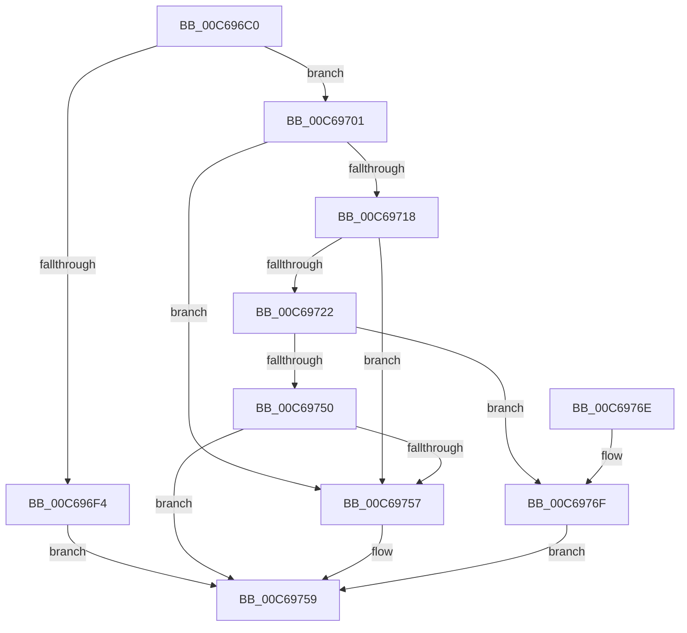

# MiApplyDynamicRelocations

- RVA: `0x00C696C0`–`0x00C6978A` (길이 `202` bytes)
- VA: `0x0000000140C696C0`
- 실행 섹션: `INIT`
- PDB 이름 있음: `예`; PDB Function 태그: `아니요`
- unwind 정보 RVA: `0x000D8EAC`
- 디코드: `55`개 명령, `202/202` bytes 표시
- 미해석 바이트: `0` (있으면 어셈블리에 `.byte`로 보존)

> 이 문서는 커널 이미지의 기계어와 PDB 기호를 분석해 생성했습니다. 4번과 5번은 함수 원형과 자료형을 바이너리 사용 방식에서 추정한 C 해석이며 원본 소스 복구 결과는 아닙니다.

## 1. Dependencies

- 직접 호출 지점: **4**; 고유 호출 대상: **4**
- 직접 호출자로 확인된 함수: **1**
- RIP 상대 이미지 참조: **1**

### Outgoing calls
- `0x00C696FA` → [VslApplyDynamicRelocations](../C2/VslApplyDynamicRelocations_function_00C29AE8.md) (function, `0x00C29AE8`)
- `0x00C6970E` → [RtlImageDirectoryEntryToData](../../text/43/RtlImageDirectoryEntryToData_function_004328D0.md) (function, `0x004328D0`)
- `0x00C69747` → [LdrCaptureDynamicRelocationTableHeader](../../page/94/LdrCaptureDynamicRelocationTableHeader_function_009421E4.md) (function, `0x009421E4`)
- `0x00C69783` → [LdrApplyDynamicRelocations](../../text/5E/LdrApplyDynamicRelocations_function_005EDEC8.md) (function, `0x005EDEC8`)

### Direct callers
- [MiRebaseDynamicRelocationRegions](MiRebaseDynamicRelocationRegions_function_00C65C4C.md) at `0x00C65D48`
- [MiRebaseDynamicRelocationRegions](MiRebaseDynamicRelocationRegions_function_00C65C4C.md) at `0x00C65D70`
- [MiRebaseDynamicRelocationRegions](MiRebaseDynamicRelocationRegions_function_00C65C4C.md) at `0x00C65DD1`

### Static image references
- `0x00C696E2` → RVA `0x00FC6A88` (`ALMOSTRO`; read)

## 2. Other-region calls and transfers

- 다른 실행 섹션으로 향하는 call: **3**
  - `0x00C6970E` → [RtlImageDirectoryEntryToData](../../text/43/RtlImageDirectoryEntryToData_function_004328D0.md) (`INIT` → `.text`)
  - `0x00C69747` → [LdrCaptureDynamicRelocationTableHeader](../../page/94/LdrCaptureDynamicRelocationTableHeader_function_009421E4.md) (`INIT` → `PAGE`)
  - `0x00C69783` → [LdrApplyDynamicRelocations](../../text/5E/LdrApplyDynamicRelocations_function_005EDEC8.md) (`INIT` → `.text`)
- 별도 외부 분기/꼬리 이동을 확인하지 못했습니다.

## 3. Assembly (complete function range)

```asm
00C696C0  48 8B C4                        mov rax, rsp
00C696C3  48 89 58 08                     mov qword ptr [rax + 8], rbx
00C696C7  48 89 68 10                     mov qword ptr [rax + 0x10], rbp
00C696CB  48 89 70 18                     mov qword ptr [rax + 0x18], rsi
00C696CF  57                              push rdi
00C696D0  48 83 EC 50                     sub rsp, 0x50
00C696D4  83 60 E8 00                     and dword ptr [rax - 0x18], 0
00C696D8  49 8B F9                        mov rdi, r9
00C696DB  83 60 EC 00                     and dword ptr [rax - 0x14], 0
00C696DF  49 8B F0                        mov rsi, r8
00C696E2  48 F7 05 9B D3 35 00 00 40 00 00  test qword ptr [rip + 0x35d39b], 0x4000
00C696ED  8B EA                           mov ebp, edx
00C696EF  48 8B D9                        mov rbx, rcx
00C696F2  74 0D                           je 0x140c69701
00C696F4  4D 8B C1                        mov r8, r9
00C696F7  48 8B D6                        mov rdx, rsi
00C696FA  E8 E9 03 FC FF                  call 0x140c29ae8
00C696FF  EB 58                           jmp 0x140c69759
00C69701  41 B8 0A 00 00 00               mov r8d, 0xa
00C69707  4C 8D 4C 24 40                  lea r9, [rsp + 0x40]
00C6970C  B2 01                           mov dl, 1
00C6970E  E8 BD 91 7C FF                  call 0x1404328d0
00C69713  48 85 C0                        test rax, rax
00C69716  74 3F                           je 0x140c69757
00C69718  44 8B 08                        mov r9d, dword ptr [rax]
00C6971B  44 39 4C 24 40                  cmp dword ptr [rsp + 0x40], r9d
00C69720  75 35                           jne 0x140c69757
00C69722  48 83 64 24 38 00               and qword ptr [rsp + 0x38], 0
00C69728  48 8D 4C 24 44                  lea rcx, [rsp + 0x44]
00C6972D  48 89 4C 24 30                  mov qword ptr [rsp + 0x30], rcx
00C69732  4C 8B C0                        mov r8, rax
00C69735  66 C7 44 24 28 0B 02            mov word ptr [rsp + 0x28], 0x20b
00C6973C  48 8B CB                        mov rcx, rbx
00C6973F  48 83 64 24 20 00               and qword ptr [rsp + 0x20], 0
00C69745  8B D5                           mov edx, ebp
00C69747  E8 98 8A CD FF                  call 0x1409421e4
00C6974C  85 C0                           test eax, eax
00C6974E  79 1F                           jns 0x140c6976f
00C69750  3D BB 00 00 C0                  cmp eax, 0xc00000bb
00C69755  75 02                           jne 0x140c69759
00C69757  33 C0                           xor eax, eax
00C69759  48 8B 5C 24 60                  mov rbx, qword ptr [rsp + 0x60]
00C6975E  48 8B 6C 24 68                  mov rbp, qword ptr [rsp + 0x68]
00C69763  48 8B 74 24 70                  mov rsi, qword ptr [rsp + 0x70]
00C69768  48 83 C4 50                     add rsp, 0x50
00C6976C  5F                              pop rdi
00C6976D  C3                              ret
00C6976E  CC                              int3
00C6976F  8B 54 24 44                     mov edx, dword ptr [rsp + 0x44]
00C69773  48 8B CB                        mov rcx, rbx
00C69776  48 03 D3                        add rdx, rbx
00C69779  48 89 7C 24 38                  mov qword ptr [rsp + 0x38], rdi
00C6977E  48 89 74 24 30                  mov qword ptr [rsp + 0x30], rsi
00C69783  E8 40 47 98 FF                  call 0x1405edec8
00C69788  EB CF                           jmp 0x140c69759
```

## 4. C-style interpretation (structured pseudocode)

```c
__int64 __fastcall MiApplyDynamicRelocations(__int64 a1, int a2, __int64 a3, __int64 a4)
{
    __int64 result;
    __int64 v_rsp;
    unsigned __int64 v_stack_m14;
    unsigned __int64 v_stack_m18;
    unsigned __int64 v_stack_m20;
    unsigned __int64 v_stack_m28;
    unsigned __int16 v_stack_m30;
    unsigned __int64 v_stack_m38;
    unsigned __int64 v_stack_p10;
    unsigned __int64 v_stack_p18;
    unsigned __int64 v_stack_p30;
    unsigned __int64 v_stack_p38;
    unsigned int v_stack_p44;
    unsigned __int64 v_stack_p8;

    *(unsigned __int64 *)(v_rsp + 8) = v_rbx;
    *(unsigned __int64 *)(v_rsp + 16) = v_rbp;
    *(unsigned __int64 *)(v_rsp + 24) = v_rsi;
    v_rsp = (v_rsp) - (80);
    if (((*(unsigned __int64 *)(v_rip + 3527579)) & (0x4000ULL)) == 0) goto loc_00C69701;
    result = VslApplyDynamicRelocations(a1, a3, a4, a4);
    goto loc_00C69759;
loc_00C69701:
    result = RtlImageDirectoryEntryToData(a1, 1, 10, v_stack_m18);
    if (result == 0) goto loc_00C69757;
    if (v_stack_m18 != ((unsigned int)((unsigned int)(*(unsigned int *)(result))))) goto loc_00C69757;
    v_stack_m28 = v_stack_m14;
    v_stack_m30 = 523;
    result = LdrCaptureDynamicRelocationTableHeader(a1, (unsigned int)((unsigned int)((unsigned int)(a2))), result, (unsigned int)(*(unsigned int *)(result)));
    if (!sign_flag) goto loc_00C6976F;
    if (((unsigned int)(result)) == 0xC00000BBULL) {
        result = 0;
    }
    v_rsp = (v_rsp) + (80);
    return result;
loc_00C6976F:
    a2 = ((unsigned int)(v_stack_p44)) + (v_stack_p8);
    v_stack_p38 = a4;
    v_stack_p30 = v_stack_p18;
    result = LdrApplyDynamicRelocations(v_stack_p8, a2, result, (unsigned int)(*(unsigned int *)(result)));
    goto loc_00C69759;
}
```

## 5. (Beta) C Style

```c
int64_t MiApplyDynamicRelocations(int64_t Arg1, int32_t Arg2, int64_t Arg3, int64_t Arg4)
{
    int64_t result;
    int64_t local_rsp;
    uint64_t v_stack_m14;
    uint64_t v_stack_m18;
    uint64_t v_stack_m20;
    uint64_t v_stack_m28;
    uint16_t v_stack_m30;
    uint64_t v_stack_m38;
    uint64_t v_stack_p10;
    uint64_t v_stack_p18;
    uint64_t v_stack_p30;
    uint64_t v_stack_p38;
    uint32_t v_stack_p44;
    uint64_t v_stack_p8;

    *(uint64_t *)(local_rsp + 0x8) = local_rbx;
    *(uint64_t *)(local_rsp + 0x10) = local_rbp;
    *(uint64_t *)(local_rsp + 0x18) = local_rsi;
    local_rsp = (local_rsp) - (80);
    if (((*(uint64_t *)(v_rip + 0x35D39B)) & (0x4000ULL)) == 0) goto loc_00C69701;
    result = VslApplyDynamicRelocations(Arg1, Arg3, Arg4, Arg4);
    goto loc_00C69759;
loc_00C69701:
    result = RtlImageDirectoryEntryToData(Arg1, 1, 10, v_stack_m18);
    if (result == 0) goto loc_00C69757;
    if (v_stack_m18 != ((uint32_t)((uint32_t)(*(uint32_t *)(result))))) goto loc_00C69757;
    v_stack_m28 = v_stack_m14;
    v_stack_m30 = 523;
    result = LdrCaptureDynamicRelocationTableHeader(Arg1, (uint32_t)((uint32_t)((uint32_t)(Arg2))), result, (uint32_t)(*(uint32_t *)(result)));
    if (!sign_flag) goto loc_00C6976F;
    if (((uint32_t)(result)) == 0xC00000BBULL) {
        result = 0;
    }
    local_rsp = (local_rsp) + (80);
    return result;
loc_00C6976F:
    Arg2 = ((uint32_t)(v_stack_p44)) + (v_stack_p8);
    v_stack_p38 = Arg4;
    v_stack_p30 = v_stack_p18;
    result = LdrApplyDynamicRelocations(v_stack_p8, Arg2, result, (uint32_t)(*(uint32_t *)(result)));
    goto loc_00C69759;
}
```

## 6. Execution-region graph

[열기: 2D/3D 그래프와 함수 탐색 컨트롤 패널](../../../control-panel.html?section=init&rva=0x00C696C0&view=graph)

- 2D 그래프는 위에서 아래로 흐르고, 3D 그래프는 빈 공간을 드래그해 회전합니다. Shift+드래그는 이동, 휠은 확대·축소, 함수 노드 선택은 대상 보고서 이동입니다.

### Static fallback


