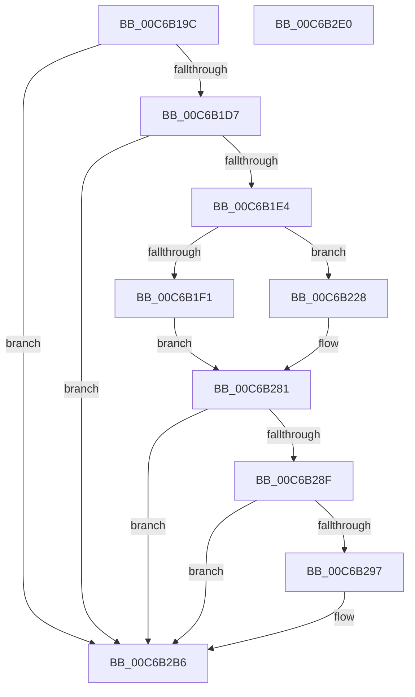

# MiApplyFunctionOverrideToBootDriver

- RVA: `0x00C6B19C`–`0x00C6B2E1` (길이 `325` bytes)
- VA: `0x0000000140C6B19C`
- 실행 섹션: `INIT`
- PDB 이름 있음: `예`; PDB Function 태그: `아니요`
- unwind 정보 RVA: `0x000D9520`
- 디코드: `74`개 명령, `325/325` bytes 표시
- 미해석 바이트: `0` (있으면 어셈블리에 `.byte`로 보존)

> 이 문서는 커널 이미지의 기계어와 PDB 기호를 분석해 생성했습니다. 4번과 5번은 함수 원형과 자료형을 바이너리 사용 방식에서 추정한 C 해석이며 원본 소스 복구 결과는 아닙니다.

## 1. Dependencies

- 직접 호출 지점: **6**; 고유 호출 대상: **6**
- 직접 호출자로 확인된 함수: **1**
- RIP 상대 이미지 참조: **5**

### Outgoing calls
- `0x00C6B1FC` → [memset](../../text/6C/memset_function_006C6C40.md) (function, `0x006C6C40`)
- `0x00C6B221` → [VslpEnterIumSecureMode](../../text/23/VslpEnterIumSecureMode_function_00235E50.md) (function, `0x00235E50`)
- `0x00C6B235` → [RtlInitializeImageSystemOverride](../../page/94/RtlInitializeImageSystemOverride_function_00940098.md) (function, `0x00940098`)
- `0x00C6B27C` → [RtlApplyFunctionOverrideFixupsToImage](../../page/79/RtlApplyFunctionOverrideFixupsToImage_function_007954E0.md) (function, `0x007954E0`)
- `0x00C6B2B0` → [KeBugCheckEx](../../text/4F/KeBugCheckEx_function_004FD660.md) (function, `0x004FD660`)
- `0x00C6B2C6` → [_security_check_cookie](../../text/6A/_security_check_cookie_function_006AC640.md) (function, `0x006AC640`)

### Direct callers
- [MiReloadBootLoadedDrivers](MiReloadBootLoadedDrivers_function_00C6C3F8.md) at `0x00C6C51A`

### Static image references
- `0x00C6B1AE` → RVA `0x00E0A740` (`.data`; read)
- `0x00C6B1C7` → RVA `0x00FC6B28` (`ALMOSTRO`; read)
- `0x00C6B1D7` → RVA `0x00FC6B98` (`ALMOSTRO`; read)
- `0x00C6B1E4` → RVA `0x00FC6A88` (`ALMOSTRO`; read)
- `0x00C6B23A` → RVA `0x00E2DAC0` (`.data`; read)

## 2. Other-region calls and transfers

- 다른 실행 섹션으로 향하는 call: **6**
  - `0x00C6B1FC` → [memset](../../text/6C/memset_function_006C6C40.md) (`INIT` → `.text`)
  - `0x00C6B221` → [VslpEnterIumSecureMode](../../text/23/VslpEnterIumSecureMode_function_00235E50.md) (`INIT` → `.text`)
  - `0x00C6B235` → [RtlInitializeImageSystemOverride](../../page/94/RtlInitializeImageSystemOverride_function_00940098.md) (`INIT` → `PAGE`)
  - `0x00C6B27C` → [RtlApplyFunctionOverrideFixupsToImage](../../page/79/RtlApplyFunctionOverrideFixupsToImage_function_007954E0.md) (`INIT` → `PAGE`)
  - `0x00C6B2B0` → [KeBugCheckEx](../../text/4F/KeBugCheckEx_function_004FD660.md) (`INIT` → `.text`)
  - `0x00C6B2C6` → [_security_check_cookie](../../text/6A/_security_check_cookie_function_006AC640.md) (`INIT` → `.text`)
- 별도 외부 분기/꼬리 이동을 확인하지 못했습니다.

## 3. Assembly (complete function range)

```asm
00C6B19C  48 89 5C 24 10                  mov qword ptr [rsp + 0x10], rbx
00C6B1A1  48 89 74 24 18                  mov qword ptr [rsp + 0x18], rsi
00C6B1A6  57                              push rdi
00C6B1A7  48 81 EC F0 00 00 00            sub rsp, 0xf0
00C6B1AE  48 8B 05 8B F5 19 00            mov rax, qword ptr [rip + 0x19f58b]
00C6B1B5  48 33 C4                        xor rax, rsp
00C6B1B8  48 89 84 24 E0 00 00 00         mov qword ptr [rsp + 0xe0], rax
00C6B1C0  48 8B 79 30                     mov rdi, qword ptr [rcx + 0x30]
00C6B1C4  48 8B D9                        mov rbx, rcx
00C6B1C7  48 3B 3D 5A B9 35 00            cmp rdi, qword ptr [rip + 0x35b95a]
00C6B1CE  8B 71 40                        mov esi, dword ptr [rcx + 0x40]
00C6B1D1  0F 84 DF 00 00 00               je 0x140c6b2b6
00C6B1D7  48 3B 3D BA B9 35 00            cmp rdi, qword ptr [rip + 0x35b9ba]
00C6B1DE  0F 84 D2 00 00 00               je 0x140c6b2b6
00C6B1E4  48 F7 05 99 B8 35 00 00 80 00 00  test qword ptr [rip + 0x35b899], 0x8000
00C6B1EF  74 37                           je 0x140c6b228
00C6B1F1  33 D2                           xor edx, edx
00C6B1F3  48 8D 4C 24 70                  lea rcx, [rsp + 0x70]
00C6B1F8  44 8D 42 68                     lea r8d, [rdx + 0x68]
00C6B1FC  E8 3F BA A5 FF                  call 0x1406c6c40
00C6B201  BA E4 00 00 00                  mov edx, 0xe4
00C6B206  48 89 7C 24 78                  mov qword ptr [rsp + 0x78], rdi
00C6B20B  4C 8D 4C 24 70                  lea r9, [rsp + 0x70]
00C6B210  48 C7 84 24 80 00 00 00 01 00 00 00  mov qword ptr [rsp + 0x80], 1
00C6B21C  45 33 C0                        xor r8d, r8d
00C6B21F  B1 02                           mov cl, 2
00C6B221  E8 2A AC 5C FF                  call 0x140235e50
00C6B226  EB 59                           jmp 0x140c6b281
00C6B228  41 B8 01 00 00 00               mov r8d, 1
00C6B22E  48 8D 4C 24 70                  lea rcx, [rsp + 0x70]
00C6B233  8B D6                           mov edx, esi
00C6B235  E8 5E 4E CD FF                  call 0x140940098
00C6B23A  4C 8D 05 7F 28 1C 00            lea r8, [rip + 0x1c287f]
00C6B241  8B D6                           mov edx, esi
00C6B243  48 8B CF                        mov rcx, rdi
00C6B246  0F 10 08                        movups xmm1, xmmword ptr [rax]
00C6B249  0F 10 40 10                     movups xmm0, xmmword ptr [rax + 0x10]
00C6B24D  0F 11 4C 24 30                  movups xmmword ptr [rsp + 0x30], xmm1
00C6B252  0F 10 48 20                     movups xmm1, xmmword ptr [rax + 0x20]
00C6B256  0F 11 44 24 40                  movups xmmword ptr [rsp + 0x40], xmm0
00C6B25B  F2 0F 10 40 30                  movsd xmm0, qword ptr [rax + 0x30]
00C6B260  8B 40 38                        mov eax, dword ptr [rax + 0x38]
00C6B263  89 44 24 68                     mov dword ptr [rsp + 0x68], eax
00C6B267  48 8D 44 24 30                  lea rax, [rsp + 0x30]
00C6B26C  48 89 44 24 20                  mov qword ptr [rsp + 0x20], rax
00C6B271  0F 11 4C 24 50                  movups xmmword ptr [rsp + 0x50], xmm1
00C6B276  F2 0F 11 44 24 60               movsd qword ptr [rsp + 0x60], xmm0
00C6B27C  E8 5F A2 B2 FF                  call 0x1407954e0
00C6B281  BA 00 00 00 80                  mov edx, 0x80000000
00C6B286  8B C8                           mov ecx, eax
00C6B288  8D 04 10                        lea eax, [rax + rdx]
00C6B28B  85 C2                           test edx, eax
00C6B28D  75 27                           jne 0x140c6b2b6
00C6B28F  81 F9 BB 00 00 C0               cmp ecx, 0xc00000bb
00C6B295  74 1F                           je 0x140c6b2b6
00C6B297  4C 8B 4B 30                     mov r9, qword ptr [rbx + 0x30]
00C6B29B  4C 8B C3                        mov r8, rbx
00C6B29E  48 63 C1                        movsxd rax, ecx
00C6B2A1  BA 84 10 00 00                  mov edx, 0x1084
00C6B2A6  B9 1A 00 00 00                  mov ecx, 0x1a
00C6B2AB  48 89 44 24 20                  mov qword ptr [rsp + 0x20], rax
00C6B2B0  E8 AB 23 89 FF                  call 0x1404fd660
00C6B2B5  CC                              int3
00C6B2B6  B8 01 00 00 00                  mov eax, 1
00C6B2BB  48 8B 8C 24 E0 00 00 00         mov rcx, qword ptr [rsp + 0xe0]
00C6B2C3  48 33 CC                        xor rcx, rsp
00C6B2C6  E8 75 13 A4 FF                  call 0x1406ac640
00C6B2CB  4C 8D 9C 24 F0 00 00 00         lea r11, [rsp + 0xf0]
00C6B2D3  49 8B 5B 18                     mov rbx, qword ptr [r11 + 0x18]
00C6B2D7  49 8B 73 20                     mov rsi, qword ptr [r11 + 0x20]
00C6B2DB  49 8B E3                        mov rsp, r11
00C6B2DE  5F                              pop rdi
00C6B2DF  C3                              ret
00C6B2E0  CC                              int3
```

## 4. C-style interpretation (structured pseudocode)

```c
__int64 __fastcall MiApplyFunctionOverrideToBootDriver(__int64 a1, int a2)
{
    __int64 result;
    __int64 v_rsp;
    unsigned __int64 v_stack_m18;
    unsigned __int64 v_stack_m78;
    unsigned __int64 v_stack_m8;
    unsigned __int64 v_stack_m80;
    unsigned __int64 v_stack_m88;
    unsigned int v_stack_m90;
    unsigned __int64 v_stack_m98;
    unsigned __int64 v_stack_mA8;
    unsigned __int64 v_stack_mB8;
    unsigned __int64 v_stack_mC8;
    unsigned __int64 v_stack_mD8;
    unsigned __int64 v_stack_p10;
    unsigned __int64 v_stack_p18;

    v_stack_p10 = v_rbx;
    v_stack_p18 = v_rsi;
    v_rsp = (v_rsp) - (240);
    result = (*(unsigned __int64 *)(v_rip + 1701259)) ^ (v_rsp);
    v_stack_m18 = result;
    if ((*(unsigned __int64 *)(a1 + 48)) == (*(unsigned __int64 *)(v_rip + 3520858))) goto loc_00C6B2B6;
    if ((*(unsigned __int64 *)(a1 + 48)) == (*(unsigned __int64 *)(v_rip + 3520954))) goto loc_00C6B2B6;
    if (((*(unsigned __int64 *)(v_rip + 3520665)) & (0x8000ULL)) == 0) goto loc_00C6B228;
    a2 = 0;
    result = memset(v_stack_m88, a2, a2 + 104, a4);
    v_stack_m80 = *(unsigned __int64 *)(a1 + 48);
    v_stack_m78 = 1;
    a3 = 0;
    result = VslpEnterIumSecureMode(2, 228, a3, v_stack_m88);
    goto loc_00C6B281;
loc_00C6B228:
    result = RtlInitializeImageSystemOverride(v_stack_m88, (unsigned int)((unsigned int)((unsigned int)(*(unsigned int *)(a1 + 64)))), 1, v_stack_m88);
    v_stack_mC8 = v_xmm1;
    v_stack_mB8 = v_xmm0;
    v_stack_m90 = (unsigned int)((unsigned int)(*(unsigned int *)(result + 56)));
    v_stack_mD8 = v_stack_mC8;
    v_stack_mA8 = v_xmm1;
    v_stack_m98 = v_xmm0;
    result = RtlApplyFunctionOverrideFixupsToImage(*(unsigned __int64 *)(a1 + 48), (unsigned int)((unsigned int)((unsigned int)(*(unsigned int *)(a1 + 64)))), v_rip + 1845375, v_stack_m88);
loc_00C6B281:
    if ((((unsigned int)((unsigned int)(0x80000000ULL))) & ((unsigned int)(result + (unsigned int)(0x80000000ULL) * 1))) != 0) goto loc_00C6B2B6;
    result = result + (unsigned int)(0x80000000ULL) * 1;
    if (((unsigned int)((unsigned int)((unsigned int)(result)))) != 0xC00000BBULL) {
        a4 = *(unsigned __int64 *)(a1 + 48);
        a3 = a1;
        result = (int)((unsigned int)((unsigned int)((unsigned int)(result))));
        a2 = 0x1084ULL;
        a1 = 26;
        v_stack_mD8 = result;
        result = KeBugCheckEx(a1, a2, a3, a4);
    }
    a1 = (v_stack_m18) ^ (v_rsp);
    result = _security_check_cookie(a1, a2, a3, a4);
    return result;
}
```

## 5. (Beta) C Style

```c
int64_t MiApplyFunctionOverrideToBootDriver(void *Arg1, int32_t Arg2)
{
    uint8_t *arg1 = (uint8_t *)Arg1;

    int64_t result;
    int64_t local_rsp;
    uint64_t v_stack_m18;
    uint64_t v_stack_m78;
    uint64_t v_stack_m8;
    uint64_t v_stack_m80;
    uint64_t v_stack_m88;
    uint32_t v_stack_m90;
    uint64_t v_stack_m98;
    uint64_t v_stack_mA8;
    uint64_t v_stack_mB8;
    uint64_t v_stack_mC8;
    uint64_t v_stack_mD8;
    uint64_t v_stack_p10;
    uint64_t v_stack_p18;

    v_stack_p10 = local_rbx;
    v_stack_p18 = local_rsi;
    local_rsp = (local_rsp) - (240);
    result = (*(uint64_t *)(v_rip + 0x19F58B)) ^ (local_rsp);
    v_stack_m18 = result;
    if ((*(uint64_t *)(arg1 + 0x30)) == (*(uint64_t *)(v_rip + 0x35B95A))) goto loc_00C6B2B6;
    if ((*(uint64_t *)(arg1 + 0x30)) == (*(uint64_t *)(v_rip + 0x35B9BA))) goto loc_00C6B2B6;
    if (((*(uint64_t *)(v_rip + 0x35B899)) & (0x8000ULL)) == 0) goto loc_00C6B228;
    Arg2 = 0;
    result = memset(v_stack_m88, Arg2, Arg2 + 104, a4);
    v_stack_m80 = *(uint64_t *)(arg1 + 0x30);
    v_stack_m78 = 1;
    a3 = 0;
    result = VslpEnterIumSecureMode(2, 228, a3, v_stack_m88);
    goto loc_00C6B281;
loc_00C6B228:
    result = RtlInitializeImageSystemOverride(v_stack_m88, (uint32_t)((uint32_t)((uint32_t)(*(uint32_t *)(arg1 + 0x40)))), 1, v_stack_m88);
    v_stack_mC8 = v_xmm1;
    v_stack_mB8 = v_xmm0;
    v_stack_m90 = (uint32_t)((uint32_t)(*(uint32_t *)(result + 0x38)));
    v_stack_mD8 = v_stack_mC8;
    v_stack_mA8 = v_xmm1;
    v_stack_m98 = v_xmm0;
    result = RtlApplyFunctionOverrideFixupsToImage(*(uint64_t *)(arg1 + 0x30), (uint32_t)((uint32_t)((uint32_t)(*(uint32_t *)(arg1 + 0x40)))), v_rip + 1845375, v_stack_m88);
loc_00C6B281:
    if ((((uint32_t)((uint32_t)(0x80000000ULL))) & ((uint32_t)(result + (uint32_t)(0x80000000ULL) * 1))) != 0) goto loc_00C6B2B6;
    result = result + (uint32_t)(0x80000000ULL) * 1;
    if (((uint32_t)((uint32_t)((uint32_t)(result)))) != 0xC00000BBULL) {
        a4 = *(uint64_t *)(arg1 + 0x30);
        a3 = Arg1;
        result = (int32_t)((uint32_t)((uint32_t)((uint32_t)(result))));
        Arg2 = 0x1084ULL;
        Arg1 = 26;
        v_stack_mD8 = result;
        result = KeBugCheckEx(Arg1, Arg2, a3, a4);
    }
    Arg1 = (v_stack_m18) ^ (local_rsp);
    result = _security_check_cookie(Arg1, Arg2, a3, a4);
    return result;
}
```

### 관측된 메모리 오프셋

구조체 형식이 확인되지 않은 접근은 인자 기준의 오프셋으로만 기록했습니다.

| 기준 인자 | 오프셋 표현 | 폭 (bit) | 접근 |
|---|---:|---:|---|
| `Arg1` | `+ 0x30` | `64` | `R` |
| `Arg1` | `+ 0x40` | `32` | `R` |

## 6. Execution-region graph

[열기: 2D/3D 그래프와 함수 탐색 컨트롤 패널](../../../control-panel.html?section=init&rva=0x00C6B19C&view=graph)

- 2D 그래프는 위에서 아래로 흐르고, 3D 그래프는 빈 공간을 드래그해 회전합니다. Shift+드래그는 이동, 휠은 확대·축소, 함수 노드 선택은 대상 보고서 이동입니다.

### Static fallback


