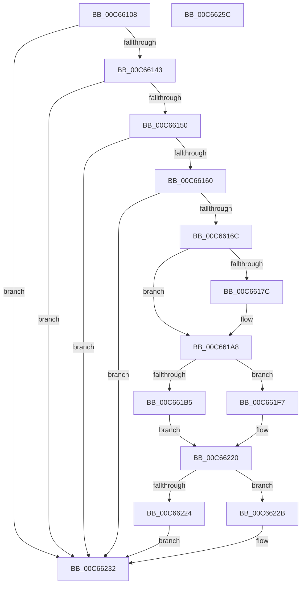

# MiApplyImportOptimizationToBootDriver

- RVA: `0x00C66108`–`0x00C6625D` (길이 `341` bytes)
- VA: `0x0000000140C66108`
- 실행 섹션: `INIT`
- PDB 이름 있음: `예`; PDB Function 태그: `아니요`
- unwind 정보 RVA: `0x000D82F0`
- 디코드: `79`개 명령, `341/341` bytes 표시
- 미해석 바이트: `0` (있으면 어셈블리에 `.byte`로 보존)

> 이 문서는 커널 이미지의 기계어와 PDB 기호를 분석해 생성했습니다. 4번과 5번은 함수 원형과 자료형을 바이너리 사용 방식에서 추정한 C 해석이며 원본 소스 복구 결과는 아닙니다.

## 1. Dependencies

- 직접 호출 지점: **5**; 고유 호출 대상: **5**
- 직접 호출자로 확인된 함수: **1**
- RIP 상대 이미지 참조: **8**

### Outgoing calls
- `0x00C66153` → [MI_IS_PHYSICAL_ADDRESS](../../text/23/MI_IS_PHYSICAL_ADDRESS_function_0023B3A0.md) (function, `0x0023B3A0`)
- `0x00C661F0` → [RtlUpdateImportRelocationsInImage](../../text/6A/RtlUpdateImportRelocationsInImage_function_006A9E1C.md) (function, `0x006A9E1C`)
- `0x00C66202` → [memset](../../text/6C/memset_function_006C6C40.md) (function, `0x006C6C40`)
- `0x00C6621B` → [VslpEnterIumSecureMode](../../text/23/VslpEnterIumSecureMode_function_00235E50.md) (function, `0x00235E50`)
- `0x00C66242` → [_security_check_cookie](../../text/6A/_security_check_cookie_function_006AC640.md) (function, `0x006AC640`)

### Direct callers
- [MiReloadBootLoadedDrivers](MiReloadBootLoadedDrivers_function_00C6C3F8.md) at `0x00C6C505`

### Static image references
- `0x00C6611A` → RVA `0x00E0A740` (`.data`; read)
- `0x00C66133` → RVA `0x00FC6B28` (`ALMOSTRO`; read)
- `0x00C66143` → RVA `0x00FC6B98` (`ALMOSTRO`; read)
- `0x00C6616C` → RVA `0x00FC6B48` (`ALMOSTRO`; read)
- `0x00C6617C` → RVA `0x00E375B0` (`.data`; read)
- `0x00C66182` → RVA `0x00E375AC` (`.data`; read)
- `0x00C661A8` → RVA `0x00FC6A88` (`ALMOSTRO`; read)
- `0x00C661BF` → RVA `0x00E2D830` (`.data`; read)

## 2. Other-region calls and transfers

- 다른 실행 섹션으로 향하는 call: **5**
  - `0x00C66153` → [MI_IS_PHYSICAL_ADDRESS](../../text/23/MI_IS_PHYSICAL_ADDRESS_function_0023B3A0.md) (`INIT` → `.text`)
  - `0x00C661F0` → [RtlUpdateImportRelocationsInImage](../../text/6A/RtlUpdateImportRelocationsInImage_function_006A9E1C.md) (`INIT` → `.text`)
  - `0x00C66202` → [memset](../../text/6C/memset_function_006C6C40.md) (`INIT` → `.text`)
  - `0x00C6621B` → [VslpEnterIumSecureMode](../../text/23/VslpEnterIumSecureMode_function_00235E50.md) (`INIT` → `.text`)
  - `0x00C66242` → [_security_check_cookie](../../text/6A/_security_check_cookie_function_006AC640.md) (`INIT` → `.text`)
- 별도 외부 분기/꼬리 이동을 확인하지 못했습니다.

## 3. Assembly (complete function range)

```asm
00C66108  48 89 5C 24 18                  mov qword ptr [rsp + 0x18], rbx
00C6610D  48 89 74 24 20                  mov qword ptr [rsp + 0x20], rsi
00C66112  57                              push rdi
00C66113  48 81 EC C0 00 00 00            sub rsp, 0xc0
00C6611A  48 8B 05 1F 46 1A 00            mov rax, qword ptr [rip + 0x1a461f]
00C66121  48 33 C4                        xor rax, rsp
00C66124  48 89 84 24 B0 00 00 00         mov qword ptr [rsp + 0xb0], rax
00C6612C  48 8B 79 30                     mov rdi, qword ptr [rcx + 0x30]
00C66130  48 8B F2                        mov rsi, rdx
00C66133  48 3B 3D EE 09 36 00            cmp rdi, qword ptr [rip + 0x3609ee]
00C6613A  48 8B D9                        mov rbx, rcx
00C6613D  0F 84 EF 00 00 00               je 0x140c66232
00C66143  48 3B 3D 4E 0A 36 00            cmp rdi, qword ptr [rip + 0x360a4e]
00C6614A  0F 84 E2 00 00 00               je 0x140c66232
00C66150  48 8B CF                        mov rcx, rdi
00C66153  E8 48 52 5D FF                  call 0x14023b3a0
00C66158  85 C0                           test eax, eax
00C6615A  0F 85 D2 00 00 00               jne 0x140c66232
00C66160  66 0F BA 63 6E 09               bt word ptr [rbx + 0x6e], 9
00C66166  0F 82 C6 00 00 00               jb 0x140c66232
00C6616C  48 8B 05 D5 09 36 00            mov rax, qword ptr [rip + 0x3609d5]
00C66173  33 C9                           xor ecx, ecx
00C66175  48 0F BA E0 29                  bt rax, 0x29
00C6617A  73 2C                           jae 0x140c661a8
00C6617C  8B 15 2E 14 1D 00               mov edx, dword ptr [rip + 0x1d142e]
00C66182  03 15 24 14 1D 00               add edx, dword ptr [rip + 0x1d1424]
00C66188  8B C2                           mov eax, edx
00C6618A  25 FF 0F 00 00                  and eax, 0xfff
00C6618F  F7 D8                           neg eax
00C66191  1B C9                           sbb ecx, ecx
00C66193  81 E2 00 F0 FF FF               and edx, 0xfffff000
00C66199  81 E1 00 10 00 00               and ecx, 0x1000
00C6619F  03 CA                           add ecx, edx
00C661A1  03 4B 40                        add ecx, dword ptr [rbx + 0x40]
00C661A4  48 03 4B 30                     add rcx, qword ptr [rbx + 0x30]
00C661A8  48 F7 05 D5 08 36 00 00 80 00 00  test qword ptr [rip + 0x3608d5], 0x8000
00C661B3  75 42                           jne 0x140c661f7
00C661B5  48 8B 15 8C 09 36 00            mov rdx, qword ptr [rip + 0x36098c]
00C661BC  4C 8B CE                        mov r9, rsi
00C661BF  48 8B 05 6A 76 1C 00            mov rax, qword ptr [rip + 0x1c766a]
00C661C6  44 8B 43 40                     mov r8d, dword ptr [rbx + 0x40]
00C661CA  48 83 C0 04                     add rax, 4
00C661CE  48 C1 EA 29                     shr rdx, 0x29
00C661D2  F6 D2                           not dl
00C661D4  80 E2 01                        and dl, 1
00C661D7  88 54 24 38                     mov byte ptr [rsp + 0x38], dl
00C661DB  48 8B D7                        mov rdx, rdi
00C661DE  C6 44 24 30 00                  mov byte ptr [rsp + 0x30], 0
00C661E3  48 89 44 24 28                  mov qword ptr [rsp + 0x28], rax
00C661E8  48 89 4C 24 20                  mov qword ptr [rsp + 0x20], rcx
00C661ED  48 8B CF                        mov rcx, rdi
00C661F0  E8 27 3C A4 FF                  call 0x1406a9e1c
00C661F5  EB 29                           jmp 0x140c66220
00C661F7  33 D2                           xor edx, edx
00C661F9  48 8D 4C 24 40                  lea rcx, [rsp + 0x40]
00C661FE  44 8D 42 68                     lea r8d, [rdx + 0x68]
00C66202  E8 39 0A A6 FF                  call 0x1406c6c40
00C66207  BA E1 00 00 00                  mov edx, 0xe1
00C6620C  48 89 7C 24 48                  mov qword ptr [rsp + 0x48], rdi
00C66211  4C 8D 4C 24 40                  lea r9, [rsp + 0x40]
00C66216  45 33 C0                        xor r8d, r8d
00C66219  B1 02                           mov cl, 2
00C6621B  E8 30 FC 5C FF                  call 0x140235e50
00C66220  85 C0                           test eax, eax
00C66222  78 07                           js 0x140c6622b
00C66224  0F BA 6B 68 07                  bts dword ptr [rbx + 0x68], 7
00C66229  EB 07                           jmp 0x140c66232
00C6622B  48 8B 0D 16 09 36 00            mov rcx, qword ptr [rip + 0x360916]
00C66232  B8 01 00 00 00                  mov eax, 1
00C66237  48 8B 8C 24 B0 00 00 00         mov rcx, qword ptr [rsp + 0xb0]
00C6623F  48 33 CC                        xor rcx, rsp
00C66242  E8 F9 63 A4 FF                  call 0x1406ac640
00C66247  4C 8D 9C 24 C0 00 00 00         lea r11, [rsp + 0xc0]
00C6624F  49 8B 5B 20                     mov rbx, qword ptr [r11 + 0x20]
00C66253  49 8B 73 28                     mov rsi, qword ptr [r11 + 0x28]
00C66257  49 8B E3                        mov rsp, r11
00C6625A  5F                              pop rdi
00C6625B  C3                              ret
00C6625C  CC                              int3
```

## 4. C-style interpretation (structured pseudocode)

```c
__int64 __fastcall MiApplyImportOptimizationToBootDriver(__int64 a1, __int64 a2)
{
    __int64 result;
    __int64 v_rsp;
    unsigned __int64 v_stack_m18;
    unsigned __int64 v_stack_m8;
    unsigned __int64 v_stack_m80;
    unsigned __int64 v_stack_m88;
    unsigned __int8 v_stack_m90;
    unsigned __int8 v_stack_m98;
    unsigned __int64 v_stack_mA0;
    unsigned __int64 v_stack_mA8;
    unsigned __int64 v_stack_p18;
    unsigned __int64 v_stack_p20;

    v_stack_p18 = v_rbx;
    v_stack_p20 = v_rsi;
    v_rsp = (v_rsp) - (192);
    result = (*(unsigned __int64 *)(v_rip + 1721887)) ^ (v_rsp);
    v_stack_m18 = result;
    if ((*(unsigned __int64 *)(a1 + 48)) == (*(unsigned __int64 *)(v_rip + 3541486))) goto loc_00C66232;
    if ((*(unsigned __int64 *)(a1 + 48)) == (*(unsigned __int64 *)(v_rip + 3541582))) goto loc_00C66232;
    result = MI_IS_PHYSICAL_ADDRESS(*(unsigned __int64 *)(a1 + 48), a2, a3, a4);
    if ((unsigned int)(result) != 0) goto loc_00C66232;
    if (condition_is_below) goto loc_00C66232;
    a1 = 0;
    result = *(unsigned __int64 *)(v_rip + 3541461);
    if (!(condition_is_above_or_equal)) {
        a2 = *(unsigned int *)(v_rip + 1905710);
        a2 = (unsigned int)((a2) + (*(unsigned int *)(v_rip + 1905700)));
        result = (unsigned int)(a2);
        result = (unsigned int)((result) & (0xFFFULL));
        result = (unsigned int)(-(result));
        a2 = (unsigned int)((a2) & (0xFFFFF000ULL));
        a1 = (unsigned int)((a1) & (0x1000ULL));
        a1 = (unsigned int)((a1) + ((unsigned int)(a2)));
        a1 = (unsigned int)((a1) + (*(unsigned int *)(a1 + 64)));
        a1 = (a1) + (*(unsigned __int64 *)(a1 + 48));
    }
    if (((*(unsigned __int64 *)(v_rip + 3541205)) & (0x8000ULL)) != 0) goto loc_00C661F7;
    result = (*(unsigned __int64 *)(v_rip + 1865322)) + (4);
    a2 = (*(unsigned __int64 *)(v_rip + 3541388)) >> (41);
    a2 = (unsigned __int8)(~(a2));
    a2 = (unsigned __int8)((a2) & (1));
    v_stack_m90 = (unsigned __int8)(a2);
    v_stack_m98 = 0;
    v_stack_mA0 = result;
    v_stack_mA8 = a1;
    result = RtlUpdateImportRelocationsInImage(*(unsigned __int64 *)(a1 + 48), *(unsigned __int64 *)(a1 + 48), (unsigned int)(*(unsigned int *)(a1 + 64)), a2);
    goto loc_00C66220;
loc_00C661F7:
    a2 = 0;
    result = memset(v_stack_m88, a2, a2 + 104, a2);
    v_stack_m80 = *(unsigned __int64 *)(a1 + 48);
    a3 = 0;
    result = VslpEnterIumSecureMode(2, 225, a3, v_stack_m88);
loc_00C66220:
    if (sign_flag) goto loc_00C6622B;
    goto loc_00C66232;
loc_00C6622B:
loc_00C66232:
    a1 = (v_stack_m18) ^ (v_rsp);
    result = _security_check_cookie(a1, 225, a3, v_stack_m88);
    return result;
}
```

## 5. (Beta) C Style

```c
int64_t MiApplyImportOptimizationToBootDriver(void *Arg1, int64_t Arg2)
{
    uint8_t *arg1 = (uint8_t *)Arg1;

    int64_t result;
    int64_t local_rsp;
    uint64_t v_stack_m18;
    uint64_t v_stack_m8;
    uint64_t v_stack_m80;
    uint64_t v_stack_m88;
    uint8_t v_stack_m90;
    uint8_t v_stack_m98;
    uint64_t v_stack_mA0;
    uint64_t v_stack_mA8;
    uint64_t v_stack_p18;
    uint64_t v_stack_p20;

    v_stack_p18 = local_rbx;
    v_stack_p20 = local_rsi;
    local_rsp = (local_rsp) - (192);
    result = (*(uint64_t *)(v_rip + 0x1A461F)) ^ (local_rsp);
    v_stack_m18 = result;
    if ((*(uint64_t *)(arg1 + 0x30)) == (*(uint64_t *)(v_rip + 0x3609EE))) goto loc_00C66232;
    if ((*(uint64_t *)(arg1 + 0x30)) == (*(uint64_t *)(v_rip + 0x360A4E))) goto loc_00C66232;
    result = MI_IS_PHYSICAL_ADDRESS(*(uint64_t *)(arg1 + 0x30), Arg2, a3, a4);
    if ((uint32_t)(result) != 0) goto loc_00C66232;
    if (condition_is_below) goto loc_00C66232;
    Arg1 = 0;
    result = *(uint64_t *)(v_rip + 0x3609D5);
    if (!(condition_is_above_or_equal)) {
        Arg2 = *(uint32_t *)(v_rip + 0x1D142E);
        Arg2 = (uint32_t)((Arg2) + (*(uint32_t *)(v_rip + 0x1D1424)));
        result = (uint32_t)(Arg2);
        result = (uint32_t)((result) & (0xFFFULL));
        result = (uint32_t)(-(result));
        Arg2 = (uint32_t)((Arg2) & (0xFFFFF000ULL));
        Arg1 = (uint32_t)((Arg1) & (0x1000ULL));
        Arg1 = (uint32_t)((Arg1) + ((uint32_t)(Arg2)));
        Arg1 = (uint32_t)((Arg1) + (*(uint32_t *)(arg1 + 0x40)));
        Arg1 = (Arg1) + (*(uint64_t *)(arg1 + 0x30));
    }
    if (((*(uint64_t *)(v_rip + 0x3608D5)) & (0x8000ULL)) != 0) goto loc_00C661F7;
    result = (*(uint64_t *)(v_rip + 0x1C766A)) + (4);
    Arg2 = (*(uint64_t *)(v_rip + 0x36098C)) >> (41);
    Arg2 = (uint8_t)(~(Arg2));
    Arg2 = (uint8_t)((Arg2) & (1));
    v_stack_m90 = (uint8_t)(Arg2);
    v_stack_m98 = 0;
    v_stack_mA0 = result;
    v_stack_mA8 = Arg1;
    result = RtlUpdateImportRelocationsInImage(*(uint64_t *)(arg1 + 0x30), *(uint64_t *)(arg1 + 0x30), (uint32_t)(*(uint32_t *)(arg1 + 0x40)), Arg2);
    goto loc_00C66220;
loc_00C661F7:
    Arg2 = 0;
    result = memset(v_stack_m88, Arg2, Arg2 + 104, Arg2);
    v_stack_m80 = *(uint64_t *)(arg1 + 0x30);
    a3 = 0;
    result = VslpEnterIumSecureMode(2, 225, a3, v_stack_m88);
loc_00C66220:
    if (sign_flag) goto loc_00C6622B;
    goto loc_00C66232;
loc_00C6622B:
loc_00C66232:
    Arg1 = (v_stack_m18) ^ (local_rsp);
    result = _security_check_cookie(Arg1, 225, a3, v_stack_m88);
    return result;
}
```

### 관측된 메모리 오프셋

구조체 형식이 확인되지 않은 접근은 인자 기준의 오프셋으로만 기록했습니다.

| 기준 인자 | 오프셋 표현 | 폭 (bit) | 접근 |
|---|---:|---:|---|
| `Arg1` | `+ 0x30` | `64` | `R` |
| `Arg1` | `+ 0x40` | `32` | `R` |
| `Arg1` | `+ 0x68` | `32` | `R/W` |
| `Arg1` | `+ 0x6E` | `16` | `R` |

## 6. Execution-region graph

[열기: 2D/3D 그래프와 함수 탐색 컨트롤 패널](../../../control-panel.html?section=init&rva=0x00C66108&view=graph)

- 2D 그래프는 위에서 아래로 흐르고, 3D 그래프는 빈 공간을 드래그해 회전합니다. Shift+드래그는 이동, 휠은 확대·축소, 함수 노드 선택은 대상 보고서 이동입니다.

### Static fallback


