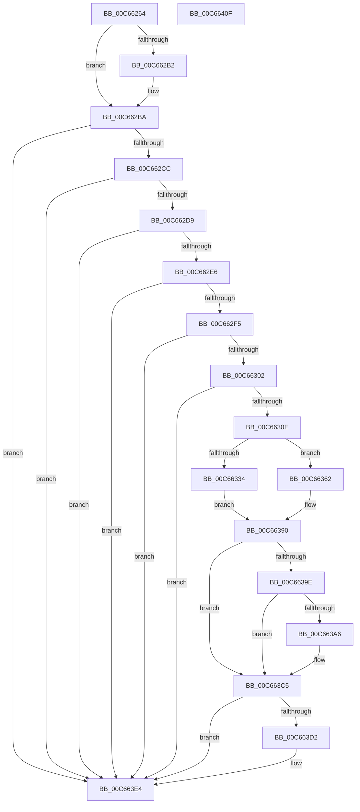

# MiApplyRetpolineToBootDriver

- RVA: `0x00C66264`–`0x00C66410` (길이 `428` bytes)
- VA: `0x0000000140C66264`
- 실행 섹션: `INIT`
- PDB 이름 있음: `예`; PDB Function 태그: `아니요`
- unwind 정보 RVA: `0x000D8310`
- 디코드: `95`개 명령, `428/428` bytes 표시
- 미해석 바이트: `0` (있으면 어셈블리에 `.byte`로 보존)

> 이 문서는 커널 이미지의 기계어와 PDB 기호를 분석해 생성했습니다. 4번과 5번은 함수 원형과 자료형을 바이너리 사용 방식에서 추정한 C 해석이며 원본 소스 복구 결과는 아닙니다.

## 1. Dependencies

- 직접 호출 지점: **9**; 고유 호출 대상: **9**
- 직접 호출자로 확인된 함수: **1**
- RIP 상대 이미지 참조: **8**

### Outgoing calls
- `0x00C662A5` → [RtlImageNtHeaderEx](../../text/41/RtlImageNtHeaderEx_function_0041EAA0.md) (function, `0x0041EAA0`)
- `0x00C662B5` → [MiLogRetpolineImageLoadEvents](../../page/A9/MiLogRetpolineImageLoadEvents_function_00A996F0.md) (function, `0x00A996F0`)
- `0x00C6635B` → [RtlPerformRetpolineRelocationsOnImageEx](../../text/6A/RtlPerformRetpolineRelocationsOnImageEx_function_006A9AD4.md) (function, `0x006A9AD4`)
- `0x00C6636D` → [memset](../../text/6C/memset_function_006C6C40.md) (function, `0x006C6C40`)
- `0x00C6638B` → [VslpEnterIumSecureMode](../../text/23/VslpEnterIumSecureMode_function_00235E50.md) (function, `0x00235E50`)
- `0x00C663BF` → [KeBugCheckEx](../../text/4F/KeBugCheckEx_function_004FD660.md) (function, `0x004FD660`)
- `0x00C663C9` → [RtlIsImageFullyRetpolined](../../text/4C/RtlIsImageFullyRetpolined_function_004CDE74.md) (function, `0x004CDE74`)
- `0x00C663DF` → [MiMarkRetpolineBits](../../page/AA/MiMarkRetpolineBits_function_00AA0394.md) (function, `0x00AA0394`)
- `0x00C663F4` → [_security_check_cookie](../../text/6A/_security_check_cookie_function_006AC640.md) (function, `0x006AC640`)

### Direct callers
- [MiReloadBootLoadedDrivers](MiReloadBootLoadedDrivers_function_00C6C3F8.md) at `0x00C6C4C7`

### Static image references
- `0x00C66277` → RVA `0x00E0A740` (`.data`; read)
- `0x00C662BA` → RVA `0x00FC6B48` (`ALMOSTRO`; read)
- `0x00C662CC` → RVA `0x00FC6B28` (`ALMOSTRO`; read)
- `0x00C662D9` → RVA `0x00FC6B98` (`ALMOSTRO`; read)
- `0x00C6630E` → RVA `0x00E375AC` (`.data`; read)
- `0x00C66315` → RVA `0x00E375B0` (`.data`; read)
- `0x00C66327` → RVA `0x00FC6A88` (`ALMOSTRO`; read)
- `0x00C66345` → RVA `0x00E2D830` (`.data`; read)

## 2. Other-region calls and transfers

- 다른 실행 섹션으로 향하는 call: **9**
  - `0x00C662A5` → [RtlImageNtHeaderEx](../../text/41/RtlImageNtHeaderEx_function_0041EAA0.md) (`INIT` → `.text`)
  - `0x00C662B5` → [MiLogRetpolineImageLoadEvents](../../page/A9/MiLogRetpolineImageLoadEvents_function_00A996F0.md) (`INIT` → `PAGE`)
  - `0x00C6635B` → [RtlPerformRetpolineRelocationsOnImageEx](../../text/6A/RtlPerformRetpolineRelocationsOnImageEx_function_006A9AD4.md) (`INIT` → `.text`)
  - `0x00C6636D` → [memset](../../text/6C/memset_function_006C6C40.md) (`INIT` → `.text`)
  - `0x00C6638B` → [VslpEnterIumSecureMode](../../text/23/VslpEnterIumSecureMode_function_00235E50.md) (`INIT` → `.text`)
  - `0x00C663BF` → [KeBugCheckEx](../../text/4F/KeBugCheckEx_function_004FD660.md) (`INIT` → `.text`)
  - `0x00C663C9` → [RtlIsImageFullyRetpolined](../../text/4C/RtlIsImageFullyRetpolined_function_004CDE74.md) (`INIT` → `.text`)
  - `0x00C663DF` → [MiMarkRetpolineBits](../../page/AA/MiMarkRetpolineBits_function_00AA0394.md) (`INIT` → `PAGE`)
  - `0x00C663F4` → [_security_check_cookie](../../text/6A/_security_check_cookie_function_006AC640.md) (`INIT` → `.text`)
- 별도 외부 분기/꼬리 이동을 확인하지 못했습니다.

## 3. Assembly (complete function range)

```asm
00C66264  48 89 5C 24 10                  mov qword ptr [rsp + 0x10], rbx
00C66269  48 89 7C 24 18                  mov qword ptr [rsp + 0x18], rdi
00C6626E  41 56                           push r14
00C66270  48 81 EC E0 00 00 00            sub rsp, 0xe0
00C66277  48 8B 05 C2 44 1A 00            mov rax, qword ptr [rip + 0x1a44c2]
00C6627E  48 33 C4                        xor rax, rsp
00C66281  48 89 84 24 D0 00 00 00         mov qword ptr [rsp + 0xd0], rax
00C66289  48 8B 79 30                     mov rdi, qword ptr [rcx + 0x30]
00C6628D  4C 8D 4C 24 50                  lea r9, [rsp + 0x50]
00C66292  48 83 64 24 50 00               and qword ptr [rsp + 0x50], 0
00C66298  45 33 C0                        xor r8d, r8d
00C6629B  48 8B D9                        mov rbx, rcx
00C6629E  48 8B D7                        mov rdx, rdi
00C662A1  41 8D 48 01                     lea ecx, [r8 + 1]
00C662A5  E8 F6 87 7B FF                  call 0x14041eaa0
00C662AA  66 0F BA 63 6E 09               bt word ptr [rbx + 0x6e], 9
00C662B0  72 08                           jb 0x140c662ba
00C662B2  48 8B CB                        mov rcx, rbx
00C662B5  E8 36 34 E3 FF                  call 0x140a996f0
00C662BA  48 8B 05 87 08 36 00            mov rax, qword ptr [rip + 0x360887]
00C662C1  48 0F BA E0 29                  bt rax, 0x29
00C662C6  0F 83 18 01 00 00               jae 0x140c663e4
00C662CC  48 3B 3D 55 08 36 00            cmp rdi, qword ptr [rip + 0x360855]
00C662D3  0F 84 0B 01 00 00               je 0x140c663e4
00C662D9  48 3B 3D B8 08 36 00            cmp rdi, qword ptr [rip + 0x3608b8]
00C662E0  0F 84 FE 00 00 00               je 0x140c663e4
00C662E6  48 8B 4C 24 50                  mov rcx, qword ptr [rsp + 0x50]
00C662EB  F6 41 16 01                     test byte ptr [rcx + 0x16], 1
00C662EF  0F 85 EF 00 00 00               jne 0x140c663e4
00C662F5  83 B9 84 00 00 00 05            cmp dword ptr [rcx + 0x84], 5
00C662FC  0F 86 E2 00 00 00               jbe 0x140c663e4
00C66302  66 0F BA 63 6E 09               bt word ptr [rbx + 0x6e], 9
00C66308  0F 82 D6 00 00 00               jb 0x140c663e4
00C6630E  44 8B 0D 97 12 1D 00            mov r9d, dword ptr [rip + 0x1d1297]
00C66315  44 03 0D 94 12 1D 00            add r9d, dword ptr [rip + 0x1d1294]
00C6631C  44 8B 43 40                     mov r8d, dword ptr [rbx + 0x40]
00C66320  4D 03 C8                        add r9, r8
00C66323  4C 03 4B 30                     add r9, qword ptr [rbx + 0x30]
00C66327  48 F7 05 56 07 36 00 00 80 00 00  test qword ptr [rip + 0x360756], 0x8000
00C66332  75 2E                           jne 0x140c66362
00C66334  83 64 24 40 00                  and dword ptr [rsp + 0x40], 0
00C66339  48 8B D7                        mov rdx, rdi
00C6633C  48 83 64 24 38 00               and qword ptr [rsp + 0x38], 0
00C66342  48 8B CF                        mov rcx, rdi
00C66345  48 8B 05 E4 74 1C 00            mov rax, qword ptr [rip + 0x1c74e4]
00C6634C  48 83 64 24 30 00               and qword ptr [rsp + 0x30], 0
00C66352  48 83 C0 04                     add rax, 4
00C66356  48 89 44 24 20                  mov qword ptr [rsp + 0x20], rax
00C6635B  E8 74 37 A4 FF                  call 0x1406a9ad4
00C66360  EB 2E                           jmp 0x140c66390
00C66362  33 D2                           xor edx, edx
00C66364  48 8D 4C 24 60                  lea rcx, [rsp + 0x60]
00C66369  44 8D 42 68                     lea r8d, [rdx + 0x68]
00C6636D  E8 CE 08 A6 FF                  call 0x1406c6c40
00C66372  BA E0 00 00 00                  mov edx, 0xe0
00C66377  48 89 7C 24 68                  mov qword ptr [rsp + 0x68], rdi
00C6637C  4C 8D 4C 24 60                  lea r9, [rsp + 0x60]
00C66381  C6 44 24 70 01                  mov byte ptr [rsp + 0x70], 1
00C66386  45 33 C0                        xor r8d, r8d
00C66389  B1 02                           mov cl, 2
00C6638B  E8 C0 FA 5C FF                  call 0x140235e50
00C66390  BA 00 00 00 80                  mov edx, 0x80000000
00C66395  8B C8                           mov ecx, eax
00C66397  8D 04 10                        lea eax, [rax + rdx]
00C6639A  85 C2                           test edx, eax
00C6639C  75 27                           jne 0x140c663c5
00C6639E  81 F9 BB 00 00 C0               cmp ecx, 0xc00000bb
00C663A4  74 1F                           je 0x140c663c5
00C663A6  4C 8B 4B 30                     mov r9, qword ptr [rbx + 0x30]
00C663AA  4C 8B C3                        mov r8, rbx
00C663AD  48 63 C1                        movsxd rax, ecx
00C663B0  BA 80 10 00 00                  mov edx, 0x1080
00C663B5  B9 1A 00 00 00                  mov ecx, 0x1a
00C663BA  48 89 44 24 20                  mov qword ptr [rsp + 0x20], rax
00C663BF  E8 9C 72 89 FF                  call 0x1404fd660
00C663C4  CC                              int3
00C663C5  48 8B 4B 30                     mov rcx, qword ptr [rbx + 0x30]
00C663C9  E8 A6 7A 86 FF                  call 0x1404cde74
00C663CE  85 C0                           test eax, eax
00C663D0  74 12                           je 0x140c663e4
00C663D2  8B 53 40                        mov edx, dword ptr [rbx + 0x40]
00C663D5  41 B8 01 00 00 00               mov r8d, 1
00C663DB  48 8B 4B 30                     mov rcx, qword ptr [rbx + 0x30]
00C663DF  E8 B0 9F E3 FF                  call 0x140aa0394
00C663E4  B8 01 00 00 00                  mov eax, 1
00C663E9  48 8B 8C 24 D0 00 00 00         mov rcx, qword ptr [rsp + 0xd0]
00C663F1  48 33 CC                        xor rcx, rsp
00C663F4  E8 47 62 A4 FF                  call 0x1406ac640
00C663F9  4C 8D 9C 24 E0 00 00 00         lea r11, [rsp + 0xe0]
00C66401  49 8B 5B 18                     mov rbx, qword ptr [r11 + 0x18]
00C66405  49 8B 7B 20                     mov rdi, qword ptr [r11 + 0x20]
00C66409  49 8B E3                        mov rsp, r11
00C6640C  41 5E                           pop r14
00C6640E  C3                              ret
00C6640F  CC                              int3
```

## 4. C-style interpretation (structured pseudocode)

```c
__int64 __fastcall MiApplyRetpolineToBootDriver(__int64 a1, __int64 a2, int a3)
{
    __int64 result;
    __int64 v_rsp;
    unsigned __int64 v_stack_m18;
    unsigned __int8 v_stack_m78;
    unsigned __int64 v_stack_m8;
    unsigned __int64 v_stack_m80;
    unsigned __int64 v_stack_m88;
    unsigned __int64 v_stack_m98;
    unsigned int v_stack_mA8;
    unsigned __int64 v_stack_mB0;
    unsigned __int64 v_stack_mB8;
    unsigned __int64 v_stack_mC8;
    unsigned __int64 v_stack_p10;
    unsigned __int64 v_stack_p18;

    v_stack_p10 = v_rbx;
    v_stack_p18 = v_rdi;
    v_rsp = (v_rsp) - (224);
    result = (*(unsigned __int64 *)(v_rip + 1721538)) ^ (v_rsp);
    v_stack_m18 = result;
    a3 = 0;
    result = RtlImageNtHeaderEx(a3 + 1, *(unsigned __int64 *)(a1 + 48), a3, v_stack_m98);
    if (!(condition_is_below)) {
        a1 = a1;
        result = MiLogRetpolineImageLoadEvents(a1, *(unsigned __int64 *)(a1 + 48), a3, v_stack_m98);
    }
    if (condition_is_above_or_equal) goto loc_00C663E4;
    if ((*(unsigned __int64 *)(a1 + 48)) == (*(unsigned __int64 *)(v_rip + 3541077))) goto loc_00C663E4;
    if ((*(unsigned __int64 *)(a1 + 48)) == (*(unsigned __int64 *)(v_rip + 3541176))) goto loc_00C663E4;
    if (((*(unsigned __int8 *)(v_stack_m98 + 22)) & (1)) != 0) goto loc_00C663E4;
    if ((*(unsigned int *)(v_stack_m98 + 132)) <= 5) goto loc_00C663E4;
    if ((*(unsigned int *)(v_stack_m98 + 132)) < 5) goto loc_00C663E4;
    a4 = (unsigned int)(((unsigned int)(*(unsigned int *)(v_rip + 1905303))) + (*(unsigned int *)(v_rip + 1905300)));
    a4 = (a4) + ((unsigned int)(*(unsigned int *)(a1 + 64)));
    a4 = (a4) + (*(unsigned __int64 *)(a1 + 48));
    if (((*(unsigned __int64 *)(v_rip + 3540822)) & (0x8000ULL)) != 0) goto loc_00C66362;
    result = (*(unsigned __int64 *)(v_rip + 1864932)) + (4);
    v_stack_mC8 = result;
    result = RtlPerformRetpolineRelocationsOnImageEx(*(unsigned __int64 *)(a1 + 48), *(unsigned __int64 *)(a1 + 48), (unsigned int)(*(unsigned int *)(a1 + 64)), a4);
    goto loc_00C66390;
loc_00C66362:
    a2 = 0;
    result = memset(v_stack_m88, a2, a2 + 104, a4);
    v_stack_m80 = *(unsigned __int64 *)(a1 + 48);
    v_stack_m78 = 1;
    a3 = 0;
    result = VslpEnterIumSecureMode(2, 224, a3, v_stack_m88);
loc_00C66390:
    if ((((unsigned int)((unsigned int)(0x80000000ULL))) & ((unsigned int)(result + (unsigned int)(0x80000000ULL) * 1))) != 0) goto loc_00C663C5;
    result = result + (unsigned int)(0x80000000ULL) * 1;
    if (((unsigned int)((unsigned int)((unsigned int)(result)))) != 0xC00000BBULL) {
        a4 = *(unsigned __int64 *)(a1 + 48);
        a3 = a1;
        result = (int)((unsigned int)((unsigned int)((unsigned int)(result))));
        a2 = 0x1080ULL;
        a1 = 26;
        v_stack_mC8 = result;
        result = KeBugCheckEx(a1, a2, a3, a4);
    }
    result = RtlIsImageFullyRetpolined(*(unsigned __int64 *)(a1 + 48), a2, a3, a4);
    if ((unsigned int)(result) != 0) {
        a2 = *(unsigned int *)(a1 + 64);
        a3 = 1;
        a1 = *(unsigned __int64 *)(a1 + 48);
        result = MiMarkRetpolineBits(a1, a2, a3, a4);
    }
    a1 = (v_stack_m18) ^ (v_rsp);
    result = _security_check_cookie(a1, a2, a3, a4);
    return result;
}
```

## 5. (Beta) C Style

```c
int64_t MiApplyRetpolineToBootDriver(void *Arg1, int64_t Arg2, int32_t Arg3)
{
    uint8_t *arg1 = (uint8_t *)Arg1;

    int64_t result;
    int64_t local_rsp;
    uint64_t v_stack_m18;
    uint8_t v_stack_m78;
    uint64_t v_stack_m8;
    uint64_t v_stack_m80;
    uint64_t v_stack_m88;
    uint64_t v_stack_m98;
    uint32_t v_stack_mA8;
    uint64_t v_stack_mB0;
    uint64_t v_stack_mB8;
    uint64_t v_stack_mC8;
    uint64_t v_stack_p10;
    uint64_t v_stack_p18;

    v_stack_p10 = local_rbx;
    v_stack_p18 = local_rdi;
    local_rsp = (local_rsp) - (224);
    result = (*(uint64_t *)(v_rip + 0x1A44C2)) ^ (local_rsp);
    v_stack_m18 = result;
    Arg3 = 0;
    result = RtlImageNtHeaderEx(Arg3 + 1, *(uint64_t *)(arg1 + 0x30), Arg3, v_stack_m98);
    if (!(condition_is_below)) {
        Arg1 = Arg1;
        result = MiLogRetpolineImageLoadEvents(Arg1, *(uint64_t *)(arg1 + 0x30), Arg3, v_stack_m98);
    }
    if (condition_is_above_or_equal) goto loc_00C663E4;
    if ((*(uint64_t *)(arg1 + 0x30)) == (*(uint64_t *)(v_rip + 0x360855))) goto loc_00C663E4;
    if ((*(uint64_t *)(arg1 + 0x30)) == (*(uint64_t *)(v_rip + 0x3608B8))) goto loc_00C663E4;
    if (((*(uint8_t *)(v_stack_m98 + 0x16)) & (1)) != 0) goto loc_00C663E4;
    if ((*(uint32_t *)(v_stack_m98 + 0x84)) <= 5) goto loc_00C663E4;
    if ((*(uint32_t *)(v_stack_m98 + 0x84)) < 5) goto loc_00C663E4;
    a4 = (uint32_t)(((uint32_t)(*(uint32_t *)(v_rip + 0x1D1297))) + (*(uint32_t *)(v_rip + 0x1D1294)));
    a4 = (a4) + ((uint32_t)(*(uint32_t *)(arg1 + 0x40)));
    a4 = (a4) + (*(uint64_t *)(arg1 + 0x30));
    if (((*(uint64_t *)(v_rip + 0x360756)) & (0x8000ULL)) != 0) goto loc_00C66362;
    result = (*(uint64_t *)(v_rip + 0x1C74E4)) + (4);
    v_stack_mC8 = result;
    result = RtlPerformRetpolineRelocationsOnImageEx(*(uint64_t *)(arg1 + 0x30), *(uint64_t *)(arg1 + 0x30), (uint32_t)(*(uint32_t *)(arg1 + 0x40)), a4);
    goto loc_00C66390;
loc_00C66362:
    Arg2 = 0;
    result = memset(v_stack_m88, Arg2, Arg2 + 104, a4);
    v_stack_m80 = *(uint64_t *)(arg1 + 0x30);
    v_stack_m78 = 1;
    Arg3 = 0;
    result = VslpEnterIumSecureMode(2, 224, Arg3, v_stack_m88);
loc_00C66390:
    if ((((uint32_t)((uint32_t)(0x80000000ULL))) & ((uint32_t)(result + (uint32_t)(0x80000000ULL) * 1))) != 0) goto loc_00C663C5;
    result = result + (uint32_t)(0x80000000ULL) * 1;
    if (((uint32_t)((uint32_t)((uint32_t)(result)))) != 0xC00000BBULL) {
        a4 = *(uint64_t *)(arg1 + 0x30);
        Arg3 = Arg1;
        result = (int32_t)((uint32_t)((uint32_t)((uint32_t)(result))));
        Arg2 = 0x1080ULL;
        Arg1 = 26;
        v_stack_mC8 = result;
        result = KeBugCheckEx(Arg1, Arg2, Arg3, a4);
    }
    result = RtlIsImageFullyRetpolined(*(uint64_t *)(arg1 + 0x30), Arg2, Arg3, a4);
    if ((uint32_t)(result) != 0) {
        Arg2 = *(uint32_t *)(arg1 + 0x40);
        Arg3 = 1;
        Arg1 = *(uint64_t *)(arg1 + 0x30);
        result = MiMarkRetpolineBits(Arg1, Arg2, Arg3, a4);
    }
    Arg1 = (v_stack_m18) ^ (local_rsp);
    result = _security_check_cookie(Arg1, Arg2, Arg3, a4);
    return result;
}
```

### 관측된 메모리 오프셋

구조체 형식이 확인되지 않은 접근은 인자 기준의 오프셋으로만 기록했습니다.

| 기준 인자 | 오프셋 표현 | 폭 (bit) | 접근 |
|---|---:|---:|---|
| `Arg1` | `+ 0x30` | `64` | `R` |
| `Arg1` | `+ 0x40` | `32` | `R` |
| `Arg1` | `+ 0x6E` | `16` | `R` |

## 6. Execution-region graph

[열기: 2D/3D 그래프와 함수 탐색 컨트롤 패널](../../../control-panel.html?section=init&rva=0x00C66264&view=graph)

- 2D 그래프는 위에서 아래로 흐르고, 3D 그래프는 빈 공간을 드래그해 회전합니다. Shift+드래그는 이동, 휠은 확대·축소, 함수 노드 선택은 대상 보고서 이동입니다.

### Static fallback


