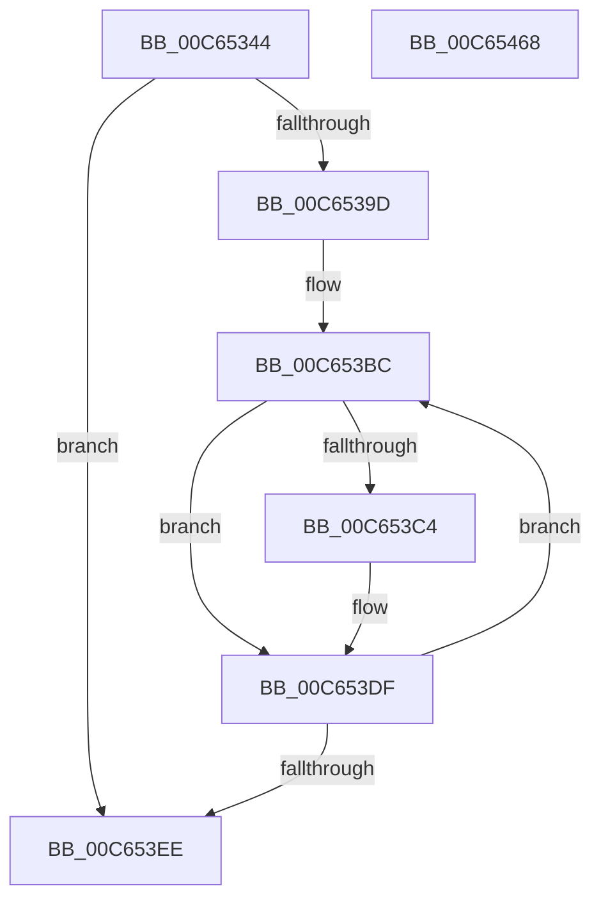

# MiAssignHalEntropy

- RVA: `0x00C65344`–`0x00C65469` (길이 `293` bytes)
- VA: `0x0000000140C65344`
- 실행 섹션: `INIT`
- PDB 이름 있음: `예`; PDB Function 태그: `아니요`
- unwind 정보 RVA: `0x00080C0C`
- 디코드: `66`개 명령, `293/293` bytes 표시
- 미해석 바이트: `0` (있으면 어셈블리에 `.byte`로 보존)

> 이 문서는 커널 이미지의 기계어와 PDB 기호를 분석해 생성했습니다. 4번과 5번은 함수 원형과 자료형을 바이너리 사용 방식에서 추정한 C 해석이며 원본 소스 복구 결과는 아닙니다.

## 1. Dependencies

- 직접 호출 지점: **4**; 고유 호출 대상: **4**
- 직접 호출자로 확인된 함수: **1**
- RIP 상대 이미지 참조: **4**

### Outgoing calls
- `0x00C65378` → [memset](../../text/6C/memset_function_006C6C40.md) (function, `0x006C6C40`)
- `0x00C653F3` → [ExGenRandom](../../text/41/ExGenRandom_function_0041B010.md) (function, `0x0041B010`)
- `0x00C6540A` → [RtlFindClearBitsAndSet](../../text/3E/RtlFindClearBitsAndSet_function_003E0CD0.md) (function, `0x003E0CD0`)
- `0x00C6545A` → [_security_check_cookie](../../text/6A/_security_check_cookie_function_006AC640.md) (function, `0x006AC640`)

### Direct callers
- [MiInitializeSystemVa](../C7/MiInitializeSystemVa_function_00C77020.md) at `0x00C7708E`

### Static image references
- `0x00C6534D` → RVA `0x00E0A740` (`.data`; read)
- `0x00C65416` → RVA `0x00E2F160` (`.data`; write)
- `0x00C65428` → RVA `0x00E2F158` (`.data`; write)
- `0x00C65444` → RVA `0x00E2F160` (`.data`; read)

## 2. Other-region calls and transfers

- 다른 실행 섹션으로 향하는 call: **4**
  - `0x00C65378` → [memset](../../text/6C/memset_function_006C6C40.md) (`INIT` → `.text`)
  - `0x00C653F3` → [ExGenRandom](../../text/41/ExGenRandom_function_0041B010.md) (`INIT` → `.text`)
  - `0x00C6540A` → [RtlFindClearBitsAndSet](../../text/3E/RtlFindClearBitsAndSet_function_003E0CD0.md) (`INIT` → `.text`)
  - `0x00C6545A` → [_security_check_cookie](../../text/6A/_security_check_cookie_function_006AC640.md) (`INIT` → `.text`)
- 별도 외부 분기/꼬리 이동을 확인하지 못했습니다.

## 3. Assembly (complete function range)

```asm
00C65344  40 53                           push rbx
00C65346  48 81 EC 80 00 00 00            sub rsp, 0x80
00C6534D  48 8B 05 EC 53 1A 00            mov rax, qword ptr [rip + 0x1a53ec]
00C65354  48 33 C4                        xor rax, rsp
00C65357  48 89 44 24 70                  mov qword ptr [rsp + 0x70], rax
00C6535C  33 D2                           xor edx, edx
00C6535E  48 C7 44 24 20 00 02 00 00      mov qword ptr [rsp + 0x20], 0x200
00C65367  83 64 24 24 00                  and dword ptr [rsp + 0x24], 0
00C6536C  48 8B D9                        mov rbx, rcx
00C6536F  48 8D 4C 24 30                  lea rcx, [rsp + 0x30]
00C65374  44 8D 42 40                     lea r8d, [rdx + 0x40]
00C65378  E8 C3 18 A6 FF                  call 0x1406c6c40
00C6537D  48 8D 44 24 30                  lea rax, [rsp + 0x30]
00C65382  B9 00 02 00 00                  mov ecx, 0x200
00C65387  48 89 44 24 28                  mov qword ptr [rsp + 0x28], rax
00C6538C  49 B9 78 DF BE 7D FB F6 FF FF   movabs r9, 0xfffff6fb7dbedf78
00C65396  49 8B 01                        mov rax, qword ptr [r9]
00C65399  A8 01                           test al, 1
00C6539B  74 51                           je 0x140c653ee
00C6539D  49 C1 E1 19                     shl r9, 0x19
00C653A1  48 B8 00 00 00 00 80 F6 FF FF   movabs rax, 0xfffff68000000000
00C653AB  48 C1 E0 19                     shl rax, 0x19
00C653AF  45 33 D2                        xor r10d, r10d
00C653B2  4C 2B C8                        sub r9, rax
00C653B5  49 C1 F9 10                     sar r9, 0x10
00C653B9  45 33 DB                        xor r11d, r11d
00C653BC  49 8B 01                        mov rax, qword ptr [r9]
00C653BF  48 85 C0                        test rax, rax
00C653C2  74 1B                           je 0x140c653df
00C653C4  4D 8B C3                        mov r8, r11
00C653C7  41 8B C2                        mov eax, r10d
00C653CA  49 C1 E8 03                     shr r8, 3
00C653CE  83 E0 07                        and eax, 7
00C653D1  42 0F BE 54 04 30               movsx edx, byte ptr [rsp + r8 + 0x30]
00C653D7  0F AB C2                        bts edx, eax
00C653DA  42 88 54 04 30                  mov byte ptr [rsp + r8 + 0x30], dl
00C653DF  49 83 C1 08                     add r9, 8
00C653E3  41 FF C2                        inc r10d
00C653E6  49 FF C3                        inc r11
00C653E9  44 3B D1                        cmp r10d, ecx
00C653EC  72 CE                           jb 0x140c653bc
00C653EE  B9 01 00 00 00                  mov ecx, 1
00C653F3  E8 18 5C 7B FF                  call 0x14041b010
00C653F8  25 FF 01 00 00                  and eax, 0x1ff
00C653FD  48 8D 4C 24 20                  lea rcx, [rsp + 0x20]
00C65402  44 8B C0                        mov r8d, eax
00C65405  BA 03 00 00 00                  mov edx, 3
00C6540A  E8 C1 B8 77 FF                  call 0x1403e0cd0
00C6540F  8B C8                           mov ecx, eax
00C65411  B8 00 00 00 80                  mov eax, 0x80000000
00C65416  48 89 05 43 9D 1C 00            mov qword ptr [rip + 0x1c9d43], rax
00C6541D  48 81 E9 00 22 00 00            sub rcx, 0x2200
00C65424  48 C1 E1 1E                     shl rcx, 0x1e
00C65428  48 89 0D 29 9D 1C 00            mov qword ptr [rip + 0x1c9d29], rcx
00C6542F  48 8B 83 F0 00 00 00            mov rax, qword ptr [rbx + 0xf0]
00C65436  48 89 88 90 0B 00 00            mov qword ptr [rax + 0xb90], rcx
00C6543D  48 8B 8B F0 00 00 00            mov rcx, qword ptr [rbx + 0xf0]
00C65444  48 8B 05 15 9D 1C 00            mov rax, qword ptr [rip + 0x1c9d15]
00C6544B  48 89 81 98 0B 00 00            mov qword ptr [rcx + 0xb98], rax
00C65452  48 8B 4C 24 70                  mov rcx, qword ptr [rsp + 0x70]
00C65457  48 33 CC                        xor rcx, rsp
00C6545A  E8 E1 71 A4 FF                  call 0x1406ac640
00C6545F  48 81 C4 80 00 00 00            add rsp, 0x80
00C65466  5B                              pop rbx
00C65467  C3                              ret
00C65468  CC                              int3
```

## 4. C-style interpretation (structured pseudocode)

```c
__int64 __fastcall MiAssignHalEntropy(__int64 a1, int a2)
{
    __int64 result;
    __int64 v_r10;
    __int64 v_r11;
    __int64 v_rsp;
    unsigned __int64 v_stack_m18;
    unsigned __int64 v_stack_m58;
    unsigned __int64 v_stack_m60;
    unsigned int v_stack_m64;
    unsigned __int64 v_stack_m68;

    v_rsp = (v_rsp) - (128);
    result = (*(unsigned __int64 *)(v_rip + 1725420)) ^ (v_rsp);
    v_stack_m18 = result;
    a2 = 0;
    v_stack_m68 = 512;
    result = memset(v_stack_m58, a2, a2 + 64, a4);
    v_stack_m60 = v_stack_m58;
    if ((((unsigned __int8)(*(unsigned __int64 *)(a4))) & (1)) == 0) goto loc_00C653EE;
    a4 = (a4) << (25);
    result = (*(unsigned __int64 *)(a4)) << (25);
    v_r10 = 0;
    a4 = (a4) - (result);
    a4 = (a4) >> (16);
    v_r11 = 0;
loc_00C653BC:
    result = *(unsigned __int64 *)(a4);
    if (*(unsigned __int64 *)(a4) != 0) {
        a3 = 0;
        result = 0;
        a3 = (a3) >> (3);
        result = (unsigned int)((result) & (7));
        a2 = (__int8)(*(unsigned __int8 *)(v_rsp + a3 * 1 + 48));
        *(unsigned __int8 *)(v_rsp + a3 * 1 + 48) = (unsigned __int8)(a2);
    }
    a4 = (a4) + (8);
    v_r10 = (unsigned int)((v_r10) + 1);
    v_r11 = (v_r11) + 1;
    if (((unsigned int)(v_r10)) < 512) goto loc_00C653BC;
loc_00C653EE:
    result = ExGenRandom(1, a2, a3, a4);
    result = (unsigned int)((result) & (511));
    result = RtlFindClearBitsAndSet(v_stack_m68, 3, (unsigned int)((unsigned int)(result)), a4);
    *(unsigned __int64 *)(v_rip + 1875267) = (unsigned int)(0x80000000ULL);
    a1 = ((unsigned int)((unsigned int)(result))) - (0x2200ULL);
    a1 = (a1) << (30);
    *(unsigned __int64 *)(v_rip + 1875241) = a1;
    *(unsigned __int64 *)(*(unsigned __int64 *)(a1 + 240) + 2960) = a1;
    *(unsigned __int64 *)(*(unsigned __int64 *)(a1 + 240) + 2968) = *(unsigned __int64 *)(v_rip + 1875221);
    a1 = (v_stack_m18) ^ (v_rsp);
    result = _security_check_cookie(a1, 3, (unsigned int)((unsigned int)(result)), a4);
    v_rsp = (v_rsp) + (128);
    return result;
}
```

## 5. (Beta) C Style

```c
int64_t MiAssignHalEntropy(void *Arg1, int32_t Arg2)
{
    uint8_t *arg1 = (uint8_t *)Arg1;

    int64_t result;
    int64_t local_r10;
    int64_t local_r11;
    int64_t local_rsp;
    uint64_t v_stack_m18;
    uint64_t v_stack_m58;
    uint64_t v_stack_m60;
    uint32_t v_stack_m64;
    uint64_t v_stack_m68;

    local_rsp = (local_rsp) - (128);
    result = (*(uint64_t *)(v_rip + 0x1A53EC)) ^ (local_rsp);
    v_stack_m18 = result;
    Arg2 = 0;
    v_stack_m68 = 512;
    result = memset(v_stack_m58, Arg2, Arg2 + 64, a4);
    v_stack_m60 = v_stack_m58;
    if ((((uint8_t)(*(uint64_t *)(a4))) & (1)) == 0) goto loc_00C653EE;
    a4 = (a4) << (25);
    result = (*(uint64_t *)(a4)) << (25);
    local_r10 = 0;
    a4 = (a4) - (result);
    a4 = (a4) >> (16);
    local_r11 = 0;
loc_00C653BC:
    result = *(uint64_t *)(a4);
    if (*(uint64_t *)(a4) != 0) {
        a3 = 0;
        result = 0;
        a3 = (a3) >> (3);
        result = (uint32_t)((result) & (7));
        Arg2 = (int8_t)(*(uint8_t *)(local_rsp + a3 * 1 + 0x30));
        *(uint8_t *)(local_rsp + a3 * 1 + 0x30) = (uint8_t)(Arg2);
    }
    a4 = (a4) + (8);
    local_r10 = (uint32_t)((local_r10) + 1);
    local_r11 = (local_r11) + 1;
    if (((uint32_t)(local_r10)) < 512) goto loc_00C653BC;
loc_00C653EE:
    result = ExGenRandom(1, Arg2, a3, a4);
    result = (uint32_t)((result) & (511));
    result = RtlFindClearBitsAndSet(v_stack_m68, 3, (uint32_t)((uint32_t)(result)), a4);
    *(uint64_t *)(v_rip + 0x1C9D43) = (uint32_t)(0x80000000ULL);
    Arg1 = ((uint32_t)((uint32_t)(result))) - (0x2200ULL);
    Arg1 = (Arg1) << (30);
    *(void **)(v_rip + 0x1C9D29) = Arg1;
    *(void **)(*(uint64_t *)(arg1 + 0xF0) + 0xB90) = Arg1;
    *(uint64_t *)(*(uint64_t *)(arg1 + 0xF0) + 0xB98) = *(uint64_t *)(v_rip + 0x1C9D15);
    Arg1 = (v_stack_m18) ^ (local_rsp);
    result = _security_check_cookie(Arg1, 3, (uint32_t)((uint32_t)(result)), a4);
    local_rsp = (local_rsp) + (128);
    return result;
}
```

### 관측된 메모리 오프셋

구조체 형식이 확인되지 않은 접근은 인자 기준의 오프셋으로만 기록했습니다.

| 기준 인자 | 오프셋 표현 | 폭 (bit) | 접근 |
|---|---:|---:|---|
| `Arg1` | `+ 0xF0` | `64` | `R` |

## 6. Execution-region graph

[열기: 2D/3D 그래프와 함수 탐색 컨트롤 패널](../../../control-panel.html?section=init&rva=0x00C65344&view=graph)

- 2D 그래프는 위에서 아래로 흐르고, 3D 그래프는 빈 공간을 드래그해 회전합니다. Shift+드래그는 이동, 휠은 확대·축소, 함수 노드 선택은 대상 보고서 이동입니다.

### Static fallback


