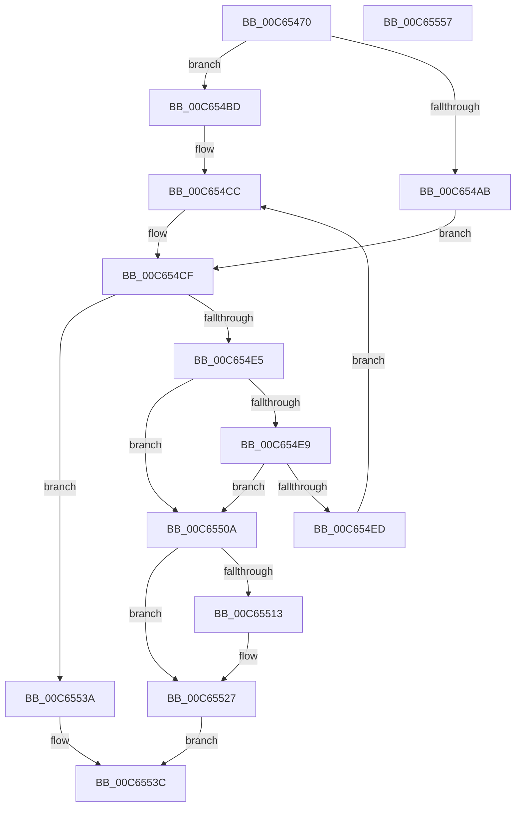

# MiAssignSystemVa

- RVA: `0x00C65470`–`0x00C65558` (길이 `232` bytes)
- VA: `0x0000000140C65470`
- 실행 섹션: `INIT`
- PDB 이름 있음: `예`; PDB Function 태그: `아니요`
- unwind 정보 RVA: `0x0005D7BC`
- 디코드: `66`개 명령, `232/232` bytes 표시
- 미해석 바이트: `0` (있으면 어셈블리에 `.byte`로 보존)

> 이 문서는 커널 이미지의 기계어와 PDB 기호를 분석해 생성했습니다. 4번과 5번은 함수 원형과 자료형을 바이너리 사용 방식에서 추정한 C 해석이며 원본 소스 복구 결과는 아닙니다.

## 1. Dependencies

- 직접 호출 지점: **5**; 고유 호출 대상: **3**
- 직접 호출자로 확인된 함수: **1**
- RIP 상대 이미지 참조: **3**

### Outgoing calls
- `0x00C654C2` → [ExGenRandom](../../text/41/ExGenRandom_function_0041B010.md) (function, `0x0041B010`)
- `0x00C654D9` → [RtlFindClearBitsAndSet](../../text/3E/RtlFindClearBitsAndSet_function_003E0CD0.md) (function, `0x003E0CD0`)
- `0x00C654F9` → [RtlClearBits](../../text/3E/RtlClearBits_function_003E1A90.md) (function, `0x003E1A90`)
- `0x00C65503` → [ExGenRandom](../../text/41/ExGenRandom_function_0041B010.md) (function, `0x0041B010`)
- `0x00C65518` → [ExGenRandom](../../text/41/ExGenRandom_function_0041B010.md) (function, `0x0041B010`)

### Direct callers
- [MiAssignTopLevelRanges](MiAssignTopLevelRanges_function_00C65560.md) at `0x00C657CA`

### Static image references
- `0x00C6549A` → RVA `0x00E2F168` (`.data`; read)
- `0x00C654AB` → RVA `0x00E2F188` (`.data`; read)
- `0x00C6552E` → RVA `0x00E2F188` (`.data`; write)

## 2. Other-region calls and transfers

- 다른 실행 섹션으로 향하는 call: **5**
  - `0x00C654C2` → [ExGenRandom](../../text/41/ExGenRandom_function_0041B010.md) (`INIT` → `.text`)
  - `0x00C654D9` → [RtlFindClearBitsAndSet](../../text/3E/RtlFindClearBitsAndSet_function_003E0CD0.md) (`INIT` → `.text`)
  - `0x00C654F9` → [RtlClearBits](../../text/3E/RtlClearBits_function_003E1A90.md) (`INIT` → `.text`)
  - `0x00C65503` → [ExGenRandom](../../text/41/ExGenRandom_function_0041B010.md) (`INIT` → `.text`)
  - `0x00C65518` → [ExGenRandom](../../text/41/ExGenRandom_function_0041B010.md) (`INIT` → `.text`)
- 별도 외부 분기/꼬리 이동을 확인하지 못했습니다.

## 3. Assembly (complete function range)

```asm
00C65470  48 8B C4                        mov rax, rsp
00C65473  48 89 58 08                     mov qword ptr [rax + 8], rbx
00C65477  48 89 68 10                     mov qword ptr [rax + 0x10], rbp
00C6547B  48 89 70 18                     mov qword ptr [rax + 0x18], rsi
00C6547F  48 89 78 20                     mov qword ptr [rax + 0x20], rdi
00C65483  41 56                           push r14
00C65485  48 83 EC 30                     sub rsp, 0x30
00C65489  48 C7 40 E8 00 01 00 00         mov qword ptr [rax - 0x18], 0x100
00C65491  44 8B F2                        mov r14d, edx
00C65494  83 60 EC 00                     and dword ptr [rax - 0x14], 0
00C65498  8B E9                           mov ebp, ecx
00C6549A  48 8D 05 C7 9C 1C 00            lea rax, [rip + 0x1c9cc7]
00C654A1  48 89 44 24 28                  mov qword ptr [rsp + 0x28], rax
00C654A6  83 F9 02                        cmp ecx, 2
00C654A9  76 12                           jbe 0x140c654bd
00C654AB  8B 35 D7 9C 1C 00               mov esi, dword ptr [rip + 0x1c9cd7]
00C654B1  83 FA 04                        cmp edx, 4
00C654B4  1B DB                           sbb ebx, ebx
00C654B6  F7 D3                           not ebx
00C654B8  83 E3 10                        and ebx, 0x10
00C654BB  EB 12                           jmp 0x140c654cf
00C654BD  B9 01 00 00 00                  mov ecx, 1
00C654C2  E8 49 5B 7B FF                  call 0x14041b010
00C654C7  BB 08 00 00 00                  mov ebx, 8
00C654CC  0F B6 F0                        movzx esi, al
00C654CF  44 8B C6                        mov r8d, esi
00C654D2  48 8D 4C 24 20                  lea rcx, [rsp + 0x20]
00C654D7  8B D5                           mov edx, ebp
00C654D9  E8 F2 B7 77 FF                  call 0x1403e0cd0
00C654DE  8B F8                           mov edi, eax
00C654E0  83 F8 FF                        cmp eax, -1
00C654E3  74 55                           je 0x140c6553a
00C654E5  3B FE                           cmp edi, esi
00C654E7  74 21                           je 0x140c6550a
00C654E9  85 DB                           test ebx, ebx
00C654EB  74 1D                           je 0x140c6550a
00C654ED  44 8B C5                        mov r8d, ebp
00C654F0  48 8D 4C 24 20                  lea rcx, [rsp + 0x20]
00C654F5  8B D7                           mov edx, edi
00C654F7  FF CB                           dec ebx
00C654F9  E8 92 C5 77 FF                  call 0x1403e1a90
00C654FE  B9 01 00 00 00                  mov ecx, 1
00C65503  E8 08 5B 7B FF                  call 0x14041b010
00C65508  EB C2                           jmp 0x140c654cc
00C6550A  8D 1C 2F                        lea ebx, [rdi + rbp]
00C6550D  41 83 FE 01                     cmp r14d, 1
00C65511  74 14                           je 0x140c65527
00C65513  B9 01 00 00 00                  mov ecx, 1
00C65518  E8 F3 5A 7B FF                  call 0x14041b010
00C6551D  33 D2                           xor edx, edx
00C6551F  41 F7 F6                        div r14d
00C65522  03 D3                           add edx, ebx
00C65524  0F B6 DA                        movzx ebx, dl
00C65527  48 8D 87 00 FF FF FF            lea rax, [rdi - 0x100]
00C6552E  89 1D 54 9C 1C 00               mov dword ptr [rip + 0x1c9c54], ebx
00C65534  48 C1 E0 27                     shl rax, 0x27
00C65538  EB 02                           jmp 0x140c6553c
00C6553A  33 C0                           xor eax, eax
00C6553C  48 8B 5C 24 40                  mov rbx, qword ptr [rsp + 0x40]
00C65541  48 8B 6C 24 48                  mov rbp, qword ptr [rsp + 0x48]
00C65546  48 8B 74 24 50                  mov rsi, qword ptr [rsp + 0x50]
00C6554B  48 8B 7C 24 58                  mov rdi, qword ptr [rsp + 0x58]
00C65550  48 83 C4 30                     add rsp, 0x30
00C65554  41 5E                           pop r14
00C65556  C3                              ret
00C65557  CC                              int3
```

## 4. C-style interpretation (structured pseudocode)

```c
__int64 __fastcall MiAssignSystemVa(int a1, int a2)
{
    __int64 result;
    __int64 v_rbx;
    __int64 v_rsp;
    unsigned __int64 v_stack_m10;
    unsigned __int64 v_stack_m18;
    unsigned __int64 v_stack_p10;
    unsigned __int64 v_stack_p18;
    unsigned __int64 v_stack_p20;
    unsigned __int64 v_stack_p8;

    *(unsigned __int64 *)(v_rsp + 8) = v_rbx;
    *(unsigned __int64 *)(v_rsp + 16) = v_rbp;
    *(unsigned __int64 *)(v_rsp + 24) = v_rsi;
    *(unsigned __int64 *)(v_rsp + 32) = v_rdi;
    v_rsp = (v_rsp) - (48);
    *(unsigned __int64 *)(v_rsp - 24) = 256;
    v_stack_m10 = v_rip + 1875143;
    if (a1 <= 2) goto loc_00C654BD;
    v_rbx = (unsigned int)(~(v_rbx));
    v_rbx = (unsigned int)((v_rbx) & (16));
    goto loc_00C654CF;
loc_00C654BD:
    result = ExGenRandom(1, a2, a3, a4);
loc_00C654CC:
loc_00C654CF:
    result = RtlFindClearBitsAndSet(v_stack_m18, (unsigned int)((unsigned int)((unsigned int)(a1))), (unsigned int)((unsigned int)((unsigned __int8)(result))), a4);
    if (((unsigned int)(result)) == -1) goto loc_00C6553A;
    if (((unsigned int)((unsigned int)((unsigned int)(result)))) == ((unsigned int)((unsigned __int8)(result)))) goto loc_00C6550A;
    if (8 == 0) goto loc_00C6550A;
    v_rbx = (unsigned int)((8) - 1);
    result = RtlClearBits(v_stack_m18, (unsigned int)((unsigned int)((unsigned int)((unsigned int)(result)))), (unsigned int)((unsigned int)((unsigned int)(a1))), a4);
    result = ExGenRandom(1, (unsigned int)((unsigned int)((unsigned int)((unsigned int)(result)))), (unsigned int)((unsigned int)((unsigned int)(a1))), a4);
    goto loc_00C654CC;
loc_00C6550A:
    v_rbx = (unsigned int)((unsigned int)(result)) + (unsigned int)(a1) * 1;
    if (((unsigned int)((unsigned int)(a2))) != 1) {
        a1 = 1;
        result = ExGenRandom(a1, (unsigned int)((unsigned int)((unsigned int)((unsigned int)(result)))), (unsigned int)((unsigned int)((unsigned int)(a1))), a4);
        a2 = 0;
        a2 = (unsigned int)((a2) + ((unsigned int)((unsigned int)((unsigned int)(result)) + (unsigned int)(a1) * 1)));
        v_rbx = (unsigned __int8)(a2);
    }
    *(unsigned int *)(v_rip + 1875028) = (unsigned int)(v_rbx);
    result = ((unsigned int)((unsigned int)(result)) - 256) << (39);
    goto loc_00C6553C;
loc_00C6553A:
    result = 0;
loc_00C6553C:
    v_rsp = (v_rsp) + (48);
    return result;
}
```

## 5. (Beta) C Style

```c
int64_t MiAssignSystemVa(int32_t Arg1, int32_t Arg2)
{
    int64_t result;
    int64_t local_rbx;
    int64_t local_rsp;
    uint64_t v_stack_m10;
    uint64_t v_stack_m18;
    uint64_t v_stack_p10;
    uint64_t v_stack_p18;
    uint64_t v_stack_p20;
    uint64_t v_stack_p8;

    *(uint64_t *)(local_rsp + 0x8) = local_rbx;
    *(uint64_t *)(local_rsp + 0x10) = local_rbp;
    *(uint64_t *)(local_rsp + 0x18) = local_rsi;
    *(uint64_t *)(local_rsp + 0x20) = local_rdi;
    local_rsp = (local_rsp) - (48);
    *(uint64_t *)(local_rsp - 0x18) = 256;
    v_stack_m10 = v_rip + 1875143;
    if (Arg1 <= 2) goto loc_00C654BD;
    local_rbx = (uint32_t)(~(local_rbx));
    local_rbx = (uint32_t)((local_rbx) & (16));
    goto loc_00C654CF;
loc_00C654BD:
    result = ExGenRandom(1, Arg2, a3, a4);
loc_00C654CC:
loc_00C654CF:
    result = RtlFindClearBitsAndSet(v_stack_m18, (uint32_t)((uint32_t)((uint32_t)(Arg1))), (uint32_t)((uint32_t)((uint8_t)(result))), a4);
    if (((uint32_t)(result)) == -1) goto loc_00C6553A;
    if (((uint32_t)((uint32_t)((uint32_t)(result)))) == ((uint32_t)((uint8_t)(result)))) goto loc_00C6550A;
    if (8 == 0) goto loc_00C6550A;
    local_rbx = (uint32_t)((8) - 1);
    result = RtlClearBits(v_stack_m18, (uint32_t)((uint32_t)((uint32_t)((uint32_t)(result)))), (uint32_t)((uint32_t)((uint32_t)(Arg1))), a4);
    result = ExGenRandom(1, (uint32_t)((uint32_t)((uint32_t)((uint32_t)(result)))), (uint32_t)((uint32_t)((uint32_t)(Arg1))), a4);
    goto loc_00C654CC;
loc_00C6550A:
    local_rbx = (uint32_t)((uint32_t)(result)) + (uint32_t)(Arg1) * 1;
    if (((uint32_t)((uint32_t)(Arg2))) != 1) {
        Arg1 = 1;
        result = ExGenRandom(Arg1, (uint32_t)((uint32_t)((uint32_t)((uint32_t)(result)))), (uint32_t)((uint32_t)((uint32_t)(Arg1))), a4);
        Arg2 = 0;
        Arg2 = (uint32_t)((Arg2) + ((uint32_t)((uint32_t)((uint32_t)(result)) + (uint32_t)(Arg1) * 1)));
        local_rbx = (uint8_t)(Arg2);
    }
    *(uint32_t *)(v_rip + 0x1C9C54) = (uint32_t)(local_rbx);
    result = ((uint32_t)((uint32_t)(result)) - 256) << (39);
    goto loc_00C6553C;
loc_00C6553A:
    result = 0;
loc_00C6553C:
    local_rsp = (local_rsp) + (48);
    return result;
}
```

## 6. Execution-region graph

[열기: 2D/3D 그래프와 함수 탐색 컨트롤 패널](../../../control-panel.html?section=init&rva=0x00C65470&view=graph)

- 2D 그래프는 위에서 아래로 흐르고, 3D 그래프는 빈 공간을 드래그해 회전합니다. Shift+드래그는 이동, 휠은 확대·축소, 함수 노드 선택은 대상 보고서 이동입니다.

### Static fallback


